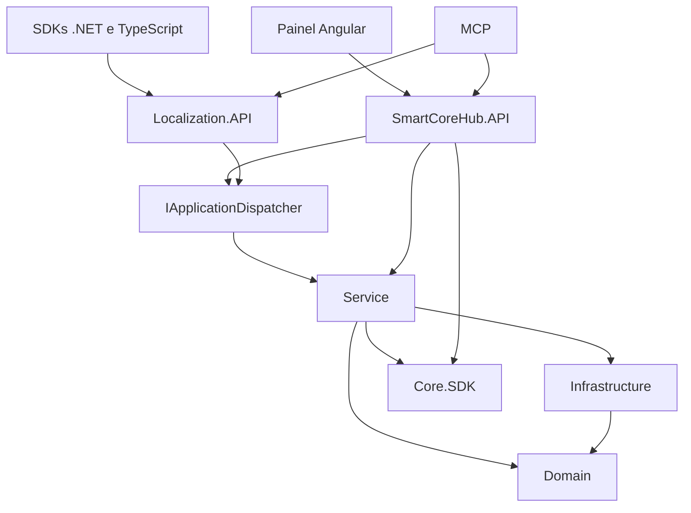

# 🏛️ Arquitetura - SmartCoreHub

Documentação centralizada da arquitetura, princípios, camadas, padrões, decisões técnicas, exemplos e boas práticas do SmartCoreHub.

[[_TOC_]]

---

## Índice
1. [Visão Geral e Objetivos](#visão-geral-e-objetivos)
2. [Princípios e Padrões](#princípios-e-padrões)
3. [Estrutura de Camadas](#estrutura-de-camadas)
4. [Diagrama de Arquitetura](#diagrama-de-arquitetura)
5. [Detalhamento das Camadas](#detalhamento-das-camadas)
6. [Padrões e Boas Práticas](#padrões-e-boas-práticas)
7. [Decisões Técnicas](#decisões-técnicas)
8. [Exemplos de Código](#exemplos-de-código)
9. [FAQ](#faq)
10. [Links Úteis](#links-úteis)
11. [Catálogo de tecnologias e recursos](#catálogo-de-tecnologias-e-recursos)

---

## 1. Visão Geral e Objetivos

O SmartCoreHub é uma plataforma multi-tenant de localização e operação (tenants, aplicações, planos, traduções e integrações servidor a servidor). A arquitetura segue SOLID e Clean Architecture.

- Duas APIs ASP.NET Core: plataforma (`SmartCoreHub.API`) e localização para clientes (`SmartCoreHub.Localization.API`)
- Autenticação JWT Bearer, API Key (`X-Auth-Token`) e MFA por código
- IAM com perfis de acesso, escopos e membership N:N de tenant e aplicação
- Painel admin Angular, landing React, SDK .NET, SDK TypeScript e extensões de IDE
- CQRS nos fluxos complexos via `IApplicationDispatcher` (MediatR fica só no adapter do Core.SDK)
- Mensagens funcionais da API separadas do conteúdo de tradução do tenant

## 2. Princípios e Padrões

- SOLID, Clean Architecture, Separation of Concerns
- Repository Pattern, Factory Pattern, CQRS com dispatcher próprio
- DTOs, Value Objects, Generics, Extension Methods
- Injeção de dependência e Central Package Management (`Directory.Packages.props`)

## 3. Estrutura de Camadas

```
backend/
├── APIs/                        # Endpoints REST
├── Core/                        # SmartCoreHub.Core.SDK (NuGet único multi-TFM)
├── Implementations/
│   ├── SmartCoreHub.Domain/         # Entidades de feature, validators, contratos de negócio
│   ├── SmartCoreHub.Infrastructure/ # DbContext, repositórios de domínio, migrations
│   └── SmartCoreHub.Service/        # Lógica de negócio, DTOs
├── SDKs/                        # Localization.SDK .NET e extensões de IDE
├── MCP/                         # Servidores Model Context Protocol
├── Orchestration/               # AppHost Aspire (opt-in) e ServiceDefaults
frontend/                        # Painel admin Angular
frontendsdk/                     # SDK TypeScript (@smartcorehub/localization-sdk)
landingpage/                     # Landing pública React
```

Tipos genéricos e reutilizáveis (entidades base, Result/Guard, DTOs comuns, `IGenericService<>`, repositórios genéricos EF/Dapper, providers de cache, adapters Azure/JWT/AutoMapper/sanitização e utilitários de EF) têm fonte única no [`SmartCoreHub.Core.SDK`](../backend/Core/SmartCoreHub.Core.SDK/README.md); `Implementations` mantém apenas o específico do produto.

## 4. Diagrama de Arquitetura



## 5. Detalhamento das Camadas

### Core (SmartCoreHub.Core.SDK)
NuGet único multi-TFM (`netstandard2.0` → `net10.0`) com primitivas de domínio, contratos e implementações genéricas. Dependências pesadas (EF, Dapper, Redis, Mongo, Cosmos, Azure, JWT, AutoMapper, HtmlSanitizer) entram apenas nos TFMs `net8.0`/`net10.0` via `Compile Remove` + `PackageReference` condicionais.

### Domain Layer
Define entidades, value objects e contratos de domínio.

Exemplo:
```csharp
public class Client {
	public Guid Id { get; set; }
	public string Name { get; set; }
	public virtual ICollection<CloudConfiguration> CloudConfigurations { get; set; } = new List<CloudConfiguration>();
}
```

### Infrastructure Layer
Implementa acesso a dados, integrações externas e repositórios.

Exemplo:
```csharp
public class ClientRepository : IClientRepository {
	private readonly SmartCoreHubDbContext _context;
	// ... métodos CRUD ...
}
```

### Service Layer
Orquestra regras de negócio, faz conversão DTO e coordena operações.

Exemplo:
```csharp
public class UserService : IUserService {
	private readonly IUserBusiness _userBusiness;
	// ... métodos de orquestração ...
}
```

### API Layer
Controllers, endpoints REST, autenticação e validação.

### ClientSDK
SDK para consumo externo da API.

### Tests
Testes unitários e de integração para todas as camadas.

## 6. Padrões e Boas Práticas

- Cada camada tem responsabilidade única (SRP)
- Entities sem lógica de negócio
- Business isolada e testável
- Repositórios apenas para acesso a dados
- DTOs para comunicação entre camadas
- Injeção de dependência para baixo acoplamento
- **Encapsulamento de Cache (R-ARCH-CACHE)**: Toda implementação que exigir cache deve obrigatoriamente utilizar o motor genérico do SDK (`SmartCoreHub.Core.SDK.Service.Caching.CacheService` / `ICacheService`), que atua como gateway único para todos os provedores e tiers (Memória, Redis, MongoDB, Cosmos). Todos os provedores e adapters de infraestrutura residem exclusivamente no `Core.SDK`. Os serviços de negócio das features (ex.: `LocalizationResourceMultiTierCacheService`) devem conter estritamente a orquestração e a lógica de domínio, interagindo com todos os tiers por meio do `Core.SDK.CacheService` e isolando cada nível em métodos encapsulados. É terminantemente proibido injetar providers brutos (Redis/MongoDB/Memory) diretamente em serviços de negócio ou criar adapters redundantes.
- **Contrato de Enums Frontend-Backend (R-ARCH-ENUM-NUMERIC)**: Todo payload JSON enviado pelo Frontend para endpoints da API deve obrigatoriamente trafegar enums como valores inteiros numéricos (`0, 1, 2, ...`), nunca como nomes textuais/strings. O backend .NET (`System.Text.Json`) serializa e desserializa enums nativamente por número. O envio de strings é terminantemente proibido em novas implementações para eliminar conversores customizados redundantes (`JsonConverter`) e garantir consistência com colunas JSON de banco de dados e snapshots de migração EF Core.
- Cadeias de migration por provedor no Infrastructure (não misturar MySQL/PG/SQL Server)
- Identificadores em inglês, comentários em português e mensagens de runtime em inglês
- Testes automatizados para regras de negócio
- Documentação sempre atualizada

## 7. Decisões Técnicas

- Migrations no projeto `SmartCoreHub.Infrastructure`, pastas `Migrations/MySql|SqlServer|PostgreSql`
- Contextos tipados (`SmartCoreHubDbContextMySql` / `SqlServer` / `PostgreSql`) + histórico EF por provedor
- Runtime escolhe o provedor via `DatabaseProvider` + `ConnectionStrings:DefaultConnection`
- DevContainer para ambiente padronizado
- API documentada com Swagger, Scalar, ReDoc, RapiDoc e OpenAPI nativo (`/openapi/v1.json`)
- EF Core 9 sobre o host .NET 10: o provider MySQL (Pomelo 9) ainda não acompanha o EF 10
- Scripts para build, migrations e testes
- Observabilidade opcional: Serilog, Application Insights e OpenTelemetry/OTLP
- Mensagem funcional da API (`IFunctionalMessageProvider`) é outro plano do conteúdo de tenant (`ILocalizationProvider`). A regra guarda `.WithMessage` em inglês, `ErrorCode` sintético e `.WithMessageKey`. `X-Locale` vence `Accept-Language` e escolhe `en-US`, `pt-BR` ou `es-ES`. Sem cultura reconhecida, o padrão funcional é `en-US`. O painel envia os dois cabeçalhos com a cultura do seletor ou, sem escolha, a do navegador.
- Serialização de Enums: o backend adota enums inteiros numéricos padrão do .NET (`System.Text.Json`). O Frontend trafega obrigatoriamente valores numéricos correspondentes, assegurando integridade e evitando converters customizados e desvios de formato em colunas JSON de banco.

## 8. Exemplos de Código

### Migration via Script
```powershell
./scripts/create-migration.ps1 -MigrationName "AddUserIsActiveIndex" -DatabaseProvider "PostgreSQL"
./scripts/create-migration.ps1 -MigrationName "AddUserIsActiveIndex" -DatabaseProvider "PostgreSQL" -UpdateDatabase
```

### Migration via EF Tools (PostgreSQL)
```bash
cd backend
dotnet ef migrations add AddUserIsActiveIndex_PostgreSql \
  --project Implementations/SmartCoreHub.Infrastructure/SmartCoreHub.Infrastructure.csproj \
  --startup-project APIs/SmartCoreHub.API/SmartCoreHub.API.csproj \
  --context SmartCoreHubDbContextPostgreSql \
  --output-dir Migrations/PostgreSql \
  -- --environment Development

dotnet ef database update \
  --project Implementations/SmartCoreHub.Infrastructure/SmartCoreHub.Infrastructure.csproj \
  --startup-project APIs/SmartCoreHub.API/SmartCoreHub.API.csproj \
  --context SmartCoreHubDbContextPostgreSql \
  -- --environment Development
```

Guia completo (incluindo trocar runtime para PostgreSQL): [General/Outros/EF-MIGRATIONS-HOWTO.md](./General/Outros/EF-MIGRATIONS-HOWTO.md).

### Teste Unitário de Business
```csharp
[Test]
public async Task CreateClient_WithValidData_ShouldCreateClient() {
	// Arrange
	// ...mock e setup...
	// Act
	// ...chamada...
	// Assert
	// ...verificações...
}
```

## 9. FAQ

**1. Como o multi-banco funciona nas migrations?**
> Model compartilhado + três contextos tipados e pastas/históricos separados. Trocar o runtime = `DatabaseProvider` + connection string; dados exigem ETL (ver EF-MIGRATIONS-HOWTO).

**2. Como garantir testabilidade?**
> Isolando regras de negócio e usando interfaces para mocks.

**3. Como adicionar um novo serviço de nuvem?**
> Implemente a interface e registre na factory de serviços.

**4. Como documentar endpoints?**
> Use Swagger e mantenha exemplos atualizados.

**5. Como a API devolve a mensagem no idioma do cliente?**
> Envie `X-Locale` (`en-US`, `pt-BR` ou `es-ES`). Esse cabeçalho vence `Accept-Language`. A chave (`messageKey`) permanece; o texto muda. Sem cultura reconhecida, o padrão funcional é `en-US`. O guia está em [04-GUIA-DE-USO-E-IMPLEMENTACAO.md](./Features/Pendding/PADRONIZACAO-IDIOMA-I18N-E-CENTRALIZACAO-MENSAGENS/04-GUIA-DE-USO-E-IMPLEMENTACAO.md).

## 10. Links Úteis

- [Guia do Desenvolvedor](./General/Outros/DEVELOPER-GUIDE.md)
- [EF Core — migrations e troca de provedor](./General/Outros/EF-MIGRATIONS-HOWTO.md)
- [Documentação do SDK](./Features/FEITOS/SDK-README.md)
- [Guia da API REST](./General/Outros/api-README.md)
- [Guia do Frontend](./General/Outros/frontend-README.md)
- [Mensagens funcionais — guia de uso](./Features/Pendding/PADRONIZACAO-IDIOMA-I18N-E-CENTRALIZACAO-MENSAGENS/04-GUIA-DE-USO-E-IMPLEMENTACAO.md)
- [Clean Architecture - Uncle Bob](https://blog.cleancoder.com/uncle-bob/2012/08/13/the-clean-architecture.html)
- [SOLID Principles](https://en.wikipedia.org/wiki/SOLID)
- [Entity Framework Core](https://docs.microsoft.com/ef/core/)

---

## 11. Catálogo de tecnologias e recursos

Versões lidas em 23/10/2026. A fonte viva é `backend/global.json`, `backend/Directory.Packages.props` e `frontend/package.json`.

### Plataforma

| Área | Tecnologia |
|---|---|
| Runtime | .NET SDK 10.0.300 (`rollForward: latestFeature`), ASP.NET Core 10.0.13 |
| Core.SDK | `net8.0`, `net10.0`, `net6.0`, `netstandard2.1`, `netstandard2.0`. Dependências pesadas só em `net8.0` e `net10.0` |
| Dados | EF Core 9.0.20. MySQL (Pomelo 9.0.0, padrão), SQL Server, PostgreSQL (Npgsql 9.0.4), InMemory e SQLite. Leitura intensiva com Dapper 2.1.89 |
| Cache e nuvem | Memory cache, Redis, MongoDB, Azure Cosmos, Blob, Queue, Table e `Azure.Identity` |
| CQRS | `IApplicationDispatcher`; MediatR 12.5.0 só como adapter |
| Validação e mapa | FluentValidation 12.2.0; AutoMapper 16.2.0 atrás de `ISmartCoreHubMapper` |
| Segurança | JWT Bearer 8.23.0, BCrypt.Net-Next, API Key, MFA, HtmlSanitizer, Polly |
| Observabilidade | Serilog, Application Insights 3.2.0, OpenTelemetry 1.20.x |
| Documentação HTTP | Swashbuckle 10.3.1, Scalar 2.18.2, ReDoc, RapiDoc |
| Orquestração local | .NET Aspire Hosting 13.6.2, opt-in. Não substitui o Azure App Service |
| Relatórios no Core.SDK | OpenXml, PDFsharp e QuestPDF |
| IA no Core.SDK | Semantic Kernel e conectores OpenAI, Ollama e Mistral |
| Testes backend | NUnit 4.6.1, Moq, AwesomeAssertions, Bogus, Coverlet e Testcontainers |

### Clientes

| Superfície | Tecnologia |
|---|---|
| Painel admin | Angular 22.2, Angular Material, PrimeNG 21, ngx-translate 17, RxJS 7.8, TypeScript 6.0, Bootstrap 5, Jest 30. Node `^22.22.3`, `^24.15.0` ou `>=26` |
| Idiomas da interface | `pt-BR`, `en-US`, `es-ES`, `fr-FR`, `de-DE`, `ja-JP`, `zh-CN`. A API funcional traduz `en-US`, `pt-BR` e `es-ES` |
| Landing | React 19, Vite e i18next |
| SDK de cliente | `SmartCoreHub.Localization.SDK` (.NET) e `@smartcorehub/localization-sdk` (TypeScript) |
| IDE | Extensões VS Code e Cursor do Localization SDK e do Core.SDK |
| Agentes | Servidores MCP da plataforma e da Localization API |

### Recursos funcionais da API principal

Autenticação e MFA, usuários, perfis de acesso e escopos, tenants, aplicações, configuração de aplicação, tokens de API e telemetria, métricas diárias de uso, planos, assinaturas, compras e eventos de cobrança, configuração de nuvem, Blob, Queue e Table, recursos de localização (busca, importação, exportação, clone e glossário), templates e variáveis de notificação, auditoria e informação de versão do produto.

---

**Esta arquitetura garante escalabilidade, manutenibilidade e facilidade de onboarding para novos desenvolvedores!**
