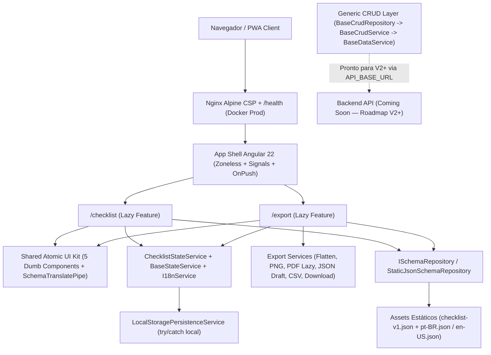

# Arquitetura — KinkConsentManager

Documentação centralizada da arquitetura, princípios, camadas, padrões, decisões técnicas, contratos genéricos e boas práticas do **KinkConsentManager**.

---

## Índice

1. [Visão Geral e Objetivos](#1-visão-geral-e-objetivos)
2. [Princípios e Padrões](#2-princípios-e-padrões)
3. [Estrutura de Camadas do Repositório](#3-estrutura-de-camadas-do-repositório)
4. [Diagrama de Arquitetura](#4-diagrama-de-arquitetura)
5. [Detalhamento das Camadas](#5-detalhamento-das-camadas)
6. [Padrões, Segurança e Decisões Técnicas](#6-padrões-segurança-e-decisões-técnicas)
7. [Exemplos de Código](#7-exemplos-de-código)
8. [FAQ](#8-faq)
9. [Links Úteis](#9-links-úteis)
10. [Catálogo de Tecnologias e Recursos](#10-catálogo-de-tecnologias-e-recursos)

---

## 1. Visão Geral e Objetivos

O **KinkConsentManager** é uma plataforma *privacy-first* (arquitetura **Zero-Knowledge** no cliente) voltada para preenchimento guiado, visualização estruturada e exportação segura de checklists de limites e consentimento.

- **Escopo oficial da V1 (implementado em `frontend/`):**
  - Aplicação SPA **100% client-side** em **Angular 22** (Standalone Components, Signals e execução *zoneless*), com **PrimeNG 22** (tema Aura) e **PrimeIcons 8**.
  - Rotas principais carregadas sob demanda (*lazy loading*): `/checklist` e `/export`.
  - Arquitetura **Schema-Driven UI** (`checklist-v1.json`), completamente separada dos dicionários de internacionalização (`@ngx-translate/core` 18 em `pt-BR` e `en-US`).
  - Três modos complementares de preenchimento: *Accordion + Próxima Categoria*, *View Full* e *Quick-Fill Wizard*.
  - Persistência local resiliente em `localStorage` (`LocalStoragePersistenceService`), sem envio de respostas a servidores.
  - Exportação e portabilidade 100% no navegador: **PNG (`1200px`)**, **PDF programático** (`pdfmake` em *chunk lazy*), **JSON Draft** (exportação e reimportação com validação de `schemaVersion`) e **CSV UTF-8 com BOM** (`\uFEFF`, compatível com Excel).
  - Camada genérica de contratos e acesso a dados já preparada (`ICrudOperations`, `BaseDataService`, `BaseCrudService`, `BaseCrudRepository`, `ISchemaRepository`) para futura evolução modular.
- **Backend — Coming Soon (Roadmap V2+):**
  - Ainda **não existe implementação de backend** neste repositório na V1.
  - Módulos de servidor, persistência remota, sincronização criptografada de ponta a ponta (Zero-Knowledge E2E) e demais recursos descritos em [Bueprint.md](./Bueprint.md) ficam documentados em alto nível como **Coming Soon** para definição e execução a partir da V2+.

---

## 2. Princípios e Padrões

- **Zero-Knowledge & Privacy-First (V1):** nenhum dado preenchido pelo usuário sai do dispositivo na V1; zero chamadas externas de telemetria, zero renderização de HTML dinâmico bruto (`[innerHTML]`) e política CSP restrita em produção via Nginx.
- **Schema-Driven UI & i18n Desacoplado:** estrutura, ordem, tipos de questão e escalas residem no schema estático (`checklist-v1.json`); todos os textos legíveis residem nos arquivos de tradução (`assets/i18n/{lang}.json`), validados por teste automatizado de paridade.
- **SOLID & Separation of Concerns:** páginas inteligentes (*Smart Pages*) orquestram estado e serviços; componentes compartilhados (*Dumb Components*) permanecem desacoplados e orientados a `input()` / `output()`.
- **Regra dos 4+1 Arquivos:** todo componente possui pasta própria com `.component.ts`, `.component.html`, `.component.scss`, `.component.spec.ts` e barrel `index.ts`, com `ChangeDetectionStrategy.OnPush` e proibição de templates inline.
- **Repository Pattern & Camada CRUD Genérica:** contratos base reutilizáveis (`ICrudOperations`, `BaseDataService`, `BaseCrudService`, `ICrudRepository`, `BaseCrudRepository`, `ISchemaRepository`) com `InjectionToken` (`SCHEMA_REPOSITORY_TOKEN`, `API_BASE_URL`, `createCrudRepositoryToken`).
- **Reactive State com Angular Signals (`BaseStateService`):** estado imutável baseado em `signal()`, `computed()` e `asReadonly()`, em modo **Angular 22 zoneless**.

---

## 3. Estrutura de Camadas do Repositório

### 3.1 Mapa da Raiz

```text
kinkconsentmanager/
├── .devcontainer/                 # Ambiente padronizado (frontend ativo + backend-container reservado V2+)
├── docs/                          # Documentação centralizada (arquitetura, diretrizes, specs V1 e guias frontend)
├── frontend/                      # Aplicação SPA Angular 22 (V1 Checklist & Export) + Docker/Nginx/Jest/Sonar
├── references/                    # Código e referências históricas analisadas na concepção da V1
└── backend/                       # [Coming Soon — Roadmap V2+] Ainda não implementado na V1
```

### 3.2 Camadas Internas do Frontend (`frontend/src/app/`)

```text
frontend/src/app/
├── app.component.{ts,html,scss,spec.ts}   # App Shell (alternância de idioma, toast/mensageria e RouterOutlet)
├── app.config.ts                          # Providers globais (Router, HttpClient, TranslateService, SCHEMA_REPOSITORY_TOKEN)
├── app.routes.ts                          # Roteamento raiz lazy (/checklist, /export)
├── core/
│   ├── models/                            # Contratos IMutáveis, Schema, Respostas, ExportConfig, CrudModels e __tests__
│   ├── repositories/                      # ISchemaRepository, StaticJsonSchemaRepository, ICrudRepository, BaseCrudRepository
│   └── services/                          # BaseStateService, BaseDataService, BaseCrudService, ChecklistStateService, I18nService, LocalStoragePersistenceService
├── shared/
│   ├── components/                        # 5 Dumb Components (4+1): dynamic-question-item, full-grid-preview, legend-bar, progress-indicator, scale-selector
│   └── pipes/                             # SchemaTranslatePipe (resolução reativa de chaves do schema)
└── features/
    ├── checklist/                         # Rotas, ChecklistPageComponent, CategoryAccordion, ChecklistHeader, FullViewContainer, QuickFillWizardModal e helpers
    └── export/                            # Rotas, ExportPageComponent, ExportActionsToolbar e serviços (Flatten, PNG, PDF, JSON Draft, CSV, FileDownload)
```

---

## 4. Diagrama de Arquitetura



---

## 5. Detalhamento das Camadas

### 5.1 Core Layer (`src/app/core/`)

- **Models (`core/models/`):** contratos tipados para schema (`ChecklistSchema`), respostas (`ChecklistAnswer`, `ChecklistDraft`), exportação (`ExportConfig`, `ExportResult`), paginação/CRUD genérico (`EntityId`, `QueryParams`, `PageRequest`, `PageResult<T>`, `ICrudOperations`) e suíte de integridade estrutural (`__tests__/schema-integrity.spec.ts`).
- **Repositories (`core/repositories/`):**
  - `ISchemaRepository` + `SCHEMA_REPOSITORY_TOKEN`: abstrai a origem do checklist schema. Na V1 é provido por `StaticJsonSchemaRepository` (com cache e evicção de erro antes do `shareReplay(1)`).
  - `ICrudRepository<T, TId, TCreate, TUpdate>` + `BaseCrudRepository` + `createCrudRepositoryToken`: repositório genérico que delega persistência a um serviço `ICrudOperations` (ex.: `BaseDataService` ou `BaseCrudService`), com cache opcional em memória e invalidação automática em mutações.
- **Services (`core/services/`):**
  - `BaseStateService<T>`: container reativo genérico baseado em Angular Signals (`state`, `select()`, `setState()`, `resetState()`).
  - `BaseDataService<T, ...>`: cliente HTTP genérico baseado em `HttpClient` e `API_BASE_URL`, padronizando `getAll`, `getPage`, `getById`, `create`, `update`, `patch` e `delete`.
  - `BaseCrudService<T, ...>`: camada de aplicação/domínio genérica sobre `ICrudOperations` com hooks de ciclo de vida (`beforeCreate`, `afterLoadList`, etc.).
  - `ChecklistStateService`: gerencia schema ativo, respostas, progresso, seleção de modo de visualização, restauração automática do `localStorage` e importação de rascunhos.
  - `I18nService`: coordena `@ngx-translate/core` (`pt-BR` / `en-US`) preservando intactas as respostas ao alternar idioma em tempo real.
  - `LocalStoragePersistenceService`: leitura e escrita seguras protegidas por `try/catch` (resiliente a modo anônimo, SSR/jsdom e `QuotaExceededError`).

### 5.2 Shared UI Kit & Pipes (`src/app/shared/`)

- **Componentes Dumb (regra 4+1 arquivos, `OnPush`, sem estado global):**
  - `ScaleSelectorComponent`: seletor acessível de escalas com navegação por teclado e tokens visuais.
  - `DynamicQuestionItemComponent`: renderização orientada ao tipo do item (`scale_matrix`, opções simples/múltiplas, texto livre/outro, modo dual-role).
  - `LegendBarComponent`: legenda dinâmica das escalas e cores do schema ativo.
  - `ProgressIndicatorComponent`: indicador de progresso respondido vs. total.
  - `FullGridPreviewComponent`: prévia consolidada vertical (`1200px` para captura/impressão e leitura).
- **Pipes (`shared/pipes/`):**
  - `SchemaTranslatePipe`: traduz dinamicamente chaves de categorias, itens, escalas, papéis (*roles*) e opções.

### 5.3 Features V1 (`src/app/features/`)

- **Feature `checklist/`:** página inteligente `ChecklistPageComponent`, cabeçalho `ChecklistHeaderComponent`, navegação por categoria em acordeão `CategoryAccordionComponent`, modo completo `FullViewContainerComponent`, preenchimento guiado `QuickFillWizardModalComponent` e utilitários puros em `checklist-view.helpers.ts`.
- **Feature `export/`:** página inteligente `ExportPageComponent`, barra `ExportActionsToolbarComponent` e serviços especializados: `ChecklistFlattenService`, `PngExportService` (com token injetável `PNG_RENDERER` sobre `html-to-image`), `PdfExportService` (carregamento dinâmico via `PDF_MAKER_LOADER` sobre `pdfmake` 0.3 + `addVirtualFileSystem`), `JsonDraftService`, `CsvExportService` e `FileDownloadService`.

### 5.4 Infraestrutura, Containers e Hosting (`frontend/` e `.devcontainer/`)

- **[Dockerfile](../frontend/Dockerfile):** build *multi-stage* (estágios de desenvolvimento, compilação Angular de produção e runtime enxuto em **Nginx Alpine**).
- **[nginx.conf](../frontend/nginx.conf):** entrega da SPA com `try_files`, cabeçalhos de segurança e **Content-Security-Policy (CSP)**, endpoint de saúde `/health`, `Cache-Control: no-store` em `index.html`, `no-cache, must-revalidate` em `/assets/` e cache longo `immutable` em bundles com hash.
- **[docker-compose.yml](../frontend/docker-compose.yml)** & **[dockercompose.prod.yml](../frontend/dockercompose.prod.yml):** orquestração local (`:8082` em produção local, profile `dev` na `:4200`) e produção (`:80`) com *healthcheck*.
- **[.devcontainer/docker-compose.yml](../.devcontainer/docker-compose.yml):** ambiente isolado Node 24 (`frontend-container` ativo e `backend-container` já reservado para o Roadmap V2+).

### 5.5 Backend (Genérico — Coming Soon)

> **Status Atual:** **Não implementado (Coming Soon / Roadmap V2+).** A V1 funciona integralmente no navegador sem dependência de API ou banco de dados.

Quando o backend for introduzido em ciclos futuros (V2+), deverá seguir diretrizes arquiteturais genéricas e agnósticas à linguagem/framework que for escolhido no momento:

- **Separação em Camadas:** distinção clara entre borda HTTP/API (rotas, autenticação/autorização, DTOs), lógica de aplicação/domínio (validações, regras de negócio, criptografia/auditoria) e persistência/repositórios.
- **Compatibilidade com o Frontend Existente:** contratos REST/JSON alinhados aos tipos já preparados em `frontend/src/app/core/models/crud.model.ts` (`PageRequest`, `PageResult<T>`, query params) e consumo transparente via `BaseDataService` + `API_BASE_URL` (permitindo substituir ou estender `SCHEMA_REPOSITORY_TOKEN` e novos repositórios sem reescrever componentes visuais).
- **Zero-Knowledge & Segurança:** caso haja sincronização, compartilhamento ou histórico em nuvem, priorizar criptografia de ponta a ponta (*Zero-Knowledge E2E* conforme [Bueprint.md](./Bueprint.md)), cabeçalhos de segurança, CORS estrito, proteção contra CSRF/injeção, logs sem dados sensíveis e endpoints de prontidão (`/health`, `/ready`).
- **Contratos & Observabilidade:** especificação OpenAPI/REST documentada, códigos HTTP padronizados e suíte de testes automatizados cobrindo contratos, regras de negócio e persistência.

### 5.6 Testes e Qualidade (`Jest 30` + `SonarCloud`)

- **Runner:** **Jest 30** com **`jest-preset-angular` 17** (`setupZonelessTestEnv()`) e **`jest-environment-jsdom`**.
- **Suíte Baseline V1 (2026-11-22):** **29 arquivos `.spec.ts`**, **150 testes unitários aprovados (100%)**, cobertura global de **92,18% Statements** / **91,84% Lines** (`>= 95%` em repositórios e serviços core).
- **Relatórios e Governança Estática:** `lcov.info`, `sonar-report.xml`, `junit/test-results.xml` e relatórios HTML (`coverage/html`, `coverage/jest-stare`, `coverage/jest-html-reporters`), alinhados a [sonar-project.properties](../frontend/sonar-project.properties) e Prettier.

---

## 6. Padrões, Segurança e Decisões Técnicas

- **Separação Estrita Schema ↔ Tradução:** o arquivo `checklist-v1.json` nunca armazena textos em português/inglês diretamente; armazena IDs estáveis mapeados pelos dicionários `pt-BR.json` e `en-US.json`. Isso permite adicionar novos idiomas sem alterar o schema nem invalidar rascunhos salvos (`schemaVersion`).
- **Prevenção de Cache Permanente de Erro:** em repositórios com `shareReplay(1)` (`StaticJsonSchemaRepository`, `BaseCrudRepository`), `catchError` limpa a referência em cache antes de propagar o erro, permitindo novas tentativas imediatas (*retry*).
- **Tokens de Injeção para Bibliotecas Pesadas e DOM:** `PNG_RENDERER` (`html-to-image`) e `PDF_MAKER_LOADER` (`pdfmake` 0.3 via `addVirtualFileSystem`) permitem *code-splitting* em produção e *mocking* determinístico no Jest sem renderização real de canvas.
- **Portabilidade Segura de Rascunhos:** `JsonDraftService` valida estrutura e compatibilidade de `schemaVersion`; `CsvExportService` aplica `\uFEFF` (UTF-8 BOM) e escape RFC-4180 completo.
- **Execução Zoneless:** sem dependência de `zone.js`; toda reatividade flui via Angular Signals e APIs de teste Jest compatíveis com `setupZonelessTestEnv()`.

---

## 7. Exemplos de Código

### Estado Reativo Genérico (`BaseStateService`)

```typescript
export abstract class BaseStateService<T extends object> {
  protected readonly stateSignal: WritableSignal<T>;
  readonly state: Signal<T>;

  protected constructor(initialState: T) {
    this.stateSignal = signal(initialState);
    this.state = this.stateSignal.asReadonly();
  }

  select<K extends keyof T>(key: K): Signal<T[K]> {
    return computed(() => this.stateSignal()[key]);
  }
}
```

### Integração Preparada para Futuras APIs (`BaseDataService` + `BaseCrudRepository`)

```typescript
@Injectable({ providedIn: 'root' })
export class ChecklistTemplateDataService extends BaseDataService<ChecklistSchemaSummary> {
  protected readonly resourcePath = 'api/v1/checklist-templates';
}

export abstract class BaseCrudRepository<T, TId extends EntityId = string> {
  protected abstract readonly service: ICrudOperations<T, TId>;
}
```

### Teste Unitário Zoneless no Padrão AAA (`Jest 30`)

```typescript
// Cenário: Exportação de rascunho JSON e validação da estrutura gerada.
// Objetivo: Garantir que o Blob produzido preserve schemaVersion e respostas atuais.
it('should serialize current state into a versioned JSON Blob', async () => {
  // Arrange
  const snapshot = { schemaVersion: '1.0.0', answers: { item_rope: { primaryScale: 'enjoy' } } };

  // Act
  const result = service.buildDraftBlob(snapshot);

  // Assert
  expect(result.filename).toMatch(/\.json$/);
  await expect(result.blob.text()).resolves.toContain('"schemaVersion": "1.0.0"');
});
```

---

## 8. FAQ

**1. Por que ainda não existe pasta `backend/` no repositório?**
> Porque a **V1** foi planejada e entregue com escopo 100% client-side para garantir privacidade absoluta sem servidor. O backend está previsto como **Coming Soon (Roadmap V2+)**, com infraestrutura preparatória de contratos CRUD (`BaseDataService`, `BaseCrudService`, `BaseCrudRepository`, `API_BASE_URL`) e container reservado em [docker-compose.yml](../.devcontainer/docker-compose.yml).

**2. Como trocar o schema estático atual por uma API REST no futuro?**
> Basta prover uma nova implementação de `ISchemaRepository` utilizando `BaseDataService` no token `SCHEMA_REPOSITORY_TOKEN` em `app.config.ts`, mantendo as páginas e componentes intocados.

**3. Por que usar `StaticJsonSchemaRepository` + `assets/i18n/` separados?**
> Permite validar a paridade estrutural automaticamente em build/test (`schema-integrity.spec.ts`), evoluir idiomas sem duplicar itens e preservar respostas salvas quando o usuário troca de idioma em tempo real.

**4. Como executar testes e build em Windows PowerShell?**
> Em ambientes Windows onde a ExecutionPolicy bloqueia scripts `.ps1`, utilizar sempre `npm.cmd`, `npx.cmd` e `ng.cmd` (`npm.cmd run test:coverage`, `npm.cmd run build:prod`).

---

## 9. Links Úteis

- [Índice Geral da Documentação](./README.md)
- [Diretrizes do Projeto (PROJECT_GUIDELINES)](./PROJECT_GUIDELINES.md)
- [Blueprint Conceitual e Roadmap Futuro](./Bueprint.md)
- [Levantamento Funcional e Técnico V1](./Features/LEVANTAMENTO_FUNCIONAL_TECNICO.md)
- [Plano de Implementação Frontend V1](./Features/PLANO_IMPLEMENTACAO_FRONTEND.md)
- [Checklist de Implementação e Progresso](./Features/CHECKLIST_IMPLEMENTACAO_PROGRESSO.md)
- [Diretrizes de Cobertura — KinkConsentManager](./Frontend/COVERAGE%20AND%20TEST/Diretrizes-Coverage-Frontend-KinkConsentManager.md)
- [Diretrizes de Code Smells — KinkConsentManager UI](./Frontend/COVERAGE%20AND%20TEST/Diretrizes-CodeSmell-KinkConsentManagerUI.md)
- [Guia de Atualização de Pacotes Frontend](./Frontend/UpdatePackages/GuiaAtualizacaoPacotes-KinkConsentManagerUI.md)
- [Conjunto Homologado Frontend (2026-11-22)](./Frontend/UpdatePackages/2026-11-22-ConjuntoHomologado-Frontend.md)

---

## 10. Catálogo de Tecnologias e Recursos

Fontes vivas: [frontend/package.json](../frontend/package.json), [frontend/jest.config.js](../frontend/jest.config.js) e [frontend/Dockerfile](../frontend/Dockerfile).

### Frontend V1 (Implementado)

| Área | Tecnologia / Versão Declarada |
| ---- | ----------------------------- |
| Framework & Runtime | Angular `^22.1.0` (Standalone, Signals, **zoneless**), `@angular/cli` / `@angular/build` `^22.1.2`, Node `24` |
| Linguagem & Reatividade | TypeScript `~6.0.2` (`strict: true`, `strictTemplates: true`), RxJS `~7.8.0` |
| Design System & UI | PrimeNG `^22.1.5`, `@primeuix/themes` `^3.1.1` (Aura), PrimeIcons `^8.0.2`, `@angular/cdk` `^22.3.0` |
| Internacionalização | `@ngx-translate/core` `^18.1.0`, `@ngx-translate/http-loader` `^18.1.0` (`pt-BR`, `en-US`) |
| Exportação Client-Side | `html-to-image` `^1.11.13` (PNG `1200px`), `pdfmake` `^0.3.15` + `@types/pdfmake` `^0.3.3` (PDF lazy chunk), CSV RFC-4180 + BOM, JSON Draft |
| Testes & Cobertura | **Jest** `^30.5.2`, `jest-preset-angular` `^17.0.3`, `jest-environment-jsdom` `^30.5.2`, `jsdom` `^28.0.0`, `@types/jest` `^30.0.0` |
| Relatórios de Teste & Qualidade | `jest-junit`, `jest-html-reporter`, `jest-sonar`, `jest-stare`, `jest-html-reporters`, Prettier `^3.8.1`, SonarCloud (`sonar-project.properties`) |
| Infraestrutura & Serving | Docker multi-stage, Nginx Alpine (`nginx.conf` com CSP, `/health` e cache policy), DevContainers |

### Backend (Coming Soon — Roadmap V2+)

| Área | Status |
| ---- | ------ |
| Servidor / API REST & Persistência Remota | **Coming Soon (V2+)** — Sem implementação na V1; stack, persistência e endpoints a definir na V2+ mantendo compatibilidade com a camada genérica do frontend (`API_BASE_URL`, `BaseDataService`, `BaseCrudRepository`) e diretrizes Zero-Knowledge. |
