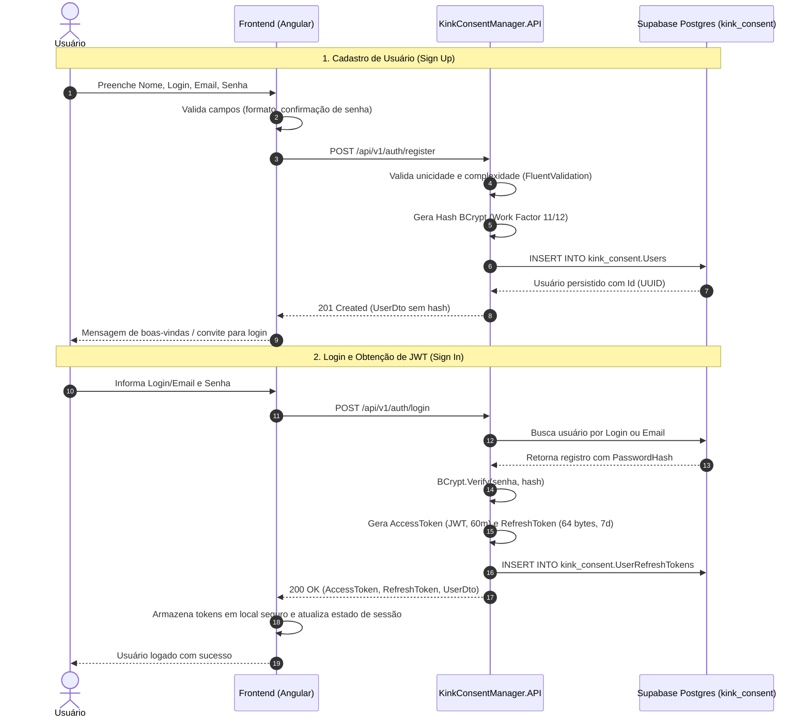
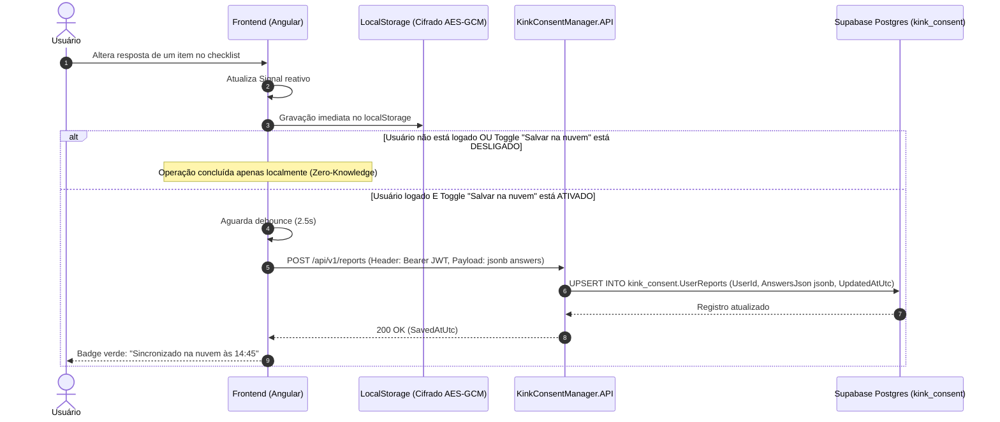

# Documento Funcional: Autenticação de Usuários e Sincronização em Nuvem (Cloud Sync)

**Projeto:** KinkConsentManager — Plataforma de Checklists de Limites e Consentimento  
**Documento:** Especificação Funcional — Autenticação, Cadastro de Usuários e Sincronização em Nuvem de Respostas  
**Versão:** 1.0 (Transição V1 Client-Side → V2 Híbrida)  
**Data:** 26 de Novembro de 2026  
**Status:** Aprovado para Implementação (Fase 1: API de Auth & Cadastro)  

---

## 1. Visão Geral e Objetivos do Módulo de Backend

O **KinkConsentManager** foi originalmente concebido como uma aplicação SPA 100% *client-side* (V1), operando sob o princípio de *Zero-Knowledge* estrito, onde os dados de preenchimento são persistidos exclusivamente na memória volátil ou no armazenamento local cifrado do navegador (`localStorage` com criptografia Web Crypto AES-GCM 256-bit).

Com a evolução para a **V2**, surge a necessidade de oferecer aos usuários a conveniência de **persistência e sincronização de suas respostas em nuvem** para acesso entre diferentes dispositivos (desktop, smartphone, tablet), além de salvaguardar seu progresso contra limpezas acidentais de cache ou rascunhos locais.

### 1.1 Princípios Fundamentais Mantidos
1. **Privacidade First e Funcionamento Desconectado (Opt-In):** O uso da nuvem é 100% opcional. Usuários anônimos continuam utilizando o checklist normalmente sem necessidade de login ou transmissão de dados para a internet.
2. **Separação Rigorosa de Etapas:**
   - **Etapa 1 (Escopo Imediato):** Fundação do backend, modelo de dados seguro, cadastro simplificado de usuários, autenticação com senha de alta entropia (padrão SmartCoreHub) e emissão de tokens JWT.
   - **Etapa 2 (Próxima):** Endpoints de persistência e recuperação do *Report* (respostas do checklist em formato estruturado `jsonb`).
   - **Etapa 3:** Integração da interface frontend (telas/modais de login e cadastro, e chave seletora de salvamento automático em nuvem na tela de preenchimento).
3. **Padrão de Segurança Enterprise:** Adoção estrita dos padrões de arquitetura e hashing do projeto de referência **SmartCoreHub** (Clean Architecture em .NET, BCrypt de alta complexidade com salt embutido, timing-safe checks, validações declarativas via FluentValidation).

---

## 2. Perfis de Acesso e Matriz de Atores

| Ator / Perfil | Descrição | Armazenamento de Respostas | Exige Login? |
| :--- | :--- | :--- | :---: |
| **Visitante Anônimo (V1 Clássico)** | Usuário que preenche o checklist sem autenticação na plataforma. | Local (`localStorage` AES-GCM 256-bit). | Não |
| **Usuário Autenticado (V2 Híbrido)** | Usuário cadastrado com credenciais validadas (login/senha/email) que opta por sincronização remota. | Híbrido (Local imediato + Nuvem assíncrona opcional). | Sim |

---

## 3. Requisitos Funcionais — Etapa 1: Cadastro e Autenticação (Foco Imediato)

### RF-01 — Cadastro de Usuário (Sign Up)
* **Objetivo:** Permitir que um novo usuário crie uma conta na plataforma com credenciais seguras.
* **Entradas:**
  - `name`: Nome ou pseudônimo do usuário (obrigatório, 3 a 100 caracteres).
  - `login`: Nome de usuário único para identificação no sistema (obrigatório, 3 a 50 caracteres, apenas caracteres alfanuméricos, sublinhado e hífen; sem espaços).
  - `email`: Endereço de email válido (obrigatório, formato RFC 5322, normalizado para minúsculas).
  - `password`: Senha de acesso com alta entropia (obrigatória, conforme política de segurança do SmartCoreHub).
  - `confirmPassword`: Confirmação da senha para evitar digitação incorreta.
* **Regras de Negócio e Validações:**
  1. O campo `login` deve ser único em toda a base de dados (insensível a maiúsculas/minúsculas).
  2. O campo `email` deve ser único em toda a base de dados.
  3. `password` e `confirmPassword` devem ser idênticos.
  4. A senha deve cumprir os requisitos de complexidade (mínimo 8 caracteres, contendo pelo menos 1 letra maiúscula, 1 minúscula, 1 número e 1 caractere especial).
  5. A senha **nunca é armazenada em texto claro**; o backend gera o hash BCrypt antes de persistir.
* **Saída:** Código HTTP `201 Created` contendo os dados básicos do usuário (ID, Name, Login, Email, CreatedAtUtc) sem expor senhas ou hashes.

---

### RF-02 — Autenticação de Usuário (Login / Sign In)
* **Objetivo:** Autenticar as credenciais fornecidas pelo usuário e iniciar uma sessão segura através de tokens JWT.
* **Entradas:**
  - `loginOrEmail`: Identificador do usuário (pode ser o `login` ou o `email`).
  - `password`: Senha em texto claro informada pelo usuário.
* **Regras de Negócio e Validações:**
  1. O sistema localiza o usuário pelo `login` ou pelo `email` (busca case-insensitive).
  2. Caso o usuário não seja localizado, deve retornar erro genérico (`401 Unauthorized`: "Credenciais inválidas"), evitando a enumeração de usuários.
  3. A verificação da senha utiliza comparação segura contra tempo (*timing-safe verification*) com o algoritmo BCrypt.
  4. Usuários inativos (`isActive == false`) são impedidos de autenticar.
  5. Ao autenticar com sucesso:
     - O campo `LastLoginAtUtc` da conta é atualizado.
     - É emitido um `AccessToken` (formato JWT Bearer, expiração curta de 60 minutos).
     - É emitido e persistido um `RefreshToken` seguro (expiração longa de 7 dias, formato string aleatória criptográfica Base64 de 64 bytes).
* **Saída:** Código HTTP `200 OK` contendo o token JWT, tempo de expiração, Refresh Token e informações resumidas do usuário.

---

### RF-03 — Renovação de Sessão (Refresh Token)
* **Objetivo:** Permitir que o aplicativo cliente renove o `AccessToken` expirado sem forçar o usuário a digitar novamente suas credenciais.
* **Entradas:**
  - `refreshToken`: Token de renovação recebido anteriormente.
* **Regras de Negócio:**
  1. O token informado é validado contra a tabela de tokens no banco de dados.
  2. O token não pode estar expirado nem revogado (`RevokedAtUtc == null`).
  3. O usuário proprietário do token deve estar ativo.
  4. Ao renovar, o Refresh Token antigo é revogado e um novo par de tokens (`AccessToken` + novo `RefreshToken`) é emitido (*Refresh Token Rotation*).
* **Saída:** Código HTTP `200 OK` com os novos tokens.

---

### RF-04 — Consulta de Dados do Usuário Corrente (`/me`)
* **Objetivo:** Retornar os dados cadastrais do usuário atualmente autenticado a partir do Bearer Token.
* **Entradas:** Cabeçalho HTTP `Authorization: Bearer <AccessToken>`.
* **Saída:** Código HTTP `200 OK` com `id`, `name`, `login`, `email`, `createdAtUtc`, `lastLoginAtUtc`.

---

## 4. Requisitos Funcionais — Etapa 2: Salvar e Carregar Respostas (Visão & Planejamento)

Embora a implementação de código desta primeira fase foque exclusivamente na API de login e cadastro, o modelo funcional e arquitetural já delimita como as respostas do usuário serão gravadas e recuperadas:

### RF-05 — Salvamento Automático na Nuvem (Cloud Autosave Opt-In)
* **Objetivo:** Disponibilizar na tela de preenchimento (`/checklist/fill`) a opção de sincronização contínua com a nuvem, coexistindo com o autosave local existente.
* **Comportamento na Interface:**
  - Ao lado do indicador visual de "Salvo localmente", é exibida uma chave seletora (*toggle switch*): **"Sincronizar com a Nuvem"** (ícone de nuvem).
  - Se o usuário **não estiver autenticado**, o toggle permanece desabilitado com tooltip ou mensagem de convite: *"Faça login para salvar suas respostas na nuvem e acessá-las de qualquer aparelho"*. Clicar no botão abre a modal de login/cadastro.
  - Se o usuário **estiver autenticado**, o toggle pode ser ligado ou desligado pelo usuário (salvando essa preferência).
* **Regra de Sincronização:**
  - O salvamento em `localStorage` continua instantâneo a cada alteração.
  - O salvamento na nuvem é disparado via *debounce* (ex.: 2,5 segundos após a última alteração de resposta) enviando o payload estruturado para a API (`POST /api/v1/reports`).
  - Indicador visual com 3 estados: *Sincronizando...*, *Salvo na Nuvem (às HH:mm)*, ou *Erro ao sincronizar (tentar novamente)*.

---

### RF-06 — Carregamento do Report na Inicialização (Load Report)
* **Objetivo:** Recuperar as respostas salvas na nuvem quando o usuário faz login em um dispositivo novo ou limpa o cache.
* **Regra de Resolução de Conflitos (Local vs. Nuvem):**
  - Ao abrir o preenchimento autenticado, o frontend compara o timestamp do rascunho local (`updatedAt`) com o timestamp do rascunho na nuvem (`updatedAtUtc`).
  - Se os dados locais estiverem vazios, a versão da nuvem é carregada automaticamente.
  - Se houver divergência entre rascunho local e rascunho na nuvem, uma modal amigável (SweetAlert2) é apresentada:
    - *"Encontramos respostas salvas na sua conta mais recentes que as deste dispositivo. Deseja carregar o rascunho da nuvem ou manter as alterações deste dispositivo?"*
    - Botões claros: `[Carregar da Nuvem]` e `[Manter Deste Dispositivo]`.

---

## 5. Diagramas de Sequência Funcionais (Mermaid)

### 5.1 Fluxo de Cadastro e Login

### 5.2 Fluxo de Preenchimento com Autosave Local e Nuvem (Visão Etapa 2)

---

## 6. Matriz de Rastreabilidade e Critérios de Aceite

| ID | Requisito Funcional | Critério de Aceite Principal | Prioridade |
| :--- | :--- | :--- | :---: |
| **CA-01** | Cadastro de Usuário | Não permitir logins ou emails duplicados; rejeitar senhas com menos de 8 caracteres ou sem caracteres especiais. | **P0 (Imediata)** |
| **CA-02** | Proteção de Senhas | Hash com BCrypt obrigatório; proibido armazenar senha em texto limpo em qualquer tabela ou log. | **P0 (Imediata)** |
| **CA-03** | Autenticação JWT | Retornar AccessToken válido assinado com HMAC-SHA256 e Refresh Token persistido no banco com expiração. | **P0 (Imediata)** |
| **CA-04** | Renovação de Sessão | Endpoint `/refresh` capaz de emitir novo JWT enquanto o Refresh Token for válido e revogar o anterior. | **P0 (Imediata)** |
| **CA-05** | Consulta do Usuário Logado | Endpoint `/me` protegido por `[Authorize]` retornando dados corretos da claim do token. | **P0 (Imediata)** |
| **CA-06** | Cloud Autosave Toggle | Chave seletora na UI de preenchimento visível e funcional apenas para usuários logados. | P1 (Etapa 2/3) |
| **CA-07** | Persistência do Report (`jsonb`) | Gravação atômica das respostas em coluna nativa `jsonb` do PostgreSQL no Supabase. | P1 (Etapa 2) |
