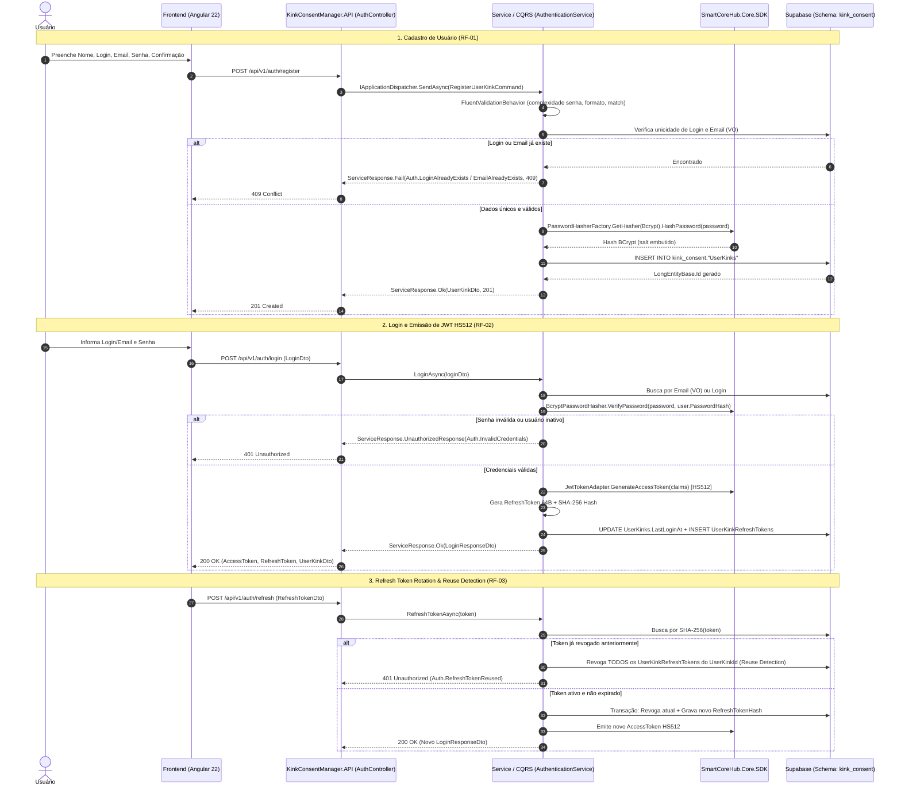
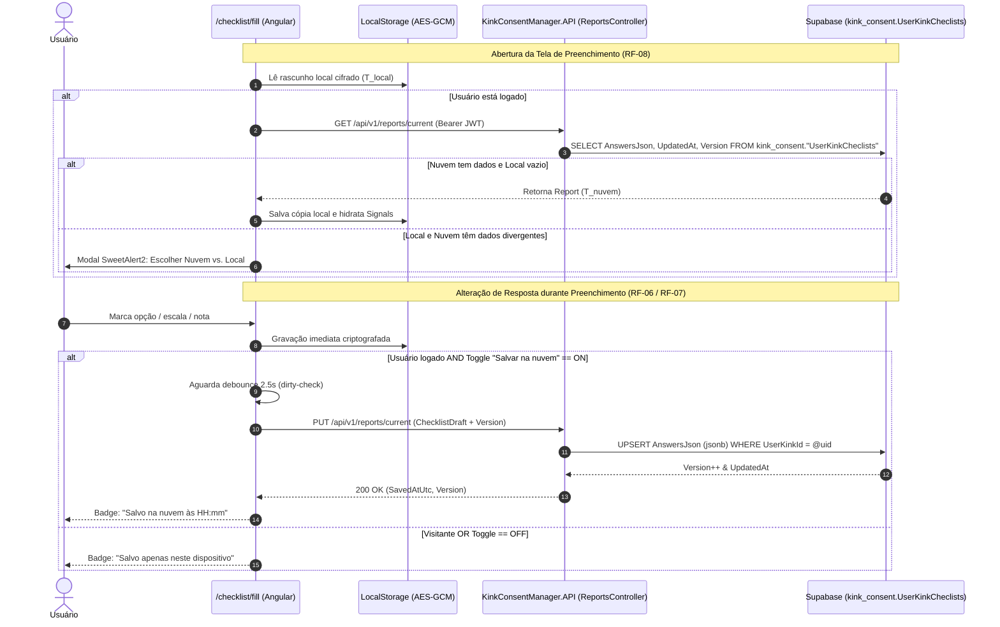
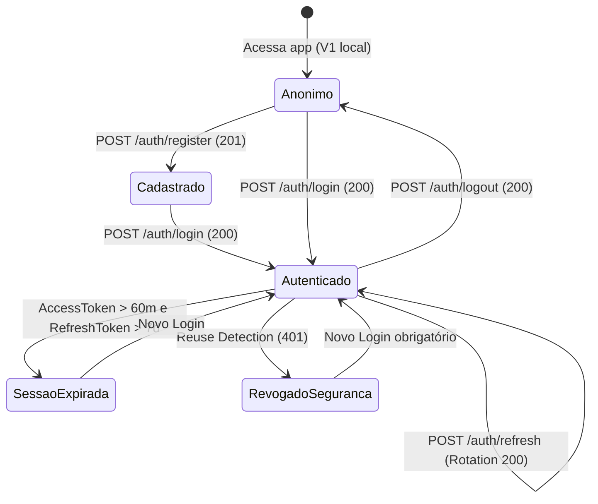

# Documento Funcional: Autenticação de Usuários e Sincronização em Nuvem (Cloud Sync)

**Projeto:** KinkConsentManager — Plataforma de Checklists de Limites e Consentimento  
**Documento:** Especificação Funcional Completa — Autenticação, Cadastro de Usuários, Segurança e Sincronização em Nuvem  
**Arquitetura Base:** `C:\git\SmartCoreHub\backend` + NuGet [`SmartCoreHub.Core.SDK`](https://www.nuget.org/packages/SmartCoreHub.Core.SDK)  
**Banco de Dados:** Supabase (PostgreSQL 16) com Entity Framework Core (`kink_consent` schema isolado)  
**Versão:** 2.0 (Revisão Alinhada ao `SmartCoreHub.Core.SDK`)  
**Data:** 26 de Novembro de 2026  
**Status:** Aprovado para Implementação (Fase 1: API de Auth & Cadastro)  

---

## Sumário

1. [Visão Geral, Propósito e Transição V1 → V2](#1-visão-geral-propósito-e-transição-v1--v2)
2. [Atores, Perfis e Ciclo de Vida da Sessão](#2-atores-perfis-e-ciclo-de-vida-da-sessão)
3. [Requisitos Funcionais — Etapa 1: Cadastro, Login e Sessão JWT (Escopo Imediato)](#3-requisitos-funcionais--etapa-1-cadastro-login-e-sessão-jwt-escopo-imediato)
4. [Requisitos Funcionais — Etapas 2 e 3: Report (`jsonb`) e Cloud Autosave Opt-In](#4-requisitos-funcionais--etapas-2-e-3-report-jsonb-e-cloud-autosave-opt-in)
5. [Requisitos Não-Funcionais, Segurança, Privacidade e LGPD](#5-requisitos-não-funcionais-segurança-privacidade-e-lgpd)
6. [Catálogo Canônico de `MessageKey`, Códigos HTTP e Localização](#6-catálogo-canônico-de-messagekey-códigos-http-e-localização)
7. [Diagramas de Sequência e Estados (Mermaid)](#7-diagramas-de-sequência-e-estados-mermaid)
8. [Critérios de Aceite (Given/When/Then) e Matriz de Rastreabilidade](#8-critérios-de-aceite-givenwhenthen-e-matriz-de-rastreabilidade)

---

## 1. Visão Geral, Propósito e Transição V1 → V2

Na Versão 1 (**V1**), o **KinkConsentManager** consolidou-se como uma SPA Angular 22 **100% *client-side*** operando sob privacidade **Zero-Knowledge**: todas as respostas de limites e consentimento são cifradas no navegador com Web Crypto AES-GCM 256-bit (`CryptoService` + `ChecklistAutosaveService` + `BrowserStorageRepository`) e armazenadas exclusivamente em `localStorage`, sem qualquer transmissão a servidores.

Na evolução para a **V2**, os usuários ganham a possibilidade opcional (*opt-in*) de **criar uma conta**, **autenticar-se** e **sincronizar automaticamente suas respostas (Report)** na nuvem, permitindo retomar o preenchimento em múltiplos dispositivos (desktop, tablet, smartphone) e proteger rascunhos contra limpeza de cache do navegador.

### 1.1 Princípios Inegociáveis da Evolução V2
1. **Funcionamento Offline Preservado:** Visitantes anônimos continuam usando o aplicativo integralmente sem cadastro, login ou chamadas de rede. O autosave local em `localStorage` permanece ativo como camada primária e imediata.
2. **Sincronização em Nuvem Estritamente Opt-In (Somente Usuário Logado):** A gravação remota ocorre exclusivamente quando o usuário está autenticado **e** mantém ativada a chave *"Salvar automaticamente na nuvem"* na tela de preenchimento (`/checklist/fill`).
3. **Reaproveitamento Direto de `SmartCoreHub.Core.SDK`:** Toda a fundação genérica (entidades base `LongEntityBase`, Value Object `Email`, envelope `ServiceResponse<T>`, DTOs `LoginDto`/`RefreshTokenDto`, hashing BCrypt, serviço JWT, middlewares de segurança/cultura/correlação, CQRS e health/readiness) é consumida diretamente do pacote NuGet oficial `SmartCoreHub.Core.SDK`, garantindo maturidade operacional e zero duplicação.
4. **Separação Estrita em 3 Etapas:**
   - **Etapa 1 (Escopo Imediato desta Entrega):** Fundação do backend espelhando `C:\git\SmartCoreHub\backend`, banco PostgreSQL no Supabase via EF Core Code First com schema isolado `kink_consent`, API de Cadastro (`register`), Login (`login`), Renovação (`refresh`), Logout (`logout`) e Perfil (`me`).
   - **Etapa 2 (Próxima):** Persistência e recuperação do Report (`kink_consent."UserKinkCheclists"`, entidade `UserKinkCheclist` com coluna nativa PostgreSQL `jsonb`) via `PUT /api/v1/reports/current`, `GET /api/v1/reports/current` e `DELETE /api/v1/reports/current`.
   - **Etapa 3 (Integração Frontend):** Modais de Login/Cadastro no Angular 22, interceptor JWT, chave seletora de Cloud Autosave em `/checklist/fill` e resolução de conflitos Local vs. Nuvem.

---

## 2. Atores, Perfis e Ciclo de Vida da Sessão

### 2.1 Matriz de Atores

| Ator / Perfil | Descrição | Acesso à API | Persistência de Respostas |
| :--- | :--- | :--- | :--- |
| **Visitante Anônimo (V1)** | Usuário que não possui conta ou não realizou login. | Nenhum (0 chamadas de persistência). | Apenas `localStorage` cifrado (AES-GCM 256-bit). |
| **Usuário Autenticado (V2)** | Usuário com conta ativa (`IsActive == true`) e `AccessToken` JWT válido. | Endpoints `/api/v1/auth/*` e (na Etapa 2) `/api/v1/reports/*`. | Híbrida: imediata em `localStorage` + nuvem (se toggle *Cloud Autosave* ligado). |

### 2.2 Ciclo de Vida da Conta e Sessão

1. **Anônimo:** Navega e preenche o checklist localmente.
2. **Cadastrado (`POST /api/v1/auth/register`):** Conta persistida em `kink_consent."UserKinks"` (entidade `UserKink`) com `IsActive = true` e `PasswordHash` gerado via BCrypt.
3. **Autenticado (`POST /api/v1/auth/login`):** Emissão de `AccessToken` JWT (`HS512`, validade padrão de 60 minutos) e `RefreshToken` opaco (validade padrão de 7 dias, armazenado em hash SHA-256 na tabela `kink_consent."UserKinkRefreshTokens"`, entidade `UserKinkRefreshToken`).
4. **Sessão Renovada (`POST /api/v1/auth/refresh`):** *Refresh Token Rotation* — o token anterior é marcado como revogado (`RevokedAtUtc`) com registro de `ReplacedByTokenHash`, emitindo um novo par de tokens.
5. **Comprometida (Reuse Detection):** Caso um `RefreshToken` já revogado seja reutilizado, **todas** as sessões ativas daquele usuário são revogadas imediatamente por segurança.
6. **Encerrada (`POST /api/v1/auth/logout`):** O usuário revoga explicitamente o refresh token da sessão atual (ou todos os seus tokens ativos).

---

## 3. Requisitos Funcionais — Etapa 1: Cadastro, Login e Sessão JWT (Escopo Imediato)

### RF-01 — Cadastro Simplificado de Usuário (`POST /api/v1/auth/register`)

* **Objetivo:** Permitir a criação de uma conta simples com nome, login, e-mail e senha forte.
* **Campos de Entrada (`RegisterUserKinkRequestDto`):**

| Campo | Tipo | Obrigatório | Regras de Validação e Normalização |
| :--- | :---: | :---: | :--- |
| `name` | `string` | Sim | 3 a 100 caracteres (após `Trim()`); não pode conter apenas espaços. |
| `login` | `string` | Sim | 3 a 50 caracteres; apenas `[a-zA-Z0-9_-]`; sem espaços; unicidade *case-insensitive*. |
| `email` | `string` | Sim | Formato válido (validado pelo Value Object `Email` do `SmartCoreHub.Core.SDK`); até 191 caracteres; normalizado para minúsculas (`ToLowerInvariant()`); unicidade garantida. |
| `password` | `string` | Sim | 8 a 100 caracteres; obrigatório conter ao menos: 1 maiúscula (`A-Z`), 1 minúscula (`a-z`), 1 dígito (`0-9`) e 1 caractere especial; proibido conter espaços em branco. |
| `confirmPassword` | `string` | Sim | Deve ser estritamente igual a `password`. |

* **Regras de Negócio:**
  1. As validações de formato são executadas via `FluentValidation` no pipeline CQRS antes de qualquer consulta ao banco.
  2. Antes de persistir, verifica-se unicidade de `Login` (normalizado em comparação *case-insensitive*) e de `Email` (já normalizado pelo Value Object `Email`). Em caso de duplicidade, retorna `409 Conflict` com `MessageKey` específica (`Auth.LoginAlreadyExists` ou `Auth.EmailAlreadyExists`).
  3. O hash da senha é gerado obrigatoriamente por `PasswordHasherFactory.GetHasher(PasswordAlgorithm.Bcrypt)` do `SmartCoreHub.Core.SDK` (salt aleatório embutido no próprio hash).
  4. A senha em texto claro e `confirmPassword` jamais são persistidas, retornadas ou registradas em logs/Application Insights/Serilog.
* **Saída de Sucesso:** HTTP `201 Created` encapsulado em `ServiceResponse<UserKinkDto>` contendo `{ id, name, login, email, isActive, createdAt, lastLoginAt }`.

---

### RF-02 — Autenticação de Usuário / Login (`POST /api/v1/auth/login`)

* **Objetivo:** Validar credenciais do usuário — aceitando **tanto `login` quanto `email`** no mesmo campo identificador — e emitir tokens JWT + Refresh Token.
* **Entradas (`LoginDto` reutilizado diretamente de `SmartCoreHub.Core.SDK.Domain.DTOs.Common`):**
  - `loginOrEmail` (`string`, obrigatório, máximo 191 caracteres): aceita **qualquer um dos dois** identificadores cadastrados (`login` ou `email`), aplicando `Trim()` e comparação ***case-insensitive*** (`"Alex_Silva"` == `"alex_silva"`; `"Alex@Example.COM"` == `"alex@example.com"`).
  - `password` (`string`, obrigatório): senha em texto claro.
* **Regras de Negócio:**
  1. **Detecção determinística sem ambiguidade:** como `Login` permite apenas `[a-zA-Z0-9_-]` (nunca contém `@`) e `Email` exige `@`, não existe colisão possível:
     - Se `loginOrEmail.Trim()` contiver `@`: o sistema tenta instanciar `new Email(trimmed)` (normalizado em minúsculas pelo SDK e protegido contra ReDoS com timeout de 250ms) e busca por `Email`. Caso o formato seja inválido (`ArgumentException`, ex.: `"usuario@semtld"`), trata como não encontrado — **nunca** retornando `500`.
     - Caso contrário: normaliza com `ToLowerInvariant()` e busca pela coluna indexada `NormalizedLogin`.
  2. **Anti-enumeração de usuários:** Se o usuário não existir, o valor com `@` for malformado, a conta estiver inativa (`IsActive == false`) ou a senha não corresponder ao hash BCrypt (`VerifyPassword`), o retorno deve ser sempre `401 Unauthorized` com mensagem e `MessageKey` genéricas (`Auth.InvalidCredentials` / `"Invalid login/email or password"`), sem revelar se o e-mail/login existe.
  3. A verificação de senha valida primeiro o par `(password, hash)` via `PasswordVerificationInput` e executa `BcryptPasswordHasher.VerifyPassword` (comparação *timing-safe*).
  4. Em caso de sucesso:
     - Atualiza `LastLoginAt` (UTC) na entidade `UserKink`.
     - Gera `AccessToken` JWT assinado com **`HS512`** (`HmacSha512`, padrão do `JwtTokenAdapter` do SDK) contendo as claims padrão (`jti`, `nameid`, `name`, `email`) mais a claim `login`.
     - Gera `RefreshToken` criptograficamente aleatório de 64 bytes (`RandomNumberGenerator.GetBytes(64)` em Base64Url) e persiste apenas seu **hash SHA-256** em `kink_consent."UserKinkRefreshTokens"`.
  5. O endpoint é protegido por **Rate Limiting** herdado de `ApiPerformanceExtensions` do SDK para mitigar ataques de força bruta.
* **Saída de Sucesso:** HTTP `200 OK` encapsulado em `ServiceResponse<LoginResponseDto>` contendo `{ accessToken, refreshToken, expiresAt, refreshTokenExpiresAt, tokenType: "Bearer", user }`.

---

### RF-03 — Renovação de Sessão (`POST /api/v1/auth/refresh`)

* **Objetivo:** Renovar o `AccessToken` expirado sem exigir novo login do usuário, aplicando rotação segura.
* **Entrada (`RefreshTokenDto` reutilizado de `SmartCoreHub.Core.SDK.Domain.DTOs.Common`):**
  - `token` (`string`, obrigatório): o `RefreshToken` atual mantido pelo cliente.
* **Regras de Negócio:**
  1. O servidor calcula o hash SHA-256 do `token` recebido e busca o registro em `kink_consent."UserKinkRefreshTokens"`.
  2. Se não existir ou estiver expirado (`ExpiresAtUtc <= UtcNow`), retorna `401 Unauthorized` (`Auth.InvalidRefreshToken`).
  3. **Detecção de Reúso (Reuse Detection):** Se o token encontrado já estiver revogado (`RevokedAtUtc != null`), o sistema assume possível comprometimento de sessão, revoga imediatamente **todos** os refresh tokens ativos daquele `UserKinkId` e retorna `401 Unauthorized` (`Auth.RefreshTokenReused`).
  4. Se o usuário vinculado estiver inativo (`IsActive == false`), revoga o token e retorna `401 Unauthorized`.
  5. Caso válido: dentro de uma transação (`ITransactionExecutor` / `EfTransactionExecutor`), marca o token atual como revogado (`RevokedAtUtc = UtcNow`), preenche `ReplacedByTokenHash`, gera novo `AccessToken` + novo `RefreshToken` e devolve `200 OK` com `LoginResponseDto`.

---

### RF-04 — Encerramento de Sessão / Logout (`POST /api/v1/auth/logout`)

* **Objetivo:** Invalidar explicitamente a sessão atual (ou todas as sessões do usuário).
* **Entrada (`LogoutRequestDto`):**
  - `refreshToken` (`string?`, opcional se `revokeAllSessions = true`).
  - `revokeAllSessions` (`bool`, padrão `false`): quando `true`, revoga todos os refresh tokens ativos do usuário autenticado.
* **Segurança:** Endpoint protegido por `[Authorize]`. Valida que o token revogado pertence ao `UserKinkId` extraído da claim `nameid` do JWT (`UserClaimsHelper.TryGetUserId`).
* **Saída:** HTTP `200 OK` com `ServiceResponse<bool>` (`data: true`).

---

### RF-05 — Consulta de Dados do Usuário Logado (`GET /api/v1/auth/me`)

* **Objetivo:** Permitir que o frontend valide a sessão corrente e recupere dados atualizados do perfil ao inicializar a aplicação.
* **Entrada:** Cabeçalho `Authorization: Bearer <AccessToken>` (controller herdando `BaseApiController` do `SmartCoreHub.Core.SDK`).
* **Regras:** Extrai o `long userId` via `UserClaimsHelper` / `BaseApiController`; caso usuário não exista ou esteja inativo, retorna `401 Unauthorized`.
* **Saída:** HTTP `200 OK` com `ServiceResponse<UserKinkDto>`.

---

## 4. Requisitos Funcionais — Etapas 2 e 3: Report (`jsonb`) e Cloud Autosave Opt-In

> [!NOTE]
> As funcionalidades abaixo compõem as **Etapas 2 (API de Reports)** e **3 (Frontend)**, mas sua especificação funcional já é fechada agora para garantir total alinhamento do modelo de dados e dos contratos com a tela de preenchimento existente (`frontend/src/app/core/models/checklist-answer.model.ts`).

### RF-06 — Salvamento Automático na Nuvem Opt-In na Tela de Preenchimento (`/checklist/fill`)

* **Objetivo:** Oferecer ao usuário logado um controle explícito para ativar ou desativar o backup automático de suas respostas na nuvem, coexistindo de forma não invasiva com o salvamento local existente.
* **Comportamento da Interface:**
  1. Ao lado do indicador atual de salvamento local (`ChecklistAutosaveService`), exibe-se um **Toggle Switch *"Salvar na nuvem"***:
     - **Usuário Deslogado (Visitante):** O toggle permanece visível em estado informativo/bloqueado (ou com ação de convite) exibindo tooltip: *"Entre ou cadastre-se para salvar suas respostas na nuvem e acessá-las de outros dispositivos"*. Ao clicar, abre o modal de Login/Cadastro sem perder o que já foi preenchido localmente.
     - **Usuário Logado:** O usuário pode ligar (`true`) ou desligar (`false`) livremente. A preferência fica salva por usuário (`UserPreferencesRepository`). Quando ligado, ativa imediatamente o envio assíncrono para a API.
  2. **Mecânica de Coexistência (Local + Nuvem):**
     - **Camada 1 (Local — Imediata):** Toda alteração no `ChecklistStateService` continua sendo cifrada com AES-GCM 256-bit e salva no `localStorage`. Funciona mesmo offline.
     - **Camada 2 (Nuvem — Debounce & Dirty-Checking):** Quando *Cloud Autosave* estiver ativado e o usuário autenticado, após **2,5 segundos** de inatividade desde a última modificação pendente (com comparação de hash/versão para evitar PUTs idênticos), o frontend envia o rascunho para `PUT /api/v1/reports/current`.
  3. **Indicador Visual de 4 Estados:**
     - `cloud_off`: *Sincronização na nuvem desativada (apenas local)*;
     - `cloud_upload` (animado): *Salvando na nuvem...*;
     - `cloud_done`: *Salvo na nuvem às HH:mm*;
     - `cloud_alert`: *Falha ao salvar na nuvem — seus dados estão seguros localmente [Tentar novamente]*.

---

### RF-07 — Salvar Report de Respostas (`PUT /api/v1/reports/current`)

* **Objetivo:** Persistir o estado atual do checklist do usuário autenticado em coluna PostgreSQL nativa `jsonb` (`kink_consent."UserKinkCheclists"`, entidade `UserKinkCheclist`).
* **Estrutura Alinhada ao Modelo Real do Frontend (`ChecklistDraft`):**

| Campo | Tipo | Origem no Frontend (`checklist-answer.model.ts`) | Descrição |
| :--- | :--- | :--- | :--- |
| `schemaVersion` | `string` | `ChecklistDraft.schemaVersion` (ex.: `"1.0.0"`) | Versão do schema do checklist respondido. |
| `language` | `string` | `SupportedLanguage` (`"pt-BR"` ou `"en-US"`) | Idioma preferido do rascunho. |
| `answers` | `object` (`jsonb`) | `Record<string, ItemResponseValue>` | Mapa chaveado por `itemId` com `primaryScale`, `secondaryScale`, `selectedOption`, `selectedOptions`, `otherText`, `customText`. |
| `clientUpdatedAtUtc` | `DateTime` | `ChecklistState.lastUpdatedAt` | Timestamp ISO-8601 UTC da última edição no cliente. |
| `expectedVersion` | `int?` | Controle de concorrência | Versão otimista opcional para detectar edições simultâneas em dois aparelhos. |

* **Regras de Negócio:**
  1. Um usuário autenticado possui 1 checklist salvo ativo principal na V2 (`UNIQUE` em `UserKinkId` na tabela `UserKinkCheclists`), atualizado via operação idempotente de *Upsert* (`PUT`).
  2. Tamanho máximo do payload limitado via `RequestSizeLimitMiddleware` do SDK (ex.: teto de 2 MiB para `answers`, muito acima dos ~50 KB médios de um checklist completo).
  3. **Privacidade nos Logs:** O conteúdo do campo `answers` **nunca** deve ser logado em console, arquivos Serilog ou telemetria Application Insights.

---

### RF-08 — Carregar Report e Resolução de Conflitos (`GET /api/v1/reports/current`)

* **Objetivo:** Recuperar o report salvo na nuvem ao fazer login ou abrir a tela de preenchimento, tratando divergências com o rascunho local.
* **Matriz de Decisão na Inicialização:**

| Cenário | Rascunho Local | Report na Nuvem | Comportamento Esperado |
| :---: | :--- | :--- | :--- |
| **1** | Vazio (0 respostas) | Ausente (`404` / `null`) | Inicia checklist limpo normalmente. |
| **2** | Vazio (novo dispositivo) | Presente | Carrega automaticamente o report da nuvem para o `ChecklistStateService` e replica cifrado no `localStorage`. |
| **3** | Preenchido | Ausente | Mantém rascunho local; se toggle *Cloud Autosave* for ativado, realiza o primeiro upload para a nuvem. |
| **4** | Preenchido (`T_local`) | Presente (`T_nuvem`) com conteúdo diferente | Exibe modal **SweetAlert2** comparando as duas datas (`Última edição local` vs. `Último backup na nuvem`) e quantidade de itens respondidos, permitindo escolher **`[Usar Versão da Nuvem]`** ou **`[Manter Versão Local (e enviar para nuvem)]`**. |

---

### RF-09 — Exclusão do Backup na Nuvem (`DELETE /api/v1/reports/current`)

* **Objetivo:** Garantir conformidade com LGPD/GDPR permitindo que o usuário remova permanentemente suas respostas armazenadas no servidor, sem apagar sua conta e sem remover automaticamente o rascunho local (ou dando essa opção).

---

## 5. Requisitos Não-Funcionais, Segurança, Privacidade e LGPD

| Código | Categoria | Requisito Técnico Mandatório | Como é Garantido (`SmartCoreHub.Core.SDK` / Host) |
| :--- | :--- | :--- | :--- |
| **RNF-01** | **Hashing de Senha** | Senhas armazenadas exclusivamente em hash BCrypt com salt aleatório único e verificação *timing-safe*. | `BcryptPasswordHasher` via `PasswordHasherFactory.GetHasher(PasswordAlgorithm.Bcrypt)` do Core.SDK. |
| **RNF-02** | **Assinatura JWT** | Tokens assinados com HMAC-SHA512 (`HS512`), expiração estrita (`ClockSkew = Zero` ou mínimo configurado), validação de `Issuer`, `Audience`, `Lifetime` e `SigningKey`. | `JwtTokenAdapter` + `TokenConfigurationServiceCollectionExtensions` do Core.SDK (`TokenConfigurations:Secret` ≥ 64 bytes). |
| **RNF-03** | **Segurança de Refresh Token** | Nunca persistir refresh token em texto claro no banco de dados. | Armazenar apenas digest SHA-256 + aplicar *Rotation* e *Reuse Detection*. |
| **RNF-04** | **Transporte e Headers** | Exigir HTTPS/TLS 1.2+ em produção e cabeçalhos defensivos (`X-Frame-Options`, `X-Content-Type-Options`, `HSTS`). | `app.UseHttpsRedirection()` + `SecurityHeadersMiddleware` via `UseSdkNetworkAndCrossCutting()`. |
| **RNF-05** | **Rastreabilidade** | Toda requisição recebe ou propaga `X-Correlation-ID` e `operationId` no `ServiceResponse<T>`. | `CorrelationIdMiddleware` + `ServiceResponse<T>.OperationId` do Core.SDK. |
| **RNF-06** | **Proteção Brute Force** | Rate limiting por IP/rota nos endpoints anônimos de autenticação (`login`, `register`, `refresh`). | `ApiPerformanceExtensions` (`AddApiPerformance` / `UseApiPerformance`) do Core.SDK + políticas por endpoint. |
| **RNF-07** | **Zero Logs Sensíveis (LGPD)** | Proibido registrar `password`, `confirmPassword`, `token`, `refreshToken` ou `answers` em Serilog / Application Insights. | DTOs com `[JsonIgnore]` quando aplicável, sanitização em behaviors e `Logger` estruturado sem dump de payloads sensíveis. |
| **RNF-08** | **Isolamento Supabase** | Tabelas e histórico de migrations não podem tocar `public`, `auth`, `storage` ou `realtime`. | `HasDefaultSchema("kink_consent")` e `MigrationsHistoryTable(..., "kink_consent")`. |
| **RNF-09** | **Contrato de Enums (`R-ARCH-ENUM-NUMERIC`)** | Quaisquer enums serializados pela API devem trafegar como valores numéricos inteiros (`0, 1, 2...`), padrão nativo `System.Text.Json`. | Diretriz `R-ARCH-ENUM-NUMERIC` do `SmartCoreHub`. |
| **RNF-10** | **Observabilidade & Saúde** | Endpoints `/health` (liveness sem DB) e `/ready` (readiness com `CanConnect()` no Supabase) disponíveis. | `MapBasicLiveness` e `MapDatabaseReadiness<KinkConsentManagerDbContext>` do Core.SDK. |
| **RNF-11** | **Idiomas & Resources em Validadores** | **Todos os validadores** (`PasswordValidator`, `RegisterUserKinkRequestValidator`, `LoginDtoValidator`, etc.) devem suportar múltiplos idiomas e `.resx` de forma desacoplada via serviço centralizado (`IValidationMessageService` → `ValidationMessageService`), sem strings fixas no domínio. | `LocalizationHeaderCultureMiddleware` + `IFunctionalMessageProvider` + `FunctionalMessageResultFilter` do Core.SDK + `ValidationMessages*.resx`. |

---

## 6. Catálogo Canônico de `MessageKey`, Códigos HTTP e Localização

Seguindo o padrão do **SmartCoreHub** e do **`SmartCoreHub.Core.SDK`**:
- A cultura ativa de cada requisição HTTP é negociada automaticamente pelo `LocalizationHeaderCultureMiddleware` na seguinte ordem de prioridade: query string (`?culture=`), cabeçalho `X-Locale`, claim `locale` do JWT, cabeçalho `Accept-Language` e `DefaultCulture` (`en-US`).
- **Todos os validadores de domínio** consomem a abstração **`IValidationMessageService`**, implementada centralmente por **`ValidationMessageService`** na camada `Service`. Essa classe resolve automaticamente:
  1. Chaves genéricas nativas do SDK (`SmartCoreHub.Core.SDK.Validation.*`, já traduzidas em `en`, `pt-BR` e `es-ES` no NuGet);
  2. Chaves específicas do produto (`Validation.Password.*`, `Validation.Login.*`, etc.) a partir dos arquivos `.resx` em `KinkConsentManager.Infrastructure/Localization/Resources/` (`ValidationMessages.resx`, `ValidationMessages.pt-BR.resx`), com fallback seguro em inglês;
- Além da mensagem já localizada em `ErrorResponse.Description` / `ServiceResponse.Message` (via `ValidationMessageService` + `FunctionalMessageResultFilter`), toda falha preserva `messageKey` e `errorCode` estáveis para eventual personalização no frontend Angular (`pt-BR` / `en-US`).

| `MessageKey` | HTTP | Descrição Padrão API (Inglês) | Uso no Frontend (`pt-BR` / `en-US`) |
| :--- | :---: | :--- | :--- |
| `Auth.UserRegistered` | `201` | `"User registered successfully."` | Conta criada com sucesso; convida para login ou autentica. |
| `Auth.LoginSuccessful` | `200` | `"Login successful."` | Redireciona / fecha modal e ativa estado autenticado. |
| `Auth.TokenRefreshed` | `200` | `"Session refreshed successfully."` | Renovação silenciosa via interceptor HTTP. |
| `Auth.LogoutSuccessful` | `200` | `"Logout successful."` | Limpa tokens locais e desativa *Cloud Autosave* na sessão. |
| `Auth.CurrentUserRetrieved` | `200` | `"User profile retrieved successfully."` | Sincroniza dados exibidos no cabeçalho/perfil. |
| `Auth.InvalidCredentials` | `401` | `"Invalid login/email or password."` | Exibe alerta de credenciais inválidas sem expor se usuário existe. |
| `Auth.UserInactive` | `401` | `"User account is inactive."` | Informa bloqueio/inatividade da conta. |
| `Auth.InvalidRefreshToken` | `401` | `"Invalid or expired refresh token."` | Força novo login no cliente. |
| `Auth.RefreshTokenReused` | `401` | `"Refresh token reuse detected. All sessions were revoked."` | Alerta de segurança e redirecionamento para login. |
| `Auth.LoginAlreadyExists` | `409` | `"A user with this login already exists."` | Destaca campo `login` no formulário de cadastro. |
| `Auth.EmailAlreadyExists` | `409` | `"A user with this email already exists."` | Destaca campo `email` no formulário de cadastro. |
| `Validation.Failed` | `400` | `"One or more validation errors occurred."` | Exibe lista de erros por campo (`errors[]`). |
| `Common.TooManyRequests` | `429` | `"Too many requests. Please try again later."` | Aviso de cooldown temporário. |
| `Report.Saved` | `200` | `"Report saved successfully."` | Atualiza badge para *"Salvo na nuvem às HH:mm"*. |
| `Report.Loaded` | `200` | `"Report retrieved successfully."` | Inicia verificação de conflito Local vs. Nuvem. |
| `Report.NotFound` | `404` | `"No saved report found for this user."` | Mantém apenas rascunho local (não é erro para o usuário). |
| `Report.VersionConflict` | `409` | `"A newer version of the report exists on the server."` | Abre modal de resolução de conflito. |

---

## 7. Diagramas de Sequência e Estados (Mermaid)

### 7.1 Fluxo Completo da Etapa 1: Cadastro, Login, Refresh com Rotation e Logout

### 7.2 Fluxo das Etapas 2 e 3: Autosave Local + Sincronização em Nuvem (`jsonb`) e Conflitos

### 7.3 Diagrama de Estados da Sessão do Usuário

---

## 8. Critérios de Aceite (Given/When/Then) e Matriz de Rastreabilidade

### 8.1 Cenários de Aceite da Etapa 1 (API Auth & Cadastro)

* **CA-01 (Cadastro com sucesso e hash BCrypt):**
  - **Dado** um payload válido com `name`, `login` único, `email` único, `password` forte (`Abc@1234`) e `confirmPassword` idêntico,
  - **Quando** for enviado `POST /api/v1/auth/register`,
  - **Então** a API deve persistir o usuário em `kink_consent."UserKinks"` com `PasswordHash` iniciado em `$2a$`/`$2b$` (BCrypt), normalizar o e-mail em minúsculas e retornar HTTP `201 Created` sem expor o hash.

* **CA-02 (Rejeição de senha fraca):**
  - **Dado** uma senha sem caractere especial ou com menos de 8 caracteres (ex.: `"abcdef12"`),
  - **Quando** for enviado `POST /api/v1/auth/register`,
  - **Então** o `FluentValidationBehavior` deve barrar antes do banco e retornar HTTP `400 Bad Request` com `errors` detalhando as regras violadas.

* **CA-03 (Unicidade de login e e-mail):**
  - **Dado** um `login` ou `email` já cadastrado (mesmo variando maiúsculas/minúsculas),
  - **Quando** tentar novo cadastro,
  - **Então** a API deve retornar HTTP `409 Conflict` com `MessageKey` `Auth.LoginAlreadyExists` ou `Auth.EmailAlreadyExists`.

* **CA-04 (Login válido com login OU e-mail *case-insensitive* + JWT HS512):**
  - **Dado** um usuário ativo cadastrado (`login: "Alex_Silva"`, `email: "alex@example.com"`),
  - **Quando** autenticar via `POST /api/v1/auth/login` enviando `"alex_silva"` em `loginOrEmail` **ou** enviando `"ALEX@EXAMPLE.COM"` em `loginOrEmail` com a senha correta,
  - **Então** ambos os caminhos devem retornar HTTP `200 OK` com `AccessToken` válido assinado em `HS512`, `RefreshToken` e `UserKinkDto`, além de atualizar `LastLoginAt`.

* **CA-05 (Login inválido sem enumeração e tratamento seguro de `@` malformado):**
  - **Dado** um `loginOrEmail` inexistente, uma string malformada contendo `@` (ex.: `"foo@invalido"`) ou uma senha incorreta,
  - **Quando** enviar `POST /api/v1/auth/login`,
  - **Então** deve retornar HTTP `401 Unauthorized` (nunca `500`) com exatamente a mesma mensagem e `MessageKey` (`Auth.InvalidCredentials`).

* **CA-06 (Rotação e detecção de reúso de Refresh Token):**
  - **Dado** um `RefreshToken` válido já utilizado uma vez para gerar novo token via `POST /api/v1/auth/refresh`,
  - **Quando** o mesmo `RefreshToken` antigo for reenviado novamente,
  - **Então** a API deve detectar reúso, revogar todos os tokens ativos do usuário e retornar HTTP `401 Unauthorized` (`Auth.RefreshTokenReused`).

* **CA-07 (Rota protegida `/me`):**
  - **Dado** um `AccessToken` válido no cabeçalho `Authorization: Bearer ...`,
  - **Quando** chamar `GET /api/v1/auth/me`,
  - **Então** retorna `200 OK` com os dados do usuário correspondente à claim `nameid`; sem token ou com token inválido, retorna `401 Unauthorized`.

* **CA-08 (Validações multi-idioma desacopladas em todos os validadores):**
  - **Dado** uma requisição de cadastro ou login inválida (ex.: senha sem maiúscula ou caractere especial no `PasswordValidator`, ou campo obrigatório ausente no `LoginDtoValidator`),
  - **Quando** a requisição incluir `Accept-Language: pt-BR` (ou `X-Locale: pt-BR`) e outra requisição idêntica incluir `Accept-Language: en-US`,
  - **Então** a resposta `400 Bad Request` deve retornar `errors[].description` traduzido dinamicamente pelo serviço centralizado `ValidationMessageService` no idioma solicitado (`pt-BR` vs. `en-US`) mantendo exatamente a mesma `messageKey` e `errorCode`, sem alteração ou acoplamento dentro dos validadores.

### 8.2 Matriz de Rastreabilidade Funcional → Fases

| Requisito | Descrição | Fase | Endpoint / Componente | Critérios Vinculados |
| :--- | :--- | :---: | :--- | :--- |
| **RF-01** | Cadastro de Usuário | **Fase 1 (Atual)** | `POST /api/v1/auth/register` | CA-01, CA-02, CA-03, CA-08 |
| **RF-02** | Login com JWT HS512 | **Fase 1 (Atual)** | `POST /api/v1/auth/login` | CA-04, CA-05, CA-08 |
| **RF-03** | Refresh Token Rotation | **Fase 1 (Atual)** | `POST /api/v1/auth/refresh` | CA-06 |
| **RF-04** | Logout / Revogação | **Fase 1 (Atual)** | `POST /api/v1/auth/logout` | — |
| **RF-05** | Perfil Corrente (`/me`) | **Fase 1 (Atual)** | `GET /api/v1/auth/me` | CA-07 |
| **RF-06** | Toggle Cloud Autosave | Fase 3 | `ChecklistFillComponent` + `ChecklistAutosaveService` | — |
| **RF-07** | Salvar Report (`jsonb`) | Fase 2 | `PUT /api/v1/reports/current` | — |
| **RF-08** | Carregar Report & Conflitos | Fases 2 e 3 | `GET /api/v1/reports/current` + SweetAlert2 | — |
| **RF-09** | Excluir Backup na Nuvem | Fase 2 | `DELETE /api/v1/reports/current` | — |
