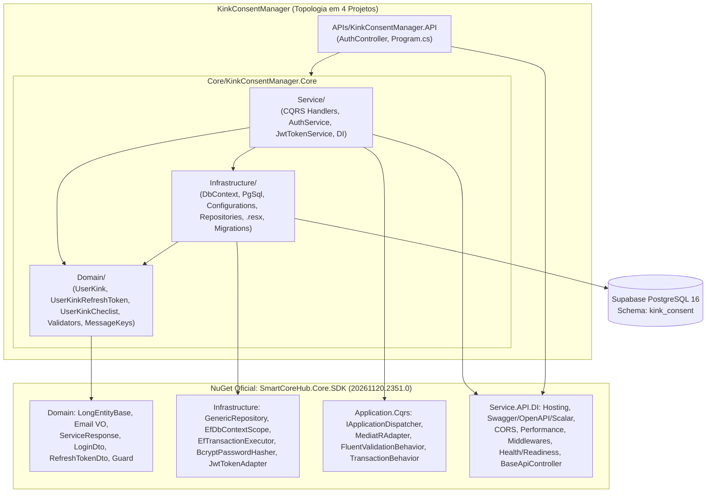

# Documento de Implementação do Backend (Arquitetura `SmartCoreHub\backend` + `SmartCoreHub.Core.SDK` + Supabase EF Core)

**Projeto:** KinkConsentManager  
**Documento:** Especificação Técnica Completa da Arquitetura, Padrões, Código de Referência, Contratos e Setup do Backend  
**Arquitetura Espelho:** `C:\git\SmartCoreHub\backend` (`APIs/` + `Core/` em 4 projetos + `build/` + CPM)  
**SDK Central Reaproveitado:** [`SmartCoreHub.Core.SDK`](https://www.nuget.org/packages/SmartCoreHub.Core.SDK) (`20261120.2351.0` — NuGet oficial)  
**Banco de Dados & ORM:** Supabase (PostgreSQL 16) + Entity Framework Core 9 (`Npgsql.EntityFrameworkCore.PostgreSQL` `9.0.4`)  
**Runtime Alvo:** .NET 10 (`net10.0`, SDK `10.0.300`)  
**Versão:** 2.0 (Revisão Alinhada ao `SmartCoreHub.Core.SDK`)  
**Data:** 26 de Novembro de 2026  

---

## Sumário

1. [Arquitetura Espelhada do `SmartCoreHub\backend`](#1-arquitetura-espelhada-do-smartcorehubbackend)
2. [Matriz de Reaproveitamento do NuGet `SmartCoreHub.Core.SDK`](#2-matriz-de-reaproveitamento-do-nuget-smartcorehubcoresdk)
3. [Stack Homologada e Central Package Management (CPM)](#3-stack-homologada-e-central-package-management-cpm)
4. [Camada Domain (`KinkConsentManager.Domain`)](#4-camada-domain-kinkconsentmanagerdomain)
5. [Segurança Criptográfica e Autenticação JWT (`SmartCoreHub` Standard)](#5-segurança-criptográfica-e-autenticação-jwt-smartcorehub-standard)
6. [Camada Infrastructure (`KinkConsentManager.Infrastructure`) — Supabase, EF Core, Migrations e `jsonb`](#6-camada-infrastructure-kinkconsentmanagerinfrastructure--supabase-ef-core-migrations-e-jsonb)
7. [Camada Service (`KinkConsentManager.Service`) — CQRS, Regras e Composição DI](#7-camada-service-kinkconsentmanagerservice--cqrs-regras-e-composição-di)
8. [Camada API (`KinkConsentManager.API`) — `Program.cs`, Controllers e `appsettings`](#8-camada-api-kinkconsentmanagerapi--programcs-controllers-e-appsettings)
9. [Estratégia de Testes (`*.Tests`) e Playbook CLI de Implantação](#9-estratégia-de-testes-tests-e-playbook-cli-de-implantação)

---

## 1. Arquitetura Espelhada do `SmartCoreHub\backend` (Topologia Unificada em 4 Projetos)

O backend do **KinkConsentManager** replica fielmente os padrões lógicos, contratos, segurança, CQRS e CPM de `C:\git\SmartCoreHub\backend`, consolidando as camadas de negócio em um único **`KinkConsentManager.Core`** dividido por pastas (`Domain/`, `Infrastructure/`, `Service/`) — totalizando **4 projetos** na solution — onde a pasta `Core/` abriga exclusivamente o código do produto (`KinkConsentManager.Core`), sem duplicar o **`SmartCoreHub.Core.SDK`** (`20261120.2351.0`), consumido diretamente via NuGet para todas as primitivas genéricas, abstrações, adapters e infraestrutura transversal.

```text
backend/
├── global.json                                           # Pinagem do .NET SDK (10.0.300, rollForward: latestFeature)
├── Directory.Build.props                                 # TargetFramework=net10.0, LangVersion=latest, Nullable, ImplicitUsings, TreatWarningsAsErrors, Import TestAssertions
├── Directory.Packages.props                              # Central Package Management (CPM) alinhado ao SmartCoreHub
├── KinkConsentManager.sln                                # Solution unificada (4 projetos)
├── build/
│   └── TestAssertions.props                              # Switch único para AwesomeAssertions + Coverlet MSBuild nos projetos *.Tests
├── APIs/
│   ├── KinkConsentManager.API/                           # Host ASP.NET Core 10, Program.cs, Controllers/V1/AuthController.cs, appsettings*.json
│   └── KinkConsentManager.API.Tests/                     # Testes unitários de controllers e integração HTTP (CustomWebApplicationFactory + EF Core InMemory)
└── Core/
    ├── KinkConsentManager.Core/                       # Projeto único da aplicação separado por pastas arquiteturais:
    │   ├── Domain/                                       # Entidades (LongEntityBase), DTOs, MessageKeys, Validators, Contratos
    │   ├── Infrastructure/                               # DbContext, PostgreSql, DbScope, Configurations, Repositories, .resx, Migrations/PostgreSql
    │   └── Service/                                      # Services, CQRS Handlers, JwtTokenService, ValidationMessageService, Composição DI
    └── KinkConsentManager.Core.Tests/                 # Testes NUnit + AwesomeAssertions + Moq + Bogus (Domain/Validators, Infrastructure, Service)
```

### 1.1 Diagrama de Camadas e Integração com `SmartCoreHub.Core.SDK`



### 1.2 Convenções de Idioma e Qualidade (Alinhadas ao `SmartCoreHub` e `KinkConsentManager`)
- **Código e identificadores C#:** estritamente em **inglês** (`UserKink`, `AuthenticationService`, `RegisterUserKinkCommand`).
- **Comentários e XML-docs:** em **português** (com documentação bilíngue PT-BR/EN nos endpoints públicos de Controllers, seguindo `AuthController.cs` do `SmartCoreHub`). Nos testes unitários, usar comentários `// Cenário:` e `// Objetivo:`.
- **Mensagens runtime da API:** em **inglês** (`ServiceResponse.Message`, `ErrorResponse.Description`, logs), acompanhadas de **`MessageKey` canônicas** para tradução client-side no Angular (`pt-BR` / `en-US`).
- **Regra de Enums (`R-ARCH-ENUM-NUMERIC`):** enums são sempre serializados como inteiros (`0, 1, 2...`) pelo `System.Text.Json`.

---

## 2. Matriz de Reaproveitamento do NuGet `SmartCoreHub.Core.SDK`

**Regra de Ouro:** É **proibido** reescrever no projeto `KinkConsentManager` qualquer classe ou contrato que já exista pronto no `SmartCoreHub.Core.SDK`.

### 2.1 Tipos Consumidos Diretamente do `SmartCoreHub.Core.SDK`

| Área | Namespace no SDK | Tipos / Métodos Reaproveitados | Papel no `KinkConsentManager` |
| :--- | :--- | :--- | :--- |
| **Entidade Base** | `SmartCoreHub.Core.SDK.Domain.Entities.Common` | `LongEntityBase` (`long Id`, `CreatedAt`, `UpdatedAt`, `IsActive`, `UpdateTimestamp()`, `Activate()`, `Deactivate()`) | Classe base de `UserKink`, `UserKinkRefreshToken` e `UserKinkCheclist`. Obrigatória para compatibilidade com `IGenericRepository<T>` e `JwtAccessTokenService`. |
| **Value Objects** | `SmartCoreHub.Core.SDK.Domain.ValueObjects` | `Email` | Validação regex com timeout 250ms (anti-ReDoS), normalização automática para minúsculas e conversão implícita/explícita. |
| **Envelopes & DTOs** | `SmartCoreHub.Core.SDK.Domain.DTOs.Common` | `ServiceResponse<T>`, `ErrorResponse`, `ErrorCodeType`, `PaginationResponse`, `LoginDto`, `RefreshTokenDto`, `PasswordVerificationInput` | Contrato único de resposta HTTP e DTOs de entrada de login, refresh e verificação de senha. |
| **Config Token** | `SmartCoreHub.Core.SDK.Domain.DTOs.Entities` | `ITokenConfigurationDto`, `TokenConfigurationDto` | Binding da seção `TokenConfigurations` do `appsettings.json`. |
| **Guards & Claims** | `SmartCoreHub.Core.SDK.Domain.Validation` / `.Helpers` | `Guard`, `UserClaimsHelper` (`TryGetUserId`, `GetEmailOrEmpty`, `GetActorDisplayNameOrEmpty`) | Validação defensiva e extração segura de claims do JWT no controller/serviço. |
| **Hashing de Senha** | `SmartCoreHub.Core.SDK.Infrastructure.Helpers.Security` | `IPasswordHasher`, `BcryptPasswordHasher`, `PasswordHasherFactory`, `PasswordAlgorithm.Bcrypt` | Hashing BCrypt com salt embutido e verificação *timing-safe*. |
| **JWT Adapter & Service** | `SmartCoreHub.Core.SDK.Infrastructure.Security` / `Service.Security` | `ISecurityTokenAdapterFactory`, `SecurityTokenAdapterFactory`, `IJwtAccessTokenService`, `JwtAccessTokenService` (`BuildStandardAccessClaims`) | Geração de AccessToken assinado em `HS512` e validação de token. |
| **Helpers de Token** | `SmartCoreHub.Core.SDK.Service.Services.ApiKey` | `TokenHelper` (`ComputeHash`, `FixedTimeEquals`) | Auxiliar criptográfico e comparação em tempo constante. |
| **EF Core & Escopo** | `SmartCoreHub.Core.SDK.EntityFrameworkCore[.Repositories]` / `Infrastructure.Data[.DependencyInjection]` | `GenericRepository<T, TContext>`, `IGenericRepository<T>`, `IEfDbContextScope<T>`, `EfDbContextScope<T>`, `EfTransactionExecutor`, `AddConfiguredDbContext<TBase, TImpl>`, `EfMigrationsHistoryHelper`, `DesignTimeDatabaseBootstrap`, `DatabaseProviderNameHelper` | Repositórios genéricos, Unit of Work/Transações EF, registro de `DbContext` tipado para PostgreSQL e bootstrap de design-time. |
| **CQRS & Pipeline** | `SmartCoreHub.Core.SDK.Application.Cqrs.*` / `.Transactions` | `IApplicationDispatcher`, `ICommand<T>`, `IQuery<T>`, `ICommandHandler<,>`, `IQueryHandler<,>`, `IHasValidationPayload<T>`, `ITransactionalCommand`, `AddSmartCoreHubMediatRAdapter`, `ServiceResponseFactory` | Pipeline automático `UnhandledException → Logging → Performance → FluentValidationBehavior → TransactionBehavior → Handler`. |
| **Validação & Mapeamento** | `SmartCoreHub.Core.SDK.Service.Validation` / `.Infrastructure.Mapping` | `FluentValidationErrorMappingHelper`, `ValidationErrorMapperHelper`, `ISmartCoreHubMapper`, `AddSdkAutoMapper`, `IAppLogger`, `SerilogAdapter`, `AddSerilogAppLogger` | Mapeamento de erros FluentValidation com localização opcional, AutoMapper e logging desacoplado. |
| **Localização & Resources** | `SmartCoreHub.Core.SDK.Domain.Interfaces.Localization` / `Infrastructure.Localization.*` / `Infrastructure.Filters` / `Infrastructure.DependencyInjection` | `IFunctionalMessageProvider`, `ResxFunctionalMessageProvider`, `CompositeFunctionalMessageProvider`, `FunctionalMessageTextResolver`, `AddSmartCoreHubFunctionalMessages`, `FunctionalMessageResultFilter`, `IErrorGetLocalizationService`, `LocalizationHeaderCultureMiddleware`, `.resx` embutidos (`Validation`, `Password`, `Authentication`, `Common`) | Negociação de cultura HTTP (`?culture=`, `X-Locale`, `Accept-Language`), resolução multi-idioma dos erros de validação/API e reaproveitamento dos catálogos `.resx` nativos do SDK. |
| **DI & Hosting ASP.NET** | `SmartCoreHub.Core.SDK.Service.API.DI.*` | `AddAspNetCoreApiBasics`, `AddSdkCorePrimitives`, `AddApplicationInsightsIfConfigured`, `AddApiPerformance`, `AddForwardedHeadersFromConfiguration`, `AddFileSystemDataProtection`, `AddCustomSwagger`, `AddCustomOpenApi`, `AddCustomCors`, `AddTokenConfiguration`, `EnsureSigningSecret`, `CreateTokenValidationParameters`, `AddAuthenticatedUserPolicy`, `ValidateNoCircularDependencies` | Wiring padronizado do `WebApplicationBuilder`. |
| **Pipeline & Health** | `SmartCoreHub.Core.SDK.Service.API.DI.Hosting.Extensions` / `.Health` / `.Generic` | `UseSdkNetworkAndCrossCutting`, `UseSdkCorsAndDocumentation`, `UseSdkSecurityAndEndpoints<T>`, `InitializeDatabaseAtStartup<T>`, `UseSdkRequestLogging`, `BaseApiController`, `ApiProductBranding`, `OpenApiDocumentationOptions`, `LogAppHelper` | Middlewares (`CorrelationId`, `SecurityHeaders`, `LocalizationHeaderCulture`), Swagger/Scalar/ReDoc/RapiDoc e rotas `/health` e `/ready`. |

### 2.2 O que Permanece no Host do Produto (`KinkConsentManager`)

Seguindo exatamente a divisão oficial documentada no `README.md` do `SmartCoreHub.Core.SDK`:
- **Entidades e Mapeamentos de Domínio:** `UserKink`, `UserKinkRefreshToken`, `UserKinkCheclist` e suas `IEntityTypeConfiguration` em `kink_consent`.
- **`KinkConsentManagerDbContext` + `KinkConsentManagerDbContextPostgreSql` + `IKinkConsentManagerDbScope`:** Contexto específico do produto com `Migrations/PostgreSql`.
- **`AuthenticationExtensions` (registro do esquema `JwtBearer`):** O SDK fornece a leitura e parâmetros de `TokenConfigurations`, mas o pacote `Microsoft.AspNetCore.Authentication.JwtBearer` fica no host.
- **`JwtTokenService` (`UserKink` → claims):** Wrapper fino sobre `IJwtAccessTokenService` do SDK.
- **`AuthenticationService` e CQRS Handlers:** Regras de negócio de cadastro, login, rotação de refresh token e futuramente `UserKinkCheclist`.
- **`KinkConsentManagerDocumentationOptions.Branding` e `DatabaseExtensions`:** Branding da API e configuração `UseNpgsql` para Supabase.

---

## 3. Stack Homologada e Central Package Management (CPM)

> [!IMPORTANT]
> **Compatibilidade Crítica (EF Core 9 vs .NET 10):** O `SmartCoreHub.Core.SDK` referencia **Entity Framework Core `9.0.23`** (devido à cadeia de providers EF 9 do ecossistema SmartCoreHub). Portanto, o projeto `KinkConsentManager` **deve obrigatoriamente usar `net10.0` como TFM dos hosts/implementações com EF Core `9.0.23` e `Npgsql.EntityFrameworkCore.PostgreSQL` `9.0.4`**, exatamente como configurado no `C:\git\SmartCoreHub\backend\Directory.Packages.props`. Instalar Npgsql 10 causará conflito de downgrade NU1605/NU1107 com o SDK!

### 3.1 `backend/global.json`
```json
{
  "sdk": {
    "version": "10.0.300",
    "rollForward": "latestFeature"
  }
}
```

### 3.2 `backend/Directory.Build.props`
```xml
<Project>
  <PropertyGroup>
    <LangVersion>latest</LangVersion>
    <Nullable>enable</Nullable>
    <ImplicitUsings>enable</ImplicitUsings>
    <TargetFramework>net10.0</TargetFramework>
    <TreatWarningsAsErrors>true</TreatWarningsAsErrors>
    <EnablePackagePruning>true</EnablePackagePruning>
    <GenerateDocumentationFile>true</GenerateDocumentationFile>
    <WarningsNotAsErrors>$(WarningsNotAsErrors);NU1901;NU1902;NU1903;NU1904</WarningsNotAsErrors>
  </PropertyGroup>

  <Import Project="build\TestAssertions.props" Condition="Exists('$(MSBuildThisFileDirectory)build\TestAssertions.props')" />
</Project>
```

### 3.3 `backend/build/TestAssertions.props`
```xml
<Project>
  <PropertyGroup Condition="$(MSBuildProjectName.EndsWith('.Tests'))">
    <TestAssertionPackageId>AwesomeAssertions</TestAssertionPackageId>
    <TestAssertionLibraryNamespace>AwesomeAssertions</TestAssertionLibraryNamespace>
    <IsPackable>false</IsPackable>
    <IsTestProject>true</IsTestProject>
    <GenerateDocumentationFile>false</GenerateDocumentationFile>
    <SingleHit Condition="'$(SingleHit)' == ''">true</SingleHit>
    <IncludeTestAssembly Condition="'$(IncludeTestAssembly)' == ''">false</IncludeTestAssembly>
    <ExcludeByFile Condition="'$(ExcludeByFile)' == ''">**/Migrations/**/*.cs,**/*.Designer.cs,**/*ModelSnapshot.cs,**/*.g.cs</ExcludeByFile>
    <ExcludeByAttribute Condition="'$(ExcludeByAttribute)' == ''">Obsolete,GeneratedCodeAttribute,CompilerGeneratedAttribute,ExcludeFromCodeCoverageAttribute</ExcludeByAttribute>
    <Exclude Condition="'$(Exclude)' == ''">[*.Tests]*</Exclude>
  </PropertyGroup>

  <ItemGroup Condition="'$(TestAssertionLibraryNamespace)' != ''">
    <Using Include="$(TestAssertionLibraryNamespace)" />
    <PackageReference Include="$(TestAssertionPackageId)" />
  </ItemGroup>
</Project>
```

### 3.4 `backend/Directory.Packages.props`
```xml
<Project>
  <PropertyGroup>
    <ManagePackageVersionsCentrally>true</ManagePackageVersionsCentrally>
    <CentralPackageTransitivePinningEnabled>true</CentralPackageTransitivePinningEnabled>
  </PropertyGroup>
  <ItemGroup>
    <!-- SDK Corporativo Central -->
    <PackageVersion Include="SmartCoreHub.Core.SDK" Version="20261120.2351.0" />

    <!-- ASP.NET Core & Auth (.NET 10) -->
    <PackageVersion Include="Microsoft.AspNetCore.Authentication.JwtBearer" Version="10.0.15" />
    <PackageVersion Include="Microsoft.AspNetCore.OpenApi" Version="10.0.15" />
    <PackageVersion Include="Microsoft.AspNetCore.Mvc.Testing" Version="10.0.15" />
    <PackageVersion Include="Microsoft.AspNetCore.TestHost" Version="10.0.15" />

    <!-- EF Core 9 + PostgreSQL / Supabase (Alinhado ao SmartCoreHub.Core.SDK) -->
    <PackageVersion Include="Microsoft.EntityFrameworkCore" Version="9.0.23" />
    <PackageVersion Include="Microsoft.EntityFrameworkCore.Design" Version="9.0.23" />
    <PackageVersion Include="Microsoft.EntityFrameworkCore.InMemory" Version="9.0.23" />
    <PackageVersion Include="Microsoft.EntityFrameworkCore.Relational" Version="9.0.23" />
    <PackageVersion Include="Microsoft.EntityFrameworkCore.Tools" Version="9.0.23" />
    <PackageVersion Include="Npgsql.EntityFrameworkCore.PostgreSQL" Version="9.0.4" />

    <!-- Validação, Logging, Mapeamento & Docs -->
    <PackageVersion Include="FluentValidation" Version="12.2.0" />
    <PackageVersion Include="FluentValidation.DependencyInjectionExtensions" Version="12.2.0" />
    <PackageVersion Include="Serilog.AspNetCore" Version="10.0.0" />
    <PackageVersion Include="Serilog.Sinks.Console" Version="6.1.1" />
    <PackageVersion Include="Serilog.Sinks.File" Version="7.0.0" />
    <PackageVersion Include="Swashbuckle.AspNetCore" Version="10.3.1" />
    <PackageVersion Include="Swashbuckle.AspNetCore.Annotations" Version="10.3.1" />

    <!-- Testes & Cobertura (Padrão SmartCoreHub) -->
    <PackageVersion Include="Microsoft.NET.Test.Sdk" Version="18.12.0" />
    <PackageVersion Include="NUnit" Version="4.6.1" />
    <PackageVersion Include="NUnit3TestAdapter" Version="6.3.1" />
    <PackageVersion Include="NUnit.Analyzers" Version="4.15.0" />
    <PackageVersion Include="Moq" Version="4.21.0" />
    <PackageVersion Include="AwesomeAssertions" Version="9.6.0" />
    <PackageVersion Include="Bogus" Version="35.6.5" />
    <PackageVersion Include="coverlet.collector" Version="10.1.1" />
    <PackageVersion Include="coverlet.msbuild" Version="10.1.1" />
  </ItemGroup>
</Project>
```

---

## 4. Camada Domain (`KinkConsentManager.Domain`)

### 4.1 Por que `LongEntityBase` em vez de `Guid`?
No `SmartCoreHub.Core.SDK`, tanto `IGenericRepository<T>` quanto `GenericRepository<TEntity, TContext>`, além de `JwtAccessTokenService.BuildStandardAccessClaims(long userId, string name, string email)` e `TryGetUserId(string token, out long? userId)`, são tipados sobre **`LongEntityBase`** (`long Id` com identidade gerada pelo banco `ValueGeneratedOnAdd()`). Adotar `LongEntityBase` habilita 100% da camada genérica de repositórios e claims do SDK sem adaptadores artificiais.

### 4.2 Entidades de Domínio

#### `Entities/UserKink.cs` (Etapa 1)
```csharp
using SmartCoreHub.Core.SDK.Domain.Entities.Common;
using SmartCoreHub.Core.SDK.Domain.ValueObjects;

namespace KinkConsentManager.Domain.Entities;

/// <summary>
/// Entidade de usuário da plataforma KinkConsentManager (somente dados e estado de domínio).
/// </summary>
public class UserKink : LongEntityBase
{
    /// <summary>Nome ou pseudônimo de exibição do usuário.</summary>
    public string Name { get; set; } = string.Empty;

    /// <summary>Identificador único de login (preserva grafia original de exibição).</summary>
    public string Login { get; set; } = string.Empty;

    /// <summary>Login normalizado em minúsculas para unicidade e busca indexada case-insensitive no PostgreSQL.</summary>
    public string NormalizedLogin { get; set; } = string.Empty;

    /// <summary>Value Object de e-mail validado e normalizado em minúsculas pelo SmartCoreHub.Core.SDK.</summary>
    public Email Email { get; set; } = null!;

    /// <summary>Define Login e mantém NormalizedLogin sincronizado.</summary>
    public void SetLogin(string login)
    {
        Login = login.Trim();
        NormalizedLogin = Login.ToLowerInvariant();
    }

    /// <summary>Hash criptográfico BCrypt da senha do usuário (com salt embutido).</summary>
    public string PasswordHash { get; set; } = string.Empty;

    /// <summary>Data e hora (UTC) do último login bem-sucedido.</summary>
    public DateTime? LastLoginAt { get; set; }

    // Navegações
    /// <summary>Coleção de refresh tokens emitidos para as sessões do usuário.</summary>
    public virtual ICollection<UserKinkRefreshToken> RefreshTokens { get; set; } = new List<UserKinkRefreshToken>();

    /// <summary>Relatório de respostas do checklist sincronizado na nuvem (Etapa 2).</summary>
    public virtual UserKinkCheclist? Checklist { get; set; }
}
```

#### `Entities/UserKinkRefreshToken.cs` (Etapa 1)
```csharp
using SmartCoreHub.Core.SDK.Domain.Entities.Common;

namespace KinkConsentManager.Domain.Entities;

/// <summary>
/// Persiste o hash SHA-256 do refresh token emitido para suportar rotação e detecção de reúso.
/// </summary>
public class UserKinkRefreshToken : LongEntityBase
{
    /// <summary>Identificador do usuário proprietário da sessão.</summary>
    public long UserKinkId { get; set; }

    /// <summary>Hash SHA-256 (hexadecimal/Base64) do refresh token; o segredo bruto nunca é salvo.</summary>
    public string TokenHash { get; set; } = string.Empty;

    /// <summary>Data e hora (UTC) de expiração do token.</summary>
    public DateTime ExpiresAtUtc { get; set; }

    /// <summary>Data e hora (UTC) da revogação manual ou por rotação.</summary>
    public DateTime? RevokedAtUtc { get; set; }

    /// <summary>Hash do token substituto gerado durante a rotação (auditoria e Reuse Detection).</summary>
    public string? ReplacedByTokenHash { get; set; }

    /// <summary>IP de origem que solicitou a emissão do token (opcional).</summary>
    public string? CreatedByIp { get; set; }

    /// <summary>Indica se o token permanece válido para renovação.</summary>
    public bool IsValidForRefresh(DateTime utcNow) =>
        IsActive && RevokedAtUtc == null && ExpiresAtUtc > utcNow;

    /// <summary>Usuário proprietário do token.</summary>
    public virtual UserKink UserKink { get; set; } = null!;
}
```

#### `Entities/UserKinkCheclist.cs` (Preparada para Etapa 2 — Schema `jsonb`)
```csharp
using SmartCoreHub.Core.SDK.Domain.Entities.Common;

namespace KinkConsentManager.Domain.Entities;

/// <summary>
/// Armazena o rascunho/relatório de respostas do checklist do usuário em formato jsonb no Supabase.
/// </summary>
public class UserKinkCheclist : LongEntityBase
{
    /// <summary>Identificador do usuário proprietário (1:1 na V2).</summary>
    public long UserKinkId { get; set; }

    /// <summary>Versão do schema estrutural do checklist (ex.: "1.0.0").</summary>
    public string SchemaVersion { get; set; } = "1.0.0";

    /// <summary>Idioma preferido do rascunho ("pt-BR" ou "en-US").</summary>
    public string Language { get; set; } = "pt-BR";

    /// <summary>Payload JSON das respostas (mapeado como coluna nativa jsonb no PostgreSQL).</summary>
    public string AnswersJson { get; set; } = "{}";

    /// <summary>Timestamp UTC da última modificação no cliente.</summary>
    public DateTime ClientUpdatedAtUtc { get; set; } = DateTime.UtcNow;

    /// <summary>Versão incremental para controle de concorrência otimista.</summary>
    public int Version { get; set; } = 1;

    /// <summary>Usuário proprietário do relatório.</summary>
    public virtual UserKink UserKink { get; set; } = null!;
}
```

### 4.3 DTOs e `MessageKeys`

> Os DTOs **`LoginDto`** (`LoginOrEmail`, `Password`), **`RefreshTokenDto`** (`Token`), **`PasswordVerificationInput`** (`Password`, `Hash`) e **`ServiceResponse<T>`** vêm diretamente de `SmartCoreHub.Core.SDK.Domain.DTOs.Common`.

```csharp
namespace KinkConsentManager.Domain.DTOs.Authentication;

/// <summary>Dados de entrada para cadastro de novo usuário.</summary>
public sealed record RegisterUserKinkRequestDto(
    string Name,
    string Login,
    string Email,
    string Password,
    string ConfirmPassword
);

/// <summary>Dados públicos resumidos do usuário autenticado.</summary>
public sealed record UserKinkDto(
    long Id,
    string Name,
    string Login,
    string Email,
    bool IsActive,
    DateTime CreatedAt,
    DateTime? LastLoginAt
);

/// <summary>Resposta da autenticação contendo AccessToken JWT, RefreshToken e perfil.</summary>
public sealed record LoginResponseDto(
    string AccessToken,
    string RefreshToken,
    DateTime ExpiresAtUtc,
    DateTime RefreshTokenExpiresAtUtc,
    UserKinkDto User,
    string TokenType = "Bearer"
);

/// <summary>Requisição de encerramento de sessão.</summary>
public sealed record LogoutRequestDto(
    string? RefreshToken,
    bool RevokeAllSessions = false
);
```

### 4.4 Internacionalização Centralizada e Validadores Desacoplados (`IValidationMessageService` + `FluentValidation`)

> [!IMPORTANT]
> **Regra Obrigatória para TODOS os Validadores:** Nenhum validador (`PasswordValidator`, `RegisterUserKinkRequestValidator`, `LoginDtoValidator`, `RefreshTokenDtoValidator`, `PasswordVerificationInputValidator` ou futuros validadores) pode conter mensagens de erro acopladas a um idioma fixo ou depender de `ResourceManager`/`HttpContext`. Todos devem injetar **`IValidationMessageService`**, utilizar **avaliação dinâmica por requisição** via lambda (`.WithMessage(_ => _messages.GetMessage(...))`), código estável (`.WithErrorCode(...)`) e chave semântica (`.WithMessageKey(...)`).

#### Por que usar `.WithMessage(_ => _messages.GetMessage(...))` (Lazy) em vez de `.WithMessage(_messages.GetMessage(...))` (Eager)?
O FluentValidation permite registrar validadores como *Scoped* ou *Singleton*; além disso, uma regra declarada com `string` direta no construtor avalia o texto apenas no instante da construção. Ao passar uma **expressão lambda (`_ => ...`)**, o texto é resolvido dinamicamente no momento da validação usando o `CultureInfo.CurrentUICulture` já definido pelo `LocalizationHeaderCultureMiddleware` do `SmartCoreHub.Core.SDK` para a requisição HTTP corrente.

#### 1) Contrato Desacoplado no Domínio (`Interfaces/Localization/IValidationMessageService.cs`)
```csharp
using System.Globalization;

namespace KinkConsentManager.Domain.Interfaces.Localization;

/// <summary>
/// Contrato centralizado de resolução multi-idioma e recursos para validadores de domínio.
/// Mantém o Domain desacoplado de ResourceManager, arquivos .resx e HttpContext.
/// </summary>
public interface IValidationMessageService
{
    /// <summary>Obtém a mensagem localizada para a cultura atual da requisição ou retorna o fallback.</summary>
    string GetMessage(string messageKey, string fallbackMessage, params object[] args);

    /// <summary>Obtém a mensagem localizada para a cultura explicitamente informada ou retorna o fallback.</summary>
    string GetMessage(string messageKey, string fallbackMessage, CultureInfo? culture, params object[] args);
}

/// <summary>Implementação neutra (Null Object) útil em testes unitários puramente estruturais.</summary>
public sealed class NullValidationMessageService : IValidationMessageService
{
    public static readonly NullValidationMessageService Instance = new();

    public string GetMessage(string messageKey, string fallbackMessage, params object[] args) =>
        args.Length > 0 ? string.Format(CultureInfo.InvariantCulture, fallbackMessage, args) : fallbackMessage;

    public string GetMessage(string messageKey, string fallbackMessage, CultureInfo? culture, params object[] args) =>
        GetMessage(messageKey, fallbackMessage, args);
}
```

#### 2) Chaves Centralizadas (`Localization/MessageKeys/ValidationMessageKeys.cs`)
Reaproveita as chaves `.resx` já embutidas no `SmartCoreHub.Core.SDK` (`SmartCoreHub.Core.SDK.Validation.*`) e define as chaves específicas do produto (`KinkConsentManager`):

```csharp
namespace KinkConsentManager.Domain.Localization.MessageKeys;

/// <summary>
/// Catálogo único de chaves canônicas para todos os validadores do domínio.
/// Chaves iniciadas por 'SmartCoreHub.Core.SDK.' usam diretamente os recursos nativos do SDK.
/// </summary>
public static class ValidationMessageKeys
{
    // Chaves nativas já traduzidas em en / pt-BR / es-ES dentro do SmartCoreHub.Core.SDK
    public const string RequiredField = "SmartCoreHub.Core.SDK.Validation.RequiredField";
    public const string InvalidEmail = "SmartCoreHub.Core.SDK.Validation.InvalidEmail";
    public const string MinimumLength = "SmartCoreHub.Core.SDK.Validation.MinimumLength";
    public const string MaximumLength = "SmartCoreHub.Core.SDK.Validation.MaximumLength";
    public const string PasswordsDoNotMatch = "SmartCoreHub.Core.SDK.Validation.PasswordsDoNotMatch";
    public const string InvalidFormat = "SmartCoreHub.Core.SDK.Validation.InvalidFormat";
    public const string Failed = "SmartCoreHub.Core.SDK.Validation.Failed";

    // Chaves específicas de regras do produto (KinkConsentManager.Infrastructure/Localization/Resources/ValidationMessages*.resx)
    public const string PasswordNoWhitespace = "Validation.Password.NoWhitespace";
    public const string PasswordUppercaseRequired = "Validation.Password.UppercaseRequired";
    public const string PasswordLowercaseRequired = "Validation.Password.LowercaseRequired";
    public const string PasswordDigitRequired = "Validation.Password.DigitRequired";
    public const string PasswordSpecialCharRequired = "Validation.Password.SpecialCharRequired";
    public const string LoginInvalidCharacters = "Validation.Login.InvalidCharacters";
    public const string RefreshTokenInvalid = "Validation.RefreshToken.Invalid";
    public const string ReportInvalidJson = "Validation.Report.InvalidJson";
}
```

#### 3) Extensão `WithMessageKey` (`Validators/Extensions/FluentValidationLocalizationExtensions.cs`)
Espelhada diretamente de `SmartCoreHub.Domain.Validators.Extensions` para interoperar com `FunctionalMessageTextResolver.TryReadMessageKey` dentro do `FluentValidationErrorMappingHelper` do SDK:

```csharp
using FluentValidation;

namespace KinkConsentManager.Domain.Validators.Extensions;

public static class FluentValidationLocalizationExtensions
{
    public static IRuleBuilderOptions<T, TProperty> WithMessageKey<T, TProperty>(
        this IRuleBuilderOptions<T, TProperty> rule,
        string messageKey)
    {
        return rule.WithState(_ => new FunctionalMessageKeyState(messageKey));
    }
}

public sealed class FunctionalMessageKeyState
{
    public FunctionalMessageKeyState(string messageKey, object? payload = null)
    {
        MessageKey = messageKey;
        Payload = payload;
    }

    public string MessageKey { get; }
    public object? Payload { get; }
}
```

#### 4) Todos os Validadores Consumindo `IValidationMessageService`
```csharp
using FluentValidation;
using KinkConsentManager.Domain.DTOs.Authentication;
using KinkConsentManager.Domain.Interfaces.Localization;
using KinkConsentManager.Domain.Localization.MessageKeys;
using KinkConsentManager.Domain.Validators.Extensions;
using SmartCoreHub.Core.SDK.Domain.DTOs.Common;

namespace KinkConsentManager.Domain.Validators.Authentication;

/// <summary>
/// Validador centralizado de complexidade de senha com suporte a resources e múltiplos idiomas via IValidationMessageService.
/// </summary>
public sealed class PasswordValidator : AbstractValidator<string>
{
    public PasswordValidator(IValidationMessageService messages)
    {
        ArgumentNullException.ThrowIfNull(messages);

        RuleFor(x => x)
            .NotEmpty()
                .WithMessage(_ => messages.GetMessage(ValidationMessageKeys.RequiredField, "{PropertyName} is required.", "Password"))
                .WithErrorCode("KinkConsentManager.Domain.PasswordValidator.Rule1")
                .WithMessageKey(ValidationMessageKeys.RequiredField)
            .MinimumLength(8)
                .WithMessage(_ => messages.GetMessage(ValidationMessageKeys.MinimumLength, "{PropertyName} must be at least {MinLength} characters.", "Password", 8))
                .WithErrorCode("KinkConsentManager.Domain.PasswordValidator.Rule2")
                .WithMessageKey(ValidationMessageKeys.MinimumLength)
            .MaximumLength(100)
                .WithMessage(_ => messages.GetMessage(ValidationMessageKeys.MaximumLength, "{PropertyName} must not exceed {MaxLength} characters.", "Password", 100))
                .WithErrorCode("KinkConsentManager.Domain.PasswordValidator.Rule3")
                .WithMessageKey(ValidationMessageKeys.MaximumLength)
            .Must(p => !p.Any(char.IsWhiteSpace))
                .WithMessage(_ => messages.GetMessage(ValidationMessageKeys.PasswordNoWhitespace, "Password cannot contain whitespace."))
                .WithErrorCode("KinkConsentManager.Domain.PasswordValidator.Rule4")
                .WithMessageKey(ValidationMessageKeys.PasswordNoWhitespace)
            .Matches(@"[A-Z]")
                .WithMessage(_ => messages.GetMessage(ValidationMessageKeys.PasswordUppercaseRequired, "Password must contain at least one uppercase letter."))
                .WithErrorCode("KinkConsentManager.Domain.PasswordValidator.Rule5")
                .WithMessageKey(ValidationMessageKeys.PasswordUppercaseRequired)
            .Matches(@"[a-z]")
                .WithMessage(_ => messages.GetMessage(ValidationMessageKeys.PasswordLowercaseRequired, "Password must contain at least one lowercase letter."))
                .WithErrorCode("KinkConsentManager.Domain.PasswordValidator.Rule6")
                .WithMessageKey(ValidationMessageKeys.PasswordLowercaseRequired)
            .Matches(@"[0-9]")
                .WithMessage(_ => messages.GetMessage(ValidationMessageKeys.PasswordDigitRequired, "Password must contain at least one number."))
                .WithErrorCode("KinkConsentManager.Domain.PasswordValidator.Rule7")
                .WithMessageKey(ValidationMessageKeys.PasswordDigitRequired)
            .Matches(@"[!@#$%^&*()_+\-=\[\]{}|;':"",.<>?/]")
                .WithMessage(_ => messages.GetMessage(ValidationMessageKeys.PasswordSpecialCharRequired, "Password must contain at least one special character."))
                .WithErrorCode("KinkConsentManager.Domain.PasswordValidator.Rule8")
                .WithMessageKey(ValidationMessageKeys.PasswordSpecialCharRequired);
    }
}

public sealed class RegisterUserKinkRequestValidator : AbstractValidator<RegisterUserKinkRequestDto>
{
    public RegisterUserKinkRequestValidator(IValidator<string> passwordValidator, IValidationMessageService messages)
    {
        ArgumentNullException.ThrowIfNull(passwordValidator);
        ArgumentNullException.ThrowIfNull(messages);

        RuleFor(x => x.Name)
            .NotEmpty()
                .WithMessage(_ => messages.GetMessage(ValidationMessageKeys.RequiredField, "{PropertyName} is required.", "Name"))
                .WithErrorCode("KinkConsentManager.Domain.RegisterUserValidator.NameRequired")
                .WithMessageKey(ValidationMessageKeys.RequiredField)
            .MinimumLength(3)
                .WithMessage(_ => messages.GetMessage(ValidationMessageKeys.MinimumLength, "{PropertyName} must be at least {MinLength} characters.", "Name", 3))
                .WithErrorCode("KinkConsentManager.Domain.RegisterUserValidator.NameMin")
                .WithMessageKey(ValidationMessageKeys.MinimumLength)
            .MaximumLength(100)
                .WithMessage(_ => messages.GetMessage(ValidationMessageKeys.MaximumLength, "{PropertyName} must not exceed {MaxLength} characters.", "Name", 100))
                .WithErrorCode("KinkConsentManager.Domain.RegisterUserValidator.NameMax")
                .WithMessageKey(ValidationMessageKeys.MaximumLength);

        RuleFor(x => x.Login)
            .NotEmpty()
                .WithMessage(_ => messages.GetMessage(ValidationMessageKeys.RequiredField, "{PropertyName} is required.", "Login"))
                .WithErrorCode("KinkConsentManager.Domain.RegisterUserValidator.LoginRequired")
                .WithMessageKey(ValidationMessageKeys.RequiredField)
            .MinimumLength(3)
                .WithMessage(_ => messages.GetMessage(ValidationMessageKeys.MinimumLength, "{PropertyName} must be at least {MinLength} characters.", "Login", 3))
                .WithErrorCode("KinkConsentManager.Domain.RegisterUserValidator.LoginMin")
                .WithMessageKey(ValidationMessageKeys.MinimumLength)
            .MaximumLength(50)
                .WithMessage(_ => messages.GetMessage(ValidationMessageKeys.MaximumLength, "{PropertyName} must not exceed {MaxLength} characters.", "Login", 50))
                .WithErrorCode("KinkConsentManager.Domain.RegisterUserValidator.LoginMax")
                .WithMessageKey(ValidationMessageKeys.MaximumLength)
            .Matches(@"^[a-zA-Z0-9_-]+$")
                .WithMessage(_ => messages.GetMessage(ValidationMessageKeys.LoginInvalidCharacters, "Login must contain only alphanumeric characters, underscores or hyphens."))
                .WithErrorCode("KinkConsentManager.Domain.RegisterUserValidator.LoginChars")
                .WithMessageKey(ValidationMessageKeys.LoginInvalidCharacters);

        RuleFor(x => x.Email)
            .NotEmpty()
                .WithMessage(_ => messages.GetMessage(ValidationMessageKeys.RequiredField, "{PropertyName} is required.", "Email"))
                .WithErrorCode("KinkConsentManager.Domain.RegisterUserValidator.EmailRequired")
                .WithMessageKey(ValidationMessageKeys.RequiredField)
            .EmailAddress()
                .WithMessage(_ => messages.GetMessage(ValidationMessageKeys.InvalidEmail, "{PropertyName} is not a valid email address.", "Email"))
                .WithErrorCode("KinkConsentManager.Domain.RegisterUserValidator.EmailInvalid")
                .WithMessageKey(ValidationMessageKeys.InvalidEmail)
            .MaximumLength(191)
                .WithMessage(_ => messages.GetMessage(ValidationMessageKeys.MaximumLength, "{PropertyName} must not exceed {MaxLength} characters.", "Email", 191))
                .WithErrorCode("KinkConsentManager.Domain.RegisterUserValidator.EmailMax")
                .WithMessageKey(ValidationMessageKeys.MaximumLength);

        RuleFor(x => x.Password).SetValidator(passwordValidator);

        RuleFor(x => x.ConfirmPassword)
            .Equal(x => x.Password)
                .WithMessage(_ => messages.GetMessage(ValidationMessageKeys.PasswordsDoNotMatch, "The passwords do not match."))
                .WithErrorCode("KinkConsentManager.Domain.RegisterUserValidator.PasswordMatch")
                .WithMessageKey(ValidationMessageKeys.PasswordsDoNotMatch);
    }
}

public sealed class LoginDtoValidator : AbstractValidator<LoginDto>
{
    public LoginDtoValidator(IValidationMessageService messages)
    {
        ArgumentNullException.ThrowIfNull(messages);

        RuleFor(x => x.LoginOrEmail)
            .NotEmpty()
                .WithMessage(_ => messages.GetMessage(ValidationMessageKeys.RequiredField, "{PropertyName} is required.", "LoginOrEmail"))
                .WithErrorCode("KinkConsentManager.Domain.LoginValidator.LoginOrEmailRequired")
                .WithMessageKey(ValidationMessageKeys.RequiredField)
            .MaximumLength(191)
                .WithMessage(_ => messages.GetMessage(ValidationMessageKeys.MaximumLength, "{PropertyName} must not exceed {MaxLength} characters.", "LoginOrEmail", 191))
                .WithErrorCode("KinkConsentManager.Domain.LoginValidator.LoginOrEmailMax")
                .WithMessageKey(ValidationMessageKeys.MaximumLength);

        RuleFor(x => x.Password)
            .NotEmpty()
                .WithMessage(_ => messages.GetMessage(ValidationMessageKeys.RequiredField, "{PropertyName} is required.", "Password"))
                .WithErrorCode("KinkConsentManager.Domain.LoginValidator.PasswordRequired")
                .WithMessageKey(ValidationMessageKeys.RequiredField)
            .MaximumLength(100)
                .WithMessage(_ => messages.GetMessage(ValidationMessageKeys.MaximumLength, "{PropertyName} must not exceed {MaxLength} characters.", "Password", 100))
                .WithErrorCode("KinkConsentManager.Domain.LoginValidator.PasswordMax")
                .WithMessageKey(ValidationMessageKeys.MaximumLength);
    }
}

public sealed class RefreshTokenDtoValidator : AbstractValidator<RefreshTokenDto>
{
    public RefreshTokenDtoValidator(IValidationMessageService messages)
    {
        ArgumentNullException.ThrowIfNull(messages);

        RuleFor(x => x.Token)
            .NotEmpty()
                .WithMessage(_ => messages.GetMessage(ValidationMessageKeys.RequiredField, "{PropertyName} is required.", "RefreshToken"))
                .WithErrorCode("KinkConsentManager.Domain.RefreshTokenValidator.Required")
                .WithMessageKey(ValidationMessageKeys.RequiredField)
            .MaximumLength(512)
                .WithMessage(_ => messages.GetMessage(ValidationMessageKeys.RefreshTokenInvalid, "Refresh token is invalid."))
                .WithErrorCode("KinkConsentManager.Domain.RefreshTokenValidator.Max")
                .WithMessageKey(ValidationMessageKeys.RefreshTokenInvalid);
    }
}

public sealed class PasswordVerificationInputValidator : AbstractValidator<PasswordVerificationInput>
{
    public PasswordVerificationInputValidator(IValidationMessageService messages)
    {
        ArgumentNullException.ThrowIfNull(messages);

        RuleFor(x => x.Password)
            .NotEmpty()
                .WithMessage(_ => messages.GetMessage(ValidationMessageKeys.RequiredField, "{PropertyName} is required.", "Password"))
                .WithErrorCode("KinkConsentManager.Domain.PasswordVerificationValidator.PasswordRequired")
                .WithMessageKey(ValidationMessageKeys.RequiredField);

        RuleFor(x => x.Hash)
            .NotEmpty()
                .WithMessage(_ => messages.GetMessage(ValidationMessageKeys.RequiredField, "{PropertyName} is required.", "Hash"))
                .WithErrorCode("KinkConsentManager.Domain.PasswordVerificationValidator.HashRequired")
                .WithMessageKey(ValidationMessageKeys.RequiredField);
    }
}
```

---

## 5. Segurança Criptográfica e Autenticação JWT (`SmartCoreHub` Standard)

### 5.1 Hash de Senhas via `SmartCoreHub.Core.SDK`
Não implementamos um hasher próprio. Consumimos diretamente o `PasswordHasherFactory` do `SmartCoreHub.Core.SDK`, que instancia `BcryptPasswordHasher` sobre `BCrypt.Net-Next` (salt embutido e verificação *timing-safe*):

```csharp
var hasher = PasswordHasherFactory.GetHasher(PasswordAlgorithm.Bcrypt);

// No cadastro (RF-01):
user.PasswordHash = hasher.HashPassword(request.Password);

// No login (RF-02):
var isValid = hasher.VerifyPassword(loginDto.Password, user.PasswordHash);
```

### 5.2 Emissão e Validação de JWT com `IJwtAccessTokenService` (`HS512`)

> [!CAUTION]
> **Pitfall Crítico Verificado no Código-Fonte do `SmartCoreHub.Core.SDK`:**
> 1. A classe `JwtTokenAdapter` do SDK assina tokens usando **`SecurityAlgorithms.HmacSha512` (`HS512`)**. Isso exige que `TokenConfigurations:Secret` tenha **pelo menos 64 bytes (512 bits)**; chaves menores lançam `ArgumentOutOfRangeException` (`IDX10720`) na emissão do token.
> 2. O SDK lê a seção **`TokenConfigurations`** (`Secret`, `Issuer`, `Audience`, `Minutes`, `DaysToExpiry`) via `ConfigurationHelper.GetTokenConfigurations`, e **não** uma seção `Jwt`.

#### `KinkConsentManager.Service/Security/JwtTokenService.cs`
```csharp
using System.Security.Claims;
using System.Security.Cryptography;
using System.Text;
using KinkConsentManager.Domain.Entities;
using SmartCoreHub.Core.SDK.Service.Security;

namespace KinkConsentManager.Service.Security;

public interface IJwtTokenService
{
    string GenerateAccessToken(UserKink user);
    (string RawToken, string TokenHash) GenerateSecureRefreshToken();
    string ComputeTokenHash(string rawToken);
    bool ValidateToken(string token, out long? userId);
}

/// <summary>
/// Adapter de domínio sobre <see cref="IJwtAccessTokenService"/> do SmartCoreHub.Core.SDK.
/// </summary>
public sealed class JwtTokenService : IJwtTokenService
{
    private readonly IJwtAccessTokenService _accessTokens;

    public JwtTokenService(IJwtAccessTokenService accessTokens)
    {
        _accessTokens = accessTokens ?? throw new ArgumentNullException(nameof(accessTokens));
    }

    public string GenerateAccessToken(UserKink user)
    {
        ArgumentNullException.ThrowIfNull(user);

        // Reaproveita BuildStandardAccessClaims (jti, nameid, name, email) do SDK
        var claims = new List<Claim>(
            JwtAccessTokenService.BuildStandardAccessClaims(user.Id, user.Name, user.Email.Value))
        {
            new("login", user.Login)
        };

        return _accessTokens.GenerateAccessToken(claims);
    }

    public (string RawToken, string TokenHash) GenerateSecureRefreshToken()
    {
        // 64 bytes criptograficamente aleatórios (superior ao Guid padrão para sessão persistida)
        var bytes = RandomNumberGenerator.GetBytes(64);
        var rawToken = Convert.ToBase64String(bytes)
            .Replace('+', '-')
            .Replace('/', '_')
            .TrimEnd('=');

        return (rawToken, ComputeTokenHash(rawToken));
    }

    public string ComputeTokenHash(string rawToken)
    {
        var hashBytes = SHA256.HashData(Encoding.UTF8.GetBytes(rawToken));
        return Convert.ToHexString(hashBytes);
    }

    public bool ValidateToken(string token, out long? userId) =>
        _accessTokens.TryGetUserId(token, out userId);
}
```

### 5.3 Registro do Esquema Bearer (`AuthenticationExtensions.cs`)
Espelhando exatamente `SmartCoreHub.Service/API/DI/AuthenticationExtensions.cs`:

```csharp
using Microsoft.AspNetCore.Authentication.JwtBearer;
using Microsoft.Extensions.Configuration;
using Microsoft.Extensions.DependencyInjection;
using SmartCoreHub.Core.SDK.Service.API.DI.Security.Extensions;

namespace KinkConsentManager.Service.API.DI;

public static class AuthenticationExtensions
{
    private const string BearerPolicyName = "Bearer";

    public static IServiceCollection AddJwtAuthentication(this IServiceCollection services, IConfiguration configuration)
    {
        var tokenConfigurations = services.AddTokenConfiguration(configuration);

        // Falha cedo no startup se TokenConfigurations:Secret estiver vazio (evita IDX10703)
        TokenConfigurationServiceCollectionExtensions.EnsureSigningSecret(tokenConfigurations);

        if (Encoding.UTF8.GetByteCount(tokenConfigurations.Secret) < 64)
        {
            throw new InvalidOperationException(
                "TokenConfigurations:Secret must be at least 64 bytes (512 bits) for HS512 signing.");
        }

        services.AddAuthentication(options =>
        {
            options.DefaultAuthenticateScheme = JwtBearerDefaults.AuthenticationScheme;
            options.DefaultChallengeScheme = JwtBearerDefaults.AuthenticationScheme;
        }).AddJwtBearer(options =>
        {
            options.TokenValidationParameters =
                TokenConfigurationServiceCollectionExtensions.CreateTokenValidationParameters(tokenConfigurations);
        });

        services.AddAuthenticatedUserPolicy(BearerPolicyName, JwtBearerDefaults.AuthenticationScheme);
        return services;
    }
}
```

---

## 6. Camada Infrastructure (`KinkConsentManager.Infrastructure`) — Supabase, EF Core, Migrations e `jsonb`

### 6.1 Isolamento Mandatório de Schema (`kink_consent`)
O Supabase mantém schemas próprios internos (`auth`, `storage`, `realtime`, `vault`, `extensions`, `public`). Para blindar a aplicação contra qualquer colisão ou tentativa do EF Core de alterar objetos internos do Supabase, configuramos **dois pontos obrigatórios**:

1. **`modelBuilder.HasDefaultSchema(DefaultSchema)`** dentro do `OnModelCreating`;
2. **`x.MigrationsHistoryTable(EfMigrationsHistoryHelper.PostgreSqlTable, KinkConsentManagerDbContext.DefaultSchema)`** dentro de `UseNpgsql(...)` — garantindo que até a tabela de histórico de migrations (`__EFMigrationsHistory_PostgreSql`) seja criada dentro do schema `kink_consent`, e nunca em `public`.

```csharp
using Microsoft.EntityFrameworkCore;
using KinkConsentManager.Domain.Entities;

namespace KinkConsentManager.Infrastructure.Data;

/// <summary>
/// Contexto EF Core principal do KinkConsentManager com isolamento no schema 'kink_consent'.
/// </summary>
public class KinkConsentManagerDbContext : DbContext
{
    public const string DefaultSchema = "kink_consent";

    public KinkConsentManagerDbContext(DbContextOptions options) : base(options)
    {
    }

    public DbSet<UserKink> UserKinks => Set<UserKink>();
    public DbSet<UserKinkRefreshToken> UserKinkRefreshTokens => Set<UserKinkRefreshToken>();
    public DbSet<UserKinkCheclist> UserKinkCheclists => Set<UserKinkCheclist>();

    protected override void OnModelCreating(ModelBuilder modelBuilder)
    {
        base.OnModelCreating(modelBuilder);
        modelBuilder.HasDefaultSchema(DefaultSchema);
        modelBuilder.ApplyConfigurationsFromAssembly(typeof(KinkConsentManagerDbContext).Assembly);
    }
}

/// <summary>
/// Contexto tipado para PostgreSQL/Supabase com cadeia de migrations isolada em Migrations/PostgreSql.
/// </summary>
public sealed class KinkConsentManagerDbContextPostgreSql : KinkConsentManagerDbContext
{
    public KinkConsentManagerDbContextPostgreSql(DbContextOptions<KinkConsentManagerDbContextPostgreSql> options)
        : base(options)
    {
    }
}
```

### 6.2 Escopo DI e Design-Time Factory (Padrão `SmartCoreHub`)

Repositórios nunca injetam o `DbContext` concreto — injetam `IKinkConsentManagerDbScope`, exatamente como `ISmartCoreHubDbScope` sobre `EfDbContextScope<T>` do SDK:

```csharp
using Microsoft.EntityFrameworkCore;
using Microsoft.EntityFrameworkCore.Design;
using Microsoft.Extensions.Configuration;
using SmartCoreHub.Core.SDK.EntityFrameworkCore;
using SmartCoreHub.Core.SDK.Infrastructure.Data;

namespace KinkConsentManager.Infrastructure.Data;

public interface IKinkConsentManagerDbScope : IEfDbContextScope<KinkConsentManagerDbContext>
{
}

public sealed class KinkConsentManagerDbContextScope
    : EfDbContextScope<KinkConsentManagerDbContext>, IKinkConsentManagerDbScope
{
    public KinkConsentManagerDbContextScope(
        KinkConsentManagerDbContext context,
        IDbContextFactory<KinkConsentManagerDbContext>? factory = null,
        DbContextOptions? options = null)
        : base(context, factory, options)
    {
    }
}

/// <summary>
/// Factory design-time para criação e aplicação de migrations no PostgreSQL/Supabase.
/// </summary>
public sealed class KinkConsentManagerDbContextPostgreSqlFactory
    : IDesignTimeDbContextFactory<KinkConsentManagerDbContextPostgreSql>
{
    public KinkConsentManagerDbContextPostgreSql CreateDbContext(string[] args)
    {
        var configuration = new ConfigurationBuilder()
            .SetBasePath(Directory.GetCurrentDirectory())
            .AddJsonFile("appsettings.json", optional: true)
            .AddJsonFile("appsettings.Development.json", optional: true)
            .AddEnvironmentVariables()
            .Build();

        var connectionString = DesignTimeDatabaseBootstrap.ConnectionStringOrFallback(
            DesignTimeDatabaseBootstrap.GetConnectionString(configuration),
            "Host=127.0.0.1;Port=5432;Database=kinkconsentmanager;Username=postgres");

        var builder = new DbContextOptionsBuilder<KinkConsentManagerDbContextPostgreSql>();
        builder.UseNpgsql(connectionString, options =>
        {
            options.MigrationsAssembly(typeof(KinkConsentManagerDbContext).Assembly.GetName().Name!);
            options.MigrationsHistoryTable(
                EfMigrationsHistoryHelper.PostgreSqlTable,
                KinkConsentManagerDbContext.DefaultSchema);
        });

        return new KinkConsentManagerDbContextPostgreSql(builder.Options);
    }
}
```

### 6.3 Direct Connection vs. Session/Transaction Pooler no Supabase

| Modo de Conexão Supabase | Porta | Suporta EF Migrations (`dotnet ef`)? | Uso Recomendado |
| :--- | :---: | :---: | :--- |
| **Direct Connection** (`db.<ref>.supabase.co`) | `5432` | **SIM (Obrigatório para DDL)** | Execução de `dotnet ef database update` e ambientes com IPv6/rede direta. |
| **Session Pooler (Supavisor)** | `5432` | **SIM** | Runtime da API Web tradicional (longa duração) ou migrations em redes somente IPv4. |
| **Transaction Pooler (Supavisor)** | `6543` | **NÃO** | Apenas runtime stateless em altíssima escala; **proibido para Migrations** pois não suporta *advisory locks* nem DDL transacional do EF Core. Se usado em runtime, definir `Database:SkipInitialization = true` no startup. |

### 6.4 Mapeamentos Fluent API (`IEntityTypeConfiguration`)

#### `UserKinkConfiguration.cs`
```csharp
using KinkConsentManager.Domain.Entities;
using Microsoft.EntityFrameworkCore;
using Microsoft.EntityFrameworkCore.Metadata.Builders;
using SmartCoreHub.Core.SDK.Domain.ValueObjects;

namespace KinkConsentManager.Infrastructure.Data.Configurations;

public sealed class UserKinkConfiguration : IEntityTypeConfiguration<UserKink>
{
    public void Configure(EntityTypeBuilder<UserKink> entity)
    {
        entity.ToTable("UserKinks");
        entity.HasKey(u => u.Id);
        entity.Property(u => u.Id).ValueGeneratedOnAdd();

        entity.Property(u => u.Name).IsRequired().HasMaxLength(100);
        entity.Property(u => u.Login).IsRequired().HasMaxLength(50);
        entity.Property(u => u.NormalizedLogin).IsRequired().HasMaxLength(50);
        entity.Property(u => u.PasswordHash).IsRequired().HasMaxLength(500);
        entity.Property(u => u.CreatedAt).IsRequired();
        entity.Property(u => u.UpdatedAt).IsRequired();
        entity.Property(u => u.IsActive).IsRequired().HasDefaultValue(true);
        entity.Property(u => u.LastLoginAt).IsRequired(false);

        // Conversão do Value Object Email do SmartCoreHub.Core.SDK (sempre em minúsculas)
        entity.Property(u => u.Email)
            .HasConversion(
                email => email.Value,
                value => new Email(value))
            .IsRequired()
            .HasMaxLength(191);

        // No PostgreSQL (Supabase), colunas varchar e índices UNIQUE são case-sensitive por padrão;
        // NormalizedLogin + Email VO garantem unicidade e busca rápida B-Tree case-insensitive.
        entity.HasIndex(u => u.Email).IsUnique().HasDatabaseName("IX_UserKinks_Email");
        entity.HasIndex(u => u.NormalizedLogin).IsUnique().HasDatabaseName("IX_UserKinks_NormalizedLogin");
        entity.HasIndex(u => u.Login).IsUnique().HasDatabaseName("IX_UserKinks_Login");
        entity.HasIndex(u => u.IsActive).HasDatabaseName("IX_UserKinks_IsActive");
    }
}
```

#### `UserKinkRefreshTokenConfiguration.cs`
```csharp
using KinkConsentManager.Domain.Entities;
using Microsoft.EntityFrameworkCore;
using Microsoft.EntityFrameworkCore.Metadata.Builders;

namespace KinkConsentManager.Infrastructure.Data.Configurations;

public sealed class UserKinkRefreshTokenConfiguration : IEntityTypeConfiguration<UserKinkRefreshToken>
{
    public void Configure(EntityTypeBuilder<UserKinkRefreshToken> entity)
    {
        entity.ToTable("UserKinkRefreshTokens");
        entity.HasKey(t => t.Id);
        entity.Property(t => t.Id).ValueGeneratedOnAdd();

        entity.Property(t => t.TokenHash).IsRequired().HasMaxLength(128);
        entity.Property(t => t.ReplacedByTokenHash).IsRequired(false).HasMaxLength(128);
        entity.Property(t => t.CreatedByIp).IsRequired(false).HasMaxLength(64);
        entity.Property(t => t.ExpiresAtUtc).IsRequired();
        entity.Property(t => t.RevokedAtUtc).IsRequired(false);

        entity.HasIndex(t => t.TokenHash).IsUnique().HasDatabaseName("IX_UserKinkRefreshTokens_TokenHash");
        entity.HasIndex(t => t.UserKinkId).HasDatabaseName("IX_UserKinkRefreshTokens_UserKinkId");

        entity.HasOne(t => t.UserKink)
            .WithMany(u => u.RefreshTokens)
            .HasForeignKey(t => t.UserKinkId)
            .OnDelete(DeleteBehavior.Cascade);
    }
}
```

### 6.5 Repositórios sobre `GenericRepository<TEntity, TContext>` do SDK

```csharp
using KinkConsentManager.Infrastructure.Data;
using SmartCoreHub.Core.SDK.Domain.Entities.Common;
using SmartCoreHub.Core.SDK.Domain.Interfaces.Common;
using SmartCoreHub.Core.SDK.EntityFrameworkCore.Repositories;

namespace KinkConsentManager.Infrastructure.Repositories;

/// <summary>Binding open-generic de DI sobre o repositório genérico do Core.SDK.</summary>
public sealed class KinkConsentManagerGenericRepository<TEntity>
    : GenericRepository<TEntity, KinkConsentManagerDbContext>
    where TEntity : LongEntityBase
{
    public KinkConsentManagerGenericRepository(IKinkConsentManagerDbScope dbScope, IAppLogger logger)
        : base(dbScope, logger)
    {
    }
}

/// <summary>
/// Repositório de usuários suportando autenticação dual (Login ou Email) case-insensitive no PostgreSQL.
/// </summary>
public sealed class UserKinkRepository : GenericRepository<UserKink, KinkConsentManagerDbContext>, IUserKinkRepository
{
    public UserKinkRepository(IKinkConsentManagerDbScope dbScope, IAppLogger logger)
        : base(dbScope, logger)
    {
    }

    public Task<UserKink?> GetByLoginAsync(string login, CancellationToken cancellationToken = default)
    {
        var normalized = login.Trim().ToLowerInvariant();
        return _dbSet.FirstOrDefaultAsync(u => u.NormalizedLogin == normalized, cancellationToken);
    }

    public Task<UserKink?> GetByEmailAsync(Email email, CancellationToken cancellationToken = default) =>
        _dbSet.FirstOrDefaultAsync(u => u.Email == email, cancellationToken);

    public async Task<UserKink?> GetByLoginOrEmailAsync(string loginOrEmail, CancellationToken cancellationToken = default)
    {
        if (string.IsNullOrWhiteSpace(loginOrEmail))
            return null;

        var trimmed = loginOrEmail.Trim();

        // Como Login nunca aceita '@', a presença de '@' identifica e-mail deterministicamente.
        if (trimmed.Contains('@'))
        {
            if (!TryCreateEmail(trimmed, out var email))
                return null; // Evita exceção 500 se o usuário digitar um e-mail malformado com '@'.

            return await GetByEmailAsync(email!, cancellationToken);
        }

        return await GetByLoginAsync(trimmed, cancellationToken);
    }

    public Task<bool> LoginExistsAsync(string login, CancellationToken cancellationToken = default)
    {
        var normalized = login.Trim().ToLowerInvariant();
        return _dbSet.AnyAsync(u => u.NormalizedLogin == normalized, cancellationToken);
    }

    public Task<bool> EmailExistsAsync(Email email, CancellationToken cancellationToken = default) =>
        _dbSet.AnyAsync(u => u.Email == email, cancellationToken);

    private static bool TryCreateEmail(string candidate, out Email? email)
    {
        try
        {
            email = new Email(candidate);
            return true;
        }
        catch (ArgumentException)
        {
            email = null;
            return false;
        }
    }
}
```

### 6.6 Persistência de JSON no Supabase: Opção B (`jsonb`) vs. Opção A (Supabase Storage)

| Critério | Opção B: Coluna `jsonb` no PostgreSQL (**Adotada para Reports/Autosave**) | Opção A: Supabase Storage (`AWSSDK.S3` / `supabase-csharp`) |
| :--- | :--- | :--- |
| **Caso de Uso** | Respostas do checklist (`ChecklistDraft`), autosave frequente, payloads estruturados (10 KB – 500 KB). | Arquivos binários/baixáveis gerados (`.pdf`, `.xlsx`, `.png`, ou backups `.json` arquivados). |
| **Atomicidade** | Transação ACID junto ao `UserKinkId`, `Version` e `UpdatedAt`. | Consistência eventual (banco separado do bucket S3). |
| **Latência** | Baixa (1 round-trip SQL com `UseNpgsql`). | Maior (upload HTTP multipart + assinatura de URL). |
| **Consultabilidade** | Suporta consultas LINQ/JSONPath e índices GIN (`HasIndex(...).HasMethod("gin")`). | Nenhuma (apenas leitura/download opaco de objeto). |

#### Configuração da Entidade `UserKinkCheclist` para Etapa 2 (`UserKinkCheclistConfiguration.cs`)
```csharp
entity.ToTable("UserKinkCheclists");
entity.HasKey(r => r.Id);
entity.Property(r => r.AnswersJson).HasColumnType("jsonb").IsRequired();
entity.Property(r => r.SchemaVersion).HasMaxLength(20).IsRequired();
entity.Property(r => r.Language).HasMaxLength(10).IsRequired();
entity.Property(r => r.Version).IsConcurrencyToken().HasDefaultValue(1);
entity.HasIndex(r => r.UserKinkId).IsUnique().HasDatabaseName("IX_UserKinkCheclists_UserKinkId");
entity.HasIndex(r => r.AnswersJson).HasMethod("gin").HasDatabaseName("IX_UserKinkCheclists_AnswersJson_Gin");
```

### 6.7 Arquivos de Recursos `.resx` (`Localization/Resources/`)

Seguindo `SmartCoreHub.Infrastructure/Localization/Resources/`, os arquivos de recursos compilados da camada de infraestrutura centralizam os textos específicos do produto por idioma, mantendo o Domain completamente desacoplado:

```text
Core/KinkConsentManager.Core/Infrastructure/Localization/Resources/
├── ValidationMessages.resx          # Cultura neutra (Inglês - fallback garantido)
├── ValidationMessages.pt-BR.resx    # Português (Brasil)
├── AuthMessages.resx                # Mensagens funcionais de Auth (Inglês)
└── AuthMessages.pt-BR.resx          # Mensagens funcionais de Auth (Português)
```

> As chaves genéricas iniciadas em `SmartCoreHub.Core.SDK.*` (`RequiredField`, `MinimumLength`, `MaximumLength`, `InvalidEmail`, `PasswordsDoNotMatch`) são resolvidas diretamente pelos arquivos `.resx` embutidos no NuGet `SmartCoreHub.Core.SDK` via `ResxFunctionalMessageProvider`.

| Chave (`ValidationMessages`) | `ValidationMessages.resx` (Neutral / `en-US`) | `ValidationMessages.pt-BR.resx` (`pt-BR`) |
| :--- | :--- | :--- |
| `Validation.Password.NoWhitespace` | `Password cannot contain whitespace.` | `A senha não pode conter espaços em branco.` |
| `Validation.Password.UppercaseRequired` | `Password must contain at least one uppercase letter.` | `A senha deve conter pelo menos uma letra maiúscula.` |
| `Validation.Password.LowercaseRequired` | `Password must contain at least one lowercase letter.` | `A senha deve conter pelo menos uma letra minúscula.` |
| `Validation.Password.DigitRequired` | `Password must contain at least one number.` | `A senha deve conter pelo menos um número.` |
| `Validation.Password.SpecialCharRequired` | `Password must contain at least one special character.` | `A senha deve conter pelo menos um caractere especial.` |
| `Validation.Login.InvalidCharacters` | `Login must contain only alphanumeric characters, underscores or hyphens.` | `O login deve conter apenas letras, números, sublinhado (_) ou hífen (-).` |
| `Validation.RefreshToken.Invalid` | `Refresh token is invalid.` | `O refresh token informado é inválido.` |
| `Validation.Report.InvalidJson` | `Report payload must be a valid JSON object.` | `O conteúdo do relatório deve ser um JSON válido.` |

---

## 7. Camada Service (`KinkConsentManager.Service`) — CQRS, Regras e Composição DI

### 7.1 Fachadas de Composição Espelhadas do `SmartCoreHub.Service`

Seguindo exatamente `WebApplicationBuilderServicesConfigure` e `WebApplicationExtensions`:

```csharp
// KinkConsentManager.Service/API/DI/KinkConsentManagerDocumentationOptions.cs
public static class KinkConsentManagerDocumentationOptions
{
    public static ApiProductBranding Branding { get; } = new()
    {
        ProductName = "KinkConsentManager",
        Description = "API de autenticação e sincronização do KinkConsentManager.",
        ContactName = "KinkConsentManager Team",
        ContactEmail = "support@kinkconsentmanager.local",
        CorsPrivatePolicyName = "AllowFrontendApp"
    };
}
```

#### `DatabaseExtensions.cs` (Supabase / PostgreSQL + InMemory para testes)
```csharp
public static class DatabaseExtensions
{
    private static readonly string MigrationsAssemblyName =
        typeof(KinkConsentManagerDbContext).Assembly.GetName().Name!;

    public static IServiceCollection AddDatabase(this IServiceCollection services, IConfiguration configuration)
    {
        var connectionString = configuration.GetConnectionString("DefaultConnection");
        var provider = configuration.GetValue("DatabaseProvider", DatabaseProviderNameHelper.PostgreSql);
        var normalizedProvider = DatabaseProviderNameHelper.Normalize(provider);

        switch (normalizedProvider)
        {
            case DatabaseProviderNameHelper.InMemory:
                services.AddConfiguredDbContext<KinkConsentManagerDbContext>(options =>
                    options.UseInMemoryDatabase("KinkConsentManagerTestDb"));
                break;

            case DatabaseProviderNameHelper.PostgreSql:
                services.AddConfiguredDbContext<KinkConsentManagerDbContext, KinkConsentManagerDbContextPostgreSql>(options =>
                    options.UseNpgsql(
                        connectionString,
                        x =>
                        {
                            x.MigrationsAssembly(MigrationsAssemblyName);
                            x.MigrationsHistoryTable(
                                EfMigrationsHistoryHelper.PostgreSqlTable,
                                KinkConsentManagerDbContext.DefaultSchema);
                        }));
                break;

            default:
                throw new InvalidOperationException(
                    DatabaseProviderNameHelper.BuildUnsupportedProviderMessage(provider));
        }

        services.Replace(ServiceDescriptor.Scoped<ITransactionExecutor, EfTransactionExecutor>());
        services.TryAddScoped<IKinkConsentManagerDbScope>(sp =>
        {
            var context = sp.GetRequiredService<KinkConsentManagerDbContext>();
            var factory = sp.GetService<IDbContextFactory<KinkConsentManagerDbContext>>();
            return new KinkConsentManagerDbContextScope(context, factory);
        });
        services.TryAddScoped<IEfDbContextScope<KinkConsentManagerDbContext>>(
            sp => sp.GetRequiredService<IKinkConsentManagerDbScope>());

        return services;
    }
}
```

#### `WebApplicationBuilderServicesConfigure.cs` e `WebApplicationExtensions.cs`
```csharp
public static class WebApplicationBuilderServicesConfigure
{
    public static void Configure(WebApplicationBuilder builder)
    {
        // Hosting, Performance, Insights, ForwardedHeaders, DataProtection (Core.SDK)
        builder.Services.AddAspNetCoreApiBasics();
        builder.Services.AddSdkCorePrimitives(includeNullAppLogger: false);
        builder.AddApplicationInsightsIfConfigured();
        builder.AddApiPerformance();
        builder.Services.AddForwardedHeadersFromConfiguration(builder.Configuration, builder.Environment);
        builder.Services.AddFileSystemDataProtection(builder.Configuration, builder.Environment);

        // Aplicação, Localização Centralizada, FluentValidation, CQRS MediatRAdapter (Core.SDK), Banco Supabase, JWT
        builder.Services.AddSmartCoreHubFunctionalMessages(
            options => builder.Configuration.GetSection("Localization:FunctionalMessages").Bind(options),
            typeof(KinkConsentManagerDbContext).Assembly,
            "KinkConsentManager.Infrastructure.Localization.Resources");
        builder.Services.AddScoped<IValidationMessageService, ValidationMessageService>();
        builder.Services.AddScoped<IErrorGetLocalizationService>(sp =>
            (ValidationMessageService)sp.GetRequiredService<IValidationMessageService>());
        builder.Services.AddValidatorsFromAssemblyContaining<RegisterUserKinkRequestValidator>();
        builder.Services.AddSmartCoreHubMediatRAdapter(typeof(WebApplicationBuilderServicesConfigure).Assembly);
        builder.Services.AddDatabase(builder.Configuration);
        builder.Services.AddScoped<ISecurityTokenAdapterFactory, SecurityTokenAdapterFactory>();
        builder.Services.AddScoped<IJwtAccessTokenService, JwtAccessTokenService>();
        builder.Services.AddScoped<IJwtTokenService, JwtTokenService>();
        builder.Services.AddScoped(typeof(IGenericRepository<>), typeof(KinkConsentManagerGenericRepository<>));
        builder.Services.AddScoped<IUserKinkRepository, UserKinkRepository>();
        builder.Services.AddScoped<IUserKinkRefreshTokenRepository, UserKinkRefreshTokenRepository>();
        builder.Services.AddScoped<IAuthenticationService, AuthenticationService>();
        builder.Services.AddJwtAuthentication(builder.Configuration);

        // Registra o filtro do Core.SDK para traduzir envelopes ServiceResponse/ErrorResponse na resposta HTTP
        builder.Services.Configure<Microsoft.AspNetCore.Mvc.MvcOptions>(options =>
        {
            options.Filters.AddService<SmartCoreHub.Core.SDK.Infrastructure.Filters.FunctionalMessageResultFilter>();
        });

        // Superfície HTTP: Swagger, OpenAPI, CORS (Core.SDK)
        var docs = KinkConsentManagerDocumentationOptions.Branding.CreateDocumentation(builder.Configuration);
        builder.Services.AddSingleton(docs);
        builder.Services.AddCustomSwagger(docs);
        builder.Services.AddCustomOpenApi(docs);
        builder.Services.AddCustomCors(
            builder.Configuration,
            builder.Environment,
            KinkConsentManagerDocumentationOptions.Branding.CreateCors());

        // Cross-cutting: Serilog, AutoMapper, validação de grafo DI (Core.SDK)
        builder.Services.AddSerilogAppLogger();
        builder.Services.AddSdkAutoMapper(typeof(AutoMapperProfile).Assembly);
        builder.Services.ValidateNoCircularDependencies();
    }
}

public static class WebApplicationExtensions
{
    public static void ConfigurePipeline(this WebApplication app)
    {
        app.UseSdkNetworkAndCrossCutting();

        var docs = app.Services.GetService<OpenApiDocumentationOptions>()
            ?? KinkConsentManagerDocumentationOptions.Branding.CreateDocumentation(app.Configuration);
        app.UseSdkCorsAndDocumentation(docs, KinkConsentManagerDocumentationOptions.Branding.CreateCors());

        app.UseSdkSecurityAndEndpoints<KinkConsentManagerDbContext>();
        app.InitializeDatabaseAtStartup<KinkConsentManagerDbContext>();
        app.UseSdkRequestLogging();
    }
}
```

### 7.2 Fluxo CQRS com `IApplicationDispatcher`
Os endpoints podem delegar comandos para handlers via `IApplicationDispatcher` (nunca `IMediator`) usando `IHasValidationPayload<T>` para acionar automaticamente o `FluentValidationBehavior` do SDK e `ITransactionalCommand` para transações no `EfTransactionExecutor`.

#### Fluxo de Autenticação Dual (`AuthenticationService.AuthenticateUserAsync`)
Espelhando `SmartCoreHub.Service/Services/Imp/AuthenticationService.cs`:

```csharp
private async Task<UserKink?> AuthenticateUserAsync(string loginOrEmail, string password, CancellationToken cancellationToken)
{
    var user = await _userKinkRepository.GetByLoginOrEmailAsync(loginOrEmail, cancellationToken);
    if (user is null || !user.IsActive)
        return null;

    var hasher = PasswordHasherFactory.GetHasher(PasswordAlgorithm.Bcrypt);
    var isPasswordValid = hasher.VerifyPassword(password, user.PasswordHash);
    return isPasswordValid ? user : null;
}
```

### 7.3 Classe Service Centralizada de Recursos e Idiomas (`ValidationMessageService.cs`)

Para garantir **desacoplamento total** dos validadores e **ponto único de manutenção** de idiomas/resources, a classe `ValidationMessageService` na camada `Service` implementa simultaneamente:
- **`IValidationMessageService` (Domain):** consumida por todos os validadores (`PasswordValidator`, `RegisterUserKinkRequestValidator`, `LoginDtoValidator`, etc.) para resolver textos dinâmicos no `CultureInfo.CurrentUICulture`.
- **`IErrorGetLocalizationService` (`SmartCoreHub.Core.SDK`):** consumida automaticamente pelo `FluentValidationBehavior` e `FluentValidationErrorMappingHelper.MapAsync` do SDK.

Se no futuro a aplicação migrar de `.resx` para JSON em banco ou para o `SmartCoreHub.Localization.API`, **apenas `ValidationMessageService` (e o DI) será alterado**, sem tocar em nenhum validador.

```csharp
using System.Globalization;
using System.Resources;
using KinkConsentManager.Domain.Interfaces.Localization;
using KinkConsentManager.Infrastructure.Data;
using SmartCoreHub.Core.SDK.Domain.Interfaces;
using SmartCoreHub.Core.SDK.Domain.Interfaces.Localization;

namespace KinkConsentManager.Service.Localization;

/// <summary>
/// Serviço centralizado de resolução de resources e múltiplos idiomas para todos os validadores.
/// Unifica chaves nativas do SmartCoreHub.Core.SDK e arquivos .resx de KinkConsentManager.Infrastructure.
/// </summary>
public sealed class ValidationMessageService : IValidationMessageService, IErrorGetLocalizationService
{
    private const string SdkPrefix = "SmartCoreHub.Core.SDK.";

    private static readonly ResourceManager ValidationResourceManager = new(
        "KinkConsentManager.Infrastructure.Localization.Resources.ValidationMessages",
        typeof(KinkConsentManagerDbContext).Assembly);

    private readonly IFunctionalMessageProvider _sdkMessageProvider;

    public ValidationMessageService(IFunctionalMessageProvider sdkMessageProvider)
    {
        _sdkMessageProvider = sdkMessageProvider ?? throw new ArgumentNullException(nameof(sdkMessageProvider));
    }

    /// <inheritdoc />
    public string GetMessage(string messageKey, string fallbackMessage, params object[] args) =>
        GetMessage(messageKey, fallbackMessage, CultureInfo.CurrentUICulture, args);

    /// <inheritdoc />
    public string GetMessage(string messageKey, string fallbackMessage, CultureInfo? culture, params object[] args)
    {
        var targetCulture = culture ?? CultureInfo.CurrentUICulture;

        // 1. Chaves do Core.SDK delegam ao IFunctionalMessageProvider (lê Validation*.resx nativos do NuGet)
        if (!string.IsNullOrWhiteSpace(messageKey) &&
            messageKey.StartsWith(SdkPrefix, StringComparison.Ordinal))
        {
            var resolvedFromSdk = _sdkMessageProvider.GetString(messageKey, targetCulture, args);
            if (!string.IsNullOrWhiteSpace(resolvedFromSdk) &&
                !string.Equals(resolvedFromSdk, messageKey, StringComparison.Ordinal))
            {
                return ApplyNamedOrIndexedFormatting(resolvedFromSdk, targetCulture, args);
            }
        }

        // 2. Chaves específicas do produto consultam o ResourceManager de Infrastructure (.resx)
        if (!string.IsNullOrWhiteSpace(messageKey))
        {
            var rawFromResx = ValidationResourceManager.GetString(messageKey, targetCulture);
            if (!string.IsNullOrWhiteSpace(rawFromResx))
            {
                return ApplyNamedOrIndexedFormatting(rawFromResx, targetCulture, args);
            }
        }

        // 3. Fallback seguro caso a chave não exista no catálogo
        return ApplyNamedOrIndexedFormatting(fallbackMessage, targetCulture, args);
    }

    /// <inheritdoc />
    public Task<string> GetLocalizationAsync(
        string? errorCode,
        string fallback,
        CancellationToken cancellationToken = default)
    {
        if (string.IsNullOrWhiteSpace(errorCode))
            return Task.FromResult(fallback);

        return Task.FromResult(GetMessage(errorCode, fallback));
    }

    private static string ApplyNamedOrIndexedFormatting(string template, CultureInfo culture, object[] args)
    {
        if (args is null || args.Length == 0 || string.IsNullOrEmpty(template))
            return template;

        // Suporte compatível aos placeholders nomeados herdados dos .resx do Core.SDK
        var normalized = template
            .Replace("{PropertyName}", "{0}", StringComparison.Ordinal)
            .Replace("{MinLength}", "{1}", StringComparison.Ordinal)
            .Replace("{MaxLength}", "{1}", StringComparison.Ordinal);

        try
        {
            return string.Format(culture, normalized, args);
        }
        catch (FormatException)
        {
            return template;
        }
    }
}
```

---

## 8. Camada API (`KinkConsentManager.API`) — `Program.cs`, Controllers e `appsettings`

### 8.1 `Program.cs` (Espelho direto de `SmartCoreHub.API/Program.cs`)
```csharp
using Serilog;
using SmartCoreHub.Core.SDK.Infrastructure.Logging;
using SmartCoreHub.Core.SDK.Service.API.Helpers;
using KinkConsentManager.Service.API.DI;

namespace KinkConsentManager.API;

public static class Program
{
    public static void Main(string[] args) => ExecuteAsync(args).GetAwaiter().GetResult();

    internal static async Task ExecuteAsync(string[] args, CancellationToken cancellationToken = default)
    {
        Log.Information("KinkConsentManager API Loading at: {Time}", DateTime.UtcNow);
        LogAppHelper.PrintLogInformationVersionProduct(new SerilogAdapter(Log.Logger));
        try
        {
            var builder = CreateConfiguredBuilder(args);
            var app = BuildConfiguredApplication(builder);
            await app.RunAsync(cancellationToken);
        }
        catch (Exception ex)
        {
            Log.Fatal(ex, "API terminated due to fatal error");
        }
        finally
        {
            await Log.CloseAndFlushAsync();
        }
    }

    internal static WebApplicationBuilder CreateConfiguredBuilder(string[] args)
    {
        var builder = WebApplication.CreateBuilder(args);
        builder.Configuration
            .AddJsonFile("appsettings.json", optional: false, reloadOnChange: true)
            .AddJsonFile($"appsettings.{builder.Environment.EnvironmentName}.json", optional: true, reloadOnChange: true)
            .AddEnvironmentVariables();

        Log.Logger = new LoggerConfiguration().ReadFrom.Configuration(builder.Configuration).CreateLogger();
        builder.Host.UseSerilog();

        WebApplicationBuilderServicesConfigure.Configure(builder);
        return builder;
    }

    internal static WebApplication BuildConfiguredApplication(WebApplicationBuilder builder)
    {
        var app = builder.Build();
        app.ConfigurePipeline();
        LogAppHelper.PrintLogInformationVersionProduct(new SerilogAdapter(Log.Logger));
        return app;
    }
}
```

### 8.2 `AuthController` (Herdando `BaseApiController` do `SmartCoreHub.Core.SDK`)

Rotas expostas pela Etapa 1:
- `POST /api/v1/auth/register` (`[AllowAnonymous]`) → `201 Created` / `400` / `409`
- `POST /api/v1/auth/login` (`[AllowAnonymous]`) → `200 OK` / `400` / `401` / `429`
- `POST /api/v1/auth/refresh` (`[AllowAnonymous]`) → `200 OK` / `400` / `401`
- `POST /api/v1/auth/logout` (`[Authorize]`) → `200 OK` / `401`
- `GET /api/v1/auth/me` (`[Authorize]`) → `200 OK` / `401`

Rotas automáticas herdadas do `SmartCoreHub.Core.SDK`:
- `GET /health` (liveness sem acesso ao banco)
- `GET /ready` (readiness verificando `CanConnect()` no Supabase)
- `GET /swagger`, `GET /openapi/v1.json`, `GET /scalar/v1`, `GET /redoc`, `GET /rapidoc`

#### Exemplo Real de Request & Envelope `ServiceResponse<T>` do SDK

**Requisição aceitando Login OU E-mail (`POST /api/v1/auth/login`):**
```json
// Opção 1 — Autenticando via Login (case-insensitive):
{
  "loginOrEmail": "Alex_Silva",
  "password": "MyStrongPassword@2026"
}

// Opção 2 — Autenticando via E-mail (case-insensitive):
{
  "loginOrEmail": "ALEX@EXAMPLE.COM",
  "password": "MyStrongPassword@2026"
}
```

**Sucesso (`POST /api/v1/auth/login` — `200 OK`):**
```json
{
  "success": true,
  "data": {
    "accessToken": "eyJhbGciOiJIUzUxMiIsInR5cCI6IkpXVCJ9...",
    "refreshToken": "k9F3_x8B2...",
    "expiresAtUtc": "2026-11-26T16:50:00Z",
    "refreshTokenExpiresAtUtc": "2026-12-03T15:50:00Z",
    "user": {
      "id": 1,
      "name": "Alex Silva",
      "login": "alex_silva",
      "email": "alex@example.com",
      "isActive": true,
      "createdAt": "2026-11-26T15:40:00Z",
      "lastLoginAt": "2026-11-26T15:50:00Z"
    },
    "tokenType": "Bearer"
  },
  "message": "Login successful.",
  "messageKey": "Auth.LoginSuccessful",
  "errors": [],
  "unauthorized": false,
  "statusCode": 200,
  "operationId": "3fa85f64-5717-4562-b3fc-2c963f66afa6"
}
```

### 8.3 `appsettings.json` (Sem Segredos Reais Versionados)
```json
{
  "DatabaseProvider": "PostgreSQL",
  "Database": {
    "SkipInitialization": false
  },
  "ConnectionStrings": {
    "DefaultConnection": ""
  },
  "TokenConfigurations": {
    "Secret": "",
    "Issuer": "KinkConsentManager.API",
    "Audience": "KinkConsentManager.Client",
    "Minutes": 60,
    "DaysToExpiry": 7
  },
  "DataProtection": {
    "KeysPath": "data-protection-keys",
    "ApplicationName": "KinkConsentManager"
  },
  "OpenApiDocumentation": {
    "Title": "KinkConsentManager API",
    "Description": "API de autenticação e sincronização em nuvem do KinkConsentManager.",
    "ContactName": "KinkConsentManager Team",
    "ContactEmail": "support@kinkconsentmanager.local"
  },
  "Localization": {
    "FunctionalMessages": {
      "DefaultCulture": "en-US",
      "SupportedCultures": [ "en-US", "pt-BR" ],
      "AllowQueryCulture": true,
      "MissingKeyBehavior": "ReturnKey"
    }
  },
  "Cors": {
    "AllowedOrigins": [ "http://localhost:4200", "http://localhost:8082" ]
  },
  "Serilog": {
    "MinimumLevel": {
      "Default": "Information",
      "Override": {
        "Microsoft": "Warning",
        "Microsoft.EntityFrameworkCore": "Error"
      }
    },
    "WriteTo": [
      { "Name": "Console" }
    ]
  },
  "AllowedHosts": "*"
}
```

---

## 9. Estratégia de Testes (`*.Tests`) e Playbook CLI de Implantação

### 9.1 Padrão de Testes (`NUnit 4` + `Moq` + `AwesomeAssertions` + `Bogus` + `WebApplicationFactory`)
- **`KinkConsentManager.Core.Tests` (`112` testes aprovados na Fase 1):**
  - **`Domain/Validators/`:** Validação exaustiva de todas as regras de `PasswordValidator`, `RegisterUserKinkRequestValidator`, `LoginDtoValidator`, `RefreshTokenDtoValidator` e `PasswordVerificationInputValidator` injetando `NullValidationMessageService` ou mock de `IValidationMessageService` (validando `ErrorCode`, `MessageKey` e chamada dinâmica ao serviço por cultura, sem depender de `.resx`).
  - **`Infrastructure/`:** Mapeamento do `KinkConsentManagerDbContext` garantindo `HasDefaultSchema("kink_consent")`, índices únicos de `Login`/`NormalizedLogin`/`Email`/`TokenHash`, coluna `jsonb` + índice GIN de `UserKinkCheclists`, repositórios com EF Core InMemory (`GetByLoginOrEmailAsync` *case-insensitive*, rotação/revogação de refresh token) e paridade 100% entre `.resx` `en-US` e `pt-BR`.
  - **`Service/`:** Testes unitários de `ValidationMessageService` comprovando resolução dinâmica em `en-US` e `pt-BR` (para chaves `SmartCoreHub.Core.SDK.*` e chaves do produto + fallback seguro), `AuthenticationService`, `JwtTokenService` (`HS512`), handlers CQRS (`RegisterUserKinkCommand`, `LoginCommand`, `RefreshTokenCommand`, `LogoutCommand`, `GetCurrentUserKinkQuery`) e verificação de grafo DI (`ValidateNoCircularDependencies`).
- **`KinkConsentManager.API.Tests` (`19` testes aprovados na Fase 1):**
  - Testes unitários de `AuthController` e testes de integração HTTP com `CustomWebApplicationFactory` (`WebApplicationFactory<Program>` + `Microsoft.EntityFrameworkCore.InMemory`), validando `/api/v1/auth/*`, login dual por `login` ou `email`, rotação e detecção de reúso de refresh token, negociação de idioma via `Accept-Language: pt-BR` e `X-Locale: en-US`, `/health`, `/ready` e contrato `ServiceResponse<T>`.

### 9.2 Playbook CLI Passo a Passo (Para Reproduzir e Aplicar no Supabase)

```powershell
# 1. Estrutura adotada em backend/ (4 projetos espelhando os padrões do SmartCoreHub\backend)
mkdir backend\build, backend\APIs, backend\Core
cd backend

dotnet new sln -n KinkConsentManager -f sln

dotnet new classlib -n KinkConsentManager.Core -o Core\KinkConsentManager.Core
dotnet new webapi   -n KinkConsentManager.API     -o APIs\KinkConsentManager.API

dotnet new nunit -n KinkConsentManager.Core.Tests -o Core\KinkConsentManager.Core.Tests
dotnet new nunit -n KinkConsentManager.API.Tests     -o APIs\KinkConsentManager.API.Tests

# 2. Associar projetos à Solution e instalar pacotes (versões centralizadas em Directory.Packages.props)
dotnet sln add (Get-ChildItem -Recurse -Filter *.csproj)
dotnet add Core\KinkConsentManager.Core package SmartCoreHub.Core.SDK
dotnet add Core\KinkConsentManager.Core package Npgsql.EntityFrameworkCore.PostgreSQL
dotnet add APIs\KinkConsentManager.API package Microsoft.AspNetCore.Authentication.JwtBearer
dotnet add APIs\KinkConsentManager.API package Microsoft.EntityFrameworkCore.Design

# 3. Configurar segredos locais com dotnet user-secrets (nunca commitar segredos!)
cd APIs\KinkConsentManager.API
dotnet user-secrets init
dotnet user-secrets set "ConnectionStrings:DefaultConnection" "Host=db.<project-ref>.supabase.co;Port=5432;Database=postgres;Username=postgres;Password=<SENHA_DIRECT>;SSL Mode=Require;Trust Server Certificate=true;"
dotnet user-secrets set "TokenConfigurations:Secret" "<CHAVE_ALEATORIA_MINIMO_64_CARACTERES_PARA_HS512>"

# 4. Gerar e aplicar Migration inicial no schema kink_consent (via Direct Connection porta 5432)
cd ..\..
dotnet ef migrations add InitialCreateAuth `
  --project Core\KinkConsentManager.Core `
  --startup-project APIs\KinkConsentManager.API `
  --context KinkConsentManagerDbContextPostgreSql `
  --output-dir Infrastructure\Migrations\PostgreSql

dotnet ef database update `
  --project Core\KinkConsentManager.Core `
  --startup-project APIs\KinkConsentManager.API `
  --context KinkConsentManagerDbContextPostgreSql

# 5. Compilar em modo estrito e rodar testes com cobertura
dotnet build KinkConsentManager.sln -c Release
dotnet test KinkConsentManager.sln -c Release --collect:"XPlat Code Coverage"
```
