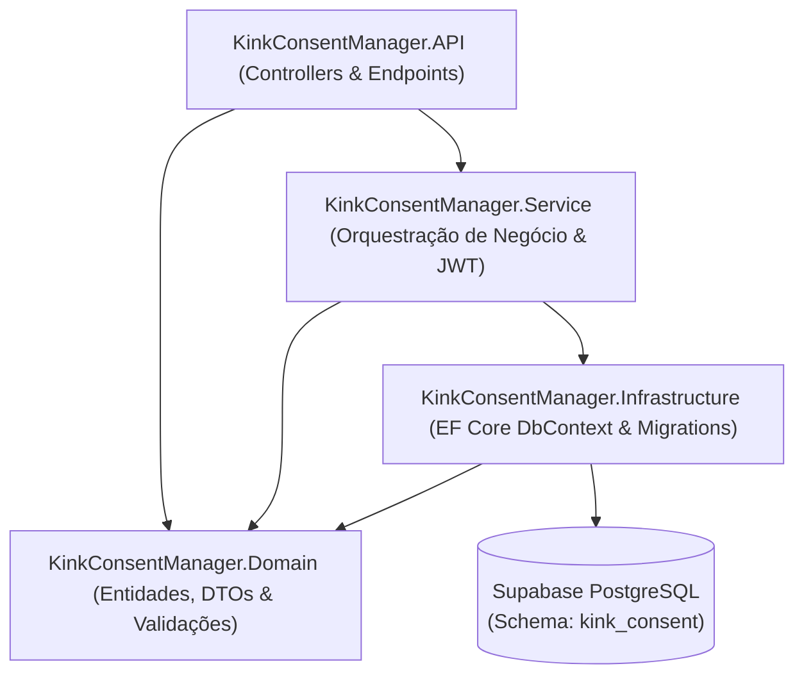

# Documento de Implementação do Backend (Arquitetura SmartCoreHub + Supabase EF Core)

**Projeto:** KinkConsentManager  
**Documento:** Especificação Técnica de Implementação da API Backend  
**Arquitetura de Referência:** `C:\git\SmartCoreHub\backend` (Clean Architecture + SOLID + DTOs + Repository Pattern)  
**Banco de Dados & ORM:** Supabase (PostgreSQL 16) + Entity Framework Core 8/9 (`Npgsql.EntityFrameworkCore.PostgreSQL`)  
**Versão:** 1.0 (Etapa 1: API de Autenticação e Cadastro)  
**Data:** 26 de Novembro de 2026  

---

## 1. Visão Geral da Arquitetura do Backend

A arquitetura do backend do **KinkConsentManager** adota rigorosamente a mesma divisão em camadas, padrões de injeção de dependência e regras de governança do projeto de referência **SmartCoreHub** (`SmartCoreHub.backend`).

A estrutura organiza o código em quatro camadas centrais com clara separação de responsabilidades (SRP) e um projeto dedicado de testes unitários:

```text
backend/
├── KinkConsentManager.sln
├── Directory.Build.props                  # Versão do .NET, C# 12/13, flags estritas (Nullable, TreatWarningsAsErrors)
├── Directory.Packages.props               # Central Package Management (CPM) para travar versões dos pacotes NuGet
├── src/
│   ├── KinkConsentManager.Domain/         # Entidades, Value Objects, Enums, DTOs, Contratos de Repositório/Serviço, FluentValidation
│   ├── KinkConsentManager.Infrastructure/ # DbContext, Mapeamentos Fluent API, Migrations Postgres, Implementação de Repositórios, Hasher
│   ├── KinkConsentManager.Service/        # Orquestração de regras de negócio, Geração de JWT, Serviços de Autenticação e Usuário
│   └── KinkConsentManager.API/            # ASP.NET Core Web API, Controllers RESTful, Middlewares, Program.cs, Swagger, Health Checks
└── tests/
    └── KinkConsentManager.Tests/          # Testes unitários com xUnit, Moq/NSubstitute e FluentAssertions
```

### 1.1 Diagrama de Dependências entre Camadas



---

## 2. Padrões de Segurança e Autenticação (Padrão SmartCoreHub)

Seguindo o padrão de alta segurança do `SmartCoreHub`:

### 2.1 Criptografia de Senhas com BCrypt
- **Algoritmo:** BCrypt (utilizando o pacote homologado `BCrypt.Net-Next`).
- **Complexidade:** Work Factor (fator de custo) configurado em `11` ou `12`, garantindo alta resistência contra ataques de dicionário e força bruta com GPUs.
- **Salt:** Gerado de forma criptograficamente aleatória e **embutido diretamente na string do hash resultante** (60 caracteres), dispensando colunas separadas de salt.
- **Verificação Segura:** Comparação contra tempo constante (*timing-safe*) em `BCrypt.Net.BCrypt.Verify(password, hash)` para neutralizar ataques de temporização (*timing attacks*).

```csharp
// Exemplo de Hasher idêntico ao BcryptPasswordHasher do SmartCoreHub
namespace KinkConsentManager.Domain.Interfaces.Security;

public interface IPasswordHasher
{
    string HashPassword(string password);
    bool VerifyPassword(string password, string hash);
}

// Implementação em KinkConsentManager.Infrastructure.Security
public class BcryptPasswordHasher : IPasswordHasher
{
    private const int WorkFactor = 11;

    public string HashPassword(string password) =>
        BCrypt.Net.BCrypt.HashPassword(password, workFactor: WorkFactor);

    public bool VerifyPassword(string password, string hash) =>
        BCrypt.Net.BCrypt.Verify(password, hash);
}
```

### 2.2 Política de Complexidade de Senhas (FluentValidation)
A validação declarativa é executada antes de qualquer acesso ao banco de dados:
- **Tamanho:** Mínimo de 8 caracteres e máximo de 100 caracteres.
- **Entropia Obrigatória:**
  - Pelo menos uma letra maiúscula (`A-Z`);
  - Pelo menos uma letra minúscula (`a-z`);
  - Pelo menos um dígito numérico (`0-9`);
  - Pelo menos um caractere especial (`!@#$%^&*()_+-=[]{}|;':",.<>?/`);
- **Proibições:** Espaços em branco não são permitidos na senha ou login.

```csharp
public class RegisterUserRequestValidator : AbstractValidator<RegisterUserRequestDto>
{
    public RegisterUserRequestValidator()
    {
        RuleFor(x => x.Name)
            .NotEmpty().WithMessage("Name is required")
            .MinimumLength(3).WithMessage("Name must be at least 3 characters")
            .MaximumLength(100).WithMessage("Name cannot exceed 100 characters");

        RuleFor(x => x.Login)
            .NotEmpty().WithMessage("Login is required")
            .MinimumLength(3).WithMessage("Login must be at least 3 characters")
            .MaximumLength(50).WithMessage("Login cannot exceed 50 characters")
            .Matches(@"^[a-zA-Z0-9_-]+$").WithMessage("Login must contain only alphanumeric characters, underscores or hyphens");

        RuleFor(x => x.Email)
            .NotEmpty().WithMessage("Email is required")
            .EmailAddress().WithMessage("Invalid email format")
            .MaximumLength(150).WithMessage("Email cannot exceed 150 characters");

        RuleFor(x => x.Password)
            .NotEmpty().WithMessage("Password is required")
            .MinimumLength(8).WithMessage("Password must be at least 8 characters")
            .MaximumLength(100).WithMessage("Password cannot exceed 100 characters")
            .Matches(@"[A-Z]").WithMessage("Password must contain at least one uppercase letter")
            .Matches(@"[a-z]").WithMessage("Password must contain at least one lowercase letter")
            .Matches(@"[0-9]").WithMessage("Password must contain at least one number")
            .Matches(@"[!@#$%^&*()_+\-=\[\]{}|;':"",.<>?/]").WithMessage("Password must contain at least one special character");

        RuleFor(x => x.ConfirmPassword)
            .Equal(x => x.Password).WithMessage("Password and confirmation password do not match");
    }
}
```

### 2.3 Autenticação JWT (Tokens Bearer e Refresh Tokens)
- **Token de Acesso (AccessToken):**
  - Assinatura: HMAC-SHA256 com chave simétrica de no mínimo 256 bits (`Jwt:SecretKey`).
  - Claims inclusas: `sub` (Id do usuário), `unique_name` (Login), `email` (Email), `name` (Nome), `jti` (UUID do token).
  - Validade: Curta (padrão: 60 minutos).
- **Token de Renovação (RefreshToken):**
  - Formato: String criptográfica aleatória de 64 bytes codificada em Base64 ou UUID v4.
  - Persistência: Armazenado na tabela `UserRefreshTokens` no Supabase com data de expiração (7 dias) e data de revogação.
  - Rotação: A cada renovação bem-sucedida, o refresh token anterior é revogado e um novo par é gerado.

---

## 3. Integração com o Supabase (PostgreSQL) e EF Core

O Supabase fornece uma instância de PostgreSQL 16 com extensões nativas. Para o Entity Framework Core, a integração utiliza o provedor oficial `Npgsql.EntityFrameworkCore.PostgreSQL`.

### 3.1 Isolamento Mandatório de Schema (`kink_consent`)
O Supabase cria esquemas internos no PostgreSQL para seus próprios serviços:
- `auth`: Usuários do Supabase Auth (GoTrue);
- `storage`: Metadados de buckets de arquivos;
- `realtime`: Sockets de tempo real;
- `vault`: Segredos criptografados.

> [!IMPORTANT]
> **Regra de Ouro:** O EF Core **nunca deve utilizar o schema `public` nem interferir nos schemas internos do Supabase**.  
> O `KinkConsentManagerDbContext` deve obrigatoriamente definir um schema padrão isolado:

```csharp
namespace KinkConsentManager.Infrastructure.Data;

public class KinkConsentManagerDbContext : DbContext
{
    public const string DefaultSchema = "kink_consent";

    public KinkConsentManagerDbContext(DbContextOptions<KinkConsentManagerDbContext> options)
        : base(options)
    {
    }

    public DbSet<User> Users => Set<User>();
    public DbSet<UserRefreshToken> UserRefreshTokens => Set<UserRefreshToken>();
    public DbSet<UserReport> UserReports => Set<UserReport>();

    protected override void OnModelCreating(ModelBuilder modelBuilder)
    {
        // Isola todas as tabelas no schema 'kink_consent'
        modelBuilder.HasDefaultSchema(DefaultSchema);

        // Aplica os mapeamentos Fluent API do assembly
        modelBuilder.ApplyConfigurationsFromAssembly(typeof(KinkConsentManagerDbContext).Assembly);

        base.OnModelCreating(modelBuilder);
    }
}
```

### 3.2 Cuidados com Migrations e Pooler do Supabase (Direct Connection vs Pooler)

O Supabase expõe duas portas/modos de conexão:

| Tipo de Conexão | Porta Padrão | Cenário de Uso | Suporta EF Migrations? |
| :--- | :---: | :--- | :---: |
| **Direct Connection (IPv4 / IPv6)** | `5432` | Execução de Migrations via CLI (`dotnet ef database update`) ou Session Mode | **SIM (Obrigatório)** |
| **Session Pooler (Supavisor)** | `5432` / `6543` | Execução da API em runtime com persistência de sessões | **SIM** |
| **Transaction Pooler (Supavisor)** | `6543` | Serveless em larga escala com alto volume de conexões efêmeras | **NÃO** (Não suporta DDL locks) |

> [!WARNING]
> **Atenção nas Migrations:** Para executar `dotnet ef database update`, utilize sempre a string de conexão direta (**Direct Connection**) obtida em *Project Settings > Database* no painel do Supabase. O Transaction Pooler não suporta operações DDL/locks que o EF Core exige ao aplicar migrations.

---

## 4. Estratégia de Persistência do Report de Respostas (JSON)

Para salvar as respostas do checklist preenchidas pelo usuário, foram avaliadas as duas opções suportadas pelo Supabase:

### Opção A: Supabase Storage (Object Storage / Bucket S3)
- Adequado para: Arquivos físicos binários ou exports finais para download (.json exportado, .pdf gerado, .xlsx).
- Protocolo: Compatível com AWS S3 (`AWSSDK.S3`) ou SDK `supabase-csharp`.
- Desvantagem para autosave: Exige upload via HTTP Multipart, latência maior por requisição, ausência de busca ou indexação de respostas no banco.

### Opção B: Coluna Nativa `jsonb` no PostgreSQL (Adotada como Primária)
- Adequado para: Dados estruturados do checklist, rascunhos de preenchimento, sincronização contínua (*autosave*).
- Como funciona no EF Core: O Npgsql suporta o tipo PostgreSQL `jsonb` de forma nativa através da propriedade string ou documento JSON.
- Vantagens:
  1. **Performance máxima:** Salvo diretamente em uma transação ACID no PostgreSQL junto aos dados do usuário.
  2. **Indexação GIN:** Permite no futuro criar índices dentro das chaves do JSON para consultas analíticas (ex.: contar categorias preenchidas).
  3. **Zero custos extras:** Não requer infraestrutura de buckets adicionais.

### Mapeamento da Entidade `UserReport` com `jsonb`:
```csharp
public class UserReportConfiguration : IEntityTypeConfiguration<UserReport>
{
    public void Configure(EntityTypeBuilder<UserReport> builder)
    {
        builder.ToTable("UserReports");
        builder.HasKey(x => x.Id);

        builder.Property(x => x.AnswersJson)
            .HasColumnType("jsonb")
            .IsRequired();

        builder.Property(x => x.SchemaVersion)
            .HasMaxLength(20)
            .IsRequired();

        builder.Property(x => x.Language)
            .HasMaxLength(10)
            .IsRequired();

        builder.HasOne(x => x.User)
            .WithMany()
            .HasForeignKey(x => x.UserId)
            .OnDelete(DeleteBehavior.Cascade);

        builder.HasIndex(x => x.UserId).IsUnique();
    }
}
```

---

## 5. Modelagem de Entidades de Domínio (Etapa 1)

### 5.1 Entidade `User`
```csharp
namespace KinkConsentManager.Domain.Entities;

public class User
{
    public Guid Id { get; set; } = Guid.NewGuid();
    public string Name { get; set; } = string.Empty;
    public string Login { get; set; } = string.Empty;
    public string Email { get; set; } = string.Empty;
    public string PasswordHash { get; set; } = string.Empty;
    public bool IsActive { get; set; } = true;
    public DateTime? LastLoginAtUtc { get; set; }
    public DateTime CreatedAtUtc { get; set; } = DateTime.UtcNow;
    public DateTime UpdatedAtUtc { get; set; } = DateTime.UtcNow;

    // Navegações
    public virtual ICollection<UserRefreshToken> RefreshTokens { get; set; } = new List<UserRefreshToken>();
    public virtual UserReport? Report { get; set; }
}
```

### 5.2 Entidade `UserRefreshToken`
```csharp
namespace KinkConsentManager.Domain.Entities;

public class UserRefreshToken
{
    public Guid Id { get; set; } = Guid.NewGuid();
    public Guid UserId { get; set; }
    public string Token { get; set; } = string.Empty;
    public DateTime ExpiresAtUtc { get; set; }
    public DateTime? RevokedAtUtc { get; set; }
    public DateTime CreatedAtUtc { get; set; } = DateTime.UtcNow;

    public bool IsActive => RevokedAtUtc == null && DateTime.UtcNow < ExpiresAtUtc;

    public virtual User User { get; set; } = null!;
}
```

### 5.3 Mapeamento EF Core (`UserConfiguration.cs`)
```csharp
namespace KinkConsentManager.Infrastructure.Data.Configurations;

public class UserConfiguration : IEntityTypeConfiguration<User>
{
    public void Configure(EntityTypeBuilder<User> builder)
    {
        builder.ToTable("Users");
        builder.HasKey(u => u.Id);

        builder.Property(u => u.Name)
            .HasMaxLength(100)
            .IsRequired();

        builder.Property(u => u.Login)
            .HasMaxLength(50)
            .IsRequired();

        builder.Property(u => u.Email)
            .HasMaxLength(150)
            .IsRequired();

        builder.Property(u => u.PasswordHash)
            .HasMaxLength(255)
            .IsRequired();

        // Índices únicos
        builder.HasIndex(u => u.Login).IsUnique();
        builder.HasIndex(u => u.Email).IsUnique();
    }
}
```

---

## 6. Contratos de API e DTOs (Etapa 1: Auth & Cadastro)

Seguindo o envelope padrão `ServiceResponse<T>` do SmartCoreHub:

```csharp
namespace KinkConsentManager.Domain.DTOs.Common;

public class ServiceResponse<T>
{
    public bool Success { get; set; }
    public string Message { get; set; } = string.Empty;
    public T? Data { get; set; }
    public List<string> Errors { get; set; } = new();

    public static ServiceResponse<T> Ok(T data, string message = "Operation completed successfully") =>
        new() { Success = true, Data = data, Message = message };

    public static ServiceResponse<T> Fail(string message, List<string>? errors = null) =>
        new() { Success = false, Message = message, Errors = errors ?? new() };
}
```

### 6.1 DTOs de Entrada e Saída
```csharp
// Cadastro
public record RegisterUserRequestDto(
    string Name,
    string Login,
    string Email,
    string Password,
    string ConfirmPassword
);

// Login
public record LoginRequestDto(
    string LoginOrEmail,
    string Password
);

// Refresh
public record RefreshTokenRequestDto(
    string RefreshToken
);

// Respostas
public record UserDto(
    Guid Id,
    string Name,
    string Login,
    string Email,
    DateTime CreatedAtUtc
);

public record LoginResponseDto(
    string AccessToken,
    string RefreshToken,
    DateTime ExpiresAtUtc,
    UserDto User
);
```

### 6.2 Endpoints do `AuthController`
- `POST /api/v1/auth/register` [AllowAnonymous]: Cadastra novo usuário e retorna `201 Created` ou `400 Bad Request`.
- `POST /api/v1/auth/login` [AllowAnonymous]: Autentica e retorna tokens JWT `200 OK` ou `401 Unauthorized`.
- `POST /api/v1/auth/refresh` [AllowAnonymous]: Renova sessão e retorna novos tokens `200 OK` ou `401 Unauthorized`.
- `GET /api/v1/auth/me` [Authorize]: Retorna dados cadastrais do usuário autenticado no token.

---

## 7. Configurações de Ambiente (`appsettings.json`)

```json
{
  "ConnectionStrings": {
    "DefaultConnection": "Host=aws-0-sa-east-1.pooler.supabase.com;Port=5432;Database=postgres;Username=postgres.sua-instancia;Password=SUA_SENHA_AQUI;SSL Mode=Require;Trust Server Certificate=true;"
  },
  "Jwt": {
    "SecretKey": "CHAVE_SECRETA_MUITO_SEGURA_COM_NO_MINIMO_256_BITS_PARA_O_KINKCONSENTMANAGER",
    "Issuer": "KinkConsentManager.API",
    "Audience": "KinkConsentManager.Client",
    "AccessTokenExpirationMinutes": 60,
    "RefreshTokenExpirationDays": 7
  },
  "Logging": {
    "LogLevel": {
      "Default": "Information",
      "Microsoft.AspNetCore": "Warning"
    }
  },
  "AllowedHosts": "*"
}
```

---

## 8. Guia Passo a Passo de Instalação e Execução

### Passo 1: Criação da Estrutura de Diretórios e Solution
```powershell
mkdir -p backend/src
mkdir -p backend/tests

cd backend
dotnet new sln -n KinkConsentManager

# Criação das Camadas
dotnet new classlib -n KinkConsentManager.Domain -o src/KinkConsentManager.Domain
dotnet new classlib -n KinkConsentManager.Infrastructure -o src/KinkConsentManager.Infrastructure
dotnet new classlib -n KinkConsentManager.Service -o src/KinkConsentManager.Service
dotnet new webapi -n KinkConsentManager.API -o src/KinkConsentManager.API
dotnet new xunit -n KinkConsentManager.Tests -o tests/KinkConsentManager.Tests

# Associação à Solution
dotnet sln add src/KinkConsentManager.Domain/KinkConsentManager.Domain.csproj
dotnet sln add src/KinkConsentManager.Infrastructure/KinkConsentManager.Infrastructure.csproj
dotnet sln add src/KinkConsentManager.Service/KinkConsentManager.Service.csproj
dotnet sln add src/KinkConsentManager.API/KinkConsentManager.API.csproj
dotnet sln add tests/KinkConsentManager.Tests/KinkConsentManager.Tests.csproj

# Referências entre Projetos
dotnet add src/KinkConsentManager.Infrastructure reference src/KinkConsentManager.Domain
dotnet add src/KinkConsentManager.Service reference src/KinkConsentManager.Domain
dotnet add src/KinkConsentManager.Service reference src/KinkConsentManager.Infrastructure
dotnet add src/KinkConsentManager.API reference src/KinkConsentManager.Domain
dotnet add src/KinkConsentManager.API reference src/KinkConsentManager.Service
dotnet add tests/KinkConsentManager.Tests reference src/KinkConsentManager.Domain
dotnet add tests/KinkConsentManager.Tests reference src/KinkConsentManager.Service
dotnet add tests/KinkConsentManager.Tests reference src/KinkConsentManager.Infrastructure
```

### Passo 2: Adição dos Pacotes NuGet Homologados
```powershell
# Infraestrutura (Supabase PostgreSQL & EF Core)
dotnet add src/KinkConsentManager.Infrastructure package Npgsql.EntityFrameworkCore.PostgreSQL
dotnet add src/KinkConsentManager.Infrastructure package Microsoft.EntityFrameworkCore.Design
dotnet add src/KinkConsentManager.Infrastructure package BCrypt.Net-Next

# Domínio (Validações)
dotnet add src/KinkConsentManager.Domain package FluentValidation
dotnet add src/KinkConsentManager.Domain package FluentValidation.DependencyInjectionExtensions

# API (JWT & Swagger)
dotnet add src/KinkConsentManager.API package Microsoft.AspNetCore.Authentication.JwtBearer
dotnet add src/KinkConsentManager.API package Swashbuckle.AspNetCore
dotnet add src/KinkConsentManager.API package Microsoft.EntityFrameworkCore.Tools

# Testes
dotnet add tests/KinkConsentManager.Tests package Moq
dotnet add tests/KinkConsentManager.Tests package FluentAssertions
```

### Passo 3: Geração e Aplicação das Migrations no Supabase
```powershell
# Gerar migration no schema 'kink_consent'
dotnet ef migrations add InitialCreateAuth --project src/KinkConsentManager.Infrastructure --startup-project src/KinkConsentManager.API --output-dir Migrations

# Aplicar migration diretamente no Supabase (Porta 5432 - Direct Connection)
dotnet ef database update --project src/KinkConsentManager.Infrastructure --startup-project src/KinkConsentManager.API
```
