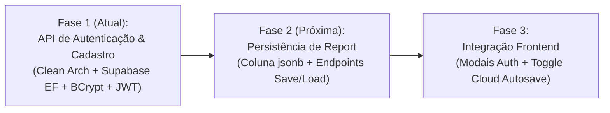

# Documento de Progresso e Checklist de Implantação do Backend

**Projeto:** KinkConsentManager  
**Documento:** Matriz de Rastreabilidade, Checklist de Tarefas e Acompanhamento de Progresso do Backend  
**Arquitetura:** Clean Architecture (Padrão SmartCoreHub) + Supabase (PostgreSQL EF Core)  
**Versão:** 1.0 (Lançamento da Fase 1: API de Autenticação e Cadastro)  
**Data:** 26 de Novembro de 2026  

---

## 1. Visão Geral das Fases de Implantação

O desenvolvimento do backend do **KinkConsentManager** está estruturado em 3 fases progressivas, garantindo isolamento de riscos, validação técnica antecipada e alinhamento com as diretrizes do projeto:

### 1.1 Painel Resumido de Status por Fase

| Fase | Descrição do Escopo | Tarefas | Concluídas | Testes / DoD | Status Geral |
| :---: | :--- | :---: | :---: | :---: | :---: |
| **Fase 1** | **API de Login e Cadastro (Escopo Imediato)** | **9** | **0** | **0 / 9** | 🟡 **Planejado / Pronto para Iniciar** |
| **Fase 2** | Sincronização de Respostas (Report `jsonb`) | 6 | 0 | 0 / 6 | ⚪ Aguardando Fase 1 |
| **Fase 3** | Integração Frontend (UI, Interceptor e Autosave) | 7 | 0 | 0 / 7 | ⚪ Aguardando Fase 2 |
| **TOTAL** | **Ciclo Completo V2 Backend + Cloud Sync** | **22** | **0** | **0 / 22** | **Início da Fase 1** |

*Legenda de Status:* `[ ] Pendente` · `[/] Em Progresso` · `[x] Concluído` · `[!] Bloqueado`

---

## 2. Checklist Detalhado da Fase 1: API de Autenticação e Cadastro (Escopo Imediato)

Esta é a fase ativa no momento. Foca exclusivamente na criação da solução .NET, modelagem das entidades de usuário, segurança criptográfica com BCrypt (padrão SmartCoreHub), persistência no Supabase via EF Core com isolamento de schema (`kink_consent`) e exposição dos endpoints JWT.

- [ ] **B1.1 — Fundação da Solution .NET e Estrutura em Camadas**
  - **Camada:** Raiz / Solution
  - **Artefatos:** `backend/KinkConsentManager.sln`, `src/KinkConsentManager.Domain/`, `src/KinkConsentManager.Infrastructure/`, `src/KinkConsentManager.Service/`, `src/KinkConsentManager.API/`, `tests/KinkConsentManager.Tests/`.
  - **DoD:** Solution compila com zero erros e zero warnings via `dotnet build`; referências entre camadas configuradas conforme diagrama Clean Architecture.
  - **Status:** `[ ] Pendente`

- [ ] **B1.2 — Configuração Centralizada de Pacotes e Build (CPM)**
  - **Camada:** Governança
  - **Artefatos:** `backend/Directory.Build.props`, `backend/Directory.Packages.props`.
  - **DoD:** Versões dos pacotes NuGet (`Npgsql.EntityFrameworkCore.PostgreSQL`, `FluentValidation`, `BCrypt.Net-Next`, `Microsoft.AspNetCore.Authentication.JwtBearer`, `xunit`, `Moq`, `FluentAssertions`) centralizadas sem versões dispersas nos `.csproj`.
  - **Status:** `[ ] Pendente`

- [ ] **B1.3 — Modelagem de Domínio e Contratos (`KinkConsentManager.Domain`)**
  - **Camada:** Domain
  - **Artefatos:**
    - `Entities/User.cs`: `Id`, `Name`, `Login`, `Email`, `PasswordHash`, `IsActive`, `LastLoginAtUtc`, `CreatedAtUtc`, `UpdatedAtUtc`.
    - `Entities/UserRefreshToken.cs`: `Id`, `UserId`, `Token`, `ExpiresAtUtc`, `RevokedAtUtc`, `CreatedAtUtc`.
    - `DTOs/Authentication/`: `RegisterUserRequestDto`, `LoginRequestDto`, `RefreshTokenRequestDto`, `UserDto`, `LoginResponseDto`.
    - `DTOs/Common/ServiceResponse.cs`: Envelope padronizado de retorno da API.
    - `Interfaces/Repositories/IUserRepository.cs`, `Interfaces/Services/IAuthenticationService.cs`.
  - **DoD:** Tipos imutáveis com documentação XML em português e identificadores em inglês; sem acoplamento com EF Core.
  - **Status:** `[ ] Pendente`

- [ ] **B1.4 — Implementação dos Validadores Declarativos (FluentValidation)**
  - **Camada:** Domain
  - **Artefatos:**
    - `Validators/RegisterUserRequestValidator.cs`: Regras de nome, login alfanumérico, email RFC 5322 e senha forte (mínimo 8 caracteres, maiúscula, minúscula, número e caractere especial).
    - `Validators/LoginRequestValidator.cs`.
  - **DoD:** Testes unitários validando cada regra de restrição de senha e campos obrigatórios passando 100%.
  - **Status:** `[ ] Pendente`

- [ ] **B1.5 — Hasher de Senha BCrypt (Padrão SmartCoreHub)**
  - **Camada:** Infrastructure
  - **Artefatos:**
    - `Security/BcryptPasswordHasher.cs`: Implementação de `IPasswordHasher` com work factor 11/12, salt embutido automático e verificação timing-safe.
  - **DoD:** Testes unitários comprovando que senhas idênticas produzem hashes com salts diferentes e que a verificação de senha correta/incorreta é precisa.
  - **Status:** `[ ] Pendente`

- [ ] **B1.6 — Configuração do EF Core e Schema Supabase (`kink_consent`)**
  - **Camada:** Infrastructure
  - **Artefatos:**
    - `Data/KinkConsentManagerDbContext.cs`: Configuração de `modelBuilder.HasDefaultSchema("kink_consent")`.
    - `Data/Configurations/UserConfiguration.cs`: Mapeamento com índices únicos para `Login` e `Email`.
    - `Data/Configurations/UserRefreshTokenConfiguration.cs`.
    - `Repositories/UserRepository.cs`.
  - **DoD:** O DbContext compila e aplica o schema padrão `kink_consent` isolado dos schemas internos do Supabase (`auth`, `storage`, `public`).
  - **Status:** `[ ] Pendente`

- [ ] **B1.7 — Geração e Aplicação da Migration no Supabase**
  - **Camada:** Infrastructure / Database
  - **Artefatos:** `Migrations/YYYYMMDD_InitialCreateAuth.cs`.
  - **DoD:** Comando `dotnet ef database update` executado com sucesso apontando para a conexão direta (*Direct Connection*, porta 5432) do Supabase; tabelas `kink_consent.Users` e `kink_consent.UserRefreshTokens` criadas com sucesso.
  - **Status:** `[ ] Pendente`

- [ ] **B1.8 — Implementação da Camada de Serviço e Geração de JWT (`KinkConsentManager.Service`)**
  - **Camada:** Service
  - **Artefatos:**
    - `Services/AuthenticationService.cs`: Orquestração de cadastro (verificação de duplicidade, hash de senha, persistência) e login (busca, verificação de hash, emissão de AccessToken + RefreshToken).
    - `Security/JwtTokenGenerator.cs`: Criação e assinatura do token JWT com claims e expiração.
  - **DoD:** Serviço coberto por testes unitários simulando cenários de sucesso, credenciais inválidas, usuário duplicado e renovação de token.
  - **Status:** `[ ] Pendente`

- [ ] **B1.9 — Implementação da API REST e Controllers (`KinkConsentManager.API`)**
  - **Camada:** API
  - **Artefatos:**
    - `Controllers/AuthController.cs`: Endpoints `POST /api/v1/auth/register`, `POST /api/v1/auth/login`, `POST /api/v1/auth/refresh`, `GET /api/v1/auth/me`.
    - `Program.cs`: Injeção de dependências, configuração do JWT Bearer, configuração do DbContext com connection string do Supabase, Swagger com suporte a Bearer Token e Health Checks (`/health` e `/ready`).
  - **DoD:** API executando localmente; Swagger UI funcional; endpoints testados via cURL/Postman com códigos HTTP adequados (`201`, `200`, `400`, `401`).
  - **Status:** `[ ] Pendente`

---

## 3. Planejamento das Fases Seguintes (Visão Futura)

### Fase 2: Persistência e Sincronização do Report (`jsonb`)
- [ ] **B2.1** — Modelagem da entidade `UserReport` com coluna `AnswersJson` do tipo PostgreSQL `jsonb`.
- [ ] **B2.2** — Mapeamento no EF Core com índice único por `UserId`.
- [ ] **B2.3** — Criação da Migration `AddUserReports` no Supabase.
- [ ] **B2.4** — Criação do `ReportService` e repositório `IUserReportRepository`.
- [ ] **B2.5** — Endpoints `POST /api/v1/reports` (salvar rascunho de respostas) e `GET /api/v1/reports` (carregar respostas).
- [ ] **B2.6** — Testes de integração de serialização/deserialização do payload JSON do checklist.

### Fase 3: Integração no Frontend (Angular 22)
- [ ] **B3.1** — Criação dos contratos TypeScript de Auth (`User`, `LoginRequest`, `RegisterRequest`, `AuthResponse`) em `src/app/core/models/auth.model.ts`.
- [ ] **B3.2** — Implementação do `AuthService` com Signals (`currentUser`, `isAuthenticated`) e armazenamento de tokens em local seguro.
- [ ] **B3.3** — Implementação do `AuthInterceptor` para injeção automática do cabeçalho `Authorization: Bearer <token>`.
- [ ] **B3.4** — Criação do componente modal `AuthModalComponent` (abas Login / Cadastro com validação de senha forte e i18n).
- [ ] **B3.5** — Adição do botão/avatar de perfil no `AppHeaderComponent`.
- [ ] **B3.6** — Inclusão do toggle switch "Salvar na nuvem (Cloud Sync)" na tela de preenchimento (`/checklist/fill`), habilitado apenas para usuários logados.
- [ ] **B3.7** — Conexão do `ChecklistAutosaveService` para disparar a sincronização na nuvem com debounce de 2,5 segundos quando a opção estiver ativa.

---

## 4. Critérios de Qualidade e Definition of Done (DoD)

Para que qualquer tarefa da Fase 1 seja marcada como concluída `[x]`, ela deve atender integralmente aos seguintes requisitos:
1. **Compilação Estrita:** Compilar em modo `Release` sem avisos (`TreatWarningsAsErrors = true`).
2. **Segurança de Senhas:** Nenhuma senha em texto claro pode trafegar sem HTTPS ou ser gravada em banco/logs.
3. **Isolamento do Banco:** Nenhuma migration pode criar tabelas fora do schema `kink_consent`.
4. **Cobertura de Testes:** Todos os serviços de negócio e validadores devem possuir testes unitários automatizados cobrindo caminhos felizes e exceções.
5. **Aderência aos Padrões:** Respeitar o idioma do código em inglês, comentários de contexto em português e convenções de nomenclatura do `PROJECT_GUIDELINES.md` e do `SmartCoreHub`.
