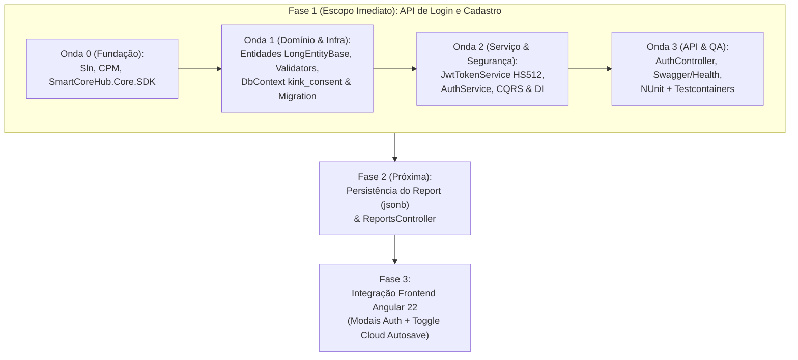

# Documento de Progresso e Checklist de Implantação do Backend

**Projeto:** KinkConsentManager  
**Documento:** Orquestração em Ondas, Checklist Granular, Rastreabilidade e Controle de Riscos  
**Arquitetura:** Espelho `C:\git\SmartCoreHub\backend` + NuGet [`SmartCoreHub.Core.SDK`](https://www.nuget.org/packages/SmartCoreHub.Core.SDK) + Supabase EF Core (`kink_consent`)  
**Versão:** 2.0 (Revisão Alinhada ao `SmartCoreHub.Core.SDK`)  
**Data:** 26 de Novembro de 2026  

---

## 1. Estratégia de Execução em Fases e Ondas

O ciclo completo de entrega do Backend e Sincronização em Nuvem foi dividido em **3 Fases**, sendo que a **Fase 1 (API de Autenticação e Cadastro)** é o escopo imediato e é executada em **4 Ondas (Gates)** de dependência para permitir validação rápida, testes contínuos e zero retrabalho:

### 1.1 Painel Executivo de Progresso

| Fase / Onda | Escopo Principal | Tarefas | Concluídas | Cobertura Alvo | Status Geral |
| :--- | :--- | :---: | :---: | :---: | :--- |
| **Fase 1 — Onda 0** | Fundação, Estrutura `SmartCoreHub`, CPM & `Core.SDK` | 2 | 0 | N/A (Build Gate) | 🟡 Planejado |
| **Fase 1 — Onda 1** | Domínio (`User`, `UserRefreshToken`), FluentValidation & Supabase EF (`kink_consent`) | 4 | 0 | ≥ 90% Domain / ≥ 85% Infra | 🟡 Planejado |
| **Fase 1 — Onda 2** | `ValidationMessageService`, `JwtTokenService` (`HS512`), `AuthService`, CQRS & DI | 5 | 0 | ≥ 90% Service | 🟡 Planejado |
| **Fase 1 — Onda 3** | `AuthController`, `Program.cs`, OpenAPI/Health & Suíte Integrada | 3 | 0 | ≥ 85% API / 100% Endpoints | 🟡 Planejado |
| **Subtotal Fase 1** | **API de Login e Cadastro (Escopo Imediato)** | **14** | **0** | **≥ 85% Global** | 🟡 **Pronto para Execução** |
| **Fase 2** | Entidade `UserReport` (`jsonb`), `ReportsController` & Testes | 7 | 0 | ≥ 85% | ⚪ Aguardando Fase 1 |
| **Fase 3** | Frontend Angular 22 (Auth Modal, Interceptor, Cloud Autosave Toggle) | 8 | 0 | ≥ 85% Jest | ⚪ Aguardando Fase 2 |
| **TOTAL GERAL** | **Backend V2 Completo + Cloud Sync** | **29** | **0** | **—** | **Especificado** |

*Legenda de Status:* `[ ] Pendente` · `[/] Em Progresso` · `[x] Concluído` · `[!] Bloqueado`

---

## 2. Checklist Detalhado — Fase 1: API de Login e Cadastro (Escopo Imediato)

### Onda 0: Fundação, Estrutura Espelho e `SmartCoreHub.Core.SDK`

- [ ] **B1.1 — Criar Estrutura `backend/` Espelhando `SmartCoreHub\backend`**
  - **Camada:** Solution / Governance
  - **Artefatos:** `backend/global.json` (`10.0.300`), `backend/Directory.Build.props`, `backend/build/TestAssertions.props`, `backend/KinkConsentManager.sln`, pastas `APIs/` e `Implementations/`.
  - **Reaproveitamento SDK:** Nenhum (prepara o workspace sem pasta `Core/` duplicada).
  - **Verificação:** `dotnet --info` confirma SDK `10.0.x`; `dotnet build` compila solution vazia sem warnings (`TreatWarningsAsErrors = true`).
  - **DoD:** Todos os 8 projetos (4 código + 4 testes NUnit) criados e referenciados corretamente na solution.

- [ ] **B1.2 — Configurar `Directory.Packages.props` (CPM) e Instalar `SmartCoreHub.Core.SDK`**
  - **Camada:** Governance / NuGet
  - **Artefatos:** `backend/Directory.Packages.props`.
  - **Reaproveitamento SDK:** Instalação de `SmartCoreHub.Core.SDK` (`PackageReference`), pinando EF Core `9.0.23` e `Npgsql.EntityFrameworkCore.PostgreSQL` `9.0.4` para compatibilidade total com o SDK.
  - **Verificação:** `dotnet restore` sem erros ou warnings `NU1605`/`NU1107`.
  - **DoD:** Zero versões hardcoded dentro dos `.csproj`; restauração limpa do `SmartCoreHub.Core.SDK` e `AwesomeAssertions`.

---

### Onda 1: Domínio, Validadores e Infraestrutura Supabase (`kink_consent`)

- [ ] **B1.3 — Modelar Entidades e DTOs de Autenticação (`KinkConsentManager.Domain`)**
  - **Camada:** Domain
  - **Artefatos:** `Entities/User.cs` (incluindo `NormalizedLogin` + `SetLogin`), `Entities/UserRefreshToken.cs`, `DTOs/Authentication/` (`RegisterUserRequestDto`, `UserDto`, `LoginResponseDto`, `LogoutRequestDto`), `Localization/AuthenticationMessageKeys.cs`, `Interfaces/Repositories/` (`IUserRepository` com `GetByLoginOrEmailAsync`, `IUserRefreshTokenRepository`), `Interfaces/Services/IAuthenticationService.cs`.
  - **Reaproveitamento SDK:** Herdar `LongEntityBase`; usar Value Object `Email`; reutilizar `LoginDto`, `RefreshTokenDto`, `PasswordVerificationInput` e `ServiceResponse<T>` diretamente do SDK.
  - **Verificação:** `dotnet build Implementations/KinkConsentManager.Domain`.
  - **DoD:** Zero classes duplicadas do SDK; XML-docs em português em todos os tipos e membros públicos.

- [ ] **B1.4 — Implementar Contratos de i18n no Domínio e Validadores Desacoplados**
  - **Camada:** Domain + Domain.Tests
  - **Artefatos:** `Interfaces/Localization/IValidationMessageService.cs` (+ `NullValidationMessageService`), `Localization/MessageKeys/ValidationMessageKeys.cs`, `Validators/Extensions/FluentValidationLocalizationExtensions.cs` (`WithMessageKey`), `Validators/Authentication/` (`PasswordValidator`, `RegisterUserRequestValidator`, `LoginDtoValidator`, `RefreshTokenDtoValidator`, `PasswordVerificationInputValidator`), `KinkConsentManager.Domain.Tests/...`.
  - **Reaproveitamento SDK:** Reutiliza chaves nativas `SmartCoreHub.Core.SDK.Validation.*`, compatibilidade com `FluentValidationBehavior` via `IHasValidationPayload<T>` e `FunctionalMessageTextResolver.TryReadMessageKey`.
  - **Verificação:** `dotnet test Implementations/KinkConsentManager.Domain.Tests`.
  - **DoD:** **Todos** os validadores injetam `IValidationMessageService`, usam avaliação dinâmica por requisição (`.WithMessage(_ => ...)`), `WithErrorCode` e `WithMessageKey`, sem dependência de `.resx` no Domain; testes NUnit + AwesomeAssertions + Bogus cobrindo 100% das regras.

- [ ] **B1.5 — Configurar `DbContext`, `DbScope`, `.resx` de Localização, Mapeamentos e Repositórios**
  - **Camada:** Infrastructure + Infrastructure.Tests
  - **Artefatos:** `Data/KinkConsentManagerDbContext.cs`, `Data/KinkConsentManagerDbContextPostgreSql.cs`, `Data/KinkConsentManagerDbContextScope.cs`, `Data/KinkConsentManagerDbContextPostgreSqlFactory.cs`, `Data/Configurations/UserConfiguration.cs`, `Data/Configurations/UserRefreshTokenConfiguration.cs`, `Localization/Resources/ValidationMessages.resx`, `Localization/Resources/ValidationMessages.pt-BR.resx`, `Localization/Resources/AuthMessages*.resx`, `Repositories/KinkConsentManagerGenericRepository.cs`, `Repositories/UserRepository.cs`, `Repositories/UserRefreshTokenRepository.cs`.
  - **Reaproveitamento SDK:** `EfDbContextScope<T>`, `GenericRepository<T, TCtx>`, `EfMigrationsHistoryHelper.PostgreSqlTable`, `DesignTimeDatabaseBootstrap`, `Email` VO conversion.
  - **Verificação:** `dotnet test Implementations/KinkConsentManager.Infrastructure.Tests` (schema `kink_consent` com Testcontainers PostgreSQL + testes de `GetByLoginOrEmailAsync` *case-insensitive* + paridade 100% entre `.resx` `en-US` e `pt-BR`).
  - **DoD:** Nenhuma tabela ou histórico de migration mapeado em `public`; índices únicos em `Users(Email)`, `Users(NormalizedLogin)`, `Users(Login)` e `UserRefreshTokens(TokenHash)`; 100% das chaves de `ValidationMessageKeys` presentes nos `.resx`.

- [ ] **B1.6 — Gerar e Aplicar Migration Inicial `InitialCreateAuth` no Supabase**
  - **Camada:** Infrastructure / Supabase DB
  - **Artefatos:** `Migrations/PostgreSql/*_InitialCreateAuth.cs`.
  - **Reaproveitamento SDK:** `EfMigrationsHistoryHelper.PostgreSqlTable` no schema `kink_consent`.
  - **Verificação:** `dotnet ef migrations add InitialCreateAuth ...` e `dotnet ef database update ...` usando **Direct Connection (porta `5432`)**.
  - **DoD:** Tabelas `kink_consent."Users"`, `kink_consent."UserRefreshTokens"` e `kink_consent."__EFMigrationsHistory_PostgreSql"` criadas com sucesso no Supabase sem tocar nos schemas `auth`, `storage` ou `public`.

---

### Onda 2: Localização Centralizada, Segurança JWT (`HS512`), Serviços e Composição DI

- [ ] **B1.7 — Implementar Classe Service Centralizada `ValidationMessageService`**
  - **Camada:** Service
  - **Artefatos:** `Localization/ValidationMessageService.cs` (implementando `IValidationMessageService` e `IErrorGetLocalizationService`).
  - **Reaproveitamento SDK:** `IFunctionalMessageProvider`, `AddSmartCoreHubFunctionalMessages`, `FunctionalMessageResultFilter`, `LocalizationHeaderCultureMiddleware`.
  - **Verificação:** Testes unitários validando resolução de chaves do Core.SDK e chaves de `ValidationMessages*.resx` em `en-US` e `pt-BR` + fallback seguro.
  - **DoD:** Ponto único centralizado de idiomas/resources para todos os validadores e pipeline de erros da API.

- [ ] **B1.8 — Implementar `JwtTokenService` e `AuthenticationExtensions` (JWT `HS512`)**
  - **Camada:** Service
  - **Artefatos:** `Security/JwtTokenService.cs`, `API/DI/AuthenticationExtensions.cs`.
  - **Reaproveitamento SDK:** `IJwtAccessTokenService`, `JwtAccessTokenService.BuildStandardAccessClaims`, `ISecurityTokenAdapterFactory`, `TokenConfigurationServiceCollectionExtensions` (`AddTokenConfiguration`, `EnsureSigningSecret`, `CreateTokenValidationParameters`, `AddAuthenticatedUserPolicy`).
  - **Verificação:** Teste unitário validando emissão e validação do JWT `HS512` e rejeição de `TokenConfigurations:Secret` menor que 64 bytes.
  - **DoD:** Nenhuma chave secreta hardcoded no código; validação automática de tamanho mínimo de 512 bits no startup.

- [ ] **B1.9 — Implementar `AuthenticationService` (BCrypt + Login/Email Dual + Rotation + Reuse Detection)**
  - **Camada:** Service
  - **Artefatos:** `Services/AuthenticationService.cs`, `Mappings/AutoMapperProfile.cs`.
  - **Reaproveitamento SDK:** `PasswordHasherFactory.GetHasher(PasswordAlgorithm.Bcrypt)`, `FluentValidationErrorMappingHelper`, `ISmartCoreHubMapper`, `IAppLogger`, `ServiceResponse<T>`, `ITransactionExecutor`.
  - **Verificação:** `dotnet test Implementations/KinkConsentManager.Service.Tests` cobrindo cadastro, duplicidade `409`, autenticação por `Login` (*case-insensitive*), autenticação por `Email` (*case-insensitive*), entrada malformada com `@` retornando `401`, refresh rotation e reuse detection.
  - **DoD:** Zero vazamento de hashes ou senhas em logs/DTOs; cobertura ≥ 90% em `AuthenticationService`.

- [ ] **B1.10 — Implementar Comandos/Handlers CQRS e Composição DI do Host**
  - **Camada:** Service
  - **Artefatos:** `Cqrs/Authentication/Commands/` (`RegisterUserCommand`, `LoginCommand`, `RefreshTokenCommand`, `LogoutCommand`), `API/DI/WebApplicationBuilderServicesConfigure.cs`, `API/DI/WebApplicationExtensions.cs`, `API/DI/DatabaseExtensions.cs`, `API/DI/KinkConsentManagerDocumentationOptions.cs`.
  - **Reaproveitamento SDK:** `AddSmartCoreHubMediatRAdapter`, `IApplicationDispatcher`, `IHasValidationPayload<T>`, `ITransactionalCommand`, `AddAspNetCoreApiBasics`, `AddSdkCorePrimitives`, `AddApiPerformance`, `AddCustomSwagger`, `AddCustomOpenApi`, `AddCustomCors`, `ValidateNoCircularDependencies`, `UseSdkNetworkAndCrossCutting`, `UseSdkCorsAndDocumentation`, `UseSdkSecurityAndEndpoints<T>`, `InitializeDatabaseAtStartup<T>`.
  - **Verificação:** Teste de composição DI confirmando que `ValidateNoCircularDependencies()` passa sem exceções.
  - **DoD:** `WebApplicationBuilderServicesConfigure` e `WebApplicationExtensions` espelhando fielmente o `SmartCoreHub.Service`.

- [ ] **B1.11 — Criar Suíte de Testes Unitários de Serviço (`KinkConsentManager.Service.Tests`)**
  - **Camada:** Service.Tests
  - **Artefatos:** `Localization/ValidationMessageServiceTests.cs`, `Services/AuthenticationServiceTests.cs`, `Security/JwtTokenServiceTests.cs`, `DI/DependencyInjectionGraphTests.cs`.
  - **Verificação:** `dotnet test Implementations/KinkConsentManager.Service.Tests --collect:"XPlat Code Coverage"`.
  - **DoD:** Todos os testes com `// Cenário:` e `// Objetivo:` em português e nomes em inglês; cobertura ≥ 90%.

---

### Onda 3: API REST, OpenAPI, Health Checks e Testes End-to-End

- [ ] **B1.12 — Implementar `Program.cs`, `appsettings*.json` e `user-secrets`**
  - **Camada:** API
  - **Artefatos:** `APIs/KinkConsentManager.API/Program.cs`, `appsettings.json`, `appsettings.Development.json`.
  - **Reaproveitamento SDK:** `LogAppHelper`, `SerilogAdapter`.
  - **Verificação:** Inicialização local (`dotnet run --project APIs/KinkConsentManager.API`) sem erros, validando `/health` (`200 OK`) e `/ready` (`200 OK` conectado ao Supabase).
  - **DoD:** Zero credenciais no repositório; conexão ao Supabase e `TokenConfigurations:Secret` injetados via `dotnet user-secrets` ou variáveis de ambiente.

- [ ] **B1.13 — Implementar `AuthController` Herdando `BaseApiController`**
  - **Camada:** API
  - **Artefatos:** `APIs/KinkConsentManager.API/Controllers/V1/AuthController.cs`.
  - **Reaproveitamento SDK:** `BaseApiController`, `IApplicationDispatcher`, `UserClaimsHelper`, `ServiceResponse<T>`.
  - **Verificação:** Swagger UI (`/swagger`) e Scalar (`/scalar/v1`) exibindo todos os 5 endpoints (`register`, `login`, `refresh`, `logout`, `me`) com documentação bilíngue e autenticação Bearer configurada.
  - **DoD:** Fluxo completo testado via Swagger/HTTP client validando códigos `201`, `200`, `400`, `401` e `409`.

- [ ] **B1.14 — Criar Suíte de Testes de Integração HTTP (`KinkConsentManager.API.Tests`)**
  - **Camada:** API.Tests
  - **Artefatos:** `Controllers/AuthControllerIntegrationTests.cs` (com `WebApplicationFactory<Program>` + `Testcontainers.PostgreSql`).
  - **Verificação:** `dotnet test -c Release --collect:"XPlat Code Coverage"`.
  - **DoD:** Suíte completa das 4 camadas verde, testes de negociação de idioma (`Accept-Language` / `X-Locale`) passando, cobertura global ≥ 85% e zero warnings de compilação.

---

## 3. Planejamento das Fases Seguintes (Etapas 2 e 3)

### Fase 2: Persistência e Recuperação do Report em `jsonb` (`UserReports`)
- [ ] **B2.1** — Criar `UserReportConfiguration` com `HasColumnType("jsonb")`, índice único em `UserId`, token de concorrência em `Version` e índice GIN.
- [ ] **B2.2** — Criar e aplicar Migration `AddUserReports` no schema `kink_consent` do Supabase.
- [ ] **B2.3** — Criar `UserReportDto`, `UpsertUserReportRequestDto`, `UpsertUserReportRequestValidator` (validando `SchemaVersion`, `Language` e JSON válido) e `IUserReportRepository`.
- [ ] **B2.4** — Implementar `UserReportService` + comandos/queries CQRS (`UpsertUserReportCommand`, `GetCurrentUserReportQuery`, `DeleteCurrentUserReportCommand`).
- [ ] **B2.5** — Implementar `ReportsController : BaseApiController` com rotas `GET /api/v1/reports/current`, `PUT /api/v1/reports/current` e `DELETE /api/v1/reports/current` (`[Authorize]`).
- [ ] **B2.6** — Configurar `RequestSizeLimitMiddleware` com limite adequado para o payload JSON de respostas.
- [ ] **B2.7** — Criar testes unitários e de integração com PostgreSQL real (`Testcontainers`) validando serialização `jsonb`, concorrência otimista (`409`) e isolamento por `UserId`.

### Fase 3: Integração Frontend (`frontend/` — Angular 22 + Padrão 4+1 + i18n)
- [ ] **B3.1** — Criar contratos TypeScript em `frontend/src/app/core/models/auth.model.ts` e `service-response.model.ts` alinhados ao `ServiceResponse<T>`.
- [ ] **B3.2** — Implementar `AuthService` (Signals `currentUser`, `isAuthenticated`, armazenamento seguro de tokens, auto-refresh) + `authInterceptor`.
- [ ] **B3.3** — Implementar `CloudReportService` estendendo `BaseDataService` para `GET/PUT/DELETE /api/v1/reports/current`.
- [ ] **B3.4** — Criar componente modal `AuthModalComponent` (padrão 4+1, `OnPush`, zero template inline, sem strings hardcoded — 100% em `pt-BR.json` e `en-US.json` validado por `npm.cmd run check:i18n`).
- [ ] **B3.5** — Adicionar botão/menu de conta no `AppHeaderComponent` (Login / Cadastro / Perfil / Logout).
- [ ] **B3.6** — Adicionar chave seletora *"Salvar na nuvem"* (`CloudAutosaveToggleComponent`, padrão 4+1) na tela `/checklist/fill`, com convite de login para visitantes e 4 estados visuais para usuários logados.
- [ ] **B3.7** — Conectar `ChecklistAutosaveService` para disparar *debounce* de 2,5s com *dirty-checking* enviando `PUT /api/v1/reports/current` quando logado e toggle ativado.
- [ ] **B3.8** — Implementar resolução de conflitos Local vs. Nuvem com `SweetAlertService` e validar suíte Jest (`npm.cmd run test:coverage`) + `npm.cmd run check:i18n`.

---

## 4. Matriz de Riscos Técnicos e Mitigações

| Risco Identificado | Impacto | Probabilidade | Mitigação Documentada |
| :--- | :---: | :---: | :--- |
| **Conflito de versão EF Core 10 vs. `SmartCoreHub.Core.SDK` (EF 9)** | Alto (Erro de restore NuGet) | Alta se não pinado | Fixar `Microsoft.EntityFrameworkCore` `9.0.23` e `Npgsql.EntityFrameworkCore.PostgreSQL` `9.0.4` no `Directory.Packages.props`. |
| **Chave JWT menor que 64 bytes no `HS512` (`IDX10720`)** | Alto (API quebra no login) | Média | `AuthenticationExtensions` valida no startup `Encoding.UTF8.GetByteCount(Secret) >= 64` e falha cedo com mensagem clara. |
| **Uso de Transaction Pooler (`6543`) para EF Migrations** | Alto (Lock/DDL falha no Supabase) | Média | Executar `dotnet ef database update` sempre via **Direct Connection (`5432`)** ou Session Pooler; usar `Database:SkipInitialization=true` em runtime atrás de pooler transacional. |
| **Tabela `__EFMigrationsHistory` criada no schema `public`** | Médio (Poluição do Supabase) | Alta se omitido | Passar explicitamente o segundo argumento `KinkConsentManagerDbContext.DefaultSchema` em `MigrationsHistoryTable(EfMigrationsHistoryHelper.PostgreSqlTable, "kink_consent")`. |
| **Comparação *case-sensitive* padrão no PostgreSQL (Supabase)** | Alto (Falha de login/duplicidade com variação de maiúsculas) | Alta se não normalizado | Persistir `NormalizedLogin` (`ToLowerInvariant()`) indexado como `UNIQUE` e usar o Value Object `Email` do Core.SDK; buscar sempre via `GetByLoginOrEmailAsync` com tratamento seguro para `@` malformado. |
| **Avaliação *eager* de idioma no construtor do FluentValidation** | Médio (Mensagens congeladas no 1º idioma) | Alta se usar string direta | Todos os validadores devem usar expressão lambda (`.WithMessage(_ => _messages.GetMessage(...))`) para resolver `CultureInfo.CurrentUICulture` por requisição. |
| **Vazamento de segredos em JSON ou Markdown** | Crítico | Baixa | `appsettings.json` sempre com strings vazias; desenvolvimento usa `dotnet user-secrets` e produção usa variáveis de ambiente/Azure Key Vault. |
| **Violação de `R-GOV-GIT` durante automação** | Médio | Baixa | Nenhuma automação executa `git commit`, `git push` ou troca de branch; alterações ficam locais até revisão humana. |

---

## 5. Definition of Done (DoD) Obrigatório por Tarefa

Uma tarefa só pode ser marcada como `[x] Concluído` quando cumprir todos os critérios abaixo:
1. **Build Limpo:** `dotnet build -c Release` com `0` erros e `0` warnings (`TreatWarningsAsErrors = true`).
2. **Reaproveitamento SDK Verificado:** Nenhuma classe utilitária, envelope, VO ou hasher existente no `SmartCoreHub.Core.SDK` foi reimplementado no projeto consumidor.
3. **Validadores Desacoplados e Multi-idioma:** Nenhum validador (`PasswordValidator` ou qualquer outro) pode conter strings fixas fora de `.resx` ou acessar `ResourceManager`/`HttpContext` diretamente — todos usam `IValidationMessageService` com lambda dinâmica + `WithMessageKey`.
4. **Banco Isolado:** Todas as tabelas e histórico de migrations pertencem exclusivamente ao schema `kink_consent`.
5. **Qualidade de Testes:** Testes unitários/integração em NUnit + AwesomeAssertions passando 100%, cobrindo cenários positivos, bordas e erros, com comentários `// Cenário:` e `// Objetivo:` em português.
6. **Segurança & Privacidade:** Zero segredos commitados e zero logs contendo senhas, tokens brutos ou respostas de checklist.
