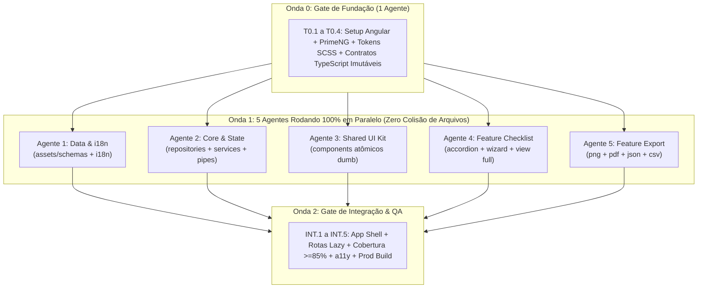

# Checklist de Implementação, Etapas e Progresso
**Projeto:** KinkConsentManager — Plataforma de Checklists de Limites e Consentimento (BDSM / D/s)  
**Documento:** Orquestração Multi-Agente, Matriz de Tarefas Modulares, Testes Unitários e Controle de Escopo V1  
**Versão:** 2.0 (Paralelismo Multi-Agente, TDD & Foco 100% Checklist na V1)  
**Data:** 21 de Novembro de 2026  

---

## 1. Estratégia de Orquestração em Paralelo (Multi-Agent Execution Plan)

Para acelerar o desenvolvimento com máxima segurança e zero conflito de edição de arquivos, a execução é dividida em **3 Ondas (Gates)**:
1. **Onda 0 (Gate de Fundação — Sequencial Rápido):** Prepara o workspace Angular e congela os contratos TypeScript (`core/models/`).
2. **Onda 1 (Execução Massiva em Paralelo — 5 Agentes Simultâneos):** Cada agente atua exclusivamente no seu conjunto isolado de diretórios e escreve código + testes unitários (`.spec.ts`).
3. **Onda 2 (Gate de Integração, QA e Build Final):** Conecta as rotas em `app.routes.ts` / `app.config.ts`, executa toda a suíte de testes com cobertura, audita acessibilidade e valida o build de produção.

---

## 2. Painel de Progresso por Trilha de Agente

| Trilha / Agente | Escopo Exclusivo | Tarefas | Concluídas | Specs Verificados | Cobertura Meta | Status Geral |
| :--- | :--- | :---: | :---: | :---: | :---: | :---: |
| **Onda 0 — Gate Fundação** | Setup, SCSS & Contratos | 4 | 0 | 0 / 1 | N/A | 🔴 Pendente |
| **Agente 1 — Data & i18n** | Schemas JSON & Traduções | 4 | 0 | 0 / 1 | 100% integridade | 🔴 Pendente |
| **Agente 2 — Core & State** | Repositories, Signals & I18n | 6 | 0 | 0 / 6 | >= 90% | 🔴 Pendente |
| **Agente 3 — Shared UI Kit** | Componentes Dumb Atômicos | 5 | 0 | 0 / 5 | >= 85% | 🔴 Pendente |
| **Agente 4 — Feature Checklist** | UX Mobile-First & Wizard | 5 | 0 | 0 / 5 | >= 85% | 🔴 Pendente |
| **Agente 5 — Feature Export** | Motores PNG, PDF, JSON, CSV | 6 | 0 | 0 / 6 | >= 90% | 🔴 Pendente |
| **Onda 2 — Integração & QA** | Rotas, E2E/QA, a11y & Build | 5 | 0 | 0 / 2 | >= 85% Global | 🔴 Pendente |
| **TOTAL V1 (Checklist)** | **100% Escopo V1** | **35** | **0** | **0 / 26** | **>= 85%** | **0%** |

*Legenda de Status:* `[ ] Pendente` · `[/] Em Progresso` · `[x] Concluído` · `[!] Bloqueado`

---

## 3. Checklist Granular de Implementação e Testes Unitários

### Onda 0: Gate de Fundação e Contratos (Bloqueante para Onda 1)

- [ ] **T0.1 — Inicializar Workspace Angular Standalone com TypeScript Estrito**
  - **Agente:** `Gate-0` | **Dependência:** Nenhuma
  - **Arquivos:** `package.json`, `angular.json`, `tsconfig.json`, `tsconfig.app.json`, `tsconfig.spec.json`
  - **DoD:** Projeto Angular 18+/19+ criado com `strict: true`, `strictTemplates: true`, `noImplicitOverride: true`, estilo SCSS e `standalone: true` padrão.
- [ ] **T0.2 — Instalar e Configurar Dependências Oficiais da V1**
  - **Agente:** `Gate-0` | **Dependência:** `T0.1`
  - **Dependências:** `primeng`, `primeicons`, `@ngx-translate/core`, `@ngx-translate/http-loader`, `html-to-image`, `pdfmake`, `@types/pdfmake`
  - **DoD:** Instalação limpa sem conflitos de peer dependencies; fontes PrimeIcons configuradas no `angular.json`.
- [ ] **T0.3 — Criar Sistema de Tokens SCSS e Mixins Responsivos**
  - **Agente:** `Gate-0` | **Dependência:** `T0.1`
  - **Arquivos:** `src/styles/_variables.scss`, `src/styles/_mixins.scss`, `src/styles.scss`
  - **DoD:** Cores das 5 escalas (`hard_limit` a `favorite`), cores de contraste e breakpoints mobile-first definidos.
- [ ] **T0.4 — Congelar Contratos TypeScript Compartilhados (`core/models/`)**
  - **Agente:** `Gate-0` | **Dependência:** `T0.1`
  - **Arquivos:** `src/app/core/models/checklist-schema.model.ts`, `checklist-answer.model.ts`, `export-config.model.ts`, `index.ts`
  - **Verificação:** `npx tsc --noEmit` passa com 0 erros.

---

### Onda 1 — Trilha Agente 1: Dados Neutros e Internacionalização (`assets/`)

- [ ] **A1.1 — Construir `checklist-v1.json` Orientado a IDs**
  - **Agente:** `Agent-Data` | **Dependência:** `T0.4`
  - **Arquivo:** `src/assets/schemas/checklist-v1.json`
  - **DoD:** Contém `schemaVersion: "1.0.0"`, 5 escalas com cores/ícones e os 8 grupos taxonômicos (Segurança/Saúde, Afeto/Geral, Bondage, Impact Play, Sensação/Dor, Dominação D/s, Roleplay/Gear, Edge/Breathplay) usando todos os 5 `QuestionType` e `allowOtherOption`.
- [ ] **A1.2 — Construir Dicionário `pt-BR.json`**
  - **Agente:** `Agent-Data` | **Dependência:** `A1.1`
  - **Arquivo:** `src/assets/i18n/pt-BR.json`
  - **DoD:** Traduções completas com terminologia natural brasileira para `ui`, `roles`, `scales`, `groups`, `items` (label + tooltip) e `options`.
- [ ] **A1.3 — Construir Dicionário `en-US.json`**
  - **Agente:** `Agent-Data` | **Dependência:** `A1.1`
  - **Arquivo:** `src/assets/i18n/en-US.json`
  - **DoD:** Traduções completas em inglês alinhadas aos termos de referência (Goctionni / Kinklist.gitlab.io).
- [ ] **A1.4 — Criar Teste Automatizado de Integridade e Paridade Schema ↔ i18n**
  - **Agente:** `Agent-Data` | **Dependência:** `A1.1`, `A1.2`, `A1.3`
  - **Arquivo:** `src/app/core/models/__tests__/schema-integrity.spec.ts`
  - **Verificação:** `ng test --include=**/schema-integrity.spec.ts` garante 100% de paridade de chaves entre `pt-BR.json`, `en-US.json` e todos os IDs de `checklist-v1.json`.

---

### Onda 1 — Trilha Agente 2: Core Repositories, Services & Pipes (`core/` + `shared/pipes/`)

- [ ] **A2.1 — Implementar `ISchemaRepository`, Token e `StaticJsonSchemaRepository` + Spec**
  - **Agente:** `Agent-Core` | **Dependência:** `T0.4`
  - **Arquivos:** `src/app/core/repositories/schema.repository.ts`, `static-json-schema.repository.ts`, `static-json-schema.repository.spec.ts`, `index.ts`
  - **Testes:** Mock HTTP via `HttpTestingController`, verificação de cache (`shareReplay`), erro em schema malformado.
- [ ] **A2.2 — Implementar `LocalStoragePersistenceService` + Spec**
  - **Agente:** `Agent-Core` | **Dependência:** `T0.4`
  - **Arquivos:** `src/app/core/services/local-storage-persistence.service.ts`, `local-storage-persistence.service.spec.ts`
  - **Testes:** Gravação/leitura segura, tolerância a JSON corrompido, tratamento de `QuotaExceededError`.
- [ ] **A2.3 — Implementar `BaseStateService<T>` + Spec**
  - **Agente:** `Agent-Core` | **Dependência:** `T0.4`
  - **Arquivos:** `src/app/core/services/base-state.service.ts`, `base-state.service.spec.ts`
  - **Testes:** `select()`, atualização parcial imutável `setState()`, `resetState()`.
- [ ] **A2.4 — Implementar `ChecklistStateService` + Spec**
  - **Agente:** `Agent-Core` | **Dependência:** `A2.2`, `A2.3`
  - **Arquivos:** `src/app/core/services/checklist-state.service.ts`, `checklist-state.service.spec.ts`
  - **Testes:** Cálculo de progresso dual/single-role, preservação independente de `primaryScale`/`secondaryScale`, filtros combinados (`searchQuery` + `onlyUnanswered`), navegação `nextCategory()`, `importDraft()`, `resetAllAnswers()`.
- [ ] **A2.5 — Implementar `I18nService` + Spec**
  - **Agente:** `Agent-Core` | **Dependência:** `T0.4`
  - **Arquivos:** `src/app/core/services/i18n.service.ts`, `i18n.service.spec.ts`
  - **Testes:** Troca reativa `pt-BR` ↔ `en-US`, fallback para ID se chave ausente, resolução dos 4 `RolePairId`, garantia de não mutação das respostas ao trocar idioma.
- [ ] **A2.6 — Implementar `SchemaTranslatePipe` + Spec**
  - **Agente:** `Agent-Core` | **Dependência:** `A2.5`
  - **Arquivos:** `src/app/shared/pipes/schema-translate.pipe.ts`, `schema-translate.pipe.spec.ts`, `index.ts`
  - **Testes:** Atualização automática do output quando o signal `currentLang` muda.

---

### Onda 1 — Trilha Agente 3: Shared Atomic UI Kit (`shared/components/`)

*Regra estrita:* Cada componente com 5 arquivos (`.component.ts`, `.component.html`, `.component.scss`, `.component.spec.ts`, `index.ts`), `OnPush` e zero dependência de `ChecklistStateService`.

- [ ] **A3.1 — Implementar `ScaleSelectorComponent` + Spec**
  - **Agente:** `Agent-UI` | **Dependência:** `T0.3`, `T0.4`
  - **Arquivos:** `src/app/shared/components/scale-selector/*`
  - **Testes:** Renderização de opções com ícone+cor, emissão de `scaleChange`, deseleção ao clicar no item ativo, atributos `role="radiogroup"`/`aria-checked`, estado `disabled`.
- [ ] **A3.2 — Implementar `DynamicQuestionItemComponent` + Spec**
  - **Agente:** `Agent-UI` | **Dependência:** `A3.1`
  - **Arquivos:** `src/app/shared/components/dynamic-question-item/*`
  - **Testes:** Renderização correta de todos os 5 tipos (`scale_matrix` dual e single, `single_choice`, `multiple_choice`, `allowOtherOption` condicional, `restricted_text` com contador `maxLength`), exibição condicional de tooltip.
- [ ] **A3.3 — Implementar `LegendBarComponent` + Spec**
  - **Agente:** `Agent-UI` | **Dependência:** `T0.3`, `T0.4`
  - **Arquivos:** `src/app/shared/components/legend-bar/*`
  - **Testes:** Renderização ordenada das 5 escalas com ícone, cor e label traduzido.
- [ ] **A3.4 — Implementar `ProgressIndicatorComponent` + Spec**
  - **Agente:** `Agent-UI` | **Dependência:** `T0.3`, `T0.4`
  - **Arquivos:** `src/app/shared/components/progress-indicator/*`
  - **Testes:** Exibição exata `answered / total`, clamping de porcentagem entre `0` e `100`.
- [ ] **A3.5 — Implementar `FullGridPreviewComponent` + Spec**
  - **Agente:** `Agent-UI` | **Dependência:** `T0.3`, `T0.4`
  - **Arquivos:** `src/app/shared/components/full-grid-preview/*`
  - **Testes:** Renderização vertical em largura total, formatação de respostas dual-role, single-role, múltiplas escolhas e texto restrito, além de modo impressão (`printMode`).

---

### Onda 1 — Trilha Agente 4: Feature Checklist (`features/checklist/`)

*Regra estrita:* Cada componente com 5 arquivos + testes unitários com stubs tipados dos contratos.

- [ ] **A4.1 — Implementar `ChecklistHeaderComponent` + Spec**
  - **Agente:** `Agent-Checklist` | **Dependência:** `T0.4`
  - **Arquivos:** `src/app/features/checklist/components/checklist-header/*`
  - **Testes:** Eventos de idioma, troca de `viewMode`, filtro de busca, toggle `onlyUnanswered`, botão abrir Quick-Fill e botão limpar.
- [ ] **A4.2 — Implementar `CategoryAccordionComponent` + Spec**
  - **Agente:** `Agent-Checklist` | **Dependência:** `T0.4`
  - **Arquivos:** `src/app/features/checklist/components/category-accordion/*`
  - **Testes:** Sincronização de `activeIndex`, disparo de `nextCategory` ao clicar em "Próxima Categoria", alteração de label do botão no último grupo para "Finalizar e Exportar".
- [ ] **A4.3 — Implementar `FullViewContainerComponent` + Spec**
  - **Agente:** `Agent-Checklist` | **Dependência:** `T0.4`
  - **Arquivos:** `src/app/features/checklist/components/full-view-container/*`
  - **Testes:** Renderização simultânea de todas as categorias filtradas, estado vazio amigável quando busca não encontra itens.
- [ ] **A4.4 — Implementar `QuickFillWizardModalComponent` + Spec**
  - **Agente:** `Agent-Checklist` | **Dependência:** `T0.4`
  - **Arquivos:** `src/app/features/checklist/components/quick-fill-wizard-modal/*`
  - **Testes:** Achatamento exclusivo de itens `scale_matrix` (separando papéis dual-role), captura de atalhos `1-5` e `0` (teclado + numpad), navegação por `ArrowUp`/`ArrowDown` e avanço automático.
- [ ] **A4.5 — Implementar `ChecklistPageComponent` (Smart Container) + Spec**
  - **Agente:** `Agent-Checklist` | **Dependência:** `A4.1` a `A4.4`
  - **Arquivos:** `src/app/features/checklist/pages/checklist-page/*`, `src/app/features/checklist/checklist.routes.ts`
  - **Testes:** Carregamento inicial via mock de `ISchemaRepository`, estado de erro/retry, confirmação antes de limpar respostas, manutenção de respostas na troca de idioma.

---

### Onda 1 — Trilha Agente 5: Feature Export Client-Side (`features/export/`)

- [ ] **A5.1 — Implementar `FileDownloadService` e `ChecklistFlattenService` + Specs**
  - **Agente:** `Agent-Export` | **Dependência:** `T0.4`
  - **Arquivos:** `src/app/features/export/services/file-download.service.ts`, `checklist-flatten.service.ts` + `.spec.ts`
  - **Testes:** Transformação fiel de dual-role, single-role, múltiplas escolhas e `otherText` em `FlattenedChecklistRow[]`.
- [ ] **A5.2 — Implementar `PngExportService` + Spec**
  - **Agente:** `Agent-Export` | **Dependência:** `A5.1`
  - **Arquivos:** `src/app/features/export/services/png-export.service.ts`, `.spec.ts`
  - **Testes:** Chamada ao wrapper `html-to-image` com `pixelRatio: 2`, acionamento do `FileDownloadService`, tratamento de rejeição de Canvas.
- [ ] **A5.3 — Implementar `PdfExportService` + Spec**
  - **Agente:** `Agent-Export` | **Dependência:** `A5.1`
  - **Arquivos:** `src/app/features/export/services/pdf-export.service.ts`, `.spec.ts`
  - **Testes:** Validação estrutural do `docDefinition` (cabeçalho, legenda, tabelas com `dontBreakRows: true`, paginação), invocação do wrapper `pdfmake`.
- [ ] **A5.4 — Implementar `JsonDraftService` + Spec**
  - **Agente:** `Agent-Export` | **Dependência:** `A5.1`
  - **Arquivos:** `src/app/features/export/services/json-draft.service.ts`, `.spec.ts`
  - **Testes:** Exportação do JSON draft; validação de importação rejeitando JSON corrompido, ausência de `answers` ou `schemaVersion` incompatível.
- [ ] **A5.5 — Implementar `CsvExportService` + Spec**
  - **Agente:** `Agent-Export` | **Dependência:** `A5.1`
  - **Arquivos:** `src/app/features/export/services/csv-export.service.ts`, `.spec.ts`
  - **Testes:** Presença obrigatória de `\uFEFF` (UTF-8 BOM) no início, cabeçalho correto, escape de aspas duplas, vírgulas e quebras de linha.
- [ ] **A5.6 — Implementar `ExportActionsToolbarComponent` e `ExportPageComponent` + Specs**
  - **Agente:** `Agent-Export` | **Dependência:** `A5.2` a `A5.5`
  - **Arquivos:** `src/app/features/export/components/export-actions-toolbar/*`, `src/app/features/export/pages/export-page/*`, `src/app/features/export/export.routes.ts`
  - **Testes:** Estados de loading por botão, disparo de cada formato, fluxo de importação JSON com feedback via `MessageService` (toast) e atualização da prévia.

---

### Onda 2: Gate Final — Integração, Qualidade e Build de Produção

- [ ] **INT.1 — Configurar `app.config.ts`, `app.routes.ts` e `AppComponent`**
  - **Agente:** `Agent-QA` | **Dependência:** Onda 1 Completa
  - **DoD:** Registro de `SCHEMA_REPOSITORY_TOKEN` (`StaticJsonSchemaRepository`), configuração `TranslateModule`, rotas lazy-loaded `/checklist` (default redirect) e `/export` (wildcard `**` redireciona para `/checklist`).
- [ ] **INT.2 — Executar Suíte Completa de Testes Unitários e Cobertura**
  - **Agente:** `Agent-QA` | **Dependência:** `INT.1`
  - **Comando:** `ng test --watch=false --code-coverage`
  - **DoD:** 100% dos 26 arquivos `.spec.ts` passando sem testes ignorados (`xit`/`fit`); cobertura global `>= 85%` (e `>= 90%` em `core/` e `export/services/`).
- [ ] **INT.3 — Auditoria de Acessibilidade (WCAG 2.1 AA) e Teclado**
  - **Agente:** `Agent-QA` | **Dependência:** `INT.1`
  - **DoD:** Fluxo completo navegável apenas por teclado (`Tab`, `Enter`, `Space`, `0-5`, setas); zero violações críticas de contraste ou `aria-label` ausente no axe/Lighthouse.
- [ ] **INT.4 — Validação Responsiva & Fluxo Ponta-a-Ponta (Mobile 360px / Desktop 1280px)**
  - **Agente:** `Agent-QA` | **Dependência:** `INT.1`
  - **DoD:** Accordion + botão Next funcional em viewport `360x740`; View Full + Quick-Fill funcional em desktop; downloads reais validados para PNG, PDF, JSON (export + re-import) e CSV (abertura com acentos preservados).
- [ ] **INT.5 — Build de Produção Otimizado**
  - **Agente:** `Agent-QA` | **Dependência:** `INT.2`, `INT.3`, `INT.4`
  - **Comando:** `ng build --configuration production`
  - **DoD:** Build concluído com 0 erros e orçamentos de bundle respeitados.

---

## 4. Backlog Fora de Escopo na V1 (Decisão Posterior)

Os itens abaixo estão intencionalmente **excluídos da implementação V1** e não possuem tarefas ativas no checklist acima. Caso seja decidido implementá-los após a estabilização da V1, deverão originar um novo ciclo de levantamento e plano específico:

| ID Futuro | Módulo / Capacidade | Status na V1 |
| :--- | :--- | :--- |
| **FUT-01** | Motor de Geração de Contratos D/s | `[FORA DE ESCOPO V1 - DECIDIR DEPOIS]` |
| **FUT-02** | Custom Builder Visual de Schemas | `[FORA DE ESCOPO V1 - DECIDIR DEPOIS]` |
| **FUT-03** | Gestão de Play Partners & Comparação (Match/Diff) | `[FORA DE ESCOPO V1 - DECIDIR DEPOIS]` |
| **FUT-04** | Exportação Nativa em Excel (`.xlsx`) Multi-abas | `[FORA DE ESCOPO V1 - DECIDIR DEPOIS]` |
| **FUT-05** | Backend API Node.js & Persistência Remota | `[FORA DE ESCOPO V1 - DECIDIR DEPOIS]` |
| **FUT-06** | Integração ATProto / Bluesky ou Compartilhamento Público | `[FORA DE ESCOPO V1 - DECIDIR DEPOIS]` |
