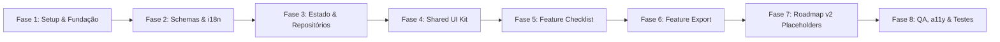

# Checklist de Implementação, Etapas e Progresso
**Projeto:** Plataforma de Gestão de Limites, Consentimento e Práticas Consensuais (BDSM / D/s)  
**Documento:** Plano de Trabalho, Matriz de Tarefas, Critérios de Aceite e Acompanhamento de Progresso  
**Versão:** 1.0  
**Data:** 21 de Novembro de 2026  

---

## 1. Visão Geral das Fases de Entrega

O plano de execução está estruturado em **8 Fases Incrementais**, garantindo que cada bloco entregue forneça valor testável e mantenha a estrita conformidade arquitetural definida no Blueprint:

---

## 2. Resumo de Progresso Global

| Fase | Descrição | Itens Totais | Concluídos | Em Progresso | Pendentes | Status |
| :--- | :--- | :---: | :---: | :---: | :---: | :---: |
| **Fase 1** | Setup do Projeto e Fundação Arquitetural | 5 | 0 | 0 | 5 | 🔴 Não iniciado |
| **Fase 2** | Schemas de Dados e Internacionalização | 4 | 0 | 0 | 4 | 🔴 Não iniciado |
| **Fase 3** | Camada de Estado e Serviços Core | 5 | 0 | 0 | 5 | 🔴 Não iniciado |
| **Fase 4** | Shared UI Kit e Componentes Atômicos | 5 | 0 | 0 | 5 | 🔴 Não iniciado |
| **Fase 5** | Feature Checklist (Preenchimento Interativo) | 6 | 0 | 0 | 6 | 🔴 Não iniciado |
| **Fase 6** | Feature Export (Motores Gráficos Client-Side) | 6 | 0 | 0 | 6 | 🔴 Não iniciado |
| **Fase 7** | Telas de Roadmap v2 (Placeholders) | 4 | 0 | 0 | 4 | 🔴 Não iniciado |
| **Fase 8** | Testes Unitários, Acessibilidade e Build | 5 | 0 | 0 | 5 | 🔴 Não iniciado |
| **TOTAL** | **Consolidado do Projeto** | **40** | **0** | **0** | **40** | **0%** |

*Legenda de Status: `[ ] Pendente`, `[/] Em Progresso`, `[x] Concluído`, `[!] Bloqueado`*

---

## 3. Detalhamento das Tarefas e Critérios de Aceite

### Fase 1: Setup do Projeto e Fundação Arquitetural
*Objetivo:* Configurar a base do projeto Angular com TypeScript estrito, PrimeNG, PrimeIcons e suporte a SCSS.

- [ ] **TASK-1.1: Inicialização do Workspace Angular 18+/19+**
  - **Arquivos:** `package.json`, `angular.json`, `tsconfig.json`
  - **Critério de Aceite:** Aplicação criada com modo standalone ativo, compilação estrita (`strict: true`) e roteamento habilitado.
- [ ] **TASK-1.2: Instalação e Configuração de Dependências de UI**
  - **Arquivos:** `package.json`, `angular.json`, `src/styles.scss`
  - **Dependências:** `primeng`, `primeicons`, `@ngx-translate/core`, `@ngx-translate/http-loader`, `html-to-image`, `pdfmake`
  - **Critério de Aceite:** PrimeNG e ícones carregando estilos sem erros no console.
- [ ] **TASK-1.3: Estruturação dos Diretórios Globais**
  - **Diretórios:** `src/app/core`, `src/app/shared`, `src/app/features`, `src/assets/schemas`, `src/assets/i18n`
  - **Critério de Aceite:** Árvore de pastas criada de acordo com o padrão do documento arquitetural.
- [ ] **TASK-1.4: Configuração de Variáveis Globais de Estilo e Breakpoints**
  - **Arquivos:** `src/styles/_variables.scss`, `src/styles/_mixins.scss`
  - **Critério de Aceite:** Cores das escalas padronizadas e mixins mobile-first disponíveis para importação.
- [ ] **TASK-1.5: Configuração do Roteamento Base e Lazy Loading**
  - **Arquivos:** `src/app/app.routes.ts`, `src/app/app.config.ts`
  - **Critério de Aceite:** Rotas `/checklist`, `/export`, `/contract`, `/custom-builder` e `/partners` mapeadas com lazy loading.

---

### Fase 2: Schemas de Dados e Internacionalização (i18n)
*Objetivo:* Estruturar a inteligência de domínio em arquivos neutros orientados a IDs e suas respectivas traduções.

- [ ] **TASK-2.1: Criação do Schema Estrutural v1**
  - **Arquivos:** `src/assets/schemas/checklist-v1.json`
  - **Critério de Aceite:** Schema JSON contendo `schemaVersion`, escalas oficiais de 5 pontos e grupos com categorias essenciais (Impact Play, Restritivo, Dominação, Cuidados Médicos, etc.) contendo flags `defaultDualRole`.
- [ ] **TASK-2.2: Criação do Arquivo de Tradução em Português**
  - **Arquivos:** `src/assets/i18n/pt-BR.json`
  - **Critério de Aceite:** Todas as chaves de IDs do schema mapeadas para termos consagrados da cena BDSM/D-s brasileira, com títulos, descrições e tooltips completos.
- [ ] **TASK-2.3: Criação do Arquivo de Tradução em Inglês**
  - **Arquivos:** `src/assets/i18n/en-US.json`
  - **Critério de Aceite:** Todas as chaves equivalentes perfeitamente traduzidas e revisadas em inglês internacional.
- [ ] **TASK-2.4: Validação de Paridade de Chaves de Tradução**
  - **Arquivos:** Script ou teste de validação de paridade
  - **Critério de Aceite:** Garantir que não existam chaves presentes em `pt-BR.json` ausentes em `en-US.json` e vice-versa.

---

### Fase 3: Camada de Estado e Serviços Core
*Objetivo:* Criar a arquitetura reativa com Signals e a abstração de dados (Padrão Repository).

- [ ] **TASK-3.1: Modelos e Interfaces TypeScript (DTOs)**
  - **Arquivos:** `src/app/core/models/checklist-schema.model.ts`, `checklist-answer.model.ts`, `export-config.model.ts`
  - **Critério de Aceite:** Interfaces tipadas para escalas, itens, grupos, respostas individuais e rascunhos.
- [ ] **TASK-3.2: Classe Abstrata Base de Estado (`BaseStateService<T>`)**
  - **Arquivos:** `src/app/core/services/base-state.service.ts`
  - **Critério de Aceite:** Implementação de classe base genérica usando `signal()`, `computed()` e método `setState()`.
- [ ] **TASK-3.3: Repositório de Schemas e Interface (`ISchemaRepository`)**
  - **Arquivos:** `src/app/core/repositories/schema.repository.interface.ts`, `static-json-schema.repository.ts`
  - **Critério de Aceite:** Leitura assíncrona do JSON estático com cache e tratamento de erros, permitindo futura troca para Node.js na v2.
- [ ] **TASK-3.4: Serviço Central de Estado (`ChecklistStateService`)**
  - **Arquivos:** `src/app/core/services/checklist-state.service.ts`
  - **Critério de Aceite:** Métodos para atualizar respostas por item, alternar visualização (accordion/full), computar progresso e carregar rascunhos.
- [ ] **TASK-3.5: Serviço de Internacionalização (`I18nService`)**
  - **Arquivos:** `src/app/core/services/i18n.service.ts`
  - **Critério de Aceite:** Troca de idioma reativa mantendo o estado do checklist intacto.

---

### Fase 4: Shared UI Kit e Componentes Atômicos
*Objetivo:* Construir componentes de interface reutilizáveis seguindo estritamente a regra dos 4 arquivos separados.

- [ ] **TASK-4.1: Componente Seletor de Escalas (`ScaleSelectorComponent`)**
  - **Arquivos:** `scale-selector.component.{ts,html,scss,spec.ts}`
  - **Critério de Aceite:** Círculos estilizados com cores e ícones PrimeIcons, acessíveis via teclado, com estados hover e selecionado.
- [ ] **TASK-4.2: Componente Dinâmico de Pergunta (`DynamicQuestionItemComponent`)**
  - **Arquivos:** `dynamic-question-item.component.{ts,html,scss,spec.ts}`
  - **Critério de Aceite:** Suporte a `scale_matrix` (com dual-role ou papel único), `single_choice`, `multiple_choice`, flag `allowOtherOption` (com input de texto) e `restricted_text` com limite de caracteres.
- [ ] **TASK-4.3: Componente de Barra de Progresso (`ProgressIndicatorComponent`)**
  - **Arquivos:** `progress-indicator.component.{ts,html,scss,spec.ts}`
  - **Critério de Aceite:** Barra de progresso reativa conectada ao Signal do `ChecklistStateService`.
- [ ] **TASK-4.4: Componente de Visualização do Grid Completo (`FullGridPreviewComponent`)**
  - **Arquivos:** `full-grid-preview.component.{ts,html,scss,spec.ts}`
  - **Critério de Aceite:** Renderização em **Full Grid Vertical** com alta legibilidade e contraste, preparado para captura de imagem e impressão.
- [ ] **TASK-4.5: Componente Badge e Modal de Roadmap (`ComingSoonBadgeComponent`)**
  - **Arquivos:** `coming-soon-badge.component.{ts,html,scss,spec.ts}`
  - **Critério de Aceite:** Tag visual "Em Breve" com abertura de modal informativo ao clicar.

---

### Fase 5: Feature Checklist (Preenchimento Interativo)
*Objetivo:* Construir a página principal `/checklist` com fluxo guiado mobile-first e alternância para visão completa.

- [ ] **TASK-5.1: Barra Superior do Checklist (`ChecklistHeaderComponent`)**
  - **Arquivos:** `checklist-header.component.{ts,html,scss,spec.ts}`
  - **Critério de Aceite:** Controles de idioma (pt-BR / en-US), botão de alternância (Modo Guiado Accordion vs. View Full) e barra de progresso.
- [ ] **TASK-5.2: Navegação Sanfonada com Botão Next (`CategoryAccordionComponent`)**
  - **Arquivos:** `category-accordion.component.{ts,html,scss,spec.ts}`
  - **Critério de Aceite:** Renderização de cada categoria em painel sanfonado (`p-accordion`). Ao final de cada categoria, botão **`Próxima Categoria`** fecha a atual e abre a seguinte.
- [ ] **TASK-5.3: Container de Visão Completa (`FullViewContainerComponent`)**
  - **Arquivos:** `full-view-container.component.{ts,html,scss,spec.ts}`
  - **Critério de Aceite:** Renderização contínua de todas as categorias expandidas simultaneamente para revisão rápida em desktop.
- [ ] **TASK-5.4: Página Principal do Checklist (`ChecklistPageComponent`)**
  - **Arquivos:** `checklist-page.component.{ts,html,scss,spec.ts}`
  - **Critério de Aceite:** Orquestração dos componentes acima, carregamento do schema via repositório e tratamento de estados de carregamento.
- [ ] **TASK-5.5: Persistência Local Automática de Rascunho (Auto-Save LocalStorage)**
  - **Arquivos:** `src/app/core/services/checklist-state.service.ts`
  - **Critério de Aceite:** Respostas salvas silenciosamente no `localStorage` do navegador para evitar perda acidental de dados ao recarregar a aba.
- [ ] **TASK-5.6: Ação de Conclusão e Navegação para Exportação**
  - **Arquivos:** `category-accordion.component.html`, `checklist-page.component.ts`
  - **Critério de Aceite:** Na última categoria, o botão avança para a rota `/export` com todos os dados mantidos.

---

### Fase 6: Feature Export e Motores Gráficos Client-Side
*Objetivo:* Implementar a página de exportação `/export` com motores de geração 100% no navegador.

- [ ] **TASK-6.1: Serviço de Exportação em Imagem PNG (`PngExportService`)**
  - **Arquivos:** `src/app/features/export/services/png-export.service.ts`
  - **Critério de Aceite:** Download de imagem PNG de alta resolução (Full Grid Vertical de 1200px) sem enviar dados para a internet.
- [ ] **TASK-6.2: Serviço de Exportação em Documento PDF (`PdfExportService`)**
  - **Arquivos:** `src/app/features/export/services/pdf-export.service.ts`
  - **Critério de Aceite:** Download de PDF diagramado via `pdfmake` com legenda de cores, cabeçalho e sem quebras de linha em meio aos itens.
- [ ] **TASK-6.3: Serviço de Rascunho Portátil JSON (`JsonDraftService`)**
  - **Arquivos:** `src/app/features/export/services/json-draft.service.ts`
  - **Critério de Aceite:** Exportação de JSON leve e importação funcional restaurando todas as respostas na tela.
- [ ] **TASK-6.4: Serviço de Exportação Tabular CSV (`CsvExportService`)**
  - **Arquivos:** `src/app/features/export/services/csv-export.service.ts`
  - **Critério de Aceite:** Geração de arquivo CSV estruturado com codificação UTF-8 BOM, garantindo abertura correta no Excel.
- [ ] **TASK-6.5: Toolbar de Ações de Exportação (`ExportActionsToolbarComponent`)**
  - **Arquivos:** `export-actions-toolbar.component.{ts,html,scss,spec.ts}`
  - **Critério de Aceite:** Botões para PNG, PDF, JSON e CSV, com status de loading individual durante o processamento do arquivo.
- [ ] **TASK-6.6: Página de Exportação (`ExportPageComponent`)**
  - **Arquivos:** `export-page.component.{ts,html,scss,spec.ts}`
  - **Critério de Aceite:** Exibição da toolbar de exportação e pré-visualização completa dos dados através do `FullGridPreviewComponent`.

---

### Fase 7: Telas de Roadmap da Versão 2 (Placeholders)
*Objetivo:* Fornecer telas informativas e polidas para as funcionalidades futuras mapeadas no Blueprint.

- [ ] **TASK-7.1: Página de Motor de Contratos D/s (`ContractsPlaceholderComponent`)**
  - **Arquivos:** `contracts-placeholder.component.{ts,html,scss,spec.ts}`
  - **Critério de Aceite:** Apresentação da funcionalidade futura de conversão de respostas em cláusulas de contrato consensual.
- [ ] **TASK-7.2: Página de Custom Builder (`CustomBuilderPlaceholderComponent`)**
  - **Arquivos:** `custom-builder-placeholder.component.{ts,html,scss,spec.ts}`
  - **Critério de Aceite:** Apresentação do editor visual planejado para criação de grupos e itens customizados.
- [ ] **TASK-7.3: Página de Gestão de Play Partners (`PartnersPlaceholderComponent`)**
  - **Arquivos:** `partners-placeholder.component.{ts,html,scss,spec.ts}`
  - **Critério de Aceite:** Apresentação da funcionalidade futura de comparação cruzada de limites (*Partner Match/Diff*).
- [ ] **TASK-7.4: Botão de Exportação Excel (.xlsx) com Badge Coming Soon**
  - **Arquivos:** `export-actions-toolbar.component.html`
  - **Critério de Aceite:** Botão estilizado com badge do PrimeNG disparando o modal explicativo da v2.

---

### Fase 8: Testes Unitários, Acessibilidade (a11y) e Build
*Objetivo:* Garantir qualidade estrita, conformidade com padrões de acessibilidade e empacotamento otimizado.

- [ ] **TASK-8.1: Testes Unitários dos Serviços Core**
  - **Arquivos:** `base-state.service.spec.ts`, `checklist-state.service.spec.ts`, `i18n.service.spec.ts`, `static-json-schema.repository.spec.ts`
  - **Critério de Aceite:** Cobertura de testes unitários superior a 85% na camada de estado e lógica de negócio.
- [ ] **TASK-8.2: Testes Unitários dos Componentes Shared**
  - **Arquivos:** `scale-selector.component.spec.ts`, `dynamic-question-item.component.spec.ts`, etc.
  - **Critério de Aceite:** Verificação de renderização condicional por tipo e emissão correta de eventos.
- [ ] **TASK-8.3: Auditoria de Acessibilidade (WCAG 2.1 AA)**
  - **Critério de Aceite:** Ausência de erros críticos de acessibilidade no Lighthouse/axe-core (contraste de cores, aria-labels nas escalas, navegação por teclado).
- [ ] **TASK-8.4: Teste de Responsividade Cross-Device**
  - **Critério de Aceite:** Funcionamento e fluidez comprovados em telas mobile (360px a 430px), tablets (768px) e desktops (1080p+).
- [ ] **TASK-8.5: Build de Produção e Otimização de Bundles**
  - **Comando:** `ng build --configuration production`
  - **Critério de Aceite:** Build gerado sem warnings críticos, com tree-shaking ativo e orçamentos de tamanho de bundle respeitados.

---

## 4. Gestão de Riscos e Mitigações Técnicas

| Risco Identificado | Impacto | Probabilidade | Estratégia de Mitigação |
| :--- | :---: | :---: | :--- |
| **Lentidão na geração de PNG em listas muito extensas** | Médio | Média | Renderizar o `FullGridPreviewComponent` com layout em bloco único vertical otimizado e utilizar `pixelRatio: 2` de forma assíncrona com spinner de carregamento. |
| **Quebra de páginas no PDF separando perguntas** | Alto | Baixa | Configurar a propriedade `dontBreakRows: true` nas tabelas do `pdfmake` e pré-calcular a altura dos blocos de categoria. |
| **Acentos quebrados no CSV aberto no Excel** | Médio | Alta | Incluir obrigatoriamente o prefixo UTF-8 BOM (`\uFEFF`) antes da geração do `Blob` no `CsvExportService`. |
| **Perda de respostas ao trocar de idioma** | Crítico | Baixa | O `ChecklistStateService` armazena respostas estritamente indexadas por `itemId` neutro. O `I18nService` atua exclusivamente na camada de apresentação visual, sem alterar o estado. |

---

## 5. Histórico de Atualizações do Documento

| Data | Versão | Autor | Descrição das Alterações |
| :---: | :---: | :---: | :--- |
| 21/11/2026 | 1.0 | Antigravity AI Team | Criação inicial do plano de trabalho, tarefas detalhadas e critérios de aceite. |
