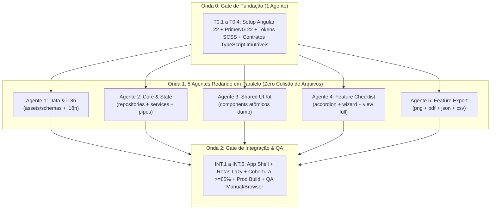

# Checklist de Implementação, Etapas e Progresso
**Projeto:** KinkConsentManager — Plataforma de Checklists de Limites e Consentimento (BDSM / D/s)  
**Documento:** Orquestração Multi-Agente, Matriz de Tarefas Modulares, Testes Unitários e Controle de Escopo V1  
**Versão:** 2.2 (Atualizado após Evoluções `v1.2.4` — Dashboard, Rotas Modulares, Web Workers/XLSX, Acessibilidade e 3 Temas)  
**Data:** 25 de Novembro de 2026  

---

## 1. Estratégia de Orquestração em Paralelo (Multi-Agent Execution Plan)

Para acelerar o desenvolvimento com máxima segurança e zero conflito de edição de arquivos, a execução foi dividida em **3 Ondas (Gates)**:
1. **Onda 0 (Gate de Fundação — Sequencial Rápido):** Prepara o workspace Angular e congela os contratos TypeScript (`core/models/`).
2. **Onda 1 (Execução Massiva em Paralelo — 5 Subagentes em 2 Sub-ondas):** Cada agente atuou exclusivamente no seu conjunto isolado de diretórios e escreveu código + testes unitários (`.spec.ts`).
3. **Onda 2 (Gate de Integração, QA e Build Final):** Conecta as rotas em `app.routes.ts` / `app.config.ts`, executa toda a suíte de testes com cobertura e valida o build de produção.

---

## 2. Painel de Progresso por Trilha de Agente

| Trilha / Agente | Escopo Exclusivo | Tarefas | Concluídas | Specs Passando | Cobertura Observada (v8) | Status Geral |
| :--- | :--- | :---: | :---: | :---: | :---: | :---: |
| **Onda 0 — Gate Fundação** | Setup, SCSS & Contratos | 4 | 4 | 1 / 1 (`app.component.spec.ts` baseline) | 100% (`core/models`) | 🟢 Concluído |
| **Agente 1 — Data & i18n** | Schemas JSON & Traduções | 4 | 4 | 1 / 1 (4 testes) | 100% integridade | 🟢 Concluído |
| **Agente 2 — Core & State** | Repositories, Signals & I18n | 6 | 6 | 6 / 6 (38 testes) | 100% repo · 98,72% services · 100% pipes | 🟢 Concluído |
| **Agente 3 — Shared UI Kit** | Componentes Dumb Atômicos | 5 | 5 | 5 / 5 (24 testes) | 87,5%–100% por componente | 🟢 Concluído |
| **Agente 4 — Feature Checklist** | UX Mobile-First & Wizard | 5 | 5 | 5 / 5 (31 testes) | 85,02%–100% por componente | 🟢 Concluído |
| **Agente 5 — Feature Export** | Motores PNG, PDF, JSON, CSV | 6 | 6 | 8 / 8 (39 testes) | 88,15% services · 87,05%–95,28% UI | 🟢 Concluído |
| **Onda 2 — Integração & QA** | Rotas, Cobertura, Build & QA Browser | 5 | 3 | 26 / 26 (**140 testes**) | **92,69% Stmts / 92,82% Lines Global** | 🟡 Código/Build OK · QA Browser Pendente |
| **TOTAL V1 (Checklist)** | **Escopo V1** | **35** | **33** | **26 / 26 (140 testes)** | **92,69% Global** | **94% (Código & Testes Unitários 100%)** |

*Legenda de Status:* `[ ] Pendente` · `[/] Em Progresso` · `[x] Concluído` · `[!] Bloqueado`

---

## 3. Checklist Granular de Implementação e Testes Unitários

### Onda 0: Gate de Fundação e Contratos (Bloqueante para Onda 1)

- [x] **T0.1 — Inicializar Workspace Angular Standalone com TypeScript Estrito**
  - **Agente:** `Gate-0` | **Dependência:** Nenhuma
  - **Arquivos:** `package.json`, `angular.json`, `tsconfig.json`, `tsconfig.app.json`, `tsconfig.spec.json`
  - **DoD:** Projeto Angular 22.1.2 criado com `strict: true`, `strictTemplates: true`, `noImplicitOverride: true`, estilo SCSS, Vitest e `standalone` padrão.
- [x] **T0.2 — Instalar e Configurar Dependências Oficiais da V1**
  - **Agente:** `Gate-0` | **Dependência:** `T0.1`
  - **Dependências:** `primeng@22.1.5`, `@angular/cdk@^22.3.0`, `@primeuix/themes@^3.1.1`, `primeicons@^8.0.2`, `@ngx-translate/core@^18.1.0`, `@ngx-translate/http-loader@^18.1.0`, `html-to-image@^1.11.13`, `pdfmake@^0.3.15`, `@types/pdfmake@^0.3.3`, `@vitest/coverage-v8@^4.0.8`
  - **DoD:** Instalação limpa sem conflitos; `primeicons.css` e `src/assets` configurados em `angular.json`.
- [x] **T0.3 — Criar Sistema de Tokens SCSS e Mixins Responsivos**
  - **Agente:** `Gate-0` | **Dependência:** `T0.1`
  - **Arquivos:** `src/styles/_variables.scss`, `src/styles/_mixins.scss`, `src/styles.scss`
  - **DoD:** Cores das 5 escalas (`hard_limit` a `favorite`), cores de contraste e breakpoints mobile-first definidos com `includePaths: ["src/styles"]`.
- [x] **T0.4 — Congelar Contratos TypeScript Compartilhados (`core/models/`)**
  - **Agente:** `Gate-0` | **Dependência:** `T0.1`
  - **Arquivos:** `src/app/core/models/checklist-schema.model.ts`, `checklist-answer.model.ts`, `export-config.model.ts`, `index.ts`
  - **Verificação:** `npx.cmd tsc --noEmit` passou com 0 erros.

---

### Onda 1 — Trilha Agente 1: Dados Neutros e Internacionalização (`assets/`)

- [x] **A1.1 — Construir `checklist-v1.json` Orientado a IDs**
  - **Agente:** `Agent-Data` | **Dependência:** `T0.4`
  - **Arquivo:** `src/assets/schemas/checklist-v1.json`
  - **DoD:** Contém `schemaVersion: "1.0.0"`, 5 escalas com cores/ícones e 8 grupos taxonômicos (51 itens, 23 opções) usando os tipos `scale_matrix`, `single_choice`, `multiple_choice`, `restricted_text` e `allowOtherOption`.
- [x] **A1.2 — Construir Dicionário `pt-BR.json`**
  - **Agente:** `Agent-Data` | **Dependência:** `A1.1`
  - **Arquivo:** `src/assets/i18n/pt-BR.json`
  - **DoD:** Traduções completas para `ui`, `roles`, `scales`, `groups`, `items` (`label` + `tooltip`) e `options`.
- [x] **A1.3 — Construir Dicionário `en-US.json`**
  - **Agente:** `Agent-Data` | **Dependência:** `A1.1`
  - **Arquivo:** `src/assets/i18n/en-US.json`
  - **DoD:** Traduções completas em inglês com 100% de paridade de chaves.
- [x] **A1.4 — Criar Teste Automatizado de Integridade e Paridade Schema ↔ i18n**
  - **Agente:** `Agent-Data` | **Dependência:** `A1.1`, `A1.2`, `A1.3`
  - **Arquivo:** `src/app/core/models/__tests__/schema-integrity.spec.ts`
  - **Verificação:** **4/4 testes passaram** garantindo 100% de paridade recursiva e cobertura de todos os IDs.

---

### Onda 1 — Trilha Agente 2: Core Repositories, Services & Pipes (`core/` + `shared/pipes/`)

- [x] **A2.1 — Implementar `ISchemaRepository`, Token e `StaticJsonSchemaRepository` + Spec**
  - **Agente:** `Agent-Core` | **Dependência:** `T0.4`
  - **Arquivos:** `src/app/core/repositories/schema.repository.ts`, `static-json-schema.repository.ts`, `static-json-schema.repository.spec.ts`, `index.ts`
  - **Testes:** **7/7 passaram** (100% cobertura).
- [x] **A2.2 — Implementar `LocalStoragePersistenceService` + Spec**
  - **Agente:** `Agent-Core` | **Dependência:** `T0.4`
  - **Arquivos:** `src/app/core/services/local-storage-persistence.service.ts`, `local-storage-persistence.service.spec.ts`
  - **Testes:** **6/6 passaram** (96,87% cobertura).
- [x] **A2.3 — Implementar `BaseStateService<T>` + Spec**
  - **Agente:** `Agent-Core` | **Dependência:** `T0.4`
  - **Arquivos:** `src/app/core/services/base-state.service.ts`, `base-state.service.spec.ts`
  - **Testes:** **4/4 passaram** (100% cobertura).
- [x] **A2.4 — Implementar `ChecklistStateService` + Spec**
  - **Agente:** `Agent-Core` | **Dependência:** `A2.2`, `A2.3`
  - **Arquivos:** `src/app/core/services/checklist-state.service.ts`, `checklist-state.service.spec.ts`
  - **Testes:** **12/12 passaram** (98,95% stmts).
- [x] **A2.5 — Implementar `I18nService` + Spec**
  - **Agente:** `Agent-Core` | **Dependência:** `T0.4`
  - **Arquivos:** `src/app/core/services/i18n.service.ts`, `i18n.service.spec.ts`
  - **Testes:** **7/7 passaram** (98,78% stmts).
- [x] **A2.6 — Implementar `SchemaTranslatePipe` + Spec**
  - **Agente:** `Agent-Core` | **Dependência:** `A2.5`
  - **Arquivos:** `src/app/shared/pipes/schema-translate.pipe.ts`, `schema-translate.pipe.spec.ts`, `index.ts`
  - **Testes:** **2/2 passaram** (100% cobertura).

---

### Onda 1 — Trilha Agente 3: Shared Atomic UI Kit (`shared/components/`)

- [x] **A3.1 — Implementar `ScaleSelectorComponent` + Spec**
  - **Agente:** `Agent-UI` | **Dependência:** `T0.3`, `T0.4`
  - **Arquivos:** `src/app/shared/components/scale-selector/*` (4+1 arquivos)
  - **Testes:** **7/7 passaram** (87,5% stmts).
- [x] **A3.2 — Implementar `DynamicQuestionItemComponent` + Spec**
  - **Agente:** `Agent-UI` | **Dependência:** `A3.1`
  - **Arquivos:** `src/app/shared/components/dynamic-question-item/*` (4+1 arquivos)
  - **Testes:** **7/7 passaram** (97,1% stmts).
- [x] **A3.3 — Implementar `LegendBarComponent` + Spec**
  - **Agente:** `Agent-UI` | **Dependência:** `T0.3`, `T0.4`
  - **Arquivos:** `src/app/shared/components/legend-bar/*` (4+1 arquivos)
  - **Testes:** **2/2 passaram** (100% cobertura).
- [x] **A3.4 — Implementar `ProgressIndicatorComponent` + Spec**
  - **Agente:** `Agent-UI` | **Dependência:** `T0.3`, `T0.4`
  - **Arquivos:** `src/app/shared/components/progress-indicator/*` (4+1 arquivos)
  - **Testes:** **3/3 passaram** (95,83% stmts).
- [x] **A3.5 — Implementar `FullGridPreviewComponent` + Spec**
  - **Agente:** `Agent-UI` | **Dependência:** `T0.3`, `T0.4`
  - **Arquivos:** `src/app/shared/components/full-grid-preview/*` (4+1 arquivos) + `shared/components/index.ts`
  - **Testes:** **5/5 passaram** (96,23% stmts).

---

### Onda 1 — Trilha Agente 4: Feature Checklist (`features/checklist/`)

- [x] **A4.1 — Implementar `ChecklistHeaderComponent` + Spec**
  - **Agente:** `Agent-Checklist` | **Dependência:** `T0.4`
  - **Arquivos:** `src/app/features/checklist/components/checklist-header/*` (4+1 arquivos)
  - **Testes:** **7/7 passaram** (100% stmts).
- [x] **A4.2 — Implementar `CategoryAccordionComponent` + Spec**
  - **Agente:** `Agent-Checklist` | **Dependência:** `T0.4`
  - **Arquivos:** `src/app/features/checklist/components/category-accordion/*` (4+1 arquivos)
  - **Testes:** **6/6 passaram** (100% stmts).
- [x] **A4.3 — Implementar `FullViewContainerComponent` + Spec**
  - **Agente:** `Agent-Checklist` | **Dependência:** `T0.4`
  - **Arquivos:** `src/app/features/checklist/components/full-view-container/*` (4+1 arquivos)
  - **Testes:** **5/5 passaram** (100% stmts).
- [x] **A4.4 — Implementar `QuickFillWizardModalComponent` + Spec**
  - **Agente:** `Agent-Checklist` | **Dependência:** `T0.4`
  - **Arquivos:** `src/app/features/checklist/components/quick-fill-wizard-modal/*` (4+1 arquivos)
  - **Testes:** **6/6 passaram** (88,11% stmts).
- [x] **A4.5 — Implementar `ChecklistPageComponent` (Smart Container) + Helpers + Routes + Spec**
  - **Agente:** `Agent-Checklist` | **Dependência:** `A4.1` a `A4.4`
  - **Arquivos:** `src/app/features/checklist/pages/checklist-page/*`, `utils/checklist-view.helpers.ts`, `checklist.routes.ts`, `index.ts`
  - **Testes:** **7/7 passaram** (`checklist-page`: 85,02% stmts).

---

### Onda 1 — Trilha Agente 5: Feature Export Client-Side (`features/export/`)

- [x] **A5.1 — Implementar `FileDownloadService` e `ChecklistFlattenService` + Specs**
  - **Agente:** `Agent-Export` | **Dependência:** `T0.4`
  - **Arquivos:** `src/app/features/export/services/file-download.service.ts`, `checklist-flatten.service.ts` + `.spec.ts`
  - **Testes:** **3/3 + 4/4 passaram** (95,83% e 98,27% stmts).
- [x] **A5.2 — Implementar `PngExportService` + Spec**
  - **Agente:** `Agent-Export` | **Dependência:** `A5.1`
  - **Arquivos:** `src/app/features/export/services/png-export.service.ts`, `.spec.ts`
  - **Testes:** **5/5 passaram** (88,88% stmts).
- [x] **A5.3 — Implementar `PdfExportService` + Spec**
  - **Agente:** `Agent-Export` | **Dependência:** `A5.1`
  - **Arquivos:** `src/app/features/export/services/pdf-export.service.ts`, `.spec.ts`
  - **Testes:** **3/3 passaram** (73,68% stmts; lazy loader `pdfmake@0.3.15` validado em runtime Node gerando `%PDF-`).
- [x] **A5.4 — Implementar `JsonDraftService` + Spec**
  - **Agente:** `Agent-Export` | **Dependência:** `A5.1`
  - **Arquivos:** `src/app/features/export/services/json-draft.service.ts`, `.spec.ts`
  - **Testes:** **7/7 passaram** (98,03% stmts).
- [x] **A5.5 — Implementar `CsvExportService` + Spec**
  - **Agente:** `Agent-Export` | **Dependência:** `A5.1`
  - **Arquivos:** `src/app/features/export/services/csv-export.service.ts`, `.spec.ts`
  - **Testes:** **3/3 passaram** (100% stmts).
- [x] **A5.6 — Implementar `ExportActionsToolbarComponent` e `ExportPageComponent` + Routes + Specs**
  - **Agente:** `Agent-Export` | **Dependência:** `A5.2` a `A5.5`
  - **Arquivos:** `src/app/features/export/components/export-actions-toolbar/*`, `src/app/features/export/pages/export-page/*`, `export.routes.ts`, `index.ts`
  - **Testes:** **5/5 + 9/9 passaram** (95,28% e 87,05% stmts).

---

### Onda 2: Gate Final — Integração, Qualidade e Build de Produção

- [x] **INT.1 — Configurar `app.config.ts`, `app.routes.ts` e `App` (`app.component.*`)**
  - **Agente:** `Principal` | **Dependência:** Onda 1 Completa
  - **DoD:** `SCHEMA_REPOSITORY_TOKEN` (`StaticJsonSchemaRepository`), `providePrimeNG` (Aura), `provideTranslateService` + `provideTranslateHttpLoader`, `ConfirmationService`, `MessageService`, `<p-toast>`, `<p-confirmdialog>` e rotas lazy `/checklist` e `/export` integrados; `app.component.spec.ts` **4/4 testes passando**.
- [x] **INT.2 — Executar Suíte Completa de Testes Unitários e Cobertura**
  - **Agente:** `Principal` | **Dependência:** `INT.1`
  - **Comando:** `ng.cmd test --watch=false --coverage`
  - **Resultado Real Observado:** **26 test files passed (26)**, **140 tests passed (140)**, 0 failures. Cobertura global v8: **92,69% Stmts / 81,25% Branch / 87,76% Funcs / 92,82% Lines** (`export/services` ficou em 88,15% stmts devido aos dynamic import loaders mockados via token em teste).
- [ ] **INT.3 — Auditoria de Acessibilidade (WCAG 2.1 AA) e Teclado em Browser Real**
  - **Status:** Pendente de verificação interativa ao vivo no navegador (Lighthouse/axe). Atributos ARIA, contraste e atalhos de teclado foram verificados nos testes unitários em jsdom.
- [ ] **INT.4 — Validação Responsiva & Fluxo Ponta-a-Ponta em Browser Real (Mobile 360px / Desktop 1280px)**
  - **Status:** Pendente de smoke test manual/E2E em `ng serve` (validação visual de Accordion, View Full, Quick-Fill e downloads reais PNG/PDF/JSON/CSV no navegador).
- [x] **INT.5 — Build de Produção Otimizado**
  - **Agente:** `Principal` | **Dependência:** `INT.1`, `INT.2`
  - **Comando:** `ng.cmd build --configuration production`
  - **Resultado Real Observado:** Build concluído com **0 erros** (`dist/kinkconsentmanager`, initial `744.93 kB` raw / `161.11 kB` transfer; lazy chunks para `checklist-routes`, `export-routes`, `pdfmake` e `vfs_fonts`; assets `checklist-v1.json`, `pt-BR.json` e `en-US.json` emitidos). *Nota: há warning de orçamento inicial (`500 kB`) e 2 warnings esperados de CommonJS para os chunks lazy do `pdfmake`.*

---

## 4. Backlog Fora de Escopo na V1 (Decisão Posterior)

Os itens abaixo estão intencionalmente **excluídos da implementação V1** e não possuem código implementado na V1. Caso seja decidido implementá-los após a estabilização da V1, deverão originar um novo ciclo de levantamento e plano específico:

| ID Futuro | Módulo / Capacidade | Status na V1 |
| :--- | :--- | :--- |
| **FUT-01** | Motor de Geração de Contratos D/s | `[FORA DE ESCOPO V1 - DECIDIR DEPOIS]` |
| **FUT-02** | Custom Builder Visual de Schemas | `[FORA DE ESCOPO V1 - DECIDIR DEPOIS]` |
| **FUT-03** | Gestão de Play Partners & Comparação (Match/Diff) | `[FORA DE ESCOPO V1 - DECIDIR DEPOIS]` |
| **FUT-04** | Exportação Nativa em Excel (`.xlsx`) | `[IMPLEMENTADO NA v1.2.4 - core/workers/xlsx/ (Layouts Moderno & Clássico)]` |
| **FUT-05** | Backend API Node.js & Persistência Remota | `[FORA DE ESCOPO V1 - DECIDIR DEPOIS]` |
| **FUT-06** | Integração ATProto / Bluesky ou Compartilhamento Público | `[FORA DE ESCOPO V1 - DECIDIR DEPOIS]` |

---

## 5. Evoluções Consolidadas Pós-Onda 2 (`v1.2.4` — `2026-11-25`)

- [x] **Painel Inicial (`/dashboard`) & Modularização de Rotas (`core/routes/`):** seção **Ferramentas**, separação `/checklist` -> `/checklist/fill` (com `checklistFillGuard`) -> `/checklist/export`, arquivos `*.routes.ts` por página e retorno direto ao `/dashboard` pelo clique em `.app-shell__brand-title` no cabeçalho (sem botões redundantes de retorno nas páginas do checklist).
- [x] **Web Worker Unificado & Exportação Excel OOXML (`core/workers/` + `core/workers/xlsx/`):** processamento em background com layout **Moderno** (cores pastel claras e texto preto em negrito) e layout **Clássico** (paisagem 3 colunas espelhando a prévia de tela), barra de progresso com estado verde concluído (`100%`) e atraso configurável via variável de ambiente (`WORKER_LOADING_DELAY_MS`, padrão `3000ms`).
- [x] **Acessibilidade Audiovisual Abrangente:** leitura automática por `(focusin)` no shell `App`, `AppIconComponent` com `title`/`<svg><title>`, `alt` descritivo em `favicon.svg` e `[attr.title]` padronizado nos 31 templates HTML.
- [x] **Sistema Modular de Temas (`core/themes/`):** 3 opções fixas selecionáveis no cabeçalho (**Sóbrio Preto & Branco com azul e degradê**, **Claro Vermelho** e **Escuro Vermelho**) sobre arquitetura extensível (`ThemeColorTokens` + `THEME_CSS_VAR_MAP`).
- [x] **Verificação Atualizada (`2026-11-25`):** **73 suítes / 296 testes aprovados (`100%`)**, cobertura **91,83% Statements / 91,59% Lines**, **66/66** chaves i18n sincronizadas (`check:i18n`), `tsc` sem erros e `npm.cmd run build` / `build:prod` limpos.
