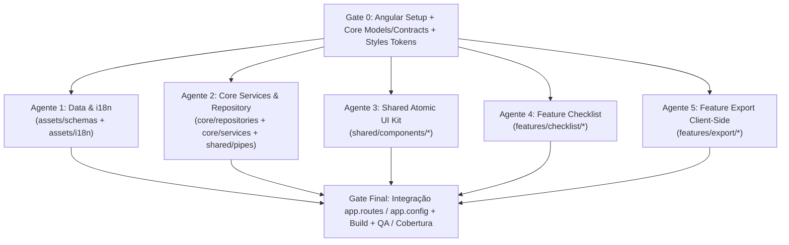

# Plano de Implementação Front-end
**Projeto:** KinkConsentManager — Plataforma de Checklists de Limites e Consentimento (BDSM / D/s)  
**Documento:** Arquitetura Modular, Estratégia de Execução Paralela Multi-Agente e Especificação de Testes Unitários  
**Versão:** 2.0 (Modularidade Estrita, TDD & Escopo Exclusivo V1 Checklist)  
**Data:** 21 de Novembro de 2026  

---

## 1. Diretrizes de Engenharia: Modularidade, Manutenibilidade e Paralelismo

Para permitir que **múltiplos agentes desenvolvam e testem em paralelo** sem conflitos de arquivos, e para garantir que **correções futuras de bugs ou evolução de recursos sejam pontuais e seguras**, a base de código segue 5 regras arquiteturais inegociáveis:

### 1.1. Regra de Isolamento Estrito (4+1 Arquivos por Unidade)
Todo componente Angular **DEVE** ser `standalone: true` com `changeDetection: ChangeDetectionStrategy.OnPush` e residir em diretório próprio com 5 arquivos separados (proibido `template` ou `styles` inline):
* `<nome>.component.ts` — apenas inputs, outputs, signals locais e orquestração enxuta.
* `<nome>.component.html` — template declarativo usando `@if` / `@for` nativos do Angular.
* `<nome>.component.scss` — estilos encapsulados usando tokens SCSS globais.
* `<nome>.component.spec.ts` — suíte de testes unitários isolados.
* `index.ts` — *barrel file* exportando apenas a API pública do componente.

### 1.2. Padrão Smart (Container) vs. Dumb (Presentational)
* **Dumb Components (`shared/components/*`):** Recebem 100% dos dados via `input()` / `input.required()` e comunicam ações exclusivamente via `output()`. **Proibido** injetar `ChecklistStateService` ou `HttpClient` dentro de `shared/`. Isso garante que qualquer bug visual possa ser reproduzido e corrigido em isolamento total no `.spec.ts` sem montar metade da aplicação.
* **Smart Components (`features/*/pages/*`):** Apenas as páginas (`ChecklistPageComponent` e `ExportPageComponent`) injetam os serviços de estado, repositórios e exportação, conectando os Signals aos Dumb Components.

### 1.3. Arquitetura Orientada a Contratos (Contract-First)
O **Gate 0** cria exclusivamente os modelos e interfaces em `src/app/core/models/`. Nenhuma trilha de agente pode alterar contratos unilateralmente durante a execução paralela — garantindo estabilidade entre as fronteiras dos módulos.

### 1.4. Escopo Fechado na V1 (Somente Checklist)
A arquitetura da V1 contém **exclusivamente** as features `checklist` e `export` (do próprio checklist). Rotas de v2 (Contratos D/s, Custom Builder, Play Partners, Excel `.xlsx` e Backend Node.js) **não são implementadas nem empacotadas** na V1, evitando código morto.

---

## 2. Topologia de Execução Paralela (Workstreams Multi-Agente)

Após a conclusão rápida do **Gate 0 (Setup & Contratos)**, **5 Agentes trabalham 100% simultaneamente** em diretórios disjuntos:



### Matriz de Propriedade Exclusiva de Arquivos (Zero-Conflict Boundary)

| Trilha / Agente | Diretórios de Escrita Exclusiva | Dependências de Leitura | Comandos de Verificação Independente |
| :--- | :--- | :--- | :--- |
| **Gate 0 (Foundation)** | `package.json`, `angular.json`, `tsconfig.json`, `src/styles/*`, `src/app/core/models/*` | `Bueprint.md`, docs | `npx tsc --noEmit` |
| **Agente 1 (Data & i18n)** | `src/assets/schemas/*`, `src/assets/i18n/*`, `src/app/core/models/__tests__/schema-integrity.spec.ts` | `core/models/*` | `ng test --include=**/schema-integrity.spec.ts` |
| **Agente 2 (Core & State)** | `src/app/core/repositories/*`, `src/app/core/services/*`, `src/app/shared/pipes/*` | `core/models/*` | `ng test --include=**/core/**/*.spec.ts` |
| **Agente 3 (Shared UI Kit)** | `src/app/shared/components/*` | `core/models/*`, `styles/*` | `ng test --include=**/shared/components/**/*.spec.ts` |
| **Agente 4 (Feature Checklist)** | `src/app/features/checklist/*` | `core/models/*`, assinaturas de `Core` e `Shared` | `ng test --include=**/features/checklist/**/*.spec.ts` |
| **Agente 5 (Feature Export)** | `src/app/features/export/*` | `core/models/*`, assinaturas de `Core` e `Shared` | `ng test --include=**/features/export/**/*.spec.ts` |
| **Gate Final (Integração)** | `src/app/app.config.ts`, `src/app/app.routes.ts`, `src/app/app.component.*` | Todas as trilhas | `ng test --code-coverage && ng build` |

> **Nota sobre Agentes 4 e 5 em paralelo com Agentes 2 e 3:** Como as assinaturas públicas dos serviços (`ChecklistStateService`, `I18nService`) e dos componentes `shared/` estão congeladas na Seção 3 deste plano, os Agentes 4 e 5 escrevem seus testes unitários usando **Stubs/Mocks tipados** desses contratos, rodando `ng test` de forma independente antes mesmo da fusão final.

---

## 3. Especificação Técnica Detalhada por Módulo e Suíte de Testes Unitários

### 3.1. Trilha Agente 1 — Dados Neutros e Internacionalização (`src/assets/`)

#### Arquivos e Responsabilidades
* `src/assets/schemas/checklist-v1.json`: Contém `schemaVersion: "1.0.0"`, as 5 escalas (`hard_limit`, `soft_limit`, `curious`, `enjoy`, `favorite`) com cores/ícones acessíveis e os 8 grupos taxonômicos com seus respectivos itens e tipos.
* `src/assets/i18n/pt-BR.json` e `src/assets/i18n/en-US.json`: Dicionários estruturados contendo seções `ui` (botões, cabeçalhos, mensagens de erro), `roles` (`giving_receiving`, `dominant_submissive`, `self_partner`, `general`), `scales`, `groups`, `items` e `options`.

#### Testes Unitários Obrigatórios (`schema-integrity.spec.ts`)
1. `should validate checklist-v1.json conforms to ChecklistSchema structure and semver`: Verifica `schemaVersion`, `scales.length === 5` e ordem única de escalas e grupos.
2. `should ensure every item has valid QuestionType and required properties`: Garante que `single_choice`/`multiple_choice` possuam `options.length > 0` e `restricted_text` possua `maxLength > 0`.
3. `should guarantee 100% key parity between pt-BR.json and en-US.json`: Compara recursivamente todas as chaves dos dois idiomas para garantir ausência de traduções faltantes.
4. `should verify every ID in checklist-v1.json exists in both pt-BR.json and en-US.json`: Valida que nenhum grupo, item, opção ou escala fique sem tradução em qualquer idioma.

---

### 3.2. Trilha Agente 2 — Core Repositories, Services e Pipes

#### 3.2.1. Repositório de Schemas (`core/repositories/`)
* `schema.repository.ts`:
  ```typescript
  export interface ISchemaRepository {
    getChecklistSchema(version?: string): Observable<ChecklistSchema>;
  }
  export const SCHEMA_REPOSITORY_TOKEN = new InjectionToken<ISchemaRepository>('ISchemaRepository');
  ```
* `static-json-schema.repository.ts`: Implementa `ISchemaRepository` consumindo `assets/schemas/checklist-v1.json` via `HttpClient` com `shareReplay(1)` (cache em memória) e validação básica de payload.
* **Testes Obrigatórios (`static-json-schema.repository.spec.ts`):**
  * `should fetch checklist-v1.json via HttpTestingController and return parsed schema`;
  * `should cache schema response on subsequent calls (single HTTP request)`;
  * `should throw descriptive error if schema payload is malformed or missing groups`.

#### 3.2.2. Persistência Local Isolada (`local-storage-persistence.service.ts`)
* Encapsula acesso seguro ao `window.localStorage` (com `try/catch` para modo anônimo/quota excedida ou ambiente SSR/testes) sob a chave versionada `kcm_checklist_state_v1`.
* **Testes Obrigatórios (`local-storage-persistence.service.spec.ts`):**
  * `should save and load serialized state accurately`;
  * `should return null without throwing when stored JSON is corrupted`;
  * `should handle QuotaExceededError gracefully without crashing`;
  * `should clear stored key when clear() is called`.

#### 3.2.3. Estado Genérico e Estado do Checklist (`base-state.service.ts` & `checklist-state.service.ts`)
* **`BaseStateService<T>`:** Classe abstrata baseada em `WritableSignal<T>`, `select<K>(key)` retornando `Signal<T[K]>`, `setState(partial)` e `resetState()`.
* **`ChecklistStateService`:**
  * Signals computados expostos:
    * `schema: Signal<ChecklistSchema | null>`
    * `answers: Signal<Readonly<Record<string, ItemResponseValue>>>`
    * `viewMode: Signal<ChecklistViewMode>` (`'accordion'` | `'full'`)
    * `activeCategoryIndex: Signal<number>`
    * `totalItemsCount: Signal<number>`
    * `answeredItemsCount: Signal<number>`
    * `progressPercentage: Signal<number>` (0 a 100)
    * `filteredGroups: Signal<readonly GroupDefinition[]>` (aplica `searchQuery` e `onlyUnanswered`)
  * Métodos públicos:
    * `initializeSchema(schema: ChecklistSchema): void`
    * `setItemAnswer(itemId: string, patch: Partial<ItemResponseValue>): void`
    * `clearItemAnswer(itemId: string): void`
    * `setViewMode(mode: ChecklistViewMode): void`
    * `setActiveCategory(index: number): void`
    * `nextCategory(): boolean` (avança se não for a última; retorna `false` se chegou ao fim)
    * `setSearchQuery(query: string): void`
    * `setOnlyUnanswered(enabled: boolean): void`
    * `importDraft(draft: ChecklistDraft): void`
    * `exportDraftSnapshot(lang: SupportedLanguage): ChecklistDraft`
    * `resetAllAnswers(): void`
* **Testes Obrigatórios (`base-state.service.spec.ts` & `checklist-state.service.spec.ts`):**
  * `should calculate answeredItemsCount and progressPercentage accurately across dual-role and single-role items`;
  * `should update primaryScale without overwriting secondaryScale in dual-role mode`;
  * `should consider item answered only when meaningful value exists (empty string/empty array counts as unanswered)`;
  * `should filter groups by searchQuery and onlyUnanswered simultaneously`;
  * `should advance activeCategoryIndex via nextCategory() and return false at the last group`;
  * `should restore state on importDraft() and trigger auto-save via LocalStoragePersistenceService`.

#### 3.2.4. Serviço de Tradução (`i18n.service.ts`) e Pipe (`schema-translate.pipe.ts`)
* **`I18nService`:** Encapsula `TranslateService` (`@ngx-translate/core`). Expõe `currentLang = signal<SupportedLanguage>('pt-BR')`, `setLanguage(lang)`, `translateUi(key, params?)`, `getScaleLabel(id)`, `getRoleLabels(pairId)`, `getGroupTitle(id)`, `getGroupDescription(id)`, `getItemLabel(id)`, `getItemTooltip(id)`, `getOptionLabel(id)`.
* **`SchemaTranslatePipe`:** Pipe puro impuro-reativo ou conectado ao signal `currentLang()` para resolução direta em templates sem boilerplate.
* **Testes Obrigatórios (`i18n.service.spec.ts` & `schema-translate.pipe.spec.ts`):**
  * `should switch language signal and invoke TranslateService.use()`;
  * `should fallback gracefully to key ID if translation entry is missing`;
  * `should resolve dual-role labels for giving_receiving, dominant_submissive and self_partner`;
  * `should NOT modify or reset ChecklistStateService answers when language changes`.

---

### 3.3. Trilha Agente 3 — Shared Atomic UI Kit (`src/app/shared/components/`)

Todos são **Dumb Components** (`OnPush`, sem injeção de serviços globais de estado):

#### 3.3.1. `ScaleSelectorComponent`
* **Inputs:** `scales = input.required<readonly ScaleOption[]>()`, `scaleLabels = input.required<Record<string, string>>()`, `roleTitle = input<string>('')`, `selectedScale = input<ScaleId | undefined>(undefined)`, `disabled = input<boolean>(false)`, `compact = input<boolean>(false)`.
* **Outputs:** `scaleChange = output<ScaleId | undefined>()` (clicar na opção já selecionada permite desmarcar para *Not Entered*).
* **Acessibilidade:** `role="radiogroup"`, cada opção com `role="radio"`, `[attr.aria-checked]`, `[attr.aria-label]`, ícone PrimeIcons visível dentro do botão circular para independência de daltonismo.
* **Testes Obrigatórios (`scale-selector.component.spec.ts`):**
  * `should render one button per ScaleOption with matching icon and aria-label`;
  * `should emit selected ScaleId when clicked`;
  * `should emit undefined (deselect) when clicking an already active scale`;
  * `should not emit when disabled input is true`;
  * `should apply active styling and aria-checked="true" only to selectedScale`.

#### 3.3.2. `DynamicQuestionItemComponent`
* **Inputs:** `item = input.required<ItemDefinition>()`, `scales = input.required<readonly ScaleOption[]>()`, `isDualRole = input.required<boolean>()`, `roleLabels = input.required<{ primary: string; secondary?: string }>()`, `itemLabel = input.required<string>()`, `itemTooltip = input<string>('')`, `scaleLabels = input.required<Record<string, string>>()`, `optionLabels = input.required<Record<string, string>>()`, `answer = input<ItemResponseValue | undefined>(undefined)`.
* **Outputs:** `answerChange = output<Partial<ItemResponseValue>>()`.
* **Comportamento:** Switch limpo no template por `item().type`:
  1. `scale_matrix` + `isDualRole()`: dois `ScaleSelectorComponent` lado a lado (empilhados em mobile `< 576px`).
  2. `scale_matrix` + `!isDualRole()`: um único `ScaleSelectorComponent`.
  3. `single_choice`: lista de `p-radioButton` + opção condicional `allowOtherOption` revelando input de texto.
  4. `multiple_choice`: lista de `p-checkbox` + opção condicional `allowOtherOption`.
  5. `restricted_text`: `<textarea pInputTextarea>` com contador dinâmico `{{ currentLength }} / {{ maxLength }}`.
* **Testes Obrigatórios (`dynamic-question-item.component.spec.ts`):**
  * `should render two ScaleSelectorComponent instances when type is scale_matrix and isDualRole is true`;
  * `should render single ScaleSelectorComponent when isDualRole is false`;
  * `should render p-radioButton list for single_choice and emit selectedOption`;
  * `should render p-checkbox list for multiple_choice and toggle options in selectedOptions array`;
  * `should show and emit otherText input only when allowOtherOption is enabled and "other" is active`;
  * `should enforce maxLength and update character counter for restricted_text`;
  * `should display tooltip icon only when itemTooltip is non-empty`.

#### 3.3.3. `LegendBarComponent` & `ProgressIndicatorComponent`
* **`LegendBarComponent`:** Exibe barra horizontal responsiva (sticky no topo opcional) com os 5 níveis da escala (cor + ícone + texto).
* **`ProgressIndicatorComponent`:** Recebe `answered`, `total` e `percentage`, exibindo `p-progressBar` e texto `{{ answered }}/{{ total }}`.
* **Testes Obrigatórios:** Renderização exata das 5 escalas na legenda; clamping de 0% a 100% e formato de contagem no progresso.

#### 3.3.4. `FullGridPreviewComponent`
* **Inputs:** `schema = input.required<ChecklistSchema>()`, `answers = input.required<Readonly<Record<string, ItemResponseValue>>>()`, `resolvedTexts = input.required<ResolvedPreviewTexts>()` (títulos/labels já traduzidos para manter o componente 100% puro e testável sem I18nService), `printMode = input<boolean>(false)`.
* **Responsabilidade:** Layout **Full Grid Vertical** (cada grupo em bloco único 100% de largura, alto contraste preto/branco, tipografia nítida). Usado tanto na tela `/export` quanto como nó alvo do `PngExportService` em `1200px`.
* **Testes Obrigatórios (`full-grid-preview.component.spec.ts`):**
  * `should render all groups stacked vertically with full width`;
  * `should display dual-role badges/columns only for dual-role items`;
  * `should format multiple_choice, otherText and restricted_text answers legibly`;
  * `should render "Não respondido / Not entered" placeholder for empty answers`.

---

### 3.4. Trilha Agente 4 — Feature Checklist (`src/app/features/checklist/`)

#### Componentes da Trilha
1. **`ChecklistHeaderComponent`:** Barra superior responsiva com seletor de idioma (`pt-BR` | `en-US`), alternador `Accordion` vs `View Full`, botão para abrir `QuickFillWizardModal`, campo de busca textual, toggle "Apenas não respondidos", botão "Limpar" e `ProgressIndicatorComponent` + `LegendBarComponent`.
2. **`CategoryAccordionComponent`:** Utiliza `p-accordion` do PrimeNG controlado por `activeCategoryIndex`. Cada painel exibe descrição da categoria, lista de `DynamicQuestionItemComponent` e, no rodapé do painel, botão **`Próxima Categoria (Next)`** (ou **`Finalizar e Exportar`** na última categoria).
3. **`FullViewContainerComponent`:** Renderiza todos os grupos abertos em sequência vertical com índice rápido lateral/superior em desktop.
4. **`QuickFillWizardModalComponent`:** Inspirado no `#InputOverlay` do `Goctionni/v1.0.2.html`. Dialog PrimeNG (`p-dialog`) focado para preenchimento ultrarrápido de itens `scale_matrix`, exibindo item atual, contexto `(Grupo • Papel)`, fila de 3 anteriores/3 próximos, botões grandes acessíveis e suporte a teclado (`0` para limpar, `1`–`5` para selecionar escala e avançar automaticamente, `ArrowUp`/`ArrowDown` para navegar).
5. **`ChecklistPageComponent` (Smart Container):** Conecta `ISchemaRepository`, `ChecklistStateService`, `I18nService` e `Router`, gerenciando estados de loading (`p-skeleton`), erro de carga e diálogo de confirmação (`p-confirmDialog`) ao resetar respostas.

#### Testes Obrigatórios da Feature Checklist
* **`checklist-header.component.spec.ts`:** Emissão de eventos de troca de idioma, troca de `viewMode`, digitação de busca e clique em limpar.
* **`category-accordion.component.spec.ts`:** Renderização dos painéis por grupo, sincronia com `activeIndex`, emissão de `nextCategoryClick` e texto alternativo do botão na última categoria.
* **`quick-fill-wizard-modal.component.spec.ts`:** Mapeamento de teclas `1-5` para escalas, tecla `0` para limpar, `ArrowDown`/`ArrowUp` para navegar e avanço automático ao escolher opção.
* **`checklist-page.component.spec.ts`:** Carga inicial via mock de `ISchemaRepository`, propagação de alteração de resposta para `ChecklistStateService`, troca de idioma preservando respostas no DOM, transição de rota para `/export`.

---

### 3.5. Trilha Agente 5 — Feature Export Client-Side (`src/app/features/export/`)

Todos os serviços de exportação são **100% client-side** e recebem dados via parâmetros ou abstração de download testável (`FileDownloadHelper` injetável para evitar download real durante os testes unitários).

#### 3.5.1. Serviços Exportadores
1. **`ChecklistFlattenService` (Helper compartilhado da feature):** Transforma `(ChecklistSchema, answers, I18nService)` em `FlattenedChecklistRow[]` normalizados, reutilizado igualmente por `PdfExportService` e `CsvExportService` (evitando duplicação de lógica!).
2. **`PngExportService`:** Recebe `HTMLElement` do `FullGridPreviewComponent` (em container de largura fixa `1200px`), invoca wrapper injetável de `html-to-image` (`toPng(element, { pixelRatio: 2, backgroundColor: '#ffffff' })`) e aciona download local.
3. **`PdfExportService`:** Monta `TDocumentDefinitions` para o `pdfmake`: cabeçalho institucional, metadados (`schemaVersion`, data ISO, idioma), bloco de legenda com badges vetoriais de cor, e tabelas por categoria com `dontBreakRows: true` e rodapé paginado.
4. **`JsonDraftService`:**
   * `exportDraft(draft: ChecklistDraft): ExportResult`: Gera `Blob` JSON formatado e dispara download `kink-checklist-draft-YYYY-MM-DD.json`.
   * `parseAndValidateDraft(fileContent: string, expectedSchemaVersion: string): DraftValidationResult`: Faz `JSON.parse` seguro, valida campos obrigatórios (`schemaVersion`, `answers` como objeto não-nulo), compara versão major do schema e retorna resultado estruturado sem lançar exceções não tratadas.
5. **`CsvExportService`:** Recebe `FlattenedChecklistRow[]`, gera string RFC-4180 escapando aspas duplas (`""`), prefixa UTF-8 BOM `\uFEFF` e dispara download `.csv`.

#### 3.5.2. Componentes da Feature Export
* **`ExportActionsToolbarComponent` (Dumb):** Botões de ação (`Baixar PNG`, `Baixar PDF`, `Exportar Rascunho JSON`, `Importar Rascunho JSON` via input file oculto, `Exportar CSV` e `Voltar ao Checklist`) com indicadores individuais de `loading` por botão.
* **`ExportPageComponent` (Smart):** Conecta estado + `I18nService` + todos os serviços de exportação, exibe `p-toast` para feedback de sucesso/erro (ex.: JSON inválido ao importar) e renderiza o `FullGridPreviewComponent` abaixo da toolbar.

#### Testes Obrigatórios da Feature Export
* **`checklist-flatten.service.spec.ts`:** Achatamento correto de `dualRole: true`, `dualRole: false`, `multiple_choice`, `allowOtherOption` e `restricted_text`.
* **`png-export.service.spec.ts`:** Chamada ao wrapper `toPng` com `pixelRatio: 2`, disparo de download e tratamento gracioso de falha na geração do Canvas.
* **`pdf-export.service.spec.ts`:** Verificação da estrutura gerada (`content`, legenda, tabelas com `dontBreakRows: true`, header/footer) e invocação do `pdfMake.createPdf`.
* **`json-draft.service.spec.ts`:**
  * Exportação correta do payload;
  * Rejeição com mensagem clara para JSON sintaticamente inválido, payload sem `answers`, ou `schemaVersion` incompatível;
  * Aceitação e retorno fiel de `ChecklistDraft` válido.
* **`csv-export.service.spec.ts`:**
  * Presença obrigatória do UTF-8 BOM `\uFEFF` no primeiro caractere;
  * Escape correto de valores contendo vírgula, ponto e vírgula, aspas duplas e quebras de linha;
  * Colunas exatas no cabeçalho CSV.
* **`export-page.component.spec.ts`:** Disparo de cada ação da toolbar, exibição de toast de erro ao importar rascunho inválido e atualização imediata do `FullGridPreviewComponent` após importação bem-sucedida.

---

## 4. Preparação Arquitetural para Decisões Futuras (Fora do Escopo V1)

Embora a V1 implemente **estritamente o Checklist**, a arquitetura foi desenhada com pontos de acoplamento mínimo para viabilizar qualquer decisão futura com custo próximo de zero:

| Possível Evolução Futura (Pós-V1) | Como a Arquitetura V1 Facilita a Expansão Sem Refatoração |
| :--- | :--- |
| **Backend Node.js / Banco de Dados** | Basta criar `HttpApiSchemaRepository implements ISchemaRepository` e registrá-lo no `SCHEMA_REPOSITORY_TOKEN` em `app.config.ts`. Nenhum componente de UI precisa mudar. |
| **Custom Builder (Editor de Perguntas)** | Como todos os itens são renderizados dinamicamente a partir de `ChecklistSchema`, qualquer schema customizado gerado no futuro funcionará automaticamente nos mesmos componentes `DynamicQuestionItem` e exportadores. |
| **Partner Match / Diff (Comparação)** | `JsonDraftService` exporta respostas indexadas por `itemId` neutro. Um futuro serviço de Diff precisará apenas cruzar dois objetos `ChecklistDraft.answers`. |
| **Motor de Contratos D/s** | Um futuro módulo lazy-loaded `/contract` pode ler o `ChecklistStateService.answers()` e traduzir `enjoy`/`favorite`/`hard_limit` em cláusulas sem alterar o módulo `/checklist`. |
| **Exportação Excel (`.xlsx`)** | O `ChecklistFlattenService` já produz a estrutura tabular normalizada pronta para alimentar uma futura biblioteca de planilhas sem duplicar regras de parsing. |

---

## 5. Convenções de Qualidade, Linting e Estilos Mobile-First

* **Variáveis de Escala (`src/styles/_variables.scss`):**
  * `$scale-hard-limit: #D32F2F;`
  * `$scale-soft-limit: #F57C00;`
  * `$scale-curious: #FBC02D;`
  * `$scale-enjoy: #388E3C;`
  * `$scale-favorite: #7B1FA2;`
  * `$scale-empty: #E0E0E0;`
* **Breakpoints Mobile-First:**
  * Base: `0px – 575px` (empilhamento vertical, alvos de toque mínimos `44x44px` conforme WCAG/Apple HIG).
  * Tablet (`@media (min-width: 768px)`): exibição de papéis Dual-Role lado a lado e barra de ferramentas horizontal.
  * Desktop (`@media (min-width: 1024px)`): container centralizado (`max-width: 1120px`), índice de navegação rápida lateral no modo `View Full`.
