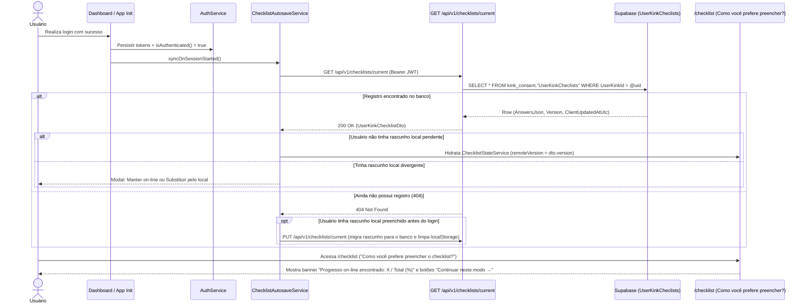
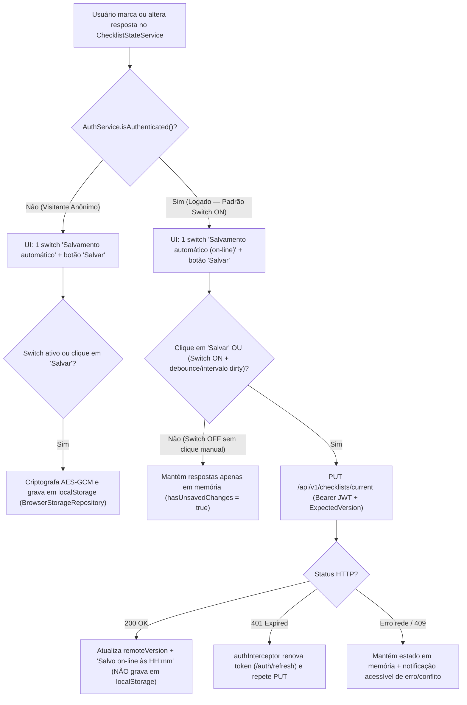

# Levantamento Funcional e Técnico — Salvamento Automático On-line (`UserKinkCheclists`)

**Projeto:** KinkConsentManager — Plataforma de Checklists de Limites, Consentimento e Práticas Consensuais  
**Documento:** Especificação Funcional, Regras de Negócio, Segurança LGPD e Contratos de Dados (Backend .NET 10 + Supabase PostgreSQL + Angular 22)  
**Versão:** 1.0  
**Data:** 27 de Novembro de 2026  
**Status:** Pronto para Implementação  

---

## Sumário

1. [Visão Geral, Propósito e Regras de Negócio Centrais](#1-visão-geral-propósito-e-regras-de-negócio-centrais)
2. [Análise do Estado Atual no Repositório (Backend & Frontend)](#2-análise-do-estado-atual-no-repositório-backend--frontend)
3. [Requisitos Funcionais (`RF-OL-01` a `RF-OL-10`)](#3-requisitos-funcionais-rf-ol-01-a-rf-ol-10)
4. [Requisitos Não-Funcionais, Segurança & LGPD (`RNF-OL-01` a `RNF-OL-07`)](#4-requisitos-não-funcionais-segurança--lgpd-rnf-ol-01-a-rnf-ol-07)
5. [Contratos de Dados Oficiais (C#, HTTP, `MessageKey` & TypeScript)](#5-contratos-de-dados-oficiais-c-http-messagekey--typescript)
6. [Diagramas de Fluxo e Critérios de Aceite (Given / When / Then)](#6-diagramas-de-fluxo-e-critérios-de-aceite-given--when--then)

---

## 1. Visão Geral, Propósito e Regras de Negócio Centrais

Com a fundação de autenticação JWT (`UserKink` / `UserKinkRefreshToken`) implantada em produção/desenvolvimento, o **KinkConsentManager** evolui para suportar o **salvamento on-line do questionário único do usuário autenticado** diretamente na tabela `kink_consent."UserKinkCheclists"` no **Supabase (PostgreSQL)**.

### 1.1. Princípios e Decisões de Produto

| Pilar | Regra Fechada |
| :--- | :--- |
| **Comportamento por Estado de Sessão** | **Visitante (não logado):** mantém 100% do comportamento atual — salvamento automático e manual criptografados (AES-GCM 256-bit) no `localStorage` do navegador.<br>**Usuário Logado:** o salvamento automático (e o botão `Salvar`) **substitui o armazenamento no navegador pelo armazenamento on-line no banco de dados** (`kink_consent."UserKinkCheclists"`). |
| **Controle Único na UI (Sem Dois Switches)** | A barra de progresso em `/checklist/fill` continua exibindo **apenas 1 botão switch** e **apenas 1 botão `Salvar`**:<br>- **Deslogado:** switch exibe **`Salvamento automático`** (`Autosave`);<br>- **Logado:** o mesmo switch passa a exibir **`Salvamento automático (on-line)`** / **`Automatic save (online)`**.<br>- O botão manual mantém exatamente o mesmo nome (**`Salvar`** / **`Save`**) — quando logado, envia e grava on-line no banco de dados. |
| **Habilitado por Padrão ao Logar** | Para usuários autenticados, o recurso **`Salvamento automático (on-line)` vem habilitado por padrão (`true`)**, podendo o usuário ligar ou desligar livremente a qualquer momento. |
| **Cardinalidade 1:1** | Cada usuário possui **exatamente 1 questionário persistido** na tabela `kink_consent."UserKinkCheclists"` (garantido no banco por `IX_UserKinkCheclists_UserKinkId` `UNIQUE`). Novas alterações atualizam o registro único (*upsert* idempotente). |
| **Continuidade na Tela de Escolha de Modo (`/checklist`)** | Quando o usuário faz login (ou já inicia o app autenticado) e existem respostas salvas em `UserKinkCheclists`, o sistema hidrata o `ChecklistStateService`. Na tela ***"Como você prefere preencher o checklist?"*** (`/checklist`), o indicador de progresso existente aparece normalmente e todos os botões dos modos exibem **`Continuar neste modo →`**, preservando exatamente o mesmo fluxo para continuar ou editar as respostas. |

> [!NOTE]
> **Alinhamento sobre evolução em relação à especificação anterior:** O rascunho inicial em `docs/Backend/DOCUMENTO_FUNCIONAL_AUTENTICACAO_E_SYNC.md` previa dois switches independentes (*Local* + *"Salvar na nuvem"* em `/api/v1/reports/current`). Por decisão de UX e simplicidade para esta entrega, **não haverá dois switches**: haverá um único switch contextual (`Salvamento automático (on-line)` quando autenticado) e o backend exporá o recurso canônico alinhado à entidade em `/api/v1/checklists/current` operando sobre `kink_consent."UserKinkCheclists"`.

---

## 2. Análise do Estado Atual no Repositório (Backend & Frontend)

### 2.1. O que já existe pronto no Backend

1. **Entidade de Domínio (`UserKinkCheclist.cs`):**
   - Localizada em `backend/Core/KinkConsentManager.Core/Domain/Entities/UserKinkCheclist.cs`.
   - Campos: `Id`, `UserKinkId` (`long`), `SchemaVersion` (`string`, padrão `"1.0.0"`), `Language` (`string`, padrão `"pt-BR"`), `AnswersJson` (`string`, padrão `"{}"`), `ClientUpdatedAtUtc` (`DateTime`), `Version` (`int`, padrão `1`), `CreatedAt`, `UpdatedAt`, `IsActive`.
   - Relação 1:1 já declarada em `UserKink.Checklist` (`public virtual UserKinkCheclist? Checklist { get; set; }`).
2. **Mapeamento EF Core & Tabela no Banco (`UserKinkCheclistConfiguration.cs` + `InitialCreateAuth`):**
   - Tabela `kink_consent."UserKinkCheclists"` já criada no PostgreSQL/Supabase desde a migration `InitialCreateAuth`:
     - Coluna `AnswersJson` mapeada como **`jsonb`** com índice **`GIN`** (`IX_UserKinkCheclists_AnswersJson_Gin`).
     - Índice único **`IX_UserKinkCheclists_UserKinkId`** (`UNIQUE` em `"UserKinkId"`), garantindo **1 questionário por usuário** diretamente no banco.
     - Token de concorrência otimista em `Version` (`IsConcurrencyToken().HasDefaultValue(1)`).
3. **Fundação SDK & CQRS já configurada:**
   - `IGenericRepository<UserKinkCheclist>` / `KinkConsentManagerGenericRepository<UserKinkCheclist>`, `IApplicationDispatcher` (MediatR via `SmartCoreHub.Core.SDK`), `FluentValidation` + `ValidationMessageService`, `FunctionalMessageResultFilter`, autenticação JWT Bearer (`[Authorize]`, `UserClaimsHelper.TryGetUserId(User)`).

### 2.2. O que já existe pronto no Frontend

1. **`AuthService` (`frontend/src/app/core/services/auth.service.ts`):**
   - Expõe `user()`, `isAuthenticated()` (`computed`), tokens (`accessToken`, `refreshToken`, `expiresAtUtc`), métodos `login()`, `register()`, `logout()`, persistidos em `kcm_auth_session_v1`.
2. **`ChecklistStateService` (`frontend/src/app/core/services/checklist-state.service.ts`):**
   - Mantém `schema`, `answers`, `viewMode`, `activeCategoryIndex`, `lastUpdatedAt`, além de `exportDraftSnapshot()`, `restoreFromEncryptedAutosave()` e `resetAllAnswers()`.
3. **`ChecklistAutosaveService` (`frontend/src/app/core/services/checklist-autosave.service.ts`):**
   - Coordena o estado `isEnabled`, `isSaving`, `lastAutosavedAt`, `hasUnsavedChanges`, timers (`start()`, `stop()`, `pagehide`), `saveIfDirty()`, `saveNow()`, `restoreFromAutosave()` e `clearAutosave()`. Atualmente grava exclusivamente em `localStorage` via `BrowserStorageRepository.setEncrypted(...)`.
4. **`ChecklistProgressBarComponent` (`frontend/src/app/features/checklist/components/checklist-progress-bar/`):**
   - Já possui exatamente **1 botão `Salvar`** (`saveNow.emit()`) e **1 `<mat-slide-toggle>`** (`autosaveEnabledChange.emit(...)`) com barra de status (`autosaveText()`).
5. **`ChecklistStartPageComponent` + `ChecklistModeSelectorComponent` (`/checklist`):**
   - Renderiza a tela *"Como você prefere preencher o checklist?"*. Já alterna automaticamente o CTA dos cards entre **"Começar neste modo →"** e **"Continuar neste modo →"** sempre que `answeredCount() > 0`, além de exibir o banner de progresso encontrado.
6. **`DashboardPageComponent` (`/dashboard`):**
   - Cartão do checklist também alterna automaticamente entre **"Abrir Checklist"** e **"Continuar Checklist"** quando há respostas em `ChecklistStateService`.

### 2.3. Lacunas a Implementar (Escopo Desta Entrega)

- **Backend:** Ainda não existem `IUserKinkChecklistRepository`, `IUserKinkChecklistService`, validators, commands/queries CQRS nem `ChecklistsController` (`GET/PUT/DELETE /api/v1/checklists/current`).
- **Frontend Auth Interceptor:** Ainda não existe `authInterceptor` anexando automaticamente `Authorization: Bearer <accessToken>` e tratando renovação por `refreshToken` em `401`.
- **Frontend Sync On-line:** `ChecklistAutosaveService` ainda não possui camada HTTP on-line, nem comuta automaticamente para banco de dados quando `AuthService.isAuthenticated()` é `true`.
- **Ciclo Login/Logout ↔ Estado:** Ao autenticar ou deslogar, o sistema precisa hidratar o `ChecklistStateService` com os dados da tabela `UserKinkCheclists` (tratando eventual rascunho prévio anônimo) e atualizar textos contextuais (`Salvamento automático (on-line)`).

---

## 3. Requisitos Funcionais (`RF-OL-01` a `RF-OL-10`)

| ID | Requisito Funcional | Regras de Negócio e Comportamento Esperado | Prioridade |
| :--- | :--- | :--- | :---: |
| **RF-OL-01** | **Obter Questionário On-line do Usuário (`GET /api/v1/checklists/current`)** | Endpoint autenticado (`[Authorize]`) que extrai `userKinkId` exclusivamente do JWT (`UserClaimsHelper.TryGetUserId(User)`). Retorna `200 OK` com `UserKinkChecklistDto` caso exista registro em `kink_consent."UserKinkCheclists"` (`IsActive == true`), ou `404 Not Found` (`Checklist.NotFound`) quando o usuário ainda não salvou respostas on-line. | Alta |
| **RF-OL-02** | **Salvar / Atualizar Questionário On-line (`PUT /api/v1/checklists/current`)** | Endpoint autenticado (`[Authorize]`) que executa *Upsert* na linha única (1:1) do usuário em `kink_consent."UserKinkCheclists"`.<br>- **Criação:** Se ainda não existe registro, cria com `Version = 1`.<br>- **Atualização:** Se já existe, valida `ExpectedVersion` (quando informado) contra o `Version` atual no banco: se divergir, retorna `409 Conflict` (`Checklist.VersionConflict`); se coincidir (ou em modo force/overwrite explícito), atualiza `SchemaVersion`, `Language`, `AnswersJson` (`jsonb`), `ClientUpdatedAtUtc`, incrementa `Version += 1` e devolve `200 OK` com o DTO atualizado. | Alta |
| **RF-OL-03** | **Excluir Questionário On-line (`DELETE /api/v1/checklists/current`)** | Endpoint autenticado (`[Authorize]`) acionado quando o usuário confirma *"Limpar tudo"* em `/checklist/fill`. Remove o registro da tabela `kink_consent."UserKinkCheclists"` pertencente ao usuário logado de forma idempotente (`200 OK` com `data: true`). | Alta |
| **RF-OL-04** | **Switch Único Contextual de Salvamento Automático** | A tela `/checklist/fill` exibe **apenas 1 switch** (proibido criar um segundo toggle na barra):<br>- **Visitante (Deslogado):** legenda **`Salvamento automático`** (`Autosave`), persistindo preferência em chave local (`kcm_checklist_autosave_enabled_v1`).<br>- **Usuário Logado:** o mesmo switch exibe **`Salvamento automático (on-line)`** / **`Automatic save (online)`** e inicia **habilitado por padrão (`true`)** (preferência persistida em `kcm_checklist_online_autosave_enabled_v1`).<br>- Quando desativado pelo usuário logado, o envio automático para o banco é pausado, exibindo status **`Salvamento automático (on-line) desativado`**; o botão manual `Salvar` permanece utilizável. | Alta |
| **RF-OL-05** | **Botão Manual `Salvar` Unificado** | O botão mantém **exatamente o mesmo nome (`Salvar` / `Save`)** nos dois modos.<br>- **Logado:** ao clicar em **`Salvar`**, persiste imediatamente na tabela `UserKinkCheclists` via `PUT /api/v1/checklists/current` (mesmo que o switch automático esteja desligado), exibe estado visual de salvamento (`fa-spinner`), atualiza horário (`Salvo on-line às HH:mm`) e anuncia acessível (`Preenchimento salvo on-line na sua conta.`).<br>- **Deslogado:** mantém o salvamento imediato criptografado no navegador. | Alta |
| **RF-OL-06** | **Substituição de Local por On-line Quando Logado** | Quando autenticado, o salvamento automático (`saveIfDirty()` com debounce reativo curto ~2,5s após edição + fallback no intervalo/saída da página `pagehide`) e o `saveNow()` gravam **no banco de dados e NÃO no `localStorage`**.<br>- Rascunhos locais criptografados anteriores permanecem reservados apenas ao modo anônimo (ver `RF-OL-08`). | Alta |
| **RF-OL-07** | **Carregamento no Login & Continuidade em `/checklist` e `/dashboard`** | Ao autenticar no `/dashboard` (ou restaurar sessão válida no bootstrap da aplicação), o sistema consulta `GET /api/v1/checklists/current`:<br>- Se houver respostas salvas no banco, popula imediatamente o `ChecklistStateService`.<br>- Na tela *"Como você prefere preencher o checklist?"* (`/checklist`), o indicador de progresso mostra `X / Total (%)` com legenda contextual **`Progresso on-line encontrado`** / **`Saved online progress found`** e **todos os botões de modo mantêm o mesmo comportamento**, exibindo **`Continuar neste modo →`** para continuar ou editar.<br>- No `/dashboard`, o card do checklist exibe **`Continuar Checklist`** com o badge de percentual. | Alta |
| **RF-OL-08** | **Transição Anônimo → Autenticado e Logout Seguro** | 1. **Se o usuário preencheu offline antes de logar e NÃO existe registro no banco:** ao logar, o rascunho local em memória/storage é sincronizado automaticamente para o banco (`PUT`) e a cópia anônima em `localStorage` é removida.<br>2. **Se existir rascunho local E registro no banco com conteúdos diferentes:** exibe diálogo de escolha (`UiFeedbackHostService.confirm`) permitindo ao usuário optar por **Manter versão on-line (banco)** ou **Usar rascunho atual e atualizar on-line** (sem perda silenciosa de dados).<br>3. **Ao fazer Logout:** as respostas da conta on-line em memória são limpas com segurança no cliente (chamando `resetAllAnswers()` + zerando estado de sincronização), garantindo que o próximo usuário ou visitante neste navegador não veja dados privados da conta encerrada. | Alta |
| **RF-OL-09** | **Renovação Automática de Token & Resiliência de Rede** | Um `authInterceptor` funcional anexa `Authorization: Bearer <accessToken>` em chamadas à API. Diante de `401 Unauthorized`, executa **1 tentativa de renovação transparente** via `POST /api/v1/auth/refresh` (enfileirando requisições simultâneas) e repete o `PUT`/`GET` automaticamente.<br>Se offline/erro transitório de rede durante autosave on-line, mantém `hasUnsavedChanges = true`, preserva as respostas em memória, exibe status de falha recuperável e permite tentar novamente no próximo ciclo ou via botão `Salvar`. | Média |
| **RF-OL-10** | **Internacionalização Bilíngue & Acessibilidade Audiovisual** | Todas as novas chaves (`pt-BR` e `en-US`) passam em `npm.cmd run check:i18n` com 100% de paridade. Todos os novos ícones, tooltips e alertas possuem `[attr.title]`, `aria-live="polite"` e anúncios via `AccessibilityService`. | Alta |

---

## 4. Requisitos Não-Funcionais, Segurança & LGPD (`RNF-OL-01` a `RNF-OL-07`)

- **RNF-OL-01 — Proteção Anti-IDOR Estrita:** Os endpoints `/api/v1/checklists/current` nunca aceitam `userId` ou `userKinkId` no corpo da requisição nem na rota; o proprietário é resolvido unicamente via `UserClaimsHelper.TryGetUserId(User)`.
- **RNF-OL-02 — Zero-PII no Payload JSON:** `AnswersJson` contém exclusivamente IDs neutros do schema (`item_rope`, `enjoy`, `soft_limit`, etc.) e textos opcionais fornecidos pelo usuário. Nenhum dado de login, e-mail, IP ou metadata identificadora pessoal é replicado dentro do JSON.
- **RNF-OL-03 — Integridade JSON & Proteção contra Payloads Abusivos:** `UpsertUserKinkChecklistRequestValidator` valida que `AnswersJson` é um objeto JSON sintaticamente válido (`JsonDocument.Parse` com `JsonValueKind.Object`) e limita seu tamanho (teto padrão de **512 KB**, muito acima dos ~20–60 KB de um checklist completo).
- **RNF-OL-04 — Concorrência Otimista & Índice GIN PostgreSQL:** O campo `Version` mapeado como `IsConcurrencyToken()` protege edições simultâneas em duas abas/dispositivos contra sobrescrita silenciosa (`409 Conflict`).
- **RNF-OL-05 — Conformidade Arquitetural Frontend:** Standalone Components, `ChangeDetectionStrategy.OnPush`, padrão 4+1 arquivos, zero strings fixas em templates/TS (100% `assets/i18n/`), strict TypeScript sem `any`.
- **RNF-OL-06 — Qualidade de Backend Espelhando `SmartCoreHub.Core.SDK`:** Uso obrigatório de `ServiceResponse<T>`, CQRS (`IApplicationDispatcher`), `IAppLogger` (sem logar conteúdo de respostas do checklist para proteger a intimidade do usuário!), XML docs completos e sem chaves ou segredos em código.
- **RNF-OL-07 — Metas de Cobertura Automatizada:** >= **90%** nos novos componentes Core/Backend e serviços Frontend; >= **85%** nos componentes de UI atualizados.

---

## 5. Contratos de Dados Oficiais (C#, HTTP, `MessageKey` & TypeScript)

### 5.1. Backend C# — DTOs (`KinkConsentManager.Core.Domain.DTOs.Checklists`)

```csharp
namespace KinkConsentManager.Core.Domain.DTOs.Checklists;

/// <summary>Dados de entrada para criação ou atualização (upsert) do checklist único do usuário autenticado.</summary>
/// <param name="SchemaVersion">Versão SemVer do schema do checklist (ex.: "1.0.0").</param>
/// <param name="Language">Idioma ativo no preenchimento ("pt-BR" ou "en-US").</param>
/// <param name="AnswersJson">Objeto JSON serializado contendo apenas IDs e respostas do checklist.</param>
/// <param name="ClientUpdatedAtUtc">Data/hora UTC da última edição no cliente.</param>
/// <param name="ExpectedVersion">Versão otimista esperada para detecção de conflito em atualizações (nulo na primeira criação ou sobrescrita explícita).</param>
public sealed record UpsertUserKinkChecklistRequestDto(
    string SchemaVersion,
    string Language,
    string AnswersJson,
    DateTime ClientUpdatedAtUtc,
    int? ExpectedVersion = null
);

/// <summary>Representação pública do checklist persistido na tabela <c>kink_consent.UserKinkCheclists</c>.</summary>
public sealed record UserKinkChecklistDto(
    long Id,
    string SchemaVersion,
    string Language,
    string AnswersJson,
    DateTime ClientUpdatedAtUtc,
    int Version,
    DateTime CreatedAt,
    DateTime UpdatedAt
);
```

### 5.2. Endpoints HTTP REST (`/api/v1/checklists`)

| Método & Rota | Auth | Request Body | Respostas (`ServiceResponse<T>`) | Descrição |
| :--- | :---: | :--- | :--- | :--- |
| `GET /api/v1/checklists/current` | Bearer | — | `200 OK` (`UserKinkChecklistDto`)<br>`404 Not Found` (`Checklist.NotFound`)<br>`401 Unauthorized` | Recupera o checklist único do usuário autenticado. |
| `PUT /api/v1/checklists/current` | Bearer | `UpsertUserKinkChecklistRequestDto` | `200 OK` (`UserKinkChecklistDto`)<br>`400 Bad Request` (`Validation`)<br>`409 Conflict` (`Checklist.VersionConflict`)<br>`401 Unauthorized` | Cria (se inexistente) ou atualiza o checklist único na tabela `UserKinkCheclists`. |
| `DELETE /api/v1/checklists/current` | Bearer | — | `200 OK` (`bool`: `true`)<br>`401 Unauthorized` | Exclui o registro salvo do usuário autenticado (usado em *Limpar tudo*). |

### 5.3. Catálogo Canônico de `MessageKey` (`ChecklistMessageKeys`)

| Constante | Valor da Chave | Mensagem (`en-US`) | Mensagem (`pt-BR`) |
| :--- | :--- | :--- | :--- |
| `ChecklistRetrieved` | `Checklist.Retrieved` | Checklist retrieved successfully. | Checklist recuperado com sucesso. |
| `ChecklistSaved` | `Checklist.Saved` | Checklist saved online successfully. | Checklist salvo on-line com sucesso. |
| `ChecklistDeleted` | `Checklist.Deleted` | Saved checklist removed successfully. | Preenchimento salvo removido com sucesso. |
| `ChecklistNotFound` | `Checklist.NotFound` | No saved online checklist was found for this user. | Nenhum checklist salvo on-line foi encontrado para este usuário. |
| `ChecklistVersionConflict` | `Checklist.VersionConflict` | A newer version of this checklist already exists online. Reload before saving. | Já existe uma versão mais recente deste checklist salva on-line. Recarregue antes de salvar. |
| `Validation.Checklist.InvalidJson` | — | `AnswersJson` must be a valid JSON object. | As respostas devem estar em um objeto JSON válido. |
| `Validation.Checklist.InvalidLanguage` | — | Supported languages are `pt-BR` and `en-US`. | Os idiomas suportados são `pt-BR` e `en-US`. |
| `Validation.Checklist.PayloadTooLarge` | — | Checklist payload exceeds the maximum allowed size. | O tamanho das respostas do checklist excede o limite permitido. |

### 5.4. Frontend TypeScript — Contratos (`core/models/cloud-checklist.model.ts`)

```typescript
import { ItemResponseValue, SupportedLanguage } from './checklist-answer.model';

export type AutosavePersistenceMode = 'local' | 'online';

export interface CloudChecklistDto {
  readonly id: number;
  readonly schemaVersion: string;
  readonly language: SupportedLanguage;
  readonly answersJson: string;
  readonly clientUpdatedAtUtc: string;
  readonly version: number;
  readonly createdAt: string;
  readonly updatedAt: string;
}

export interface UpsertCloudChecklistRequest {
  readonly schemaVersion: string;
  readonly language: SupportedLanguage;
  readonly answersJson: string;
  readonly clientUpdatedAtUtc: string;
  readonly expectedVersion?: number | null;
}

export interface RestoredChecklistPayload {
  readonly schemaVersion: string;
  readonly language: SupportedLanguage;
  readonly answers: Readonly<Record<string, ItemResponseValue>>;
  readonly savedAt: string;
  readonly version: number;
}
```

---

## 6. Diagramas de Fluxo e Critérios de Aceite (Given / When / Then)

### 6.1. Fluxo de Autenticação, Hidratação e Tela de Escolha de Modo (`/checklist`)



### 6.2. Fluxo Unificado de Preenchimento em `/checklist/fill` (Switch Único + Botão Salvar)



### 6.3. Critérios de Aceite (Given / When / Then)

1. **Cenário 1 — Usuário logado entra na tela de preenchimento com switch único:**
   - **Dado** que o usuário está autenticado (`isAuthenticated() === true`) e navega para `/checklist/fill`,
   - **Quando** a barra de progresso é renderizada,
   - **Então** existe **apenas 1 toggle switch** com a legenda **`Salvamento automático (on-line)`** marcado por padrão (`checked = true`), e **1 botão `Salvar`** com o mesmo rótulo de antes (sem segundo switch de nuvem).
2. **Cenário 2 — Salvamento on-line no banco sem gravar no navegador:**
   - **Dado** usuário autenticado com `Salvamento automático (on-line)` ativo,
   - **Quando** ele responde itens ou clica no botão `Salvar`,
   - **Então** o frontend envia `PUT /api/v1/checklists/current` atualizando a linha única em `kink_consent."UserKinkCheclists"`, exibe **`Salvo on-line às HH:mm`** e **não** grava as respostas no `localStorage`.
3. **Cenário 3 — Desativação do switch automático pelo usuário logado:**
   - **Dado** usuário autenticado com respostas em edição,
   - **Quando** ele desliga o switch `Salvamento automático (on-line)`,
   - **Então** alterações seguintes não disparam `PUT` automático (`Salvamento automático (on-line) desativado`), mas clicar manualmente em **`Salvar`** grava normalmente on-line no banco de dados.
4. **Cenário 4 — Login e retomada na tela *"Como você prefere preencher o checklist?"*:**
   - **Dado** um usuário que já possui respostas salvas em `kink_consent."UserKinkCheclists"` em outro dispositivo/sessão limpa,
   - **Quando** ele realiza login e acessa `/checklist` (*"Como você prefere preencher o checklist?"*),
   - **Então** o sistema carrega suas respostas on-line, exibe o progresso encontrado e todos os 4 cards de modo exibem **`Continuar neste modo →`** permitindo continuar ou editar normalmente.
5. **Cenário 5 — Exclusão sincronizada ao limpar tudo e proteção no logout:**
   - **Dado** usuário logado com checklist salvo on-line,
   - **Quando** confirma *"Limpar tudo"*, o frontend dispara `DELETE /api/v1/checklists/current` removendo a linha de `UserKinkCheclists`; e **quando** realiza logout, as respostas carregadas na sessão on-line são removidas da memória do navegador imediatamente.
6. **Cenário 6 — Visitante anônimo 100% preservado:**
   - **Dado** um usuário não autenticado,
   - **Quando** acessa `/checklist/fill`, vê o switch **`Salvamento automático`** e o botão **`Salvar`** funcionando 100% offline em `localStorage` cifrado com AES-GCM, sem nenhuma chamada HTTP a `/api/v1/checklists/*`.
