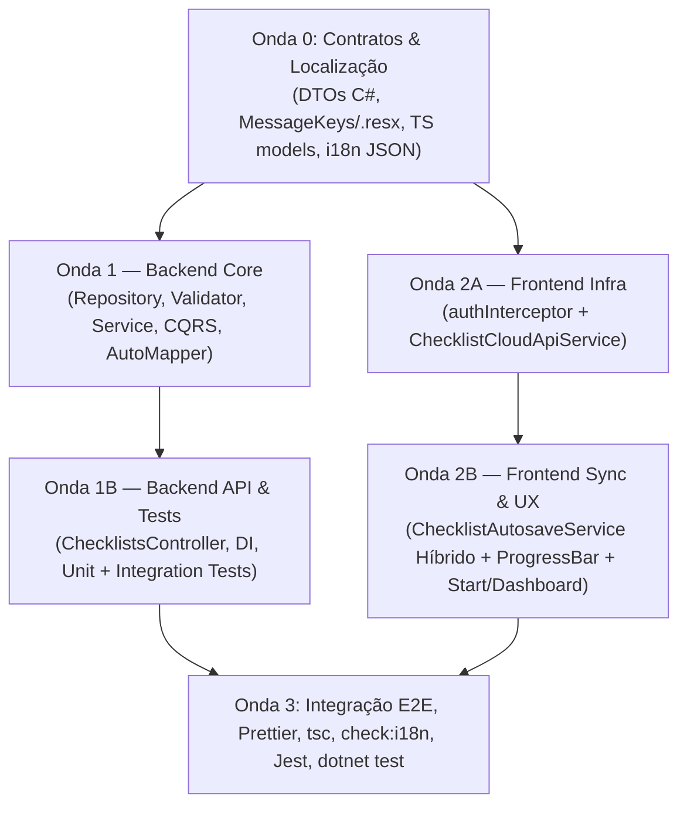

# Plano de Implementação — Salvamento Automático On-line (`UserKinkCheclists`)

**Projeto:** KinkConsentManager  
**Documento:** Plano Técnico Full-Stack — Arquitetura em Ondas, Propriedade de Arquivos e Especificação de Testes  
**Versão:** 1.0  
**Data:** 27 de Novembro de 2026  
**Documento Funcional Vinculado:** [LEVANTAMENTO_FUNCIONAL_TECNICO.md](./LEVANTAMENTO_FUNCIONAL_TECNICO.md)  

---

## 1. Diretrizes Arquiteturais e Regras Inegociáveis

1. **Reaproveitamento Integral do `SmartCoreHub.Core.SDK` (Backend):**
   - Repositório estendendo `GenericRepository<UserKinkCheclist, KinkConsentManagerDbContext>`;
   - Contratos de retorno obrigatoriamente em `ServiceResponse<T>`;
   - Validações com `FluentValidation` + `IValidationMessageService` + `.WithMessageKey(...)` suportando `pt-BR` e `en-US` dinamicamente via `Accept-Language`;
   - Controller herdando `BaseApiController` e despachando via `IApplicationDispatcher` (MediatR/CQRS);
   - Extração estrita do usuário autenticado via `UserClaimsHelper.TryGetUserId(User)`.
2. **Modularidade 4+1 e Strategy Transparente (Frontend Angular 22):**
   - Componentes `standalone: true` com `ChangeDetectionStrategy.OnPush` e `strict: true` (zero `any`);
   - `ChecklistProgressBarComponent` e `ChecklistModeSelectorComponent` permanecem **Dumb Components** puros: recebem textos/labels por `input()` do container (`ChecklistPageComponent` / `ChecklistStartPageComponent`);
   - **Roteamento Transparente em `ChecklistAutosaveService`:** apenas 1 serviço coordena `persistenceMode = computed<'online' | 'local'>(() => this.auth.isAuthenticated() ? 'online' : 'local')`, delegando para `ChecklistCloudApiService` (on-line) ou `BrowserStorageRepository` (local criptografado AES-GCM).
3. **Sem Duplicação de Controles na UI:**
   - **1 único `<mat-slide-toggle>`** na barra de progresso: alterna legenda (`Salvamento automático` vs `Salvamento automático (on-line)`);
   - **1 único botão `Salvar`**: mantém o rótulo `"Salvar"` e apenas muda o tooltip/ícone/destino (`localStorage` vs `PUT /api/v1/checklists/current`).
4. **Governança (`R-GOV-GIT` & Privacidade):**
   - Nunca executar `git commit`, `git push` ou troca de branch autonomamente;
   - Nunca gravar `AnswersJson` em logs do Serilog/Application Insights nem persistir respostas de usuário autenticado em `localStorage`.

---

## 2. Topologia de Execução Paralela em Ondas

### Matriz de Propriedade Exclusiva de Arquivos

| Onda / Trilha | Arquivos Criados ou Alterados | Verificação Independente |
| :--- | :--- | :--- |
| **Onda 0 (Contratos & i18n)** | `backend/Core/KinkConsentManager.Core/Domain/DTOs/Checklists/*.cs` `backend/Core/KinkConsentManager.Core/Domain/Localization/MessageKeys/ChecklistMessageKeys.cs` `backend/Core/KinkConsentManager.Core/Infrastructure/Localization/Resources/AuthMessages*.resx` (ou `ChecklistMessages*.resx`) `frontend/src/app/core/models/cloud-checklist.model.ts` + `index.ts` `frontend/src/assets/i18n/{pt-BR,en-US}.json` | `dotnet build` + `npm.cmd run check:i18n` |
| **Onda 1A (Backend Core)** | `Domain/Interfaces/Repositories/IUserKinkChecklistRepository.cs` `Domain/Interfaces/Services/IUserKinkChecklistService.cs` `Domain/Validators/Checklists/UpsertUserKinkChecklistRequestValidator.cs` `Infrastructure/Repositories/UserKinkChecklistRepository.cs` `Service/Services/UserKinkChecklistService.cs` `Service/Cqrs/Checklists/{Commands,Queries}/*.cs` `Service/Mappings/AutoMapperProfile.cs` `Service/API/DI/WebApplicationBuilderServicesConfigure.cs` | `dotnet test backend/Core/KinkConsentManager.Core.Tests` |
| **Onda 1B (Backend API & QA)** | `backend/APIs/KinkConsentManager.API/Controllers/V1/ChecklistsController.cs` `backend/Core/KinkConsentManager.Core.Tests/...` (Repo, Validator, Service tests) `backend/APIs/KinkConsentManager.API.Tests/...` (Controller & Integration tests) | `dotnet test backend/KinkConsentManager.sln` |
| **Onda 2A (Frontend HTTP & Auth)** | `frontend/src/app/core/interceptors/auth.interceptor.ts` + `.spec.ts` + `index.ts` `frontend/src/app/core/services/checklist-cloud-api.service.ts` + `.spec.ts` `frontend/src/app/app.config.ts` | `jest src/app/core/interceptors src/app/core/services/checklist-cloud-api` |
| **Onda 2B (Frontend Autosave & Páginas)** | `core/services/checklist-autosave.service.ts` + `.spec.ts` `core/services/auth.service.ts` (se necessário limpar hooks) + `features/dashboard/pages/dashboard-page/` `features/checklist/pages/checklist-start-page/` `features/checklist/pages/checklist-page/` `features/checklist/components/checklist-progress-bar/` | `npm.cmd run test:ci` + `tsc` + `check:i18n` |
| **Onda 3 (Integração & QA)** | Verificação conjunta Backend `.sln` + Frontend SPA + Supabase (`UserKinkCheclists`) | `dotnet test`, `npm.cmd run test:ci`, `ng build --configuration production` |

---

## 3. Especificação Técnica Detalhada por Onda

### 3.1. Onda 0 — Contratos, Recursos `.resx` e Dicionários i18n

1. **Backend DTOs (`Domain/DTOs/Checklists/UserKinkChecklistDtos.cs`):**
   - `UpsertUserKinkChecklistRequestDto(string SchemaVersion, string Language, string AnswersJson, DateTime ClientUpdatedAtUtc, int? ExpectedVersion = null)`
   - `UserKinkChecklistDto(long Id, string SchemaVersion, string Language, string AnswersJson, DateTime ClientUpdatedAtUtc, int Version, DateTime CreatedAt, DateTime UpdatedAt)`
2. **Chaves de Localização Backend (`ChecklistMessageKeys.cs` + `ChecklistMessages.resx` / `ChecklistMessages.pt-BR.resx` + `ValidationMessages*.resx`):**
   - Registrar os recursos no mesmo `ResourceManager` ou estender a configuração em `WebApplicationBuilderServicesConfigure.cs` + atualizar testes de paridade `.resx` em `KinkConsentManagerDbContextTests.cs`.
3. **Frontend Models & i18n (`cloud-checklist.model.ts`, `pt-BR.json`, `en-US.json`):**
   - Adicionar as chaves novas (listadas na Seção 4) garantindo paridade 100% no `check-i18n-keys.mjs`.

---

### 3.2. Onda 1 — Backend (.NET 10 + Supabase `UserKinkCheclists`)

1. **Repositório (`IUserKinkChecklistRepository` / `UserKinkChecklistRepository`):**
   - Herda `GenericRepository<UserKinkCheclist, KinkConsentManagerDbContext>`;
   - `Task<UserKinkCheclist?> GetByUserKinkIdAsync(long userKinkId, CancellationToken cancellationToken = default)`: busca única via `_dbSet.FirstOrDefaultAsync(c => c.UserKinkId == userKinkId, cancellationToken)`.
   - `Task<bool> DeleteByUserKinkIdAsync(long userKinkId, CancellationToken cancellationToken = default)`: localiza e remove usando `DeleteAsync` / `_dbSet.Remove`.
2. **Validador (`UpsertUserKinkChecklistRequestValidator`):**
   - `SchemaVersion`: obrigatório, máximo `20` caracteres, padrão SemVer (`^\d+\.\d+\.\d+$`);
   - `Language`: obrigatório, apenas `"pt-BR"` ou `"en-US"`;
   - `AnswersJson`: obrigatório, tamanho UTF-8 `<= 524_288` bytes (512 KB), validado via `JsonDocument.Parse` exigindo `RootElement.ValueKind == JsonValueKind.Object`;
   - `ExpectedVersion`: quando preenchido, deve ser `>= 1`.
3. **Serviço (`IUserKinkChecklistService` / `UserKinkChecklistService`):**
   - `GetCurrentAsync(long userKinkId, CancellationToken)`: retorna `200 OK` com `UserKinkChecklistDto` ou `404 Not Found` (`Checklist.NotFound`).
   - `UpsertCurrentAsync(long userKinkId, UpsertUserKinkChecklistRequestDto request, CancellationToken)`:
     - Valida com `_validator.ValidateAsync(request)`;
     - Consulta `GetByUserKinkIdAsync(userKinkId)`;
     - **Se nulo:** cria nova entidade `UserKinkCheclist { UserKinkId = userKinkId, SchemaVersion = ..., Language = ..., AnswersJson = ..., ClientUpdatedAtUtc = ..., Version = 1, IsActive = true }` e persiste com `AddAsync`;
     - **Se existente:** se `request.ExpectedVersion.HasValue && request.ExpectedVersion.Value != existing.Version`, retorna `409 Conflict` (`Checklist.VersionConflict`) com o DTO atual ou erro localizado; caso contrário atualiza campos, incrementa `existing.Version += 1`, atualiza `UpdateTimestamp()`, e persiste via `UpdateAsync`. Trata eventual `DbUpdateConcurrencyException` convertendo igualmente em `409 Conflict`.
     - **Privacidade em logs:** registrar apenas `{UserKinkId}`, `Version` e `SchemaVersion` — **nunca** logar `AnswersJson`.
   - `DeleteCurrentAsync(long userKinkId, CancellationToken)`: remove o registro se existir e retorna `200 OK` (`true`).
4. **CQRS & Controller (`ChecklistsController` em `[Route("api/v1/[controller]")]` com `[Authorize]`):**
   - `GET /api/v1/checklists/current` → `GetCurrentUserKinkChecklistQuery(userKinkId)`
   - `PUT /api/v1/checklists/current` → `UpsertUserKinkChecklistCommand(userKinkId, request)`
   - `DELETE /api/v1/checklists/current` → `DeleteCurrentUserKinkChecklistCommand(userKinkId)`
   - **Nota sobre MediatR `FluentValidationBehavior`:** A exemplo de `RegisterUserKinkCommand`, passar `UpsertUserKinkChecklistCommand` sem `IHasValidationPayload` (ou validar dentro do serviço/comportamento padrão garantindo retorno `400` localizado via `FunctionalMessageResultFilter`).

#### Testes Obrigatórios do Backend
- `UserKinkChecklistRepositoryTests`: CRUD 1:1 em InMemory DB (`GetByUserKinkIdAsync`, `DeleteByUserKinkIdAsync`, inexistente retornando `null`/`false`).
- `UpsertUserKinkChecklistRequestValidatorTests`: SemVer inválido, idioma inválido, JSON malformado, JSON array (`[]`) rejeitado (exige objeto `{}`), payload > 512 KB, mensagens localizadas em `pt-BR` e `en-US`.
- `UserKinkChecklistServiceTests`:
  - `GetCurrentAsync`: `200 OK` quando existe, `404` quando ausente;
  - `UpsertCurrentAsync`: inserção inicial (`Version = 1`), atualização bem-sucedida (`Version = 2`), conflito otimista `409 Conflict` quando `ExpectedVersion != existing.Version`, proteção contra `DbUpdateConcurrencyException`;
  - `DeleteCurrentAsync`: exclusão existente e idempotência quando ausente.
- `ChecklistsControllerTests` + `ChecklistsApiIntegrationTests` (`CustomWebApplicationFactory`):
  - `401 Unauthorized` sem token nos 3 endpoints;
  - Ciclo completo autenticado `GET (404)` → `PUT (200, Version=1)` → `GET (200)` → `PUT (200, Version=2)` → `PUT com ExpectedVersion=1 (409 Conflict)` → `DELETE (200)` → `GET (404)`;
  - Isolamento multi-usuário (usuário B nunca acessa nem altera `UserKinkCheclist` do usuário A).

---

### 3.3. Onda 2 — Frontend (Angular 22 Standalone + Signals)

1. **`authInterceptor` (`core/interceptors/auth.interceptor.ts`):**
   - Functional `HttpInterceptorFn` registrado em `app.config.ts` via `provideHttpClient(withInterceptors([authInterceptor]))`.
   - Injeta `AuthService` e `API_BASE_URL`.
   - Só anexa `Authorization: Bearer <token>` em requisições destinadas à URL da API configurada (excluindo `/auth/login`, `/auth/register`, `/auth/refresh` e assets locais `./assets/`).
   - Em resposta `401`, aciona um método deduplicado `AuthService.refreshAccessToken()` (compartilhando o mesmo `Observable` em voo entre requisições concorrentes); se renovar, repete a requisição com o novo token; se falhar (refresh expirado/revogado), limpa a sessão local sem travar o app.
2. **`ChecklistCloudApiService` (`core/services/checklist-cloud-api.service.ts`):**
   - `getCurrentChecklist(): Observable<CloudChecklistDto | null>` (`GET /api/v1/checklists/current` — mapeando `404` para `of(null)`);
   - `upsertCurrentChecklist(payload: UpsertCloudChecklistRequest): Observable<CloudChecklistDto>` (`PUT /api/v1/checklists/current`);
   - `deleteCurrentChecklist(): Observable<boolean>` (`DELETE /api/v1/checklists/current`).
3. **Evolução de `ChecklistAutosaveService` (Motor Híbrido Único Local vs. On-line):**
   - Novo sinal computado: `readonly persistenceMode = computed<AutosavePersistenceMode>(() => (this.auth.isAuthenticated() ? 'online' : 'local'));`.
   - **Preferências separadas:**
     - Visitante: chave `kcm_checklist_autosave_enabled_v1` (padrão `true`);
     - Logado: chave `kcm_checklist_online_autosave_enabled_v1` (**padrão `true`**, permitindo que o usuário logado marque/desmarque salvar on-line automaticamente).
   - **Novos sinais públicos:**
     - `readonly remoteVersion = signal<number | null>(null);`
     - `readonly syncError = signal<boolean>(false);`
     - `readonly isOnlineMode = computed(() => this.persistenceMode() === 'online');`
   - **Autosave reativo com debounce quando on-line (`2500ms`) + fallback intervalo/`pagehide`:**
     - Ao detectar mudança em `computeStateFingerprint()` com usuário logado e switch ativo, agenda `PUT /api/v1/checklists/current` após `2.5s` de inatividade (evitando flood por clique rápido no *Quick-Fill*).
   - **Regra estrita "On-line em vez do navegador":**
     - Quando `persistenceMode() === 'online'`: `saveNow()`, `saveIfDirty()` e `clearAutosave()` operam **exclusivamente via `ChecklistCloudApiService`** (`PUT` / `DELETE`), **sem gravar** em `kcm_checklist_autosave_enc_v1`.
     - Se `answers` ficar vazio via edição manual em modo on-line, ou ao acionar `clearAutosave()`, limpa o registro remoto via `DELETE /api/v1/checklists/current`.
   - **Hidratação & Transição de Sessão (`syncSessionOnAuth()` / `handleLogoutCleanup()`):**
     - **Login / Startup autenticado:** busca `GET /api/v1/checklists/current`:
       - Se existir registro na nuvem e não houver rascunho local pendente: carrega no `ChecklistStateService`, define `remoteVersion`, `lastAutosavedAt` (`updatedAt`), e remove eventual resto antigo anônimo.
       - Se existir rascunho local anônimo com respostas **e** não existir na nuvem: envia automaticamente via `PUT` e limpa `localStorage`.
       - Se existirem **ambos** e diferirem: pergunta via `UiFeedbackHostService.confirm(...)` qual versão manter (On-line vs. Local) e sincroniza a escolhida.
     - **Logout:** limpa `remoteVersion`, zera respostas da sessão on-line via `ChecklistStateService.resetAllAnswers()` (sem apagar o backup criptografado local caso houvesse antes? Não — no modo on-line não há backup local, garantindo privacidade pós-logout no dispositivo compartilhado!).
4. **Atualização da UI em `/checklist/fill` (`ChecklistPageComponent` + `ChecklistProgressBarComponent`):**
   - `ChecklistProgressBarComponent` recebe apenas 1 novo input opcional `isOnlineAutosave = input<boolean>(false)` (apenas para ajustar o ícone de `fa-lock` → `fa-cloud` na barra de status) e continua com **1 único `<mat-slide-toggle>`** e **1 único botão `Salvar`**.
   - `ChecklistPageComponent` passa os rótulos dinâmicos conforme `autosave.isOnlineMode()`:
     - Toggle: `"Salvamento automático (on-line)"` / `"Automatic save (online)"`
     - Botão manual: mantém `"Salvar"` / `"Save"` (tooltip muda para `"Salvar agora (on-line)"`)
     - Status: `"Autosave on-line ativo"`, `"Salvando on-line..."`, `"Salvo on-line às HH:mm"`, `"Salvamento automático (on-line) desativado"`, `"Erro ao salvar on-line (clique em Salvar)"`.
     - Em `onClearAll()`: após limpar estado, chama `autosave.clearAutosave()` que executa `DELETE /api/v1/checklists/current` quando logado.
5. **Hidratação em `/checklist` e `/dashboard`:**
   - Tanto `DashboardPageComponent.ngOnInit()` quanto `ChecklistStartPageComponent.ngOnInit()` garantem que `autosave.restoreFromAutosave()` execute o fluxo on-line quando autenticado (adicionando sinal `isRestoringRemote()` leve se ainda não hidratado para evitar flicker dos cards *"Começar"* → *"Continuar"*).
   - Em `ChecklistStartPageComponent`: quando logado com respostas carregadas do banco, `existingProgressLabel` muda para **`Progresso on-line encontrado`** (ou mantém visual idêntico do banner) e **todos os botões nos 4 cards** (`Continuar neste modo →`) continuam funcionando exatamente igual para continuar ou editar.

#### Testes Obrigatórios do Frontend
- `auth.interceptor.spec.ts`: anexa Bearer apenas para API, ignora endpoints públicos, renova `401` via `/auth/refresh` e repete requisição, trata falha de refresh limpando sessão.
- `checklist-cloud-api.service.spec.ts`: `GET` (200 e 404 → `null`), `PUT` (200 e 409), `DELETE` (200).
- `checklist-autosave.service.spec.ts`:
  - Modo visitante continua gravando cifrado no `localStorage`;
  - Modo autenticado habilita por padrão (`isEnabled() === true`), salva on-line (`PUT`), **não** grava em `localStorage`, envia `DELETE` ao limpar tudo;
  - Desligar o switch on-line bloqueia autosave automático mas mantém `saveNow()` manual funcionando via `PUT`;
  - Login hidrata respostas remotas do banco;
  - Conflito local vs. nuvem no login e limpeza no logout.
- `checklist-progress-bar.component.spec.ts`: verifica presença de **apenas 1 `<mat-slide-toggle>`** e legenda contextual `Salvamento automático (on-line)` + botão `Salvar` único.
- `checklist-page.component.spec.ts` e `checklist-start-page.component.spec.ts`: textos on-line, hidratação ao abrir `/checklist` logado exibindo *"Continuar neste modo"*, e exclusão remota em *"Limpar tudo"*.

---

## 4. Tabela de Novas Chaves i18n (`pt-BR` e `en-US`)

| Chave em `ui.*` | `pt-BR.json` | `en-US.json` |
| :--- | :--- | :--- |
| `autosaveOnlineToggleLabel` | `Salvamento automático (on-line)` | `Automatic save (online)` |
| `autosaveOnlineSaveNow` | `Salvar agora (on-line)` | `Save now (online)` |
| `autosaveOnlineActive` | `Salvamento on-line ativo` | `Online autosave active` |
| `autosaveOnlineSaving` | `Salvando preenchimento on-line...` | `Saving responses online...` |
| `autosaveOnlineSavedAt` | `Salvo on-line às` | `Saved online at` |
| `autosaveOnlineSavedNow` | `Preenchimento salvo on-line na sua conta.` | `Responses saved online to your account.` |
| `autosaveOnlineDisabled` | `Salvamento automático (on-line) desativado` | `Automatic save (online) disabled` |
| `autosaveOnlineError` | `Não foi possível salvar on-line. Tente novamente.` | `Could not save online. Please try again.` |
| `modePickerExistingOnlineProgress` | `Progresso on-line encontrado` | `Saved online progress found` |
| `cloudSyncConflictTitle` | `Encontramos respostas locais e on-line` | `Local and online responses found` |
| `cloudSyncConflictMessage` | `Você já possui um preenchimento salvo na sua conta e também tem respostas locais neste navegador. Deseja carregar a versão salva on-line (substituindo o rascunho local)?` | `You already have saved responses on your account as well as local answers in this browser. Would you like to load the online version (replacing the local draft)?` |
| `cloudSyncConflictUseOnline` | `Usar versão on-line` | `Use online version` |
| `cloudSyncConflictUseLocal` | `Manter versão local e enviar on-line` | `Keep local version and upload` |

---

## 5. Checklist Final de Verificação da Entrega (Quando Executada)

- `dotnet build backend/KinkConsentManager.sln --no-restore` (0 avisos, 0 erros)
- `dotnet test backend/KinkConsentManager.sln --no-build` (100% aprovados)
- `.\node_modules\.bin\prettier.cmd --check` nos arquivos alterados
- `.\node_modules\.bin\tsc.cmd -p tsconfig.app.json --noEmit` e `tsconfig.spec.json --noEmit`
- `npm.cmd run check:i18n` (100% paridade entre `pt-BR` e `en-US`)
- `npm.cmd run test:ci` e `npm.cmd run build:prod`
