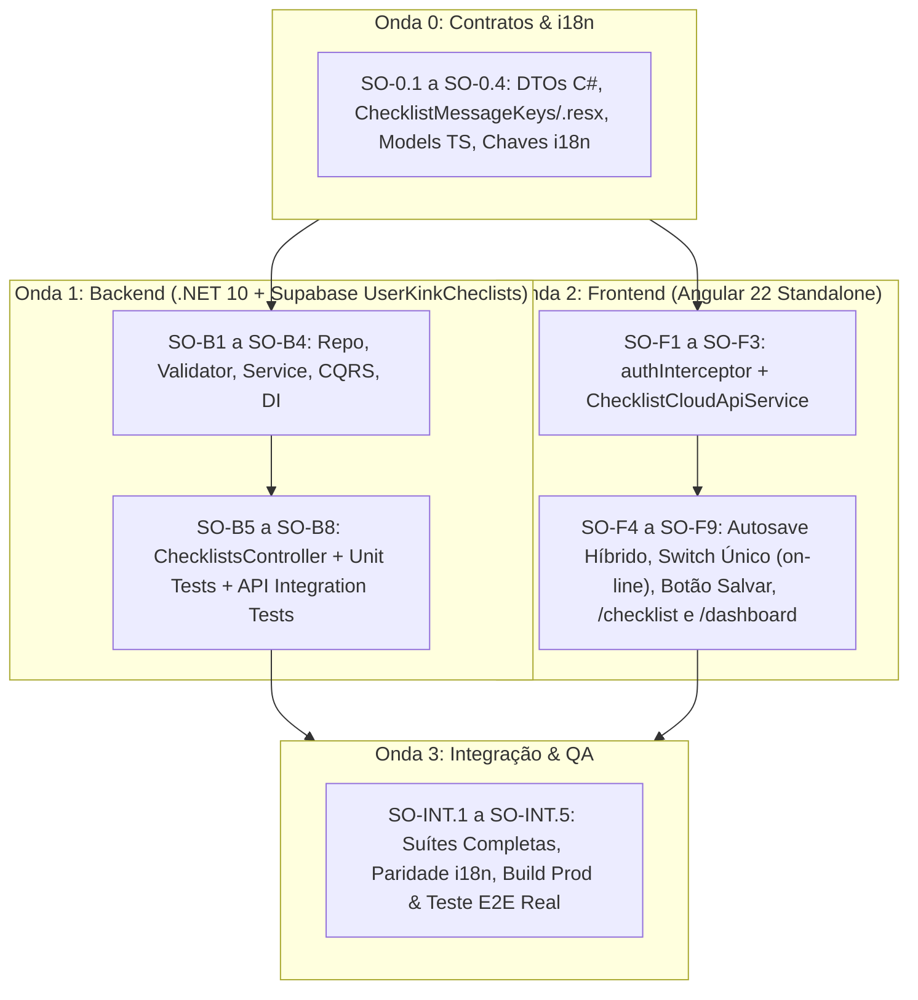

# Checklist de Implementação e Progresso — Salvamento Automático On-line (`UserKinkCheclists`)

**Projeto:** KinkConsentManager  
**Documento:** Orquestração por Ondas, Rastreamento de Tarefas, Testes e Critérios de Pronto (DoD)  
**Versão:** 1.0  
**Data:** 27 de Novembro de 2026  
**Documentos Relacionados:** [LEVANTAMENTO_FUNCIONAL_TECNICO.md](./LEVANTAMENTO_FUNCIONAL_TECNICO.md) · [PLANO_IMPLEMENTACAO.md](./PLANO_IMPLEMENTACAO.md)  

---

## 1. Visão Geral da Orquestração

---

## 2. Painel de Progresso por Trilha

| Trilha | Escopo | Tarefas | Concluídas | Status Geral |
| :--- | :--- | :---: | :---: | :---: |
| **Onda 0 — Contratos & i18n** | DTOs C#, `.resx`, Models TS e `pt-BR`/`en-US` | 4 | 0 | ⚪ Pendente |
| **Onda 1A — Backend Core** | Repositório, Validator, Service, CQRS & DI | 4 | 0 | ⚪ Pendente |
| **Onda 1B — Backend API & Testes** | Controller v1 + NUnit Unitários & Integração | 4 | 0 | ⚪ Pendente |
| **Onda 2A — Frontend Auth & Cloud API** | `authInterceptor` (Refresh) + `ChecklistCloudApiService` | 3 | 0 | ⚪ Pendente |
| **Onda 2B — Frontend Autosave Híbrido & UI** | Switch Único (`on-line`), Botão `Salvar`, `/checklist` e `/dashboard` | 6 | 0 | ⚪ Pendente |
| **Onda 3 — Integração & QA Final** | Build, Cobertura, `check:i18n`, Supabase Real & Browser | 5 | 0 | ⚪ Pendente |
| **TOTAL DA FEATURE** | **Salvamento Automático On-line (`UserKinkCheclists`)** | **26** | **0** | **0%** |

*Legenda:* `[ ] Pendente` · `[/] Em Progresso` · `[x] Concluído` · `[!] Bloqueado`

---

## 3. Checklist Granular de Tarefas

### Onda 0: Contratos Compartilhados & Localização

- [ ] **SO-0.1 — Criar DTOs C# do Checklist On-line**
  - **Arquivos:** `backend/Core/KinkConsentManager.Core/Domain/DTOs/Checklists/UserKinkChecklistDtos.cs`
  - **DoD:** `UpsertUserKinkChecklistRequestDto` e `UserKinkChecklistDto` imutáveis (`sealed record`) com XML docs completos.
- [ ] **SO-0.2 — Criar Chaves `ChecklistMessageKeys` e Recursos `.resx` Bilíngues**
  - **Arquivos:** `Domain/Localization/MessageKeys/ChecklistMessageKeys.cs`, `Infrastructure/Localization/Resources/ChecklistMessages.resx`, `ChecklistMessages.pt-BR.resx` (e chaves de validação em `ValidationMessages*.resx`)
  - **DoD:** Paridade de 100% entre `en-US` e `pt-BR` validada por teste automatizado em `KinkConsentManagerDbContextTests`.
- [ ] **SO-0.3 — Criar Contratos TypeScript de Checklist On-line**
  - **Arquivos:** `frontend/src/app/core/models/cloud-checklist.model.ts`, `frontend/src/app/core/models/index.ts`
  - **DoD:** Interfaces `CloudChecklistDto`, `UpsertCloudChecklistRequest`, `RestoredChecklistPayload` e `AutosavePersistenceMode` exportadas em `core/models`.
- [ ] **SO-0.4 — Adicionar e Sincronizar Chaves i18n no Frontend**
  - **Arquivos:** `frontend/src/assets/i18n/pt-BR.json`, `frontend/src/assets/i18n/en-US.json`
  - **DoD:** Todas as chaves listadas no Plano de Implementação inseridas e `npm.cmd run check:i18n` passando com `0` chaves ausentes.

---

### Onda 1: Backend (.NET 10 + Supabase `kink_consent."UserKinkCheclists"`)

- [ ] **SO-B1 — Implementar `IUserKinkChecklistRepository` e `UserKinkChecklistRepository`**
  - **Dependência:** `SO-0.1`
  - **Arquivos:** `Domain/Interfaces/Repositories/IUserKinkChecklistRepository.cs`, `Infrastructure/Repositories/UserKinkChecklistRepository.cs`
  - **DoD:** Métodos `GetByUserKinkIdAsync` e `DeleteByUserKinkIdAsync` operando sobre `_dbSet` com índice único `IX_UserKinkCheclists_UserKinkId`.
- [ ] **SO-B2 — Implementar `UpsertUserKinkChecklistRequestValidator`**
  - **Dependência:** `SO-0.1`, `SO-0.2`
  - **Arquivos:** `Domain/Validators/Checklists/UpsertUserKinkChecklistRequestValidator.cs`
  - **DoD:** Valida SemVer em `SchemaVersion`, idioma permitido (`pt-BR` | `en-US`), `AnswersJson` como objeto JSON válido (`JsonValueKind.Object`), limite de `512 KB` e mensagens localizadas via `IValidationMessageService`.
- [ ] **SO-B3 — Implementar `IUserKinkChecklistService` e `UserKinkChecklistService`**
  - **Dependência:** `SO-B1`, `SO-B2`
  - **Arquivos:** `Domain/Interfaces/Services/IUserKinkChecklistService.cs`, `Service/Services/UserKinkChecklistService.cs`, `Service/Mappings/AutoMapperProfile.cs`
  - **DoD:** `GetCurrentAsync` (`200`/`404`), `UpsertCurrentAsync` (`200`/`400`/`409` com concorrência otimista em `Version`), `DeleteCurrentAsync` (`200`), sem gravar `AnswersJson` nos logs.
- [ ] **SO-B4 — Implementar CQRS Commands/Queries e Registrar DI**
  - **Dependência:** `SO-B3`
  - **Arquivos:** `Service/Cqrs/Checklists/Queries/GetCurrentUserKinkChecklistQuery.cs`, `Service/Cqrs/Checklists/Commands/UpsertUserKinkChecklistCommand.cs`, `DeleteCurrentUserKinkChecklistCommand.cs`, `Service/API/DI/WebApplicationBuilderServicesConfigure.cs`
  - **DoD:** Handlers implementados usando `IApplicationDispatcher` / MediatR e grafo DI validado por `ValidateNoCircularDependencies()`.
- [ ] **SO-B5 — Implementar `ChecklistsController` (`api/v1/checklists`)**
  - **Dependência:** `SO-B4`
  - **Arquivos:** `backend/APIs/KinkConsentManager.API/Controllers/V1/ChecklistsController.cs`
  - **DoD:** Rotas `[Authorize]` `GET /current`, `PUT /current` e `DELETE /current` com `[ProducesResponseType]`, XML docs e extração exclusiva via `UserClaimsHelper.TryGetUserId(User)`.
- [ ] **SO-B6 — Testes Unitários do Core (Repositório, Validador, Serviço)**
  - **Dependência:** `SO-B1` a `SO-B4`
  - **Arquivos:** `UserKinkChecklistRepositoryTests.cs`, `UpsertUserKinkChecklistRequestValidatorTests.cs`, `UserKinkChecklistServiceTests.cs`
  - **DoD:** 100% dos fluxos de criação, atualização, conflito `409`, deleção e validação multilíngue cobertos e aprovados.
- [ ] **SO-B7 — Testes Unitários de Controller (`ChecklistsControllerTests`)**
  - **Dependência:** `SO-B5`
  - **Arquivos:** `backend/APIs/KinkConsentManager.API.Tests/Controllers/ChecklistsControllerTests.cs`
  - **DoD:** Verifica `401` sem claim `nameid`, despacho de commands/queries corretos e propagação dos status HTTP.
- [ ] **SO-B8 — Testes de Integração HTTP Ponta-a-Ponta (`ChecklistsApiIntegrationTests`)**
  - **Dependência:** `SO-B5`
  - **Arquivos:** `backend/APIs/KinkConsentManager.API.Tests/Integration/ChecklistsApiIntegrationTests.cs`
  - **DoD:** Testa `401` anônimo, `GET (404)` -> `PUT (200)` -> `GET (200)` -> `PUT Conflito (409)` -> `DELETE (200)` -> `GET (404)` e isolamento entre 2 usuários distintos no mesmo banco de teste.

---

### Onda 2: Frontend (Angular 22 Standalone + Signals)

- [ ] **SO-F1 — Implementar `authInterceptor` com Refresh Transparente + Spec**
  - **Dependência:** `SO-0.3`
  - **Arquivos:** `frontend/src/app/core/interceptors/auth.interceptor.ts`, `auth.interceptor.spec.ts`, `index.ts`, `app.config.ts` (e `refreshAccessToken()` deduplicado em `AuthService`)
  - **DoD:** Anexa `Bearer` apenas na API, renova em `401` via `/api/v1/auth/refresh`, deduplica chamadas paralelas e limpa sessão se refresh expirar.
- [ ] **SO-F2 — Implementar `ChecklistCloudApiService` + Spec**
  - **Dependência:** `SO-0.3`, `SO-F1`
  - **Arquivos:** `frontend/src/app/core/services/checklist-cloud-api.service.ts`, `checklist-cloud-api.service.spec.ts`, `core/services/index.ts`
  - **DoD:** Métodos `getCurrentChecklist()` (`404` -> `null`), `upsertCurrentChecklist()` e `deleteCurrentChecklist()` cobertos via `HttpTestingController`.
- [ ] **SO-F3 — Validar Hidratação de Sessão no Bootstrap e Login/Logout**
  - **Dependência:** `SO-F1`, `SO-F2`
  - **Arquivos:** `frontend/src/app/core/services/auth.service.ts` / `auth.service.spec.ts`
  - **DoD:** Tokens válidos restaurados antes da primeira consulta à API; refresh disponível via serviço para interceptor.
- [ ] **SO-F4 — Evoluir `ChecklistAutosaveService` para Modo Híbrido (On-line vs. Local) + Spec**
  - **Dependência:** `SO-F2`
  - **Arquivos:** `frontend/src/app/core/services/checklist-autosave.service.ts`, `checklist-autosave.service.spec.ts`
  - **DoD:**
    - Quando logado (`isAuthenticated() === true`), habilita salvamento automático on-line por padrão (`true`) com preferência própria;
    - Persiste respostas **somente via `ChecklistCloudApiService`** (`PUT` / `DELETE`), sem gravar em `localStorage`;
    - Quando deslogado, mantém 100% do salvamento cifrado AES-GCM em `localStorage`;
    - Implementa debounce reativo (~2,5s) + `saveNow()` + `restoreFromAutosave()` com resolução de conflito local vs. nuvem e limpeza no logout.
- [ ] **SO-F5 — Atualizar `ChecklistProgressBarComponent` (Manter 1 Switch + 1 Botão `Salvar`) + Spec**
  - **Dependência:** `SO-0.4`, `SO-F4`
  - **Arquivos:** `frontend/src/app/features/checklist/components/checklist-progress-bar/*`
  - **DoD:** Mantém exatamente **1 `<mat-slide-toggle>`** e **1 botão `Salvar`**; exibe ícone `fa-cloud` em status quando `isOnlineAutosave()` for `true`; testes confirmam ausência de segundo switch.
- [ ] **SO-F6 — Atualizar `ChecklistPageComponent` (`/checklist/fill`) + Spec**
  - **Dependência:** `SO-F4`, `SO-F5`
  - **Arquivos:** `frontend/src/app/features/checklist/pages/checklist-page/checklist-page.component.ts`, `html`, `spec.ts`
  - **DoD:** Exibe legenda **`Salvamento automático (on-line)`** quando logado, mantém botão **`Salvar`** gravando no banco, ajusta mensagens de status (`Salvo on-line às HH:mm`) e faz `clearAll` remover também da nuvem.
- [ ] **SO-F7 — Atualizar `ChecklistStartPageComponent` (`/checklist` — *"Como você prefere preencher o checklist?"*) + Spec**
  - **Dependência:** `SO-F4`
  - **Arquivos:** `frontend/src/app/features/checklist/pages/checklist-start-page/*`
  - **DoD:** Garante hidratação on-line da tabela `UserKinkCheclists` ao acessar `/checklist` logado; exibe banner com progresso salvo on-line e mantém os 4 botões de modo exibindo **`Continuar neste modo →`** para continuar ou editar.
- [ ] **SO-F8 — Atualizar `DashboardPageComponent` (`/dashboard`) para Sincronização Pós-Login e Logout + Spec**
  - **Dependência:** `SO-F4`
  - **Arquivos:** `frontend/src/app/features/dashboard/pages/dashboard-page/dashboard-page.component.ts`, `dashboard-page.component.spec.ts`
  - **DoD:** Após `handleLogin`, dispara restauração on-line da nuvem (atualizando o card para *"Continuar Checklist"* quando houver dados); após `handleLogout`, limpa respostas on-line em memória.
- [ ] **SO-F9 — Revisar Acessibilidade (`[attr.title]`, ARIA) e Paridade i18n em Todos os Componentes Modificados**
  - **Dependência:** `SO-F5` a `SO-F8`
  - **DoD:** Todos os botões, switches e ícones possuem `[attr.title]` e `aria-label`; `npm.cmd run check:i18n` passa sem falhas.

---

### Onda 3: Integração Final & QA

- [ ] **SO-INT.1 — Build e Testes Completos do Backend (`dotnet build` + `dotnet test`)**
  - **DoD:** `0` erros, `0` warnings e 100% dos testes em `KinkConsentManager.Core.Tests` e `KinkConsentManager.API.Tests` aprovados.
- [ ] **SO-INT.2 — Prettier, TypeScript (`tsc`), `check:i18n` e Build Prod do Frontend**
  - **DoD:** Prettier `--check` limpo, `tsconfig.app.json` + `tsconfig.spec.json` com `0` erros e `npm.cmd run build:prod` sem erros.
- [ ] **SO-INT.3 — Suíte Completa Jest + Cobertura (`npm.cmd run test:ci`)**
  - **DoD:** 100% das suítes aprovadas com cobertura global mantida acima de 90%.
- [ ] **SO-INT.4 — Validação Ponta-a-Ponta com Supabase Real (`UserKinkCheclists`)**
  - **DoD:** Logar no app em execução, preencher questões no `/checklist/fill`, confirmar registro em `kink_consent."UserKinkCheclists"` sem gravação em `localStorage`, recarregar ou reabrir `/checklist` (*"Como você prefere preencher o checklist?"*) confirmando botões **`Continuar neste modo →`** e edição contínua.
- [ ] **SO-INT.5 — Mover Documentação para `docs/Features/Feito/` Após Conclusão**
  - **DoD:** Atualizar status deste checklist para 100% concluído e arquivar a pasta conforme padrão do repositório.

---

## 4. Matriz de Riscos Técnicos e Mitigações

| Risco | Impacto | Mitigação Planejada |
| :--- | :---: | :--- |
| **Sobrescrita silenciosa em duas abas abertas ao mesmo tempo** | Médio | Concorrência otimista usando coluna `Version` em `UserKinkCheclists` (`409 Conflict` retornado pela API) e diálogo claro para recarregar ou sobrescrever intencionalmente. |
| **Access Token expirar após longo tempo preenchendo em `/checklist/fill`** | Alto | `authInterceptor` intercepta `401`, executa `POST /api/v1/auth/refresh` de forma deduplicada e reenvia o `PUT /api/v1/checklists/current` sem perder respostas. |
| **Perda de rascunho preenchido anonimamente logo antes de fazer login** | Alto | Na transição `Anônimo -> Logado`, se o banco estiver vazio (`404`), o rascunho local é enviado automaticamente via `PUT`; se ambos existirem e divergirem, modal pergunta qual versão manter. |
| **Vazamento de respostas em computador compartilhado após Logout** | Alto | Quando autenticado, respostas **não** vão para o `localStorage` e o logout executa `ChecklistStateService.resetAllAnswers()` + limpeza dos sinais de autosave. |
| **Excesso de requisições `PUT` em cliques rápidos (*Quick-Fill*)** | Médio | Debounce reativo de `2,5s` após última edição + verificação de fingerprint (`hasUnsavedChanges`) evitando envios redundantes. |
| **Queda temporária de internet ou cold start da API** | Médio | Estado permanece íntegro em memória com `hasUnsavedChanges = true`, status visível de erro recuperável e retry manual imediato pelo botão **`Salvar`**. |
