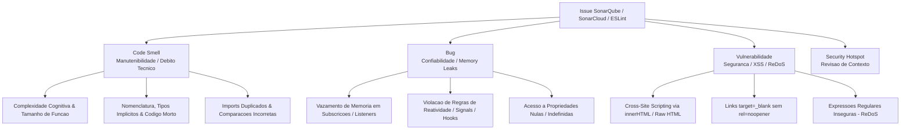
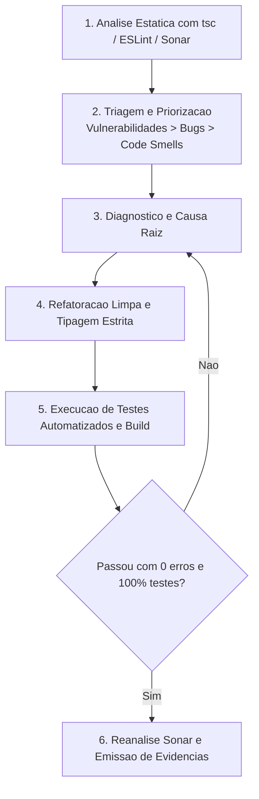

# Diretrizes para Ajuste de Issues e Code Smells — Frontend (Genérico TypeScript / JavaScript)

**Documento:** Guia operacional padronizado e reutilizável para qualidade estática e governança de código frontend  
**Arquivo:** `Diretrizes-CodeSmell-Frontend-Generico.md`  
**Escopo:** Ecossistemas TypeScript / JavaScript (Angular, React, Vue, Svelte, SDKs Web, Node.js Tooling)  
**Ferramental de Referência:** SonarQube, SonarCloud, ESLint, TypeScript Compiler (`tsc`), Prettier, Vitest / Jest  
**Data:** 2026-11-22  

---

## 1. Objetivo

Padronizar e orientar o processo de identificação, diagnóstico e remediação de **Code Smells**, **Bugs**, **Vulnerabilidades** e **Security Hotspots** apontados por analisadores estáticos (SonarQube, SonarCloud, ESLint, TypeScript) em aplicações e bibliotecas frontend, assegurando:

1. **Zero Regressão de Comportamento:** Nenhuma refatoração para eliminação de Code Smell pode alterar o comportamento da interface, reatividade de estado, contratos de APIs ou acessibilidade (a11y).
2. **Alta Manutenibilidade e Legibilidade (*Maintainability Rating A*):** Eliminar complexidade cognitiva excessiva, duplicação de lógica, código morto e acoplamentos desnecessários.
3. **Prevenção de Memory Leaks e Vulnerabilidades:** Eliminar vazamentos de memória (assinaturas de Observables e event listeners não destruídos) e brechas de segurança (XSS, manipulação insegura de DOM, links vulneráveis).
4. **Governança Ética de Linter:** Proibir a supressão indiscriminada de regras via `// eslint-disable` ou `@ts-ignore` sem justificativa técnica formal documentada.
5. **Governança Estrita de Controle de Versão (Git / CI/CD):** Proibir terminantemente a execução autônoma ou automática de `git commit`, `git push`, criação de novas branches ou abertura de Pull Requests (PRs). Quaisquer alterações de código e saneamentos de Code Smells devem permanecer estritamente no ambiente de trabalho local (*working directory* / *stage*) para revisão do desenvolvedor. Ações de versionamento e publicação cabem exclusivamente ao desenvolvedor responsável ou mediante ordem explícita e pontual deste.

---

## 2. Taxonomia de Issues do Sonar e ESLint no Frontend



---

## 3. Catálogo de Regras Sonar / ESLint Frontend e Padrões de Correção

### 3.1 Manutenibilidade e Code Smells

| Regra Sonar / ESLint | Descrição | Causa Típica | Solução Recomendada |
| -------------------- | --------- | ------------ | ------------------- |
| **`typescript:S2234`** / **`S1940`** | *Comparisons should be simplified* | `typeof x === 'undefined'` em escopos onde `x` é declarado | Comparar diretamente com `undefined` (`x === undefined`) ou utilizar checagem de presença (`!x`). |
| **`typescript:S3776`** | *Cognitive Complexity of functions should not be too high* | Funções ou métodos com muitos `if/else`, loops aninhados e ternários | Decompor a função em funções menores, especializadas e com responsabilidade única (*Extract Function*). |
| **`typescript:S1144`** / **`@typescript-eslint/no-unused-vars`** | *Unused variables, methods and imports* | Variáveis, parâmetros ou imports declarados mas nunca utilizados | Remover o identificador não utilizado. Em callbacks onde o parâmetro é posicional obrigatório, prefixar com `_` (ex.: `_event`). |
| **`typescript:S1128`** | *Unused / Duplicated imports should be removed* | Múltiplos imports do mesmo módulo no mesmo arquivo | Agrupar imports em uma única declaração ou remover duplicatas (ex.: em arquivos de setup de testes). |
| **`typescript:S1874`** | *Deprecated APIs should not be used* | Uso de métodos ou componentes marcados como `@deprecated` | Migrar para a API moderna recomendada pelo framework (ex.: `takeUntilDestroyed` e Signals no Angular, `useSyncExternalStore` no React). |
| **`typescript:S1488`** | *Local variables should not be declared and immediately returned* | `const result = calc(); return result;` sem operações intermediárias | Retornar diretamente a expressão: `return calc();`. |
| **`typescript:S3317`** | *Top-level declarations should be in separate files* | Múltiplas classes ou interfaces exportadas no mesmo arquivo | Separar cada componente, serviço ou modelo em seu próprio arquivo correspondente. |

---

### 3.2 Confiabilidade e Bugs

| Regra Sonar / ESLint | Descrição | Causa Típica | Solução Recomendada |
| -------------------- | --------- | ------------ | ------------------- |
| **`typescript:S3800`** / **`S4200`** | *Observables and Event Listeners must be unsubscribed* | Realizar `.subscribe()` ou `addEventListener` sem desinscrição no destroy | No Angular: usar `takeUntilDestroyed()`, `DestroyRef.onDestroy(...)`, `toSignal()` ou pipe `async`. No React: retornar a função de limpeza no `useEffect`. |
| **`react-hooks/rules-of-hooks`** | *Hooks must be called at top level* | Chamar `useState` ou `useEffect` dentro de `if`, loops ou callbacks | Mover a invocação do hook para o topo do componente funcional de forma incondicional. |
| **`react-hooks/exhaustive-deps`** | *React Hook useEffect has missing dependencies* | Omitir variáveis ou funções usadas dentro do `useEffect` / `useCallback` | Adicionar as dependências no array ou memorizar funções com `useCallback`. |
| **`typescript:S2259`** | *Objects should not be accessed when possibly null/undefined* | Acessar `obj.prop` quando `obj` pode ser nulo | Usar encadeamento opcional (*optional chaining* `obj?.prop`) ou coalescência nula (`obj?.prop ?? defaultValue`). |
| **`javascript:S2699`** | *Tests should include assertions* | Blocos de teste (`it`) sem nenhuma asserção `expect(...)` | Adicionar asserções explícitas validando o resultado esperado ou spies de invocação. |

---

### 3.3 Segurança e Vulnerabilidades

| Regra Sonar / ESLint | Descrição | Causa Típica | Solução Recomendada |
| -------------------- | --------- | ------------ | ------------------- |
| **`typescript:S5147`** / **`S6096`** | *Cross-Site Scripting (XSS) via raw HTML* | Uso de `innerHTML`, `[innerHTML]`, `dangerouslySetInnerHTML` sem sanitização | Evitar HTML dinâmico bruto usando interpolação segura (`textContent`, `{{ }}`). Quando indispensável, sanitizar obrigatoriamente via `DOMPurify.sanitize()`. |
| **`javascript:S2819`** | *Links with target="_blank" must include rel="noopener noreferrer"* | `<a>` com `target="_blank"` sem proteção de isolamento de contexto | Adicionar sempre `rel="noopener noreferrer"` para impedir ataques do tipo *Tabnabbing*. |
| **`typescript:S4507`** | *Debugging statements should not be present in production* | Comandos `debugger;` ou `console.log()` esquecidos no código | Remover instruções de depuração ou configurar o bundler para remoção de `console`/`debugger` em produção. |
| **`javascript:S5852`** | *Regular expressions should not be vulnerable to ReDoS* | Expressões regulares com quantificadores aninhados ambíguos | Reescrever o regex evitando *backtracking* catastrófico ou utilizar parsers determinísticos. |

---

## 4. Fluxo Operacional de Saneamento Passo a Passo



### 4.1 Comandos de Diagnóstico e Validação

```powershell
# 1. Executar validação estrita de tipos do TypeScript sem emitir arquivos
npx.cmd tsc --noEmit

# 2. Executar análise do linter / formatador (quando configurado no projeto)
npm.cmd run lint

# 3. Executar toda a suíte de testes unitários (Vitest / Jest)
npm.cmd run test:ci   # ou npm test

# 4. Compilar bundle otimizado de produção
npm.cmd run build:prod
```

---

## 5. Checklist de Qualidade Obrigatório

- [ ] **Linter / Formatação Limpos**: análise estática (`tsc` + `lint`/`prettier` quando aplicável) conclui com 0 erros.
- [ ] **TypeScript Estrito**: `npx.cmd tsc --noEmit` conclui sem erros de tipagem (`strict: true`).
- [ ] **100% dos Testes Aprovados**: Todos os testes unitários passando (`Vitest` / `Jest`).
- [ ] **Build de Produção OK**: `npm.cmd run build:prod` gera bundles minificados sem quebras.
- [ ] **Zero Supressões Arbitrárias**: Nenhum `// eslint-disable` ou `@ts-ignore` inserido sem documentação e autorização.
- [ ] **Proteção contra XSS Ativa**: Preferência por interpolação nativa segura e sanitização explícita caso HTML dinâmico seja necessário.
- [ ] **Memory Leaks Prevenidos**: Subscrições e listeners encerrados via `takeUntilDestroyed()`, `DestroyRef` ou cleanup de efeito.
- [ ] **Zero Operações Git Autônomas**: Nenhum `git commit`, `git push`, criação de `branch` ou abertura de `PR` realizado de forma automática ou não autorizada explicitamente pelo desenvolvedor.

---

## 6. Template de Registro de Evidências

```text
================================================================================
RELATÓRIO DE SANEAMENTO DE CODE SMELLS (FRONTEND)
================================================================================
Data: AAAA-MM-DD
Módulo: <frontend / feature / service>

1. Sumário de Issues Resolvidas:
   - Vulnerabilidades (XSS, ReDoS): 0 pendentes
   - Bugs / Memory Leaks (Subscriptions, Signals, Nullability): 0 pendentes
   - Code Smells (Complexidade, Tipos, Imports): N corrigidos

2. Principais Regras Saneadas:
   - typescript:S2234: Comparações com undefined simplificadas
   - typescript:S1128: Imports duplicados removidos nos arquivos .spec.ts
   - typescript:S3800: Subscrições protegidas com takeUntilDestroyed()
   - typescript:S3776: Funções de alta complexidade extraídas em helpers puros

3. Validação:
   - TypeScript (tsc --noEmit): 0 erros
   - Testes Unitários: N / N aprovados (100%)
   - Build Prod: Concluído com sucesso
================================================================================
```
