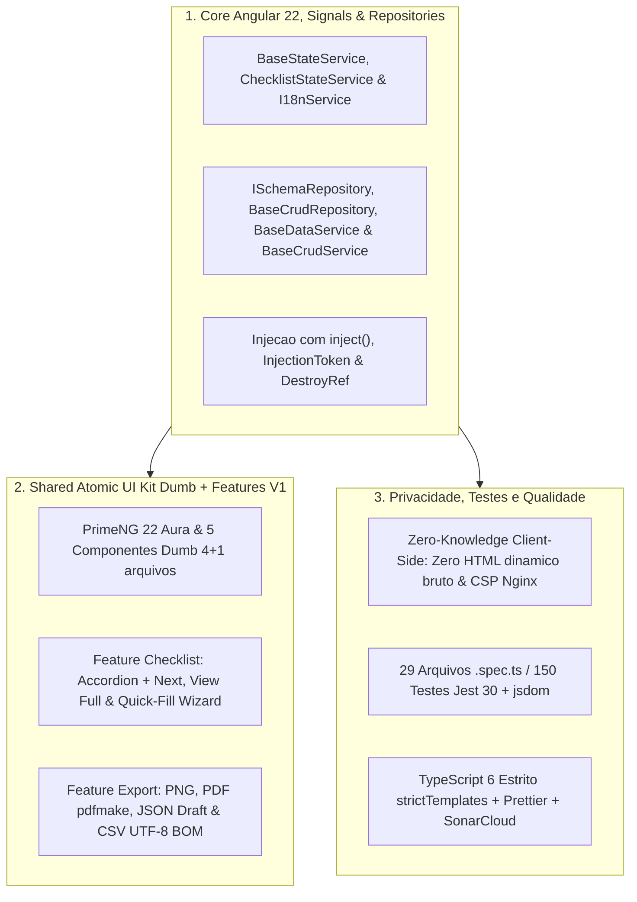

# Diretrizes para Ajuste de Issues e Code Smells — KinkConsentManager UI

**Documento:** Guia operacional específico para a aplicação frontend KinkConsentManager (V1 Checklist)  
**Projeto:** [frontend/](../../../frontend) (`kinkconsentmanager` — SPA Angular 22 + PrimeNG 22)  
**Manifesto:** [package.json](../../../frontend/package.json)  
**Configuração Sonar:** [sonar-project.properties](../../../frontend/sonar-project.properties)  
**Guia-Base Genérico:** [Diretrizes-CodeSmell-Frontend-Generico.md](./Diretrizes-CodeSmell-Frontend-Generico.md)  
**Data:** 2026-11-22  

---

## 1. Contexto Arquitetural do KinkConsentManager UI

O **KinkConsentManager UI** é uma aplicação web **100% client-side** (V1 com foco exclusivo no módulo de Checklist de Limites e Consentimento), construída sobre **Angular 22 (Standalone Components + Signals + OnPush)**, **PrimeNG 22 (`@primeuix/themes` Aura)**, **PrimeIcons 8**, **`@ngx-translate/core` 18**, **`html-to-image`** e **`pdfmake` 0.3**. Conta atualmente com uma suíte de **150 testes unitários em 29 arquivos `.spec.ts`** no **Jest 30 + `jest-preset-angular` 17** (`91,84%` de cobertura de linhas).



---

## 2. Catálogo de Code Smells Específicos e Saneamento no KinkConsentManager UI

### 2.1 Gestão de Subscriptions RxJS e Prevenção de Memory Leaks (`typescript:S3800`)
- **Problema:** Realizar `.subscribe()` em Observables de serviços (`I18nService`, `ISchemaRepository`, eventos de `TranslateService`) sem cancelar a inscrição ao destruir o componente ou serviço.
- **Padrão Homologado no KinkConsentManager UI:**
  - Preferir estado reativo com **Angular Signals** (`signal()`, `computed()`, `effect()`), eliminando assinaturas manuais na camada de apresentação.
  - Em classes TypeScript que consomem streams contínuos (como `TranslateService.onLangChange`), utilizar **`takeUntilDestroyed()`** ou `take(1)` para chamadas finitas:
    ```typescript
    private readonly schemaRepository = inject(SCHEMA_REPOSITORY_TOKEN);
    private readonly destroyRef = inject(DestroyRef);

    loadSchema(): void {
      this.schemaRepository
        .getChecklistSchema('v1')
        .pipe(takeUntilDestroyed(this.destroyRef))
        .subscribe({
          next: (schema) => this.checklistState.initializeSchema(schema),
          error: () => this.hasError.set(true),
        });
    }
    ```
  - Em repositórios com cache (`StaticJsonSchemaRepository`, `BaseCrudRepository`), garantir `catchError` para evicção de observables que falharam antes do `shareReplay(1)`, evitando cache permanente de erro.

---

### 2.2 Segurança, Privacidade Local e Exportação Segura (`typescript:S5147` / CSV Injection / JSON Malformado)
- **Política Zero HTML Dinâmico Bruto:** A V1 não renderiza Markdown ou HTML via `[innerHTML]`. Toda exibição de textos traduzidos e notas (`customText`, `otherText`) utiliza interpolação nativa segura do Angular (`{{ ... }}`), neutralizando XSS por padrão, reforçado pela **Content-Security-Policy** em [nginx.conf](../../../frontend/nginx.conf).
- **Validação Estrita de Importação JSON (`JsonDraftService`):**
  - Nunca confiar em `JSON.parse()` sem try/catch e validação estrutural (`isPlainObject`, `schemaVersion` compatível, `answers` não nulo).
- **Sanitização e Escape no Exportador CSV (`CsvExportService`):**
  - Prefixar obrigatoriamente `\uFEFF` (UTF-8 BOM) e aplicar escape RFC-4180 completo em campos com vírgulas, aspas duplas (`""`) e quebras de linha.
- **Persistência Segura (`LocalStoragePersistenceService`):**
  - Sempre encapsular `localStorage.getItem`/`setItem` em `try/catch` para suportar SSR, modo anônimo restrito e `QuotaExceededError`.

---

### 2.3 Separação Estrita 4+1 Arquivos, `OnPush` e Smart vs. Dumb Components
- **Problema:** Colocar templates/estilos inline, misturar estado global (`ChecklistStateService`) dentro de `shared/components/*` ou violar `noPropertyAccessFromIndexSignature`.
- **Padrão Homologado no KinkConsentManager UI:**
  - Todo componente possui pasta própria com `.component.ts`, `.component.html`, `.component.scss`, `.component.spec.ts` e `index.ts`.
  - `changeDetection: ChangeDetectionStrategy.OnPush` obrigatório em 100% dos componentes.
  - Componentes em `src/app/shared/components/` recebem dados exclusivamente via `input()` / `input.required()` e notificam ações via `output()`.
  - Acessos a dicionários/index signatures devem respeitar `noPropertyAccessFromIndexSignature: true` (notação `record[key]` ou helpers `hasOwn`).

---

### 2.4 Injeção Moderna com `inject()` e `InjectionToken`
- **Problema:** Construtores inflados e acoplamento direto a implementações concretas ou APIs de terceiros (`html-to-image`, `pdfmake`), dificultando testes unitários isolados.
- **Padrão Homologado:**
  - Usar `inject()` como propriedade `private readonly` no corpo da classe.
  - Abstrair dependências externas e futuras fontes de dados via tokens (`SCHEMA_REPOSITORY_TOKEN`, `API_BASE_URL`, `PNG_RENDERER`, `PDF_MAKER_LOADER`, `createCrudRepositoryToken`).
  ```typescript
  export class ExportPageComponent {
    private readonly checklistState = inject(ChecklistStateService);
    private readonly i18n = inject(I18nService);
    private readonly pngExport = inject(PngExportService);
    private readonly messageService = inject(MessageService);
  }
  ```

---

### 2.5 Governança de Controle de Versão (Git e CI/CD)
- **Regra Mandatória de Não-Versionamento Automático:**
  - **NÃO** realizar `git commit`.
  - **NÃO** realizar `git push`.
  - **NÃO** abrir Pull Requests (PRs).
  - **NÃO** criar ou alternar branches de forma automática.
- **Isolamento no Workspace Local:** Todas as modificações geradas durante a análise e saneamento de Code Smells devem permanecer estritamente na árvore de trabalho local (*working directory* / *stage*). A validação dos diffs, testes (`npm.cmd run test:ci`), compilação (`npm.cmd run build:prod`) e o versionamento final no Git são de controle exclusivo do desenvolvedor responsável.

---

## 3. Configuração Sonar e Exclusões Homologadas

Conforme definido em [frontend/sonar-project.properties](../../../frontend/sonar-project.properties):

```properties
sonar.sources=frontend/src
sonar.tests=frontend/src
sonar.inclusions=frontend/src/**/*.ts
sonar.exclusions=**/*.js,**/*.spec.ts,**/*.test.ts,**/*.css,**/*.scss,**/*.html,**/node_modules/**,**/dist/**,**/coverage/**,**/__tests__/**,frontend/src/setup-jest.ts
sonar.test.inclusions=frontend/src/**/*.spec.ts,frontend/src/**/*.test.ts
sonar.coverage.exclusions=\
frontend/src/**/*.spec.ts,\
frontend/src/**/*.test.ts,\
frontend/src/**/__tests__/**,\
frontend/src/main.ts,\
frontend/src/setup-jest.ts,\
frontend/src/app/app.config.ts,\
frontend/src/app/**/*.routes.ts,\
frontend/src/app/**/*.model.ts,\
frontend/src/app/**/index.ts,\
frontend/src/**/*.mock.ts
sonar.typescript.tsconfigPath=frontend/tsconfig.json
sonar.javascript.lcov.reportPaths=frontend/coverage/lcov.info
sonar.typescript.lcov.reportPaths=frontend/coverage/lcov.info
sonar.testExecutionReportPaths=frontend/coverage/sonar/sonar-report.xml
```

---

## 4. Procedimento Operacional de Saneamento

```powershell
Set-Location "e:\git\kinkconsentmanager\frontend"

# 1. Validar tipos estritos (app e specs)
npx.cmd tsc -p tsconfig.app.json --noEmit
npx.cmd tsc -p tsconfig.spec.json --noEmit

# 2. Verificar formatação (Prettier) e linter (quando ESLint estiver configurado)
npx.cmd prettier --check "src/**/*.{ts,html,scss,json}"

# 3. Executar suíte completa de testes unitários (29 arquivos / 150 testes)
npm.cmd run test:ci

# 4. Executar análise de cobertura com geração de LCOV
npm.cmd run test:coverage

# 5. Validar compilação de produção
npm.cmd run build:prod
```

*(Nota: Caso seja adicionado `@angular-eslint` em um ciclo futuro, incluir `npm.cmd run lint` antes dos testes.)*

---

## 5. Checklist de Homologação

- [ ] `npx.cmd tsc -p tsconfig.app.json --noEmit` e `tsconfig.spec.json` concluídos com 0 erros (`strict: true`, `strictTemplates: true`).
- [ ] **150 / 150** testes unitários aprovados em 29 arquivos `.spec.ts` no Jest 30 (100% de sucesso).
- [ ] Cobertura global de linhas mantida acima de **90%** (atual: **91,84%** linhas / **92,18%** statements).
- [ ] Subscrições finitas/contínuas protegidas (`take(1)`, `takeUntilDestroyed()`, Signals).
- [ ] Componentes `shared/` mantidos 100% Dumb (`OnPush`, sem injeção de estado global, regra dos 4+1 arquivos).
- [ ] `npm.cmd run build:prod` gera bundles em `frontend/dist/kinkconsentmanager/browser/` sem erros.
- [ ] Quality Gate do SonarCloud alinhado aos relatórios `frontend/coverage/lcov.info` e `frontend/coverage/sonar/sonar-report.xml`.
- [ ] **Operações Git Preservadas:** Nenhuma operação de `commit`, `push`, criação de `branch` ou abertura de `PR` realizada de forma autônoma.
