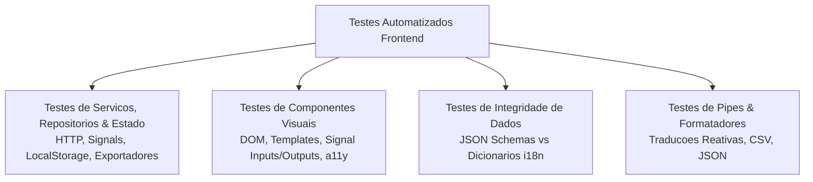

# Diretrizes para Testes Automatizados e Cobertura (Coverage) — Frontend (Genérico npm / Angular / React)

**Documento:** Guia operacional padronizado e reutilizável para engenharia de testes e cobertura frontend  
**Arquivo:** `Diretrizes-Coverage-Frontend-Generico.md`  
**Escopo:** Aplicações SPA, bibliotecas cliente e SDKs TypeScript (Angular, React, Vue, Vite, Webpack)  
**Ferramental de Referência:** Vitest, Jest, Karma/Jasmine, Testing Library, V8 / Istanbul  
**Data:** 2026-11-22  

---

## 1. Objetivo

Padronizar a criação, estruturação e manutenção de testes unitários e de integração em ecossistemas frontend baseados em TypeScript / JavaScript, garantindo:

1. **Alta Cobertura e Não-Regressão:** Atingir e manter metas rigorosas de cobertura (Statements, Branches, Functions e Lines) em componentes visuais, serviços, repositórios, pipes e utilitários.
2. **Isolamento e Determinismo:** Testes rápidos e independentes, utilizando mocks, tokens de injeção e spies para isolar chamadas de rede HTTP, armazenamento local (`localStorage`/`sessionStorage`), timers e bibliotecas externas pesadas.
3. **Clareza com Padrão AAA:** Estrutura clara baseada em **Arrange / Act / Assert**.
4. **Resiliência e Testabilidade:** Foco em testar o comportamento da aplicação a partir da perspectiva do usuário ou do consumidor da API, evitando acoplamento excessivo a detalhes internos de implementação.
5. **Governança Estrita de Controle de Versão (Git / CI/CD):** Proibir terminantemente a execução autônoma ou automática de `git commit`, `git push`, criação de novas branches ou abertura de Pull Requests (PRs). Quaisquer alterações de testes e código devem permanecer estritamente no ambiente de trabalho local (*working directory* / *stage*) para validação do desenvolvedor, cabendo exclusivamente a este as decisões de versionamento.

---

## 2. Padrões Obrigatórios de Escrita de Testes Frontend

### 2.1 Nomenclatura em Inglês
Os blocos `describe` e métodos `it` devem ser redigidos em inglês com descrição comportamental clara (no padrão `should ...` ou `Method_Scenario_ExpectedResult`):

```typescript
describe('ChecklistStateService', () => {
  it('should update primaryScale without overwriting secondaryScale in dual-role mode', () => { ... });
  it('importDraft_WithIncompatibleSchemaVersion_ReturnsValidationErrors', () => { ... });
});
```

---

### 2.2 Comentários de Contexto em Português
Acima de cada bloco de cenários complexos ou testes críticos, adicionar um comentário em português explicando o cenário e o objetivo:

```typescript
// Cenário: Troca de idioma em tempo real após preenchimento parcial do checklist.
// Objetivo: Garantir que os textos traduzidos mudem mantendo todas as respostas intactas.
it('should preserve all recorded answers when switching language from pt-BR to en-US', () => {
  // Arrange
  // Act
  // Assert
});
```

---

### 2.3 Estrutura Arrange / Act / Assert (AAA) — Vitest / Jest

```typescript
// Cenário: Tentativa de exportação quando o serviço subjacente retorna erro.
// Objetivo: Validar que a notificação de erro seja acionada e o estado de loading seja desligado.
it('should show error toast and reset busy state when export fails', async () => {
  // Arrange
  const toastSpy = vi.spyOn(messageService, 'add'); // ou jest.spyOn(...)
  vi.spyOn(pngExportService, 'exportElementAsPng').mockRejectedValue(new Error('Canvas error'));

  // Act
  await component.onExportPng();

  // Assert
  expect(toastSpy).toHaveBeenCalledWith(expect.objectContaining({ severity: 'error' }));
  expect(component.busyFormat()).toBeNull();
});
```

---

## 3. Tipologia de Testes no Frontend



### 3.1 Testes de Serviços, Repositórios e Clientes HTTP
- No **Angular 18+ / 22**: Utilizar `provideHttpClient()` + `provideHttpClientTesting()` com `HttpTestingController` (substituindo o antigo `HttpClientTestingModule`).
- Validar normalização de URLs, parâmetros de query, cache (`shareReplay`), evicção de erros, tratamento de HTTP 4xx/5xx e persistência local sem acesso à rede real.

### 3.2 Testes de Componentes Visuais
- **No Angular (Standalone + Signals + OnPush):** Utilizar `TestBed.configureTestingModule({ imports: [...] })`, `fixture.componentRef.setInput(...)`, `fixture.detectChanges()` e `await fixture.whenStable()`.
- **No React:** Utilizar `@testing-library/react` (`render`, `screen`) e `@testing-library/user-event` para simular interações reais.

---

## 4. Métricas e Gestão de Exclusões de Cobertura

### 4.1 As 4 Métricas Fundamentais do V8 / Istanbul
1. **Statements (% de Instruções):** Proporção de instruções de código executadas.
2. **Branches (% de Ramos/Condições):** Proporção de caminhos lógicos (`if/else`, `switch`, operadores ternários, `?.`) testados.
3. **Functions (% de Funções):** Proporção de funções, métodos e lambdas invocados.
4. **Lines (% de Linhas):** Proporção de linhas físicas executadas.

### 4.2 Exclusões de Cobertura Válidas
Arquivos que **não contêm lógica testável** devem ser configurados em `sonar.coverage.exclusions` (ou nas opções do runner) para não distorcer os indicadores:
- Arquivos de bootstrap e configuração de provedores (`main.ts`, `app.config.ts`, `index.html`).
- Arquivos de configuração de ambiente (`environment*.ts`).
- Definições de tipos, contratos e barrel exports (`*.model.ts`, `*.enum.ts`, `*.d.ts`, `**/index.ts`).
- Arquivos de rotas puras (`*.routes.ts`, `*-routing.module.ts`).
- Setups de ambiente de teste e suítes (`*.spec.ts`, `*.test.ts`, `**/__tests__/**`).

---

## 5. Roteiro Operacional de Execução

```powershell
# 1. Executar suíte completa de testes sem watch
npm.cmd run test:ci
# ou: ng.cmd test --watch=false

# 2. Executar suíte com relatório de cobertura V8 / LCOV
npm.cmd run test:coverage
# ou: ng.cmd test --watch=false --coverage

# 3. Executar testes filtrando por diretório ou arquivo específico (Vitest / Angular CLI)
ng.cmd test --watch=false --include=src/app/core/services
```

---

## 6. Checklist de Qualidade Frontend

- [ ] Nome do teste claro em inglês cobrindo comportamento e cenário.
- [ ] Comentários em português `// Cenário:` e `// Objetivo:` presentes nos cenários críticos.
- [ ] Padrão AAA respeitado.
- [ ] Mocks e spies limpos ao término de cada teste (`afterEach(() => vi.restoreAllMocks())` ou `jest.clearAllMocks()`).
- [ ] Cobertura de ramos (*branch coverage*) validando ambos os caminhos de condições booleanas e casos de erro.
- [ ] Zero dependência de chamadas de rede reais (100% dos fluxos HTTP mockados via `HttpTestingController` ou tokens).
- [ ] **Operações Git Preservadas:** Nenhuma operação de `commit`, `push`, criação de `branch` ou abertura de `PR` realizada de forma autônoma.
