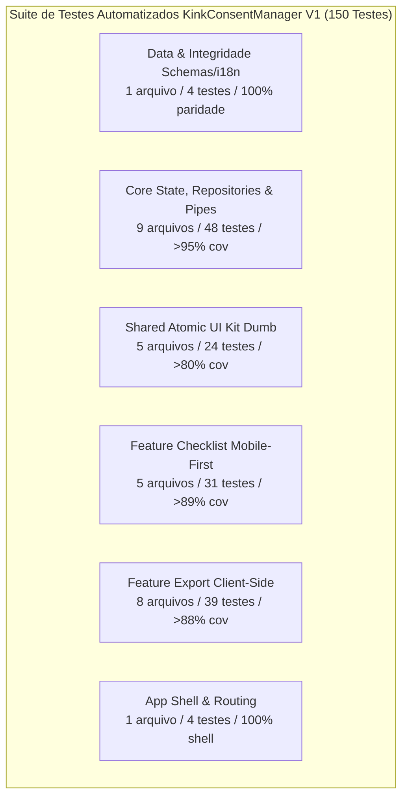

# Diretrizes para Testes Automatizados e Cobertura (Coverage) — KinkConsentManager

**Documento:** Guia operacional específico da suíte de testes e cobertura frontend (V1 Checklist)  
**Projeto:** [frontend/](../../../frontend) (`kinkconsentmanager` — Angular 22 + PrimeNG 22 + Jest 30 + jest-preset-angular 17 + jsdom)  
**Total Consolidado na V1:** **150 testes automatizados em 29 arquivos `.spec.ts` (100% de aprovação / 0 falhas)**  
**Configuração Sonar:** [frontend/sonar-project.properties](../../../frontend/sonar-project.properties)  
**Guia-Base Genérico:** [Diretrizes-Coverage-Frontend-Generico.md](./Diretrizes-Coverage-Frontend-Generico.md)  
**Data:** 2026-11-22  

---

## 1. Mapa Consolidado da Suíte V1 (150 Testes / 29 Arquivos)



### 1.1 Detalhamento Real Verificado por Camada

| Camada / Módulo | Caminho | Framework de Teste | Qtd Arquivos `.spec.ts` | Qtd Testes | Cobertura Observada (Stmts / Lines) |
| --------------- | ------- | ------------------ | :---: | :---: | :---: |
| **App Shell** | `src/app/app.component.spec.ts` | Jest 30 + Angular TestBed | **1** | **4** | `100%` / `100%` |
| **Integridade Schema ↔ i18n** | `src/app/core/models/__tests__/` | Jest 30 | **1** | **4** | `100%` / `100%` |
| **Repositories (Schema & CRUD)** | `src/app/core/repositories/` | Jest 30 + `HttpTestingController` | **2** | **11** | `96,96%` / `96,73%` |
| **Core Services (State, CRUD, i18n)** | `src/app/core/services/` | Jest 30 + `HttpTestingController` | **6** | **35** | `95,66%` / `95,47%` |
| **Shared Pipes** | `src/app/shared/pipes/` | Jest 30 | **1** | **2** | `100%` / `100%` |
| **Shared Atomic UI Kit (Dumb)** | `src/app/shared/components/` | Jest 30 + `jsdom` | **5** | **24** | `80,85%–100%` / `79,54%–100%` |
| **Feature Checklist** | `src/app/features/checklist/` | Jest 30 + `jsdom` | **5** | **31** | `89,85%–100%` (helpers `76,59%`) |
| **Feature Export Client-Side** | `src/app/features/export/` | Jest 30 + `jsdom` | **8** | **39** | Services `88,34%` · UI `88,00%–88,88%` |
| **TOTAL V1 (`frontend/`)** | `frontend/` | **Jest 30 + `jest-preset-angular` 17** | **29** | **150** | **92,18% Stmts / 91,84% Lines** |

---

## 2. Alinhamento com SonarCloud e Padrão de Cobertura

### 2.1 Integração Jest 30 ↔ `jest-preset-angular` ↔ Sonar
Para que o SonarCloud/SonarQube leia exatamente a cobertura e os resultados de execução gerados pelo **Jest 30 + `jest-preset-angular` 17** (ambiente zoneless em [src/setup-jest.ts](../../../frontend/src/setup-jest.ts)), duas configurações trabalham em conjunto:
1. Em [frontend/jest.config.js](../../../frontend/jest.config.js):
   ```js
   preset: 'jest-preset-angular',
   setupFilesAfterEnv: ['<rootDir>/src/setup-jest.ts'],
   coverageReporters: ['html', 'text-summary', 'lcov'],
   reporters: ['default', 'jest-junit', 'jest-html-reporter', 'jest-sonar', 'jest-stare', 'jest-html-reporters'],
   ```
2. Em [frontend/sonar-project.properties](../../../frontend/sonar-project.properties):
   ```properties
   sonar.javascript.lcov.reportPaths=frontend/coverage/lcov.info
   sonar.typescript.lcov.reportPaths=frontend/coverage/lcov.info
   sonar.testExecutionReportPaths=frontend/coverage/sonar/sonar-report.xml
   ```

### 2.2 Resultado Consolidado Observado (`npm.cmd run test:coverage`)

| Métrica Jest | Valor Atual Observado | Meta do Projeto |
| ------------ | :---: | :---: |
| **Statements** | **92,18%** (`1509/1637`) | >= 85,0% (Core >= 90%) |
| **Branches** | **75,38%** (`683/906`) | >= 75,0% (meta futura >= 80,0%) |
| **Functions** | **89,40%** (`329/368`) | >= 85,0% |
| **Lines** | **91,84%** (`1431/1558`) | >= 85,0% |
| **Status dos Testes** | **150 / 150 Aprovados** | 100% de Sucesso |

---

## 3. Pontos Prioritários para Evolução Futura de Cobertura

Com base no relatório Jest/Istanbul real, os módulos com maior oportunidade de aumento de cobertura em futuras rodadas de QA são:
1. `src/app/features/checklist/utils/checklist-view.helpers.ts` (`76,59%` Stmts / `54,90%` Branch) — adicionar testes unitários dedicados cobrindo fallbacks e combinações de filtros.
2. `src/app/features/export/services/pdf-export.service.ts` (`73,68%` Stmts / `60,97%` Branch) — cobrir o loader dinâmico `PDF_MAKER_LOADER` com mock de módulo e ramos de formatação vazios/múltiplos.
3. `src/app/core/services/base-crud.service.ts` (`83,33%` Stmts) e `base-data.service.ts` (`86,36%` Stmts) — ampliar cobertura de branches para URLs absolutas, `filters` nulos/undefined e fallback de resposta paginada em array.
4. `src/app/shared/components/scale-selector/scale-selector.component.ts` (`80,85%` Stmts / `79,54%` Lines) — cobrir navegação por teclado `Home`, `End`, `ArrowLeft` e lista vazia de escalas.

---

## 4. Roteiro Operacional de Execução

```powershell
Set-Location "e:\git\kinkconsentmanager\frontend"

# 1. Executar todos os 150 testes unitários
npm.cmd run test:ci

# 2. Executar suíte completa gerando LCOV, JUnit, Sonar XML e relatórios HTML (coverage/lcov.info)
npm.cmd run test:coverage

# 3. Executar testes filtrados por camada/feature durante desenvolvimento
npx.cmd jest src/app/core
npx.cmd jest src/app/shared/components
npx.cmd jest src/app/features/checklist
npx.cmd jest src/app/features/export
```

---

## 5. Governança de Controle de Versão (Git e CI/CD)
- **Regra Mandatória de Não-Versionamento Automático:**
  - **NÃO** realizar `git commit`, `git push`, criação/troca de `branch` ou abertura de `PR` de forma autônoma.
- Todas as alterações decorrentes de execução de testes, geração de cobertura ou refatorações devem permanecer no workspace local (*working directory* / *stage*) sob controle exclusivo do desenvolvedor responsável.

---

## 6. Checklist de Homologação de Testes Frontend

- [x] Todos os **150 testes em 29 arquivos `.spec.ts`** executando e passando (0 falhas).
- [x] Cobertura global mantida acima de **85%** (observado: **92,18% Stmts** / **91,84% Lines**).
- [x] Cobertura da camada `core/` mantida acima de **90%** (`repositories`: **96,96%**, `services`: **95,66%**).
- [x] Relatórios `frontend/coverage/lcov.info` e `frontend/coverage/sonar/sonar-report.xml` gerados e alinhados ao `sonar-project.properties`.
- [x] Build de produção (`npm.cmd run build:prod`) concluído com sucesso após a suíte.
- [ ] **Operações Git Preservadas:** Nenhuma operação de `commit`, `push`, criação de `branch` ou abertura de `PR` realizada de forma autônoma.
