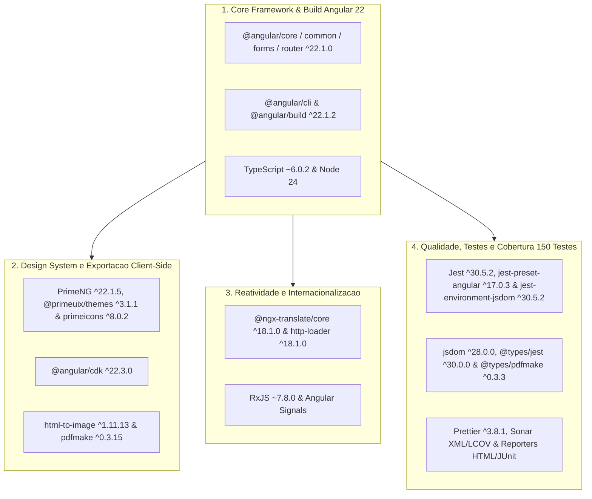

# Guia de Atualização de Pacotes — KinkConsentManager UI

**Documento:** Guia operacional específico da aplicação frontend V1  
**Projeto:** [frontend/](../../../frontend) (`kinkconsentmanager` — Angular 22 + PrimeNG 22 + Jest 30)  
**Manifesto:** [package.json](../../../frontend/package.json)  
**Lockfile:** [package-lock.json](../../../frontend/package-lock.json)  
**Runtime Verificado:** Node `24.16.0` · npm `11.14.1` · Angular CLI `22.1.2`  
**Guia-Base Genérico:** [GuiaGenericoAtualizacaoPacotesFrontend.md](./GuiaGenericoAtualizacaoPacotesFrontend.md)  
**Ciclo Homologado de Referência:** [2026-11-22-ConjuntoHomologado-Frontend.md](./2026-11-22-ConjuntoHomologado-Frontend.md)  
**Data:** 2026-11-22  

---

## 1. Contexto Arquitetural do Projeto

O **KinkConsentManager UI** é uma SPA **100% client-side** (V1 focada no módulo de Checklist de Limites e Consentimento) desenvolvida sobre **Angular 22** (Standalone Components + Signals + `OnPush`), **PrimeNG 22** (tema Aura via `@primeuix/themes`), **PrimeIcons 8**, **`@ngx-translate/core` 18**, **`html-to-image`** e **`pdfmake` 0.3**. A suíte de testes automatizados utiliza **Jest 30** com **`jest-preset-angular` 17** e **`jsdom`**, totalizando **150 testes em 29 arquivos `.spec.ts`** com **91,84%** de cobertura de linhas (**92,18%** statements).



---

## 2. Inventário de Dependências e Blocos Tecnológicos

### Bloco A — Core Framework e CLI (Angular 22)
- `@angular/common`, `@angular/compiler`, `@angular/core`, `@angular/forms`, `@angular/platform-browser`, `@angular/router` (`^22.1.0`)
- `@angular/build`, `@angular/cli`, `@angular/compiler-cli` (`^22.1.2` / `^22.1.0`)
- `rxjs` (`~7.8.0`), `tslib` (`^2.3.0`)

### Bloco B — Design System e UI (PrimeNG 22)
- `primeng` (`^22.1.5`), `@primeuix/themes` (`^3.1.1`), `primeicons` (`^8.0.2`)
- `@angular/cdk` (`^22.3.0`)
- *Ponto de atenção:* Validar seletores de PrimeNG 22 (`p-accordion-panel`, `p-accordion-header`, `p-accordion-content`, `p-radiobutton`, `p-checkbox`, `p-toggleswitch`, `p-selectbutton`, `pTextarea`) antes de subir versão major.

### Bloco C — Internacionalização e Exportação Client-Side
- `@ngx-translate/core` (`^18.1.0`), `@ngx-translate/http-loader` (`^18.1.0`)
  - *Ponto de atenção:* Usa API standalone `provideTranslateService` + `provideTranslateHttpLoader`.
- `html-to-image` (`^1.11.13`) — exportação PNG em largura fixa `1200px` via `PNG_RENDERER`.
- `pdfmake` (`^0.3.15`) e `@types/pdfmake` (`^0.3.3`) — exportação PDF programática via `PDF_MAKER_LOADER`.
  - *Ponto de atenção:* A linha `0.3.x` utiliza `pdfMake.addVirtualFileSystem(vfs)` (diferente do legado `pdfMake.vfs = ...` da linha `0.2.x`).

### Bloco D — Tooling e TypeScript
- `typescript` (`~6.0.2` — **Trava**: respeitar o range exigido pelo `@angular/compiler-cli` 22)
- `prettier` (`^3.8.1`)

### Bloco E — Suíte de Testes Automatizados (Jest 30 + `jest-preset-angular` 17 + jsdom)
- `jest` (`^30.5.2`), `jest-environment-jsdom` (`^30.5.2`), `jest-preset-angular` (`^17.0.3`), `@types/jest` (`^30.0.0`), `@types/node` (`^26.6.6`) e `jsdom` (`^28.0.0`).
- Reporters de CI e QA: `jest-junit` (`^17.0.0`), `jest-html-reporter` (`^4.4.3`), `jest-sonar` (`^0.2.16`), `jest-stare` (`^2.5.3`), `jest-html-reporters` (`^3.1.7`).
  - *Ponto de atenção:* A aplicação utiliza Angular 22 **zoneless** (`setupZonelessTestEnv()` em `src/setup-jest.ts`) e pacotes ESM em `.mjs` (`@angular`, `@ngx-translate`, `primeng`, `@primeuix`), exigindo manutenção de `transformIgnorePatterns` em `jest.config.js` a cada atualização major desses pacotes.

---

## 3. Política de `overrides` no `package.json`

Atualmente [frontend/package.json](../../../frontend/package.json) **não necessita de `overrides`** porque todas as dependências de Angular 22, PrimeNG 22, `@ngx-translate` 18 e Jest 30 convergem sem conflitos `ERESOLVE`. Caso uma dependência transitiva futura exija correção de segurança ou resolução de peer dependency (ex.: alinhamento de `jest`/`jest-environment-jsdom`/`jest-preset-angular` ou vulnerabilidade reportada pelo `npm audit`), documentar o motivo exato antes de adicionar `overrides`.

---

## 4. Procedimento Operacional Passo a Passo (Windows PowerShell)

> **Nota de Ambiente:** Em ambientes Windows onde a ExecutionPolicy bloqueia scripts `.ps1`, utilizar sempre `npm.cmd`, `npx.cmd` e `ng.cmd`.

### Passo 1: Diagnóstico e Levantamento Baseline

```powershell
Set-Location "e:\git\kinkconsentmanager\frontend"

node -v
npm.cmd -v
npm.cmd outdated
npm.cmd audit --omit=dev
```

### Passo 2: Aplicação Coesa das Atualizações

Atualizar [frontend/package.json](../../../frontend/package.json) por blocos coesos (Angular core/CLI juntos; PrimeNG + `@primeuix/themes` juntos; `jest` + `jest-environment-jsdom` + `jest-preset-angular` juntos) e sincronizar o lockfile:

```powershell
npm.cmd install
```

### Passo 3: Validação de Tipos Estritos e Formatação

```powershell
npx.cmd tsc -p tsconfig.app.json --noEmit
npx.cmd tsc -p tsconfig.spec.json --noEmit
npx.cmd prettier --check "src/**/*.{ts,html,scss,json}"
```

### Passo 4: Execução da Suíte Completa (150 Testes + Cobertura LCOV)

```powershell
npm.cmd run test:ci
npm.cmd run test:coverage
```

- **Resultados Esperados (Baseline V1):**
  - **Arquivos de teste:** `29` aprovados (`100%`)
  - **Testes unitários:** `150` aprovados / `0` falhas
  - **Cobertura global:** `>= 90%` Lines/Statements e geração de `coverage/lcov.info`, `coverage/sonar/sonar-report.xml` e `coverage/junit/test-results.xml`

### Passo 5: Compilação de Produção

```powershell
npm.cmd run build:prod
```

- **Verificações pós-build em `frontend/dist/kinkconsentmanager/browser/`:**
  - Bundles gerados (`main-*.js`, `styles-*.css`) + chunks lazy (`checklist-routes`, `export-routes`, `pdfmake`, `vfs_fonts`).
  - Assets copiados: `assets/schemas/checklist-v1.json`, `assets/i18n/pt-BR.json` e `assets/i18n/en-US.json`.

### Passo 6: Smoke Test Local e Container

```powershell
npm.cmd start
# ou via Docker Compose:
# docker compose up --build
```

- Validar em `http://localhost:4200/` (ou `http://localhost:8082/` no Nginx):
  - Carregamento do schema em `/checklist`, alternância `pt-BR` ↔ `en-US` preservando respostas, Accordion + *Próxima Categoria*, *View Full* e *Quick-Fill Wizard*.
  - Em `/export`: prévia Full Grid Vertical e downloads PNG, PDF, JSON Draft (exportar + reimportar) e CSV (acentos preservados com BOM).

---

## 5. Checklist de Entrega e Homologação

- [ ] `npm.cmd ci` executa do zero com `0` erros `ERESOLVE`.
- [ ] `npx.cmd tsc -p tsconfig.app.json --noEmit` e `tsconfig.spec.json` passam com `0` erros.
- [ ] `npm.cmd run test:ci` conclui com **150/150 testes aprovados (100%)**.
- [ ] `npm.cmd run test:coverage` gera `coverage/lcov.info` e `coverage/sonar/sonar-report.xml` mantendo cobertura global `>= 90%`.
- [ ] `npm.cmd run build:prod` conclui sem erros e emite `assets/schemas/` e `assets/i18n/`.
- [ ] `npm.cmd audit --omit=dev` reporta `0` vulnerabilidades High/Critical.
- [ ] **Governança Git:** Nenhuma operação autônoma de `commit`, `push`, `branch` ou `PR`.

---

## 6. Plano de Rollback

```powershell
Set-Location "e:\git\kinkconsentmanager\frontend"

# Restaurar manifests originais sob orientação do desenvolvedor, depois limpar e reinstalar:
Remove-Item -Recurse -Force node_modules
npm.cmd ci

npm.cmd run test:ci
npm.cmd run build:prod
```

---

## 7. Referências Internas

- [frontend/package.json](../../../frontend/package.json) — Manifesto de dependências e scripts
- [frontend/jest.config.js](../../../frontend/jest.config.js) — Configuração do Jest 30, `jest-preset-angular` e reporters
- [frontend/src/setup-jest.ts](../../../frontend/src/setup-jest.ts) — Setup zoneless e polyfills `jsdom`
- [frontend/angular.json](../../../frontend/angular.json) — Configuração do build/serve Angular CLI
- [GuiaGenericoAtualizacaoPacotesFrontend.md](./GuiaGenericoAtualizacaoPacotesFrontend.md) — Processo genérico master
- [2026-11-22-ConjuntoHomologado-Frontend.md](./2026-11-22-ConjuntoHomologado-Frontend.md) — Matriz homologada do baseline V1
