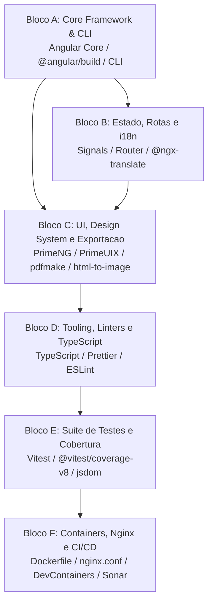

# Guia Genérico — Atualização de Pacotes Frontend (npm / Angular / React / TypeScript SDKs)

**Documento:** Guia operacional padronizado e reutilizável para ecossistemas frontend  
**Arquivo:** `GuiaGenericoAtualizacaoPacotesFrontend.md`  
**Data:** 2026-11-22  
**Aplicabilidade:** Projetos SPA, SSR, micro-frontends e SDKs JavaScript/TypeScript (Angular, React, Vue, Vite, Webpack, tsup, etc.) gerenciados via `npm` (ou `pnpm`/`yarn`).

---

## 1. Objetivo

Padronizar e estruturar o processo de governança, levantamento, homologação e atualização de dependências em aplicações frontend e bibliotecas cliente, assegurando:

1. **Estabilidade e Não-Regressão:** Preservar o funcionamento de rotas, componentes visuais, gerenciamento de estado, exportadores client-side, consumo de APIs backend e fluxos de autenticação quando aplicáveis.
2. **Coesão do Ecossistema:** Alinhar pacotes centrais de cada framework (Angular, React, etc.) nas versões estáveis coordenadas, respeitando rigorosamente as versões de TypeScript e Node.js suportadas pelo compilador.
3. **Segurança Proativa:** Identificar e eliminar vulnerabilidades em dependências diretas e transitivas (`npm audit --omit=dev`), utilizando a seção `overrides` do `package.json` de forma justificada e controlada.
4. **Reprodutibilidade Determinística:** Manter o arquivo de lock (`package-lock.json`) 100% íntegro e sincronizado com o manifesto (`package.json`), utilizando estritamente `npm ci` em esteiras de integração e testes do zero.
5. **Automação de CI/CD e Qualidade:** Garantir compilação limpa em modo de produção (`build:prod`), validação estrita de tipos (`tsc --noEmit`), linting sem bloqueios e execução determinística de testes automatizados (Vitest, Jest, Karma) com métricas de cobertura preservadas.
6. **Governança de Controle de Versão:** Nenhuma operação de `git commit`, `git push`, criação de branches ou abertura de PRs deve ser feita de forma autônoma sem autorização explícita do desenvolvedor responsável.

Este guia define as diretrizes universais. As versões concretas aplicadas em cada ciclo devem ser formalizadas no documento filho **`<AAAA-MM-DD>-ConjuntoHomologado-Frontend.md`** correspondente.

---

## 2. Escopo e Não Escopo

### 2.1 Escopo

| Categoria | Ação |
| --------- | ---- |
| **Frameworks Core** | Atualizar bibliotecas centrais (`@angular/*`, `react`, `react-dom`, `vue`) e suas tipagens TypeScript associadas (`@types/*`). |
| **Roteamento e Estado** | Atualizar roteadores (`@angular/router`, `react-router`) e gerenciadores de estado (Signals, NgRx, Redux Toolkit, Zustand). |
| **UI, Design System e Componentes** | Atualizar bibliotecas visuais (PrimeNG, `@primeuix/themes`, Angular CDK/Material, Bootstrap, Tailwind, ícones) respeitando `peerDependencies`. |
| **Internacionalização (i18n)** | Atualizar `@ngx-translate/*`, `i18next`, `react-i18next`. |
| **Exportação e Utilitários Client-Side** | Atualizar bibliotecas de geração de documentos e mídia (`pdfmake`, `html-to-image`) validando APIs ESM/CJS e bundle sizes. |
| **Tooling, Bundlers e Linters** | Alinhar TypeScript, `@angular/build`, `@angular/cli`, Vite, ESLint (flat config), `typescript-eslint`, `angular-eslint` e Prettier. |
| **Suítes de Teste e Cobertura** | Atualizar runners (`vitest`, `@vitest/coverage-v8`, `jest`), adaptadores DOM (`jsdom`, `happy-dom`), bibliotecas de asserção (`@testing-library/*`) e repórteres LCOV. |
| **Infraestrutura, Docker e CI/CD** | Atualizar imagens Docker de build e hosting (Node/Nginx Alpine), `nginx.conf`, DevContainers e pipelines CI/CD. |

### 2.2 Não Escopo

- Redesign visual amplo ou reescrita arquitetural de telas/componentes não demandada por breaking changes de pacotes.
- Trocas de paradigmas não planejadas (ex.: troca de PrimeNG por outra biblioteca de UI sem RFC dedicada).
- Modificação de regras de negócio ou contratos de dados.
- Inclusão arbitrária de novas dependências sem justificativa técnica prévia.

---

## 3. Princípios Fundamentais de Governança Frontend

1. **Inventário Obrigatório Prévio:** Jamais atualizar pacotes às cegas. Executar sempre `npm outdated` e `npm audit` para mapear o cenário completo antes de qualquer alteração.
2. **Atualização por Blocos Coesos:**
   - No **Angular**: Todos os pacotes `@angular/*`, `@angular/cli`, `@angular/build` e `@angular/compiler-cli` devem estar alinhados na mesma minor/patch compatível.
   - No **Vitest**: `vitest` e `@vitest/coverage-v8` devem permanecer rigorosamente na **mesma versão major.minor** para evitar alertas de incompatibilidade em runtime.
   - No **PrimeNG**: `primeng` e `@primeuix/themes` / `primeicons` devem ser validados em conjunto.
3. **Respeito Rígido aos Ranges de Node.js e TypeScript:**
   - As versões de Node nos Dockerfiles e DevContainers devem estar alinhadas às versões usadas localmente.
   - O compilador TypeScript deve respeitar as travas de compatibilidade do Angular Compiler (`@angular/compiler-cli`).
4. **Lockfile Íntegro e Sincronizado:** Em ambientes de CI/CD e builds Docker, utilizar estritamente `npm ci`.
5. **Uso Consciente de Overrides:** Reservar `overrides` no `package.json` para sanear vulnerabilidades transitivas ou conflitos temporários de peer dependencies.
6. **Governança Git Segura:** Alterações permanecem no ambiente local para revisão do desenvolvedor; `commit`, `push`, criação de `branch` ou `PR` ocorrem apenas sob comando explícito.

---

## 4. Blocos Estruturais de Dependências Frontend



---

## 5. Roteiro Operacional de Execução por Fases

1. **Fase 0 — Diagnóstico e Inventário:** Validar `node -v`, `npm.cmd -v`, `npm.cmd outdated`, `npm.cmd audit --omit=dev`, e rodar baseline de testes e build.
2. **Fase 1 — Core Framework e Roteamento:** Atualizar pacotes do Bloco A de forma coesa.
3. **Fase 2 — Estado e i18n:** Atualizar `@ngx-translate/*` verificando assinaturas (`provideTranslateService` / `provideTranslateHttpLoader`).
4. **Fase 3 — UI, Design System e Exportadores:** Atualizar PrimeNG, `@primeuix/themes`, `pdfmake` e `html-to-image` verificando CSS/theming e imports ESM/CJS.
5. **Fase 4 — Tooling e TypeScript:** Atualizar TypeScript dentro do range suportado e validar `npx.cmd tsc --noEmit`.
6. **Fase 5 — Testes Automatizados e Cobertura:** Alinhar `vitest` + `@vitest/coverage-v8` + `jsdom` e confirmar 100% dos testes e geração de `lcov.info`.
7. **Fase 6 — Compilação de Produção:** Rodar `npm.cmd run build:prod` e conferir artefatos e budgets em `dist/`.
8. **Fase 7 — Infraestrutura, Nginx e Evidências:** Validar alinhamento com `Dockerfile`, `nginx.conf` e registrar o `<AAAA-MM-DD>-ConjuntoHomologado-Frontend.md`.

---

## 6. Checklist Geral de Validação Frontend

```powershell
# 1. Instalação determinística a partir do lockfile
npm.cmd ci

# 2. Validação estrita de tipos
npx.cmd tsc -p tsconfig.app.json --noEmit
npx.cmd tsc -p tsconfig.spec.json --noEmit

# 3. Execução da suíte completa de testes automatizados e cobertura LCOV
npm.cmd run test:ci
npm.cmd run test:coverage

# 4. Compilação otimizada de produção
npm.cmd run build:prod

# 5. Auditoria de vulnerabilidades em produção
npm.cmd audit --omit=dev
```

- [ ] `npm.cmd ci` concluído sem erros `ERESOLVE`.
- [ ] Validação TypeScript estrita concluída com 0 erros.
- [ ] 100% dos testes unitários passando sem falhas.
- [ ] Cobertura de código e `lcov.info` preservados.
- [ ] Compilação de produção gera bundles em `dist/` sem erros.
- [ ] `npm.cmd audit --omit=dev` reporta 0 vulnerabilidades High ou Critical.
- [ ] `package.json` e `package-lock.json` sincronizados para revisão do desenvolvedor (sem Git autônomo).

---

## 7. Matriz de Riscos Recorrentes e Mitigações

| Risco / Sintoma | Impacto | Estratégia de Mitigação |
| --------------- | ------- | ----------------------- |
| **Divergência entre `vitest` e `@vitest/coverage-v8`** | Erro ou warnings na geração de cobertura | Manter ambos exatamente na mesma versão major.minor. |
| **Divergência entre TypeScript e Angular Compiler** | Erros de compilação ou versão não suportada | Respeitar a trava `typescript` suportada pelo `@angular/compiler-cli` ativo. |
| **Breaking changes em `pdfmake` / `html-to-image`** | Falha de exportação PDF/PNG em runtime | Validar chamadas de `addVirtualFileSystem` e `toPng` em testes e no build lazy chunk. |
| **Chunk missing / 404 em runtime pós-deploy** | Erro ao navegar entre rotas lazy | Configurar `Cache-Control: no-store` em `index.html` e `immutable` apenas nos bundles com hash no `nginx.conf`. |
| **Traduções/Schemas desatualizados em cache** | Textos ou schema antigos no browser | Garantir `Cache-Control: no-cache, must-revalidate` em `location ^~ /assets/` no `nginx.conf`. |
