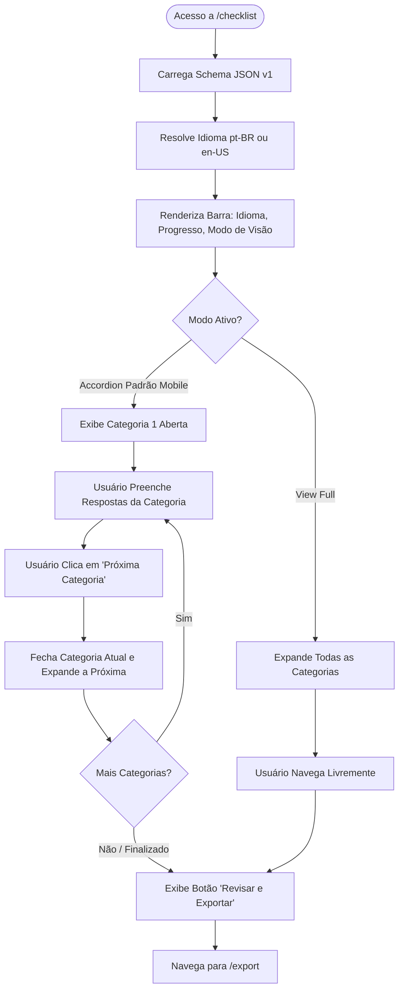

# Plano de Implementação Front-end
**Projeto:** Plataforma de Gestão de Limites, Consentimento e Práticas Consensuais (BDSM / D/s)  
**Documento:** Plano de Arquitetura e Implementação Front-end (Angular 18+ / PrimeNG)  
**Versão:** 1.0  
**Data:** 21 de Novembro de 2026  

---

## 1. Visão Geral e Princípios Arquiteturais

Este documento define a estratégia detalhada de implementação front-end da aplicação, orientando a construção de um sistema robusto, modular, escalável e de fácil manutenção.

### 1.1. Pilares Arquiteturais Estritos
1. **Padrão Angular Standalone:** Componentes, diretivas e pipes autônomos (`standalone: true`), eliminando o uso de `NgModule`.
2. **Separação Estrita de Arquivos (Regra dos 4 Arquivos):** Nenhum componente conterá templates inline ou estilos inline. Todo componente terá obrigatoriamente:
   * `<nome>.component.ts` (lógica e injeção de dependências)
   * `<nome>.component.html` (marcação semântica e acessível)
   * `<nome>.component.scss` (estilos escopados e responsivos)
   * `<nome>.component.spec.ts` (testes unitários com Jasmine/Karma ou Vitest)
3. **Reatividade com Angular Signals:** Gerenciamento de estado previsível através de `signal()`, `computed()` e `effect()`, evitando sobrecarga com RxJS desnecessário e proporcionando reatividade atômica sem ciclos de detecção de mudanças globais.
4. **Padrão Repository & Serviços Genéricos:**
   * Desacoplamento entre a camada de dados e a interface.
   * Na versão 1, os schemas e traduções são lidos de arquivos estáticos (`assets/`).
   * A transição futura para APIs em Node.js (v2) será feita via injeção de dependência (`HttpApiSchemaRepository`), sem alterar uma única linha de código dos componentes.
5. **Mobile-First & Acessibilidade (a11y):**
   * Prioridade absoluta para usabilidade em telas estreitas (smartphones).
   * Contraste cromático adequado (WCAG 2.1 AA) e navegação completa por teclado.

---

## 2. Estrutura de Diretórios do Projeto

```text
src/
├── app/
│   ├── core/
│   │   ├── models/                           # Contratos e Interfaces TypeScript (DTOs)
│   │   │   ├── checklist-schema.model.ts
│   │   │   ├── checklist-answer.model.ts
│   │   │   └── export-config.model.ts
│   │   ├── repositories/                     # Padrão Repository para Schemas
│   │   │   ├── schema.repository.interface.ts
│   │   │   └── static-json-schema.repository.ts
│   │   └── services/                         # Serviços Base, Estado e Utilidades Core
│   │       ├── base-state.service.ts         # Classe abstrata genérica com Signals
│   │       ├── base-data.service.ts          # Classe abstrata para operações de dados
│   │       ├── i18n.service.ts               # Serviço reativo de tradução bilíngue
│   │       └── checklist-state.service.ts    # Estado centralizado das respostas e navegação
│   ├── shared/
│   │   ├── components/                       # UI Kit Reutilizável (4 arquivos cada)
│   │   │   ├── scale-selector/               # Seletor visual das escalas de consentimento
│   │   │   ├── dynamic-question-item/        # Renderizador dinâmico dos 5 tipos de entrada
│   │   │   ├── coming-soon-badge/            # Badge e modal de aviso de roadmap v2
│   │   │   ├── progress-indicator/           # Barra de progresso reativa de preenchimento
│   │   │   └── full-grid-preview/            # Grid vertical otimizado para exportação
│   │   ├── pipes/                            # Pipes de formatação e resolução
│   │   │   └── schema-translate.pipe.ts      # Pipe para resolver IDs no i18n
│   │   └── directives/                       # Diretivas utilitárias de acessibilidade/foco
│   ├── features/
│   │   ├── checklist/                        # Módulo de Preenchimento Interativo
│   │   │   ├── pages/
│   │   │   │   └── checklist-page/           # Página mestre (/checklist)
│   │   │   └── components/
│   │   │       ├── checklist-header/         # Seletor de idioma, visão e progresso
│   │   │       ├── category-accordion/       # Navegação passo a passo com botão Next
│   │   │       └── full-view-container/      # Visão completa expandida
│   │   ├── export/                           # Módulo de Visualização e Exportação
│   │   │   ├── pages/
│   │   │   │   └── export-page/              # Página de conferência e download (/export)
│   │   │   ├── services/                     # Motores de exportação 100% Client-Side
│   │   │   │   ├── png-export.service.ts     # Geração de PNG com html-to-image
│   │   │   │   ├── pdf-export.service.ts     # Geração de PDF formal com pdfmake
│   │   │   │   ├── json-draft.service.ts     # Download e upload de JSON rascunho
│   │   │   │   └── csv-export.service.ts     # Planilha tabular UTF-8 BOM
│   │   │   └── components/
│   │   │       └── export-actions-toolbar/   # Barra com botões de ação e status
│   │   └── roadmap-placeholders/             # Telas de Roadmap da v2
│   │       ├── pages/
│   │       │   ├── contracts-placeholder/    # /contract (Contratos D/s)
│   │       │   ├── custom-builder-placeholder/ # /custom-builder
│   │       │   └── partners-placeholder/     # /partners (Gestão de parceiros)
│   │       └── components/
│   │           └── placeholder-card/         # Card com escopo futuro e formulário de interesse
│   ├── app.routes.ts                         # Rotas da aplicação com Lazy Loading
│   ├── app.config.ts                         # Provedores da aplicação (PrimeNG, i18n, etc.)
│   └── app.component.*                       # Componente raiz da aplicação (4 arquivos)
├── assets/
│   ├── schemas/
│   │   └── checklist-v1.json                 # Estrutura lógica neutra pura por IDs
│   └── i18n/
│       ├── pt-BR.json                        # Traduções em Português do Brasil
│       └── en-US.json                        # Traduções em Inglês dos EUA
└── styles/
    ├── _variables.scss                       # Cores das escalas, breakpoints, tipografia
    ├── _mixins.scss                          # Mixins para responsividade e layout flex/grid
    └── styles.scss                           # Estilos globais e tema PrimeNG customizado
```

---

## 3. Especificação Detalhada das Camadas

### 3.1. Camada de Estado e Serviços Genéricos (`core/services/`)

#### 3.1.1. Classe Base Genérica de Estado (`BaseStateService<T>`)
```typescript
import { signal, computed, Signal, WritableSignal } from '@angular/core';

export abstract class BaseStateService<T> {
  // Sinal protegido que armazena o estado imutável
  protected readonly stateSignal: WritableSignal<T>;

  constructor(initialState: T) {
    this.stateSignal = signal<T>(initialState);
  }

  // Leitura pública em modo somente-leitura
  public select<K extends keyof T>(key: K): Signal<T[K]> {
    return computed(() => this.stateSignal()[key]);
  }

  // Atualização atômica do estado
  protected setState(partialState: Partial<T>): void {
    this.stateSignal.update((current) => ({
      ...current,
      ...partialState
    }));
  }

  // Reset para estado inicial
  protected resetState(initialState: T): void {
    this.stateSignal.set(initialState);
  }
}
```

#### 3.1.2. Gerenciador de Estado do Checklist (`ChecklistStateService`)
* Gerencia o estado central da aplicação:
  * Respostas ativas mapeadas por `itemId`: `Record<string, ItemResponseValue>`.
  * Modo de visualização ativo: `'accordion'` ou `'full'`.
  * Índice da categoria ativa no modo accordion (`activeCategoryIndex: number`).
  * Total de itens respondidos e percentual calculado (`progressPercentage: Signal<number>`).
* Métodos essenciais:
  * `setAnswer(itemId: string, answer: Partial<ItemResponseValue>): void`
  * `getAnswer(itemId: string): Signal<ItemResponseValue | undefined>`
  * `toggleViewMode(): void`
  * `goToNextCategory(): void`
  * `goToCategory(index: number): void`
  * `loadDraft(draft: ChecklistDraft): void`
  * `resetAllAnswers(): void`

#### 3.1.3. Serviço de Internacionalização (`I18nService`)
* Encapsula a biblioteca `@ngx-translate/core`.
* Mantém um Signal reativo com o idioma ativo: `currentLang = signal<'pt-BR' | 'en-US'>('pt-BR')`.
* Expõe método para troca dinâmica de idioma: `switchLanguage(lang: 'pt-BR' | 'en-US'): void`.
* Expõe método para resolver caminhos de tradução estruturados por IDs:
  * `getScaleLabel(scaleId: string): string`
  * `getGroupTitle(groupId: string): string`
  * `getGroupDescription(groupId: string): string`
  * `getItemLabel(itemId: string): string`
  * `getItemTooltip(itemId: string): string`
  * `getOptionLabel(optionId: string): string`

---

### 3.2. Camada de Repositórios e Abstração de Dados (`core/repositories/`)

#### 3.2.1. Contrato da Interface (`ISchemaRepository`)
```typescript
import { Observable } from 'rxjs';
import { ChecklistSchema } from '../models/checklist-schema.model';

export interface ISchemaRepository {
  getChecklistSchema(version?: string): Observable<ChecklistSchema>;
}
```

#### 3.2.2. Implementação Estática da v1 (`StaticJsonSchemaRepository`)
* Injeta o `HttpClient` do Angular e consome o arquivo estático `assets/schemas/checklist-v1.json`.
* Adiciona validação de integridade e cache em memória para que o JSON não seja recarregado a cada navegação de rota.
* **Preparação para a v2:** No futuro, bastará fornecer `provide: SCHEMA_REPOSITORY_TOKEN, useClass: HttpApiSchemaRepository` sem qualquer modificação nas páginas e componentes consumidores.

---

### 3.3. Componentes Compartilhados (Shared UI Kit)

Todos os componentes abaixo seguem rigorosamente a convenção de 4 arquivos separados:

#### 3.3.1. `ScaleSelectorComponent`
* **Arquivos:**
  * `scale-selector.component.ts`
  * `scale-selector.component.html`
  * `scale-selector.component.scss`
  * `scale-selector.component.spec.ts`
* **Responsabilidade:** Renderizar os círculos/botões de seleção para a escala de 5 pontos (*Hard Limit*, *Soft Limit*, *Curious*, *Enjoy*, *Favorite*).
* **Inputs:**
  * `roleLabel`: Título do papel ('Dar / Aplicar', 'Receber / Sentir' ou 'Geral').
  * `scales`: Lista de opções de escala com cores e ícones.
  * `selectedValue`: ID da opção atualmente selecionada.
  * `disabled`: Indicador de desabilitação.
* **Outputs:**
  * `valueChange`: Emite o `scaleId` selecionado.
* **Acessibilidade:** Suporte a teclas de seta, `aria-checked`, `role="radiogroup"` e ícones visíveis dentro ou sobrepostos aos círculos para que pessoas daltônicas não dependam exclusivamente da cor.

#### 3.3.2. `DynamicQuestionItemComponent`
* **Arquivos:**
  * `dynamic-question-item.component.ts`
  * `dynamic-question-item.component.html`
  * `dynamic-question-item.component.scss`
  * `dynamic-question-item.component.spec.ts`
* **Responsabilidade:** Inspecionar o `item.type` e renderizar a interface correspondente:
  1. `scale_matrix`: Renderiza uma linha com o nome do item, tooltip explicativo e um ou dois `ScaleSelectorComponent` (conforme `dualRole`).
  2. `single_choice`: Renderiza grupo de botões de rádio (`p-radioButton`).
  3. `multiple_choice`: Renderiza lista de caixas de seleção (`p-checkbox`).
  4. `allowOtherOption`: Se marcado no item, anexa um checkbox "Outro (especifique)" que, quando selecionado, exibe um `input` de texto com placeholder amigável.
  5. `restricted_text`: Renderiza um `p-inputMask` ou `textarea` limitado a `maxLength` com contador de caracteres restantes regressivo.

#### 3.3.3. `FullGridPreviewComponent`
* **Arquivos:**
  * `full-grid-preview.component.ts`
  * `full-grid-preview.component.html`
  * `full-grid-preview.component.scss`
  * `full-grid-preview.component.spec.ts`
* **Responsabilidade:** Renderizar todo o checklist em formato **Full Grid Vertical**.
* **Design e Layout:**
  * Cada grupo ocupa 100% da largura útil.
  * Cabeçalho de categoria com cor de destaque suave.
  * Itens dispostos em linhas claras com contraste preto no branco para máxima legibilidade.
  * Não utiliza múltiplas colunas laterais estreitas que forcem o texto a quebrar letras ou palavras.
  * Componente reutilizado diretamente na tela de `/export` para conferência do usuário e como elemento de captura pelo `PngExportService`.

#### 3.3.4. `ComingSoonBadgeComponent`
* **Arquivos:**
  * `coming-soon-badge.component.ts`
  * `coming-soon-badge.component.html`
  * `coming-soon-badge.component.scss`
  * `coming-soon-badge.component.spec.ts`
* **Responsabilidade:** Exibir uma tag visual elegante (`p-tag` do PrimeNG) com o texto "Em Breve" e acionar um modal comemorativo e informativo detalhando as novidades planejadas para a versão 2.

---

## 4. Motores de Exportação 100% Client-Side (`features/export/services/`)

### 4.1. `PngExportService` (`html-to-image`)
* **Mecanismo:** Captura o nó do DOM do `FullGridPreviewComponent` configurado com dimensões fixas (largura padrão de 1200px) e renderiza em Canvas com escalonamento de densidade de pixels (`pixelRatio: 2` para tela Retina/alta resolução).
* **Fluxo:**
  1. Oculta botões de ação e elementos interativos antes da captura.
  2. Executa a conversão para Data URL (`image/png`).
  3. Cria um link de download dinâmico temporário `<a>` com atributo `download="checklist-consentimento-[data].png"` e aciona o clique do usuário.
  4. Nenhuma informação transita por nenhum servidor remoto.

### 4.2. `PdfExportService` (`pdfmake`)
* **Mecanismo:** Monta programaticamente a árvore de definição do documento PDF (`TDocumentDefinitions`) a partir das respostas do `ChecklistStateService` e das traduções ativas do `I18nService`.
* **Conteúdo do PDF:**
  * Cabeçalho: Título "Checklist de Limites e Consentimento", versão do documento, idioma e timestamp.
  * Bloco de Legenda: Tabela com os círculos e os significados da escala.
  * Seções por Categoria: Tabelas limpas com colunas formatadas (`Prática / Item`, `Dar / Aplicar`, `Receber / Sentir`, `Notas`).
  * Propriedades `dontBreakRows: true` para garantir que nenhuma pergunta seja dividida entre duas páginas.
  * Rodapé com numeração dinâmica de páginas ("Página X de Y").

### 4.3. `JsonDraftService`
* **Mecanismo:** Serialização simples e higienizada das respostas.
* **Exportação:**
  * Cria payload contendo apenas `{ schemaVersion: "1.0.0", exportedAt: new Date().toISOString(), language: "pt-BR", answers: { ... } }`.
  * Converte em `Blob` do tipo `application/json` e efetua download local imediato (`checklist-rascunho-[data].json`).
* **Importação:**
  * `FileReader` no navegador lê o arquivo selecionado pelo usuário.
  * Valida se o campo `schemaVersion` é compatível com o schema ativo.
  * Injeta os dados no `ChecklistStateService.loadDraft()`, preenchendo todos os campos automaticamente.

### 4.4. `CsvExportService`
* **Mecanismo:** Gera arquivo `.csv` utilizando delimitador de ponto e vírgula (`;`) ou vírgula (`,`) com cabeçalho tabular.
* **Preservação de Acentuação:** Insere o caractere Byte Order Mark UTF-8 (`\uFEFF`) no início do fluxo binário para garantir que acentos em português abram perfeitamente sem erros de codificação no Microsoft Excel e LibreOffice Calc.

---

## 5. Fluxo de Navegação e UX Mobile-First

### 5.1. Rota `/checklist` — Preenchimento Interativo


### 5.2. Rota `/export` — Visualização e Ações
* O usuário chega à rota `/export` com o progresso preservado.
* Uma barra de ação no topo oferece os botões:
  * **[ Baixar Imagem PNG ]**
  * **[ Baixar Documento PDF ]**
  * **[ Exportar Rascunho JSON ]**
  * **[ Importar Rascunho JSON ]**
  * **[ Exportar Planilha CSV ]**
  * **[ Exportar Excel (.xlsx) ]** com tag *Em Breve*
* Abaixo da barra de botões, uma pré-visualização completa em **Full Grid Vertical** permite conferir cada resposta dada antes de salvar.

---

## 6. Configuração e Theming (PrimeNG + SCSS)

### 6.1. Paleta de Cores e Escalas Institucionais
As cores das escalas foram padronizadas para manter alto contraste e fácil memorização:
* **Hard Limit (Limite Rígido):** Vermelho vibrante (`#D32F2F`) — Ícone `pi pi-ban`
* **Soft Limit (Limite Flexível):** Laranja escuro (`#F57C00`) — Ícone `pi pi-exclamation-triangle`
* **Curious (Curiosidade / A testar):** Amarelo âmbar (`#FBC02D`) — Ícone `pi pi-question-circle`
* **Enjoy (Gosto / Autorizado):** Verde institucional (`#388E3C`) — Ícone `pi pi-check-circle`
* **Favorite (Favorito / Alta preferência):** Roxo profundo (`#7B1FA2`) — Ícone `pi pi-heart-fill`
* **Not Entered (Não respondido):** Cinza neutro suave (`#E0E0E0`)

### 6.2. Breakpoints Responsivos
* **Mobile (< 768px):** Accordion ativo por padrão, botões de ação empilhados verticalmente, fontes ajustadas para telas de 360px a 430px.
* **Tablet (768px - 1024px):** Layout intermediário com botões em pares.
* **Desktop (> 1024px):** Opção de alternar livremente para View Full, toolbar horizontal ampla, prévia de exportação em largura integral.

---

## 7. Próximos Passos
Com este plano técnico estruturado, a equipe de engenharia dispõe de todas as especificações de componentes, contratos de interface e arquitetura de serviços necessárias para iniciar a codificação do projeto de maneira uniforme e padronizada.
